# Strompreisprognose – Architekturentwurf

**Version:** 0.8 (Entwurf) · **Stand:** 2026-10-21 · **Status:** zur Diskussion

---

## 0. Kurzfassung

- **Ziel:** Ein Docker-Compose-Stack auf einer PVE-VM, der Wettervorhersagen (allen voran NOAA GFS 384 h) per GRIB-Partial-Download lädt, platzsparend ablegt, mit Last-, Erzeugungs- und Preisdaten für Deutschland (Gebotszone DE-LU) zusammenführt und daraus ein neuronales Netz für **Strombedarf** und **Day-Ahead-Preis** trainiert und betreibt.
- **Speicher in drei Stufen (Medaillon):**
  1. **Bronze:** zugeschnittene Original-GRIB2-Ausschnitte (Europa/DE-Box, nur benötigte Variablen) in **Garage (S3)**. Quelle der Wahrheit, jederzeit neu auswertbar.
  2. **Silber:** einheitliches Gitter je Lauf als **Zarr** (float16/Scale-Offset + Zstd) in Garage. Grundlage für Training und Regionen-Aggregation.
  3. **Gold:** aggregierte Feature-Zeitreihen (DE-weit und je Regelzone/Bundesland, kapazitäts- bzw. bevölkerungsgewichtet) plus Energie-Marktdaten in **PostgreSQL + TimescaleDB** (komprimierte Hypertables).
- **Gitterdaten gehören nicht zeilenweise in die Datenbank.** Eine Zeile pro Gitterpunkt × Variable × Zeitschritt × Lauf (wie im bestehenden PredictionDB-Entwurf) würde allein für GFS über Deutschland mehrere Milliarden Zeilen pro Jahr erzeugen (Rechnung in 5.4).
- **Prognose eigener Anlagen:** Über die API lassen sich einzelne PV-, Windkraft- und Wasserkraftanlagen mit Stammdaten und optional einem Jahr Messwerten anlegen; sie bekommen eine Erzeugungsprognose aus denselben Wetterdaten, physikalisch gerechnet und mit den Messwerten kalibriert (7.6).
- **Repository:** `the78mole/PredictionDB` (Nachfolger der dortigen `SPECIFICATION.md` v0.1).
- **Python mit uv**, ein uv-Workspace mit mehreren Paketen; jeder Dienst ein eigenes, schlankes Image.
- **Cloud-Migration** ist von Anfang an mitgedacht: nur S3-API, Postgres-Protokoll und 12-Factor-Konfiguration. Garage → AWS S3/R2/Hetzner, Postgres → Managed Postgres (Timescale Cloud o. Ä.), Compose → Kubernetes/Nomad.

---

## 1. Ausgangslage

### 1.1 Vorgaben (aus dem Projekt-Thread)

| Vorgabe | Umsetzung im Entwurf |
|---|---|
| GRIB-Downloader neu in Python mit uv | uv-Workspace, Paket `wx-ingest` (Kap. 6) |
| Möglichst alle Quellen, nur kostenfreie, auch zur Redundanz | Quellenmatrix mit Primär-/Ausweich-Endpunkten je Modell (Kap. 3) |
| Zunächst separate VM auf PVE, alles in Docker, provisioniert per Docker Compose | Compose-Stack (Kap. 8) |
| Spätere Cloud-Migration | Kap. 9 |
| S3 über Garage, einzelner Knoten genügt | Garage Single-Node, `replication_factor = 1` (Kap. 5.2) |

### 1.2 Vorhandene Grundlagen in den Repos

Als Vorlage dient ein Altsystem aus den Jahren 2012/2013 (Java/OSGi-Clients und serverseitige Shell/CGI-Skripte). Es wird nur konzeptionell ausgewertet, Code wird nicht übernommen.

| Teil des Altsystems | Inhalt | Bedeutung für dieses Projekt |
|---|---|---|
| GRIB-Bundle (Java) | UCAR GRIB-Java 8.0.29, öffnet Dateien nur, kein Parser, kein Downloader. Vier Testdateien: GFS 1,0° 2-m-Temperatur 2012-12-20 00Z (3–192 h), GDAS-Analyse, Nordeuropa-Wind (GRIB1). | Kein Code; Testdateien eignen sich als Fixtures |
| Wetter-Client (Java) | HTTP-Client für den damaligen GFS-Archivserver | Zeigt die damalige Schnittstelle (siehe unten) |
| Assessments (Java) | Bewerten, wie ähnlich ein historischer Tag dem Prognosetag ist (2-m-Temperatur, Globalstrahlung DSWRF), damit die Verbrauchsprognose ähnliche Tage stärker gewichtet | Analog-Tag-Idee als Baseline/Feature (7.3) |
| Server-Dokumentation | Beschreibung der Download- und Abfrageskripte (2012/2013); die Skripte selbst sind nicht erhalten | Ablauf und Lehren, siehe unten |

**Wichtigster Befund:** Einen Java-GRIB-Downloader gab es nicht. Herunterladen und Zerlegen liefen serverseitig in Shell/CGI-Skripten. Die Java-Bundles waren nur Clients dieses Servers:

- `grib_finished.txt`: Liste vollständig geladener Läufe (`yyyyMMddHH`, eine Zeile je Lauf).
- `cgi-bin/get_cgi_data.sh?<inventarID|Kurzname>&<Ort|lon,lat>&<Lauf>`: Zeitreihe eines Parameters an einem Ort, Textformat `# Date: yyyyMMddHH`, dann Zeilen `<Vorlauf h>:<…>:<Wert>`; `?idlist`, `?loclist`, `?help`.
- Datenbasis: GFS global 1,0°, 3-h-Schritte bis 192 h, eine Datei je Lauf und Parameter (`2012122000_195.grb`).
- Ablauf: Cron `20 0,6,12,18 * * *` startete das Download-Skript. Die Daten kamen von NOAA `…/gfs/prod/`, ab August 2013 vom NOMADS-Mirror. Geladen wurde per curl mit **einem Range-Request je GRIB-Nachricht**, das waren ca. 4 200 Requests und etwa 1,5 h je Lauf. Die Werte für einen Punkt holte ein C-Programm (grib_api) heraus.
- Die Konfiguration führte die abzurufenden Parameter als Inventar-Nummern und prüfte, ob NOAA das Produktlayout geändert hatte. Das bestätigt, dass Inventar-Nummern brüchig sind. Neu wird deshalb über Kurzname und Level adressiert (6.5).
- Für Stationsdaten gab es zusätzlich einen DWD-Abruf. Dem entspricht im neuen Entwurf die DWD-CDC-Quelle als Wetter-„Wahrheit“ (3.1).

Lehren für den Neubau: benachbarte Byte-Bereiche zu wenigen Requests zusammenfassen bzw. den NOMADS-Grib-Filter nutzen (4.1). So schrumpfen die ~4 200 Requests auf einige Hundert je Lauf. Außerdem den Platz vor dem Download prüfen und Läufe erst nach Vollständigkeit freigeben (damals `grib_finished.txt`, neu `meta.nwp_run`).

**Spätere Ausbaustufe (2014):** Statusmails aus dem Jahr 2014 zeigen, dass das Altsystem die GFS-Punktwerte später zusätzlich in eine MySQL-Tabelle schrieb (Spalten etwa `id, meta_id, time, Wert`, Metadaten über `meta_id`), statt sie nur bei Abfrage aus den GRIB-Dateien zu lesen. Das ist dieselbe Idee wie `datapoints_*` in der `SPECIFICATION.md` und wie die Gold-Schicht hier. Der Neubau geht aber deutlich weiter: Gitterdaten bleiben als GRIB2/Zarr in Garage, und nur abgeleitete Punkt- und Regionsreihen landen in TimescaleDB-Hypertables mit Kompression (5.3, 5.4). Der Ansatz von 2014 dient nur als Bestätigung des Musters, nicht als Vorlage für das Schema.

Ebenfalls ausgewertet:

| Repo | Inhalt | Bedeutung für dieses Projekt |
|---|---|---|
| `the78mole/PredictionDB` (privat) | Nur `SPECIFICATION.md` v0.1 (Juli 2026): MariaDB + Python-Worker mit Plugin-Konzept je Quelle, Tabellen `pdid_registry` und `datapoints_{int,float,varchar}`, Schlüssel `(pdid, lat, lon, timestamp, offset)`; als Schnittstelle für ein Prognosesystem gedacht. | Direkter Vorläufer. Plugin-Idee, PDID-Register und die Semantik „Gültigkeitszeit + Vorlauf, negativer Offset = Messung“ übernehme ich. Das zeilenweise Speichern von Gitterwerten und MariaDB ersetze ich (Begründung in 5.4). |
| `the78mole/test-meteo` | Streamlit-Demo, Open-Meteo-Abfrage für Wind in 120 m bei Cuxhaven | Bestätigt Open-Meteo als Schnellstart-Quelle |
| `the78mole/eprice-demo` | Rust-Demo, Day-Ahead-Preise DE über `api.energy-charts.info` | Bestätigt Energy-Charts als Preisquelle |

Hinweis zu PredictionDB: Die dort genannte NOMADS-URL `filter_gdas1.pl` bezieht sich auf GDAS (Analyse-System, nur kurze Vorläufe). Für die 384-h-Prognosen ist **GFS** (`filter_gfs_0p25.pl` bzw. `filter_gfs_0p25_1hr.pl`) die richtige Quelle. Die dort aufgeführten „GRIB IDs“ (11, 12, 33 …) sind GRIB1-Parameternummern; GRIB2 wird über Kurznamen + Level (`TMP:2 m above ground`) adressiert.

---

## 2. Gesamtbild

### 2.1 Systemkontext

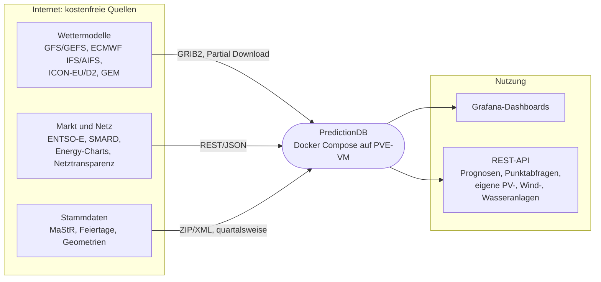

### 2.2 Dienste und Datenflüsse

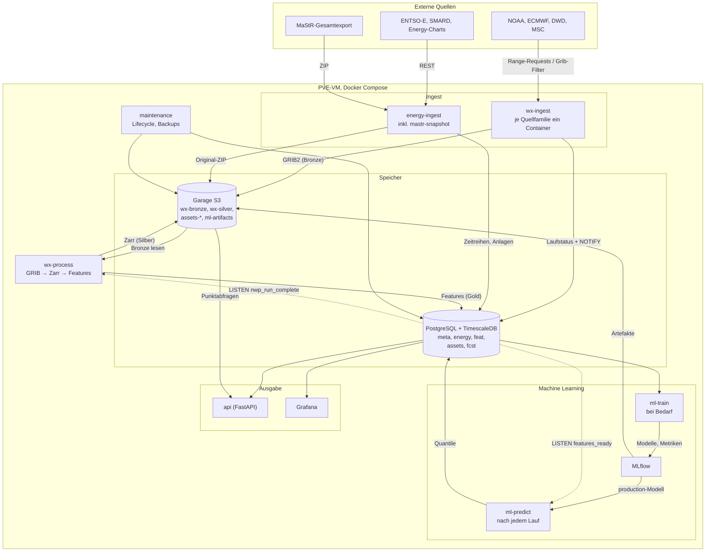

Grundprinzipien:

1. **Idempotent und wiederaufsetzbar.** Jeder Schritt ist über `(quelle, modell, lauf, schritt, variable)` eindeutig adressiert. Ein Neustart holt nur fehlende Teile nach.
2. **Entkopplung über Zustände in Postgres statt Message-Broker.** Ingest schreibt „Lauf X vollständig in Bronze“, Process pollt bzw. lauscht per `LISTEN/NOTIFY`. Kein RabbitMQ/Redis nötig. Wenn später nötig, lässt sich ein Broker ergänzen.
3. **Rohdaten bleiben erhalten.** Feature-Definitionen ändern sich während der ML-Entwicklung ständig; Bronze erlaubt Neuberechnung ohne erneuten Download (viele Quellen halten Daten nur Stunden bis Tage vor).
4. **Prognose so speichern, wie sie zum Entscheidungszeitpunkt bekannt war** (Lauf + Vorlauf). Sonst entsteht beim Training Daten-Leakage.

---

## 3. Datenquellen (nur kostenfrei)

### 3.1 Numerische Wettermodelle

| Modell | Betreiber | Auflösung | Läufe/Tag | Horizont | Zugang (Primär → Ausweich) | Partial-Download-Mechanik | Lizenz | Vorhaltezeit Quelle |
|---|---|---|---|---|---|---|---|---|
| **GFS** | NOAA/NCEP | 0,25° | 4 (00/06/12/18Z) | **384 h** (stündl. bis 120 h, dann 3-stündl.) | NOMADS Grib-Filter → AWS `noaa-gfs-bdp-pds` → Google Cloud `global-forecast-system` → Azure | NOMADS: serverseitig Variablen + Subregion; Clouds: `.idx`-Datei → HTTP-Range | Public Domain | NOMADS ~10 Tage; AWS Archiv ab 2021 |
| **GEFS** (Ensemble) | NOAA/NCEP | 0,25° / 0,5° | 4 | 384 h (Kontrolle + 30 Member) | NOMADS → AWS `noaa-gefs-pds` | wie GFS | Public Domain | wie GFS |
| **ECMWF IFS (Open Data)** | ECMWF | 0,25° | 4 (00/12Z lang, 06/18Z kurz) | 360 h (00/12Z), 144 h (06/18Z) | `data.ecmwf.int` → AWS `ecmwf-forecasts` → Azure / Google | `.index` (JSON-Zeilen mit Offset/Länge) → HTTP-Range; Python-Paket `ecmwf-opendata` | CC BY 4.0 | Portal wenige Tage; AWS-Archiv länger |
| **ECMWF AIFS** | ECMWF | 0,25° | 4 | 360 h | wie IFS | wie IFS | CC BY 4.0 | wie IFS |
| **ICON-EU** | DWD | 0,0625° (~6,5 km), regulär | 8 | 120 h (00/06/12/18Z), sonst 30 h | `opendata.dwd.de` | eine Datei je Variable/Schritt (bz2) → nur gewünschte Dateien laden | DWD Open Data (Quellenvermerk) | **ca. 24 h** – muss zeitnah gezogen werden |
| **ICON-D2** | DWD | ~2,2 km | 8 | 48 h | `opendata.dwd.de` | wie ICON-EU (zusätzlich `regular-lat-lon`-Variante) | wie oben | ca. 24 h |
| **ICON (global)** | DWD | ~13 km, Ikosaeder | 4 | 180 h (00/12Z) | `opendata.dwd.de` | je Variable; Regridding nötig | wie oben | ca. 24 h |
| **GEM Global** | Environment Canada (MSC) | 15 km / 0,24° | 2 | 240 h | MSC Datamart `dd.weather.gc.ca` | je Variable/Schritt eine Datei | Open Government Licence Canada | ca. 24 h |
| **ARPEGE / AROME** | Météo-France | 0,1° / 0,025° | 4 / 8 | 102 h / 51 h | `portail-api.meteofrance.fr` | Paketweise | Etalab 2.0, **kostenloser API-Schlüssel nötig** | kurz |
| **Open-Meteo** | Open-Meteo (Aggregator) | je Modell | – | bis 16 Tage | `api.open-meteo.com` | Punkt-JSON | CC BY 4.0, **nichtkommerziell frei** | Historical-Forecast-API ab 2021/22 |

Empfehlung zur Reihenfolge der Umsetzung:

1. **GFS** (Kernanforderung, längster Horizont, Archiv auf AWS für Backfill).
2. **ECMWF IFS Open Data** (bestes globales Modell; wichtigster Redundanzpartner).
3. **ICON-EU / ICON-D2** (beste Auflösung für DE in den ersten 2–5 Tagen, wo der Day-Ahead-Preis entsteht).
4. GEFS / AIFS / GEM / ARPEGE als Ergänzung bzw. für Unsicherheits-Features.
5. **Open-Meteo** nur für Prototyping und Backfill der Historie (Historical-Forecast-API), nicht als Produktionsquelle, solange die Nutzung kommerziell werden könnte.

Für das **Training** wird Historie benötigt. Archiv-Optionen:

| Zweck | Quelle | Bemerkung |
|---|---|---|
| Historische GFS-Prognosen | AWS `noaa-gfs-bdp-pds` (ab ~2021), NCEI-Archiv (älter) | per `.idx`-Range wie im Live-Betrieb |
| Historische ECMWF-Open-Data-Prognosen | AWS `ecmwf-forecasts` (ab ~2023) | Umfang vorher prüfen |
| Wetter-„Wahrheit“ | ERA5 über Copernicus CDS (kostenloses Konto), DWD-Stationsdaten (CDC), NOAA ISD/Global Hourly auf AWS als Ausweichquelle (7.9) | für Bias-Korrektur und als Ziel bei Hilfsmodellen |
| Schnell-Backfill Punktdaten | Open-Meteo Historical Forecast API | gut für erste Modelle |

### 3.2 Energie- und Marktdaten (Deutschland, Gebotszone DE-LU)

| Daten | Quelle | Zugang | Auflösung | Lizenz |
|---|---|---|---|---|
| Day-Ahead-Preis DE-LU | ENTSO-E Transparency Platform; SMARD (BNetzA); Energy-Charts (Fraunhofer ISE) | ENTSO-E: kostenloser Token per Registrierung; SMARD/Energy-Charts: offen | 15 min (seit Umstellung der SDAC auf 15-min-Produkte im Okt. 2025), davor 60 min | ENTSO-E-Nutzungsbedingungen; CC BY 4.0 |
| Netzlast ist und Prognose (Day-Ahead) | ENTSO-E; SMARD | wie oben | 15 min | wie oben |
| Erzeugung je Energieträger (ist) | ENTSO-E; SMARD; Energy-Charts | wie oben | 15 min | wie oben |
| Wind-/PV-Prognosen der ÜNB | Netztransparenz.de; ENTSO-E | Netztransparenz: kostenlose OAuth-Registrierung | 15 min | frei |
| Grenzkuppelflüsse, Nachbar-Preise | ENTSO-E | Token | 15/60 min | – |
| Installierte Leistung je Standort | Marktstammdatenregister (MaStR), Gesamtdatenexport | offen | Stichtag | DL-DE BY 2.0 |
| Kraftwerksnichtverfügbarkeiten | ENTSO-E (Unavailability) | Token | Ereignis | – |
| Pegel: Wasserstand und Abfluss | PEGELONLINE (WSV, Bundeswasserstraßen); Landesportale (z. B. GKD Bayern, HVZ Baden-Württemberg, Hochwasserportale der Länder) | offen (REST bzw. Download), Landesportale teils nur Webseiten | 15 min | PEGELONLINE DL-DE Zero 2.0; Landesportale je Portal prüfen |
| Niederschlag beobachtet (Radar) | DWD RADOLAN (z. B. RW stündlich, 1 km) auf opendata.dwd.de | offen | 5 min / 1 h | DWD-Nutzungsbedingungen (frei, Quellenangabe) |
| Abflussprognosen | GloFAS (Copernicus CEMS) über das Early Warning Data Store; Vorhersagen der Landes-Hochwasserzentralen | GloFAS: kostenlose Registrierung | täglich, bis 30 Tage | Copernicus-Lizenz |
| Speicherfüllstände Wasserkraft (Nachbarländer) | ENTSO-E „Water reservoirs and hydro storage plants“ | Token | Woche | – |
| Feiertage, Schulferien | Python `holidays`; Ferien-API bzw. statische Tabellen | offen | Tag | – |

Bekannte Lücke: **Brennstoff- und CO₂-Preise** (TTF-Gas, EUA) sind als Echtzeitdaten nicht verlässlich kostenlos zu bekommen. Für den Anfang reicht eine tägliche, verzögerte Reihe (z. B. aus frei veröffentlichten Tagesschlusskursen bzw. Energy-Charts, falls verfügbar). Das wird in Phase 3 geklärt; das Modell funktioniert auch ohne, verliert aber bei Preisregimewechseln an Güte.

### 3.3 Redundanzkonzept

- Je **Modell** mehrere Endpunkte (siehe Tabelle) mit fester Reihenfolge und Circuit-Breaker. Fällt NOMADS aus oder drosselt, geht derselbe Lauf über AWS.
- Je **Zielgröße** mehrere Modelle. Fällt ein Modell ganz aus, rechnet das ML-Modell mit den übrigen weiter (Masking-Features „Quelle verfügbar“, siehe 7.3).
- Je **Energiedatensatz** zwei Quellen (ENTSO-E und SMARD/Energy-Charts) mit Plausibilitätsabgleich.

---

## 4. GRIB-Partial-Download im Detail

### 4.1 Zwei Mechaniken

**a) Serverseitiger Filter (NOMADS Grib-Filter)**

```
https://nomads.ncep.noaa.gov/cgi-bin/filter_gfs_0p25_1hr.pl
  ?dir=/gfs.20261020/12/atmos
  &file=gfs.t12z.pgrb2.0p25.f042
  &var_TMP=on&var_UGRD=on&var_VGRD=on&var_DSWRF=on&var_TCDC=on
  &lev_2_m_above_ground=on&lev_10_m_above_ground=on&lev_100_m_above_ground=on&lev_surface=on
  &subregion=&toplat=58&bottomlat=44&leftlon=0&rightlon=20
```

Vorteil: kleinste Übertragung (nur Variablen und Ausschnitt). Nachteil: NOMADS drosselt bzw. sperrt IPs bei zu vielen Anfragen pro Minute. Konservatives Rate-Limit einplanen (Größenordnung ≤ 1 Anfrage/s; Grenzwert vor Inbetriebnahme verifizieren) und die Anzahl der Anfragen klein halten (alle Variablen eines Schritts in einer Anfrage).

**b) Index-basierte HTTP-Range-Requests (AWS/GCS/Azure, ECMWF)**

1. `…/gfs.t12z.pgrb2.0p25.f042.idx` laden. Zeilen der Form `<n>:<byte_offset>:d=<lauf>:<VAR>:<LEVEL>:<fcst>:`.
2. Gewünschte Nachrichten per Regex auf `VAR:LEVEL` wählen; Länge = Offset der nächsten Zeile minus eigener Offset.
3. Benachbarte Bereiche zusammenfassen und mit einem Multi-Range- bzw. mehreren parallelen Range-Requests laden.
4. Global geladenes Feld lokal auf die Europa-Box zuschneiden, bevor es nach Bronze geht.

ECMWF Open Data liefert statt `.idx` eine `.index`-Datei mit JSON-Zeilen (`_offset`, `_length`, `param`, `levtype`, `step` …); gleiche Logik.

DWD und MSC bieten pro Variable und Schritt eigene Dateien an; dort ist der „Partial Download“ einfach die Auswahl der Dateien.

Ablauf eines index-basierten Downloads je Prognoseschritt:

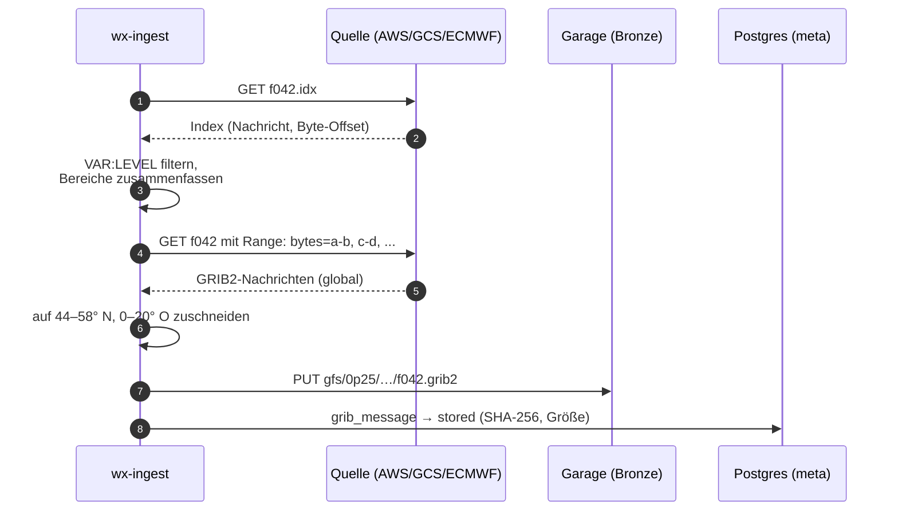

### 4.2 Inventarisierung und Vollständigkeit

Für jeden Lauf wird erwartet, welche Nachrichten kommen (aus der Quellen-Konfiguration abgeleitet). Tabelle `meta.grib_message` (Kap. 5.3) führt Status je Nachricht: `pending → downloaded → stored → processed`. Ein Lauf gilt als vollständig, wenn alle erwarteten Nachrichten mindestens `stored` sind. Verspätete Schritte (GFS veröffentlicht über ca. 1,5 h hinweg schrittweise) werden durch periodisches Nachpollen geholt; erst danach wird der Lauf an `wx-process` übergeben (Teilübergabe für frühe Schritte optional).

Zustände eines Laufs (`meta.nwp_run.status`):

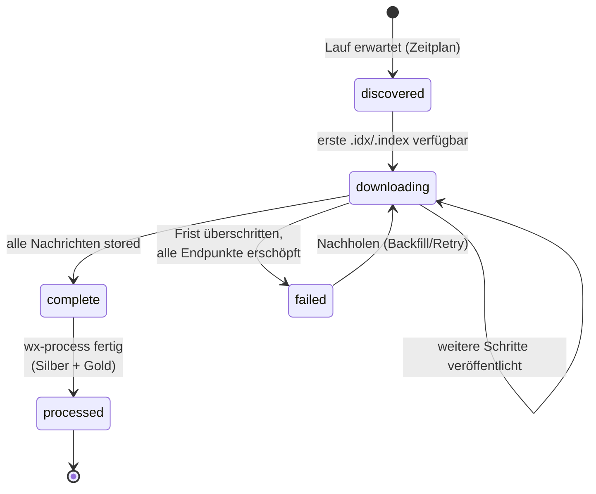

Zustände einer einzelnen Nachricht (`meta.grib_message.status`):

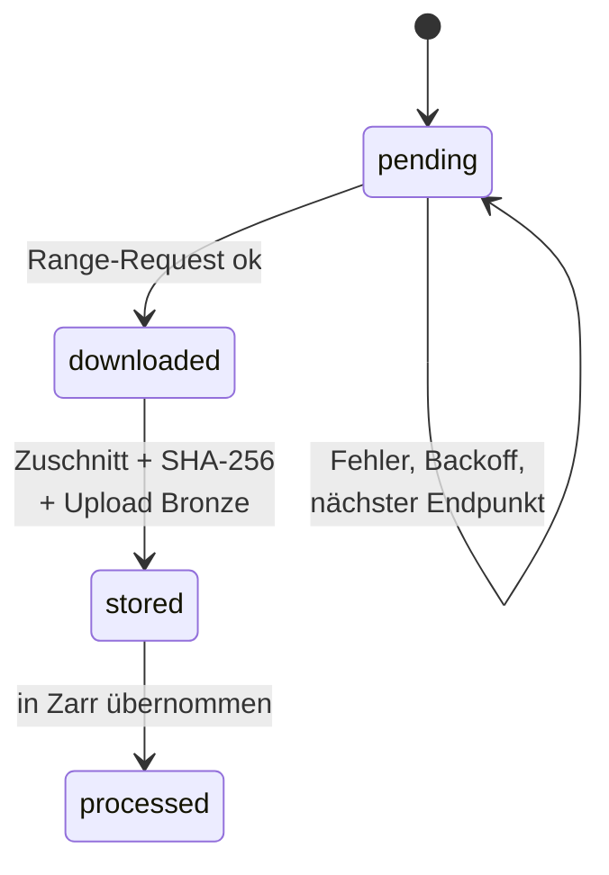

### 4.3 Vorschlag Variablenumfang (Start)

| Zweck | GFS-Kurzname : Level | ECMWF `param` | ICON |
|---|---|---|---|
| Temperatur (Last: Heizen/Kühlen) | `TMP:2 m above ground` | `2t` | `t_2m` |
| Taupunkt/Feuchte (auch Kühllast, 7.8) | `DPT:2 m above ground` / `RH:2 m` | `2d` | `td_2m` |
| Wind 10 m | `UGRD/VGRD:10 m above ground` | `10u/10v` | `u_10m/v_10m` |
| Wind 100 m (Nabenhöhe) | `UGRD/VGRD:100 m above ground` | `100u/100v` | (über Modellflächen; vorerst 10 m + Böen) |
| Böen | `GUST:surface` | `10fg` | `vmax_10m` |
| Globalstrahlung | `DSWRF:surface` | `ssrd` (akkumuliert) | `aswdir_s` + `aswdifd_s` |
| Bewölkung | `TCDC:entire atmosphere` | `tcc` | `clct` |
| Niederschlag / Schnee | `APCP`, `CSNOW` | `tp`, `sf` | `tot_prec` |
| Schneedecke (Wasseräquivalent, Wasserkraft 7.6) | `WEASD:surface`, `SNOD:surface` | `sd` | `w_snow`, `h_snow` |
| Bodenfeuchte (Wasserkraft 7.6) | `SOILW:0-0.1 m below ground`, `SOILW:0.1-0.4 m below ground` | `swvl1`–`swvl4` | `w_so` |
| Bodentemperatur (Sole-Wärmepumpen, Netzverluste, 7.8) | `TSOIL:0-0.1 m below ground`, `TSOIL:0.1-0.4 m below ground` | `stl1`, `stl2` | `t_so` |
| Langwellige Gegenstrahlung (Gebäude, 7.8) | `DLWRF:surface` | `strd` | `athb_s` (Netto) |
| Sonnenscheindauer (7.8) | `SUNSD:surface` | – (aus Strahlung ableiten) | `dursun` |
| Bodendruck | `PRMSL:mean sea level` | `msl` | `pmsl` |
| Druck am Boden (Luftdichte für Wind 7.6, Enthalpie 7.8) | `PRES:surface` | `sp` | `ps` |

Alle GFS-Felder dieser Tabelle stehen in `config/sources/gfs_0p25.yaml` (22 Felder) und werden seit 2026-10-21 gesammelt. Die ECMWF- und ICON-Spalten gelten, sobald diese Quellen dazukommen; die Namen dort vor der Umsetzung prüfen.

Ausschnitt: **44–58° N, 0–20° E** (DE plus Nachbarn, relevant für Kuppelflüsse und Wetterlagen). Bei GFS 0,25° sind das 57 × 81 = 4 617 Gitterpunkte.

---

## 5. Speicherung

### 5.1 Drei Stufen

| Stufe | Format | Ort | Inhalt | Zweck |
|---|---|---|---|---|
| **Bronze** | GRIB2 (Original-Codierung, zugeschnitten) | Garage `wx-bronze` | eine Datei je `modell/lauf/schritt` | Unveränderliche Quelle, Neuberechnung, Audit |
| **Silber** | Zarr v3, je Variable `(schritt, lat, lon)`, Int16 mit Scale/Offset, Blosc/Zstd mit Shuffle | Garage `wx-silver` | ein Zarr-Store je Modell und Lauf | Schneller Zugriff für Training, Regridding auf gemeinsames Gitter |
| **Gold** | TimescaleDB-Hypertables, native Kompression | Postgres | Features je Region × Lauf × Gültigkeitszeit, Energiedaten, Prognosen | ML-Eingang, API, Grafana |

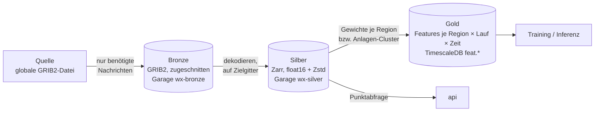

Umgesetzt in `services/wx_process` (Revision `0003_wx_features`): Silber liegt als ein Store je Lauf unter `wx-silver/gfs/0p25/JJJJ/MM/TT/HH.zarr` (statt eines wachsenden Stores je Modell), damit Neuberechnung und Aufräumen auf einen Lauf beschränkt bleiben; Int16 mit CF-Attributen `scale_factor`/`add_offset`, lesbar mit `xarray.open_zarr`. Mittel und Summen stehen dort als Werte für das Intervall seit dem vorherigen Schritt (die 6-h-Eimer von GFS sind zurückgerechnet). Einen vollständigen Lauf erkennt `wx-process` vorerst am Laufmanifest `run.json` in Bronze (Abfrage alle 10 min), nicht über `NOTIFY nwp_run_complete`; danach setzt es `meta.nwp_run` auf `processed` und sendet `NOTIFY features_ready`.

**Zeitachse:** Bronze und Silber halten die Zeitschritte der Quelle unverändert (GFS: stündlich bis 120 h, danach dreistündlich). Zeitliche Interpolation geschieht erst beim Lesen und nur auf Anforderung (7.9).

Objekt-Schlüssel (Bronze), sprechend und partitionierbar:

```
wx-bronze/gfs/0p25/2026/10/20/12/f042.grib2
wx-bronze/ecmwf-ifs/0p25/2026/10/20/00/s144.grib2
wx-bronze/icon-eu/2026/10/20/06/t_2m/s017.grib2
```

### 5.2 Garage (Single Node)

- Image `dxflrs/garage`, `replication_factor = 1`, ein Datenverzeichnis und ein Metadatenverzeichnis auf getrennten Volumes (Metadaten möglichst auf SSD).
- Buckets: `wx-bronze`, `wx-silver`, `ml-artifacts` (MLflow), `ml-exchange` (Trainings-Snapshots und -Ergebnisse, 7.7), `backups` (pg_dump/WAL-G).
- Zugriff ausschließlich über S3-API (`obstore` oder `s3fs`/`fsspec`), Endpoint, Region und Keys aus Umgebungsvariablen. Damit ist der Wechsel zu jedem S3-kompatiblen Dienst reine Konfiguration.
- Lebenszyklus: Bronze für GFS z. B. 2 Jahre vollständig, danach nur 00Z/12Z behalten; Silber unbegrenzt (klein). Garage unterstützt Lifecycle-Regeln nur eingeschränkt, daher Aufräumjob im `maintenance`-Container.
- Hinweis: Single Node heißt **keine Redundanz auf Speicherebene**. Backups der Buckets auf ein zweites Ziel (anderer PVE-Storage oder externes S3) über `rclone` einplanen, sobald Daten wertvoll werden (z. B. weil Quellen sie nicht mehr vorhalten).

### 5.3 Datenbank: PostgreSQL + TimescaleDB statt MariaDB

Begründung gegenüber dem PredictionDB-Entwurf:

- **Native spaltenorientierte Kompression** der Hypertables (typisch 90–95 % Ersparnis bei Zeitreihen). MariaDB bietet nichts Vergleichbares ohne Zusatz-Engine.
- Continuous Aggregates (z. B. 15 min → Stunde/Tag) und Retention-Policies eingebaut; ersetzt den eigenen Cleanup-Container.
- `LISTEN/NOTIFY` für die Entkopplung der Dienste.
- Gute Cloud-Optionen (Timescale Cloud, oder Managed Postgres mit Timescale-Apache-Variante bzw. Self-Hosting auf k8s).

Schemas (Auszug):

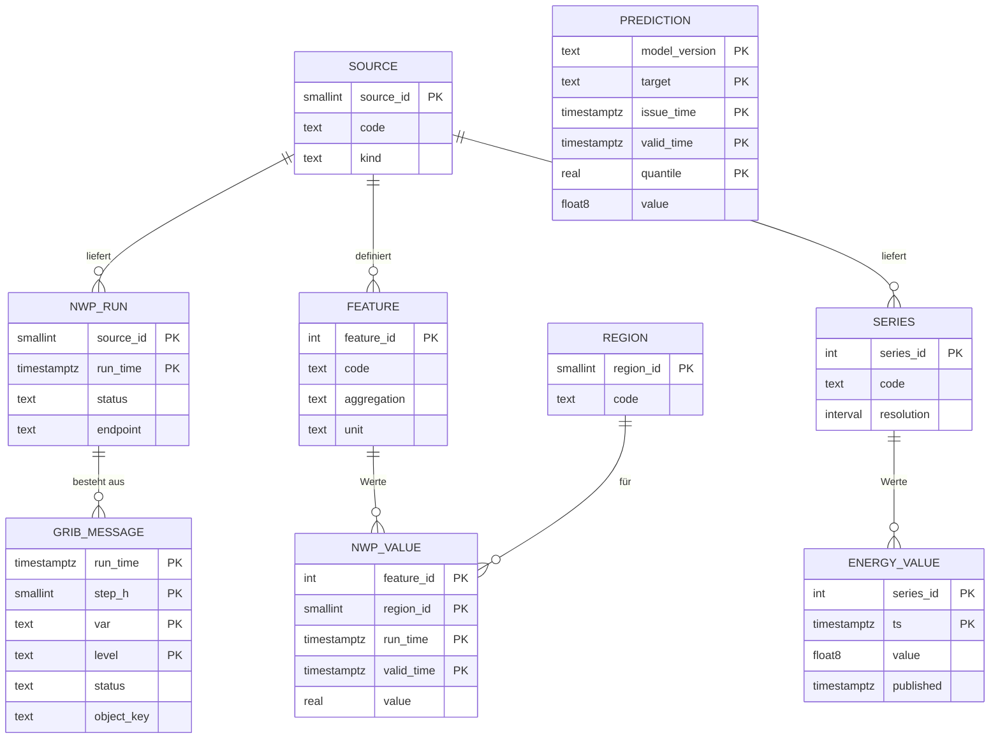


```sql
-- meta: was wurde wann woher geladen
CREATE TABLE meta.source (
  source_id    smallserial PRIMARY KEY,
  code         text UNIQUE NOT NULL,      -- 'gfs_0p25', 'ecmwf_ifs', 'icon_eu', 'entsoe', ...
  kind         text NOT NULL,             -- 'nwp' | 'energy' | 'static'
  license      text
);

CREATE TABLE meta.nwp_run (
  source_id    smallint REFERENCES meta.source,
  run_time     timestamptz NOT NULL,
  status       text NOT NULL,             -- 'discovered'|'downloading'|'complete'|'processed'|'failed'
  endpoint     text,                      -- tatsächlich genutzter Endpunkt (Redundanz nachvollziehbar)
  n_expected   int, n_stored int,
  bytes_stored bigint,
  updated_at   timestamptz DEFAULT now(),
  PRIMARY KEY (source_id, run_time)
);

CREATE TABLE meta.grib_message (
  source_id smallint, run_time timestamptz, step_h smallint,
  var text, level text,
  status text NOT NULL, object_key text, sha256 bytea, size_bytes int,
  PRIMARY KEY (source_id, run_time, step_h, var, level)
);

-- Register der Merkmale (übernimmt die PDID-Idee aus PredictionDB)
CREATE TABLE meta.feature (
  feature_id   serial PRIMARY KEY,
  source_id    smallint REFERENCES meta.source,
  code         text NOT NULL,             -- 'temperature_2m', 'wind_power_index_100m', ...
  aggregation  text NOT NULL,             -- 'pop_weighted', 'wind_cap_weighted', 'pv_cap_weighted', 'area_mean'
  unit         text NOT NULL,
  UNIQUE (source_id, code, aggregation)
);

CREATE TABLE meta.region (
  region_id smallserial PRIMARY KEY,
  code text UNIQUE NOT NULL               -- 'DE', 'DE-50Hertz', 'DE-Amprion', 'DE-TenneT', 'DE-TransnetBW', 'DE-BY', ...
);

-- feat: Wetter-Features (Gold). Lead-Time explizit, wie in PredictionDB (offset)
CREATE TABLE feat.nwp_value (
  feature_id int      NOT NULL,
  region_id  smallint NOT NULL,
  run_time   timestamptz NOT NULL,
  valid_time timestamptz NOT NULL,
  value      real NOT NULL,
  PRIMARY KEY (feature_id, region_id, run_time, valid_time)
);
SELECT create_hypertable('feat.nwp_value', 'valid_time', chunk_time_interval => interval '7 days');
ALTER TABLE feat.nwp_value SET (timescaledb.compress,
  timescaledb.compress_segmentby = 'feature_id, region_id',
  timescaledb.compress_orderby   = 'run_time, valid_time');

-- energy: Ist-Werte und offizielle Prognosen
CREATE TABLE energy.series (
  series_id serial PRIMARY KEY,
  source_id smallint, code text, unit text, resolution interval,
  UNIQUE (source_id, code)
);   -- 'da_price_de_lu', 'load_actual', 'load_da_forecast', 'gen_wind_onshore', ...

CREATE TABLE energy.value (
  series_id  int NOT NULL,
  ts         timestamptz NOT NULL,
  value      double precision,
  published  timestamptz,                 -- wann war der Wert bekannt (Leakage-Schutz)
  PRIMARY KEY (series_id, ts)
);
SELECT create_hypertable('energy.value', 'ts');

-- fcst: eigene Prognosen, je Modellversion und Quantil
CREATE TABLE fcst.prediction (
  model_version text, target text, issue_time timestamptz, valid_time timestamptz,
  quantile real, value double precision,
  PRIMARY KEY (model_version, target, issue_time, valid_time, quantile)
);
SELECT create_hypertable('fcst.prediction', 'valid_time');
```

Unterschied zu PredictionDB: Statt `(lat, lon, timestamp, offset)` steht hier `(region, run_time, valid_time)`. `run_time` ist eindeutig und erspart Rückrechnungen; die Vorlaufzeit ist `valid_time − run_time`. Messungen landen nicht mit negativem Offset in derselben Tabelle, sondern in `energy.value` bzw. einer eigenen `obs`-Tabelle. Das hält die Gitter-/Feature-Tabelle homogen und klein.

### 5.4 Mengengerüst

GFS, Ausschnitt 4 617 Punkte, 10 Variablen, 209 Schritte (0–120 h stündlich = 121, 123–384 h dreistündlich = 88), 4 Läufe/Tag:

| Ablage | Rechnung | pro Jahr |
|---|---|---|
| Zeilen je Gitterwert in SQL (PredictionDB-Ansatz) | 4 617 × 10 × 209 × 4 × 365 ≈ **14 Mrd. Zeilen**; bei ~40–60 B/Zeile inkl. Index | **~600–850 GB** (nur GFS) |
| Bronze GRIB2 (zugeschnitten, GRIB-Packing ~1–1,5 B/Wert) | 9,6 Mio. Werte/Lauf ≈ 10–15 MB/Lauf | **~15–22 GB** |
| Silber Zarr float16 + Zstd (~1 B/Wert) | ≈ 8–10 MB/Lauf | **~12–15 GB** |
| Gold Features (z. B. 40 Features × 10 Regionen × 209 Schritte × 4 Läufe) | 120 Mio. Zeilen, komprimiert ~2–4 B/Wert | **~0,5 GB** |

Mit ECMWF, ICON-EU (höhere Auflösung, aber kürzerer Horizont) und GEFS-Mittel/Streuung liegt die Gesamtmenge realistisch bei **100–200 GB pro Jahr**. Eine VM-Platte von 500 GB reicht für die ersten zwei Jahre. Die Werte sind Abschätzungen und werden nach dem ersten Betriebsmonat durch Messung ersetzt (`meta.nwp_run.bytes_stored`).

---

## 6. Software-Struktur (Python, uv)

### 6.1 Repository-Layout (Vorschlag, ein Monorepo als uv-Workspace)

```
PredictionDB/
├── pyproject.toml              # [tool.uv.workspace] members = ["packages/*", "services/*"]
├── uv.lock
├── compose.yaml                # + compose.override.yaml (dev), compose.prod.yaml
├── .env.example
├── config/
│   ├── sources/                # eine YAML je Quelle (Endpunkte, Variablen, Zeitplan, Ausschnitt)
│   │   ├── gfs_0p25.yaml
│   │   ├── ecmwf_ifs.yaml
│   │   ├── icon_eu.yaml
│   │   └── ...
│   ├── regions/                # GeoJSON/Masken für DE, Regelzonen, Bundesländer
│   └── garage.toml
├── packages/
│   ├── core/                   # Konfiguration (pydantic-settings), Logging, S3-Client, DB-Zugriff, Modelle
│   ├── gribkit/                # .idx/.index-Parser, Range-Merging, Zuschnitt, GRIB→xarray (eccodes)
│   └── features/               # Regionen-Aggregation, Wind-/PV-Proxies, Kalendermerkmale
├── services/
│   ├── wx_ingest/              # Quellen-Plugins + Scheduler
│   ├── wx_process/             # Bronze → Silber → Gold
│   ├── energy_ingest/          # ENTSO-E, SMARD, Energy-Charts, Netztransparenz, MaStR
│   ├── ml/                     # Datasets, Modelle, Training, Evaluierung, Inferenz
│   └── api/                    # FastAPI
├── migrations/                 # Alembic (SQL inkl. Timescale-Befehle)
├── docker/                     # ein gemeinsames Multi-Stage-Dockerfile mit Targets je Dienst
└── tests/                      # inkl. aufgezeichneter .idx-/GRIB-Beispiele als Fixtures
```

### 6.2 Bibliotheken

| Zweck | Wahl | Bemerkung |
|---|---|---|
| HTTP | `httpx` (async, HTTP/2) + `tenacity` (Retry/Backoff) | Range-Requests, Rate-Limit über `aiolimiter` |
| GRIB lesen/schreiben | `eccodes` (Python-Wheels bringen die Bibliothek mit) + `cfgrib`/`xarray` | GRIB-Zuschnitt ohne Dekodieren via eccodes-`sub_area`-Logik bzw. dekodieren → neu packen |
| Referenz/Abkürzung | **Herbie** (`herbie-data`) | Implementiert genau den `.idx`-Partial-Download für GFS, GEFS, ECMWF, ICON, HRRR. Entweder direkt nutzen oder als Referenz für `gribkit`. Empfehlung: im Spike prüfen, ob es unsere Anforderungen (Ausweich-Endpunkte, Zustandsführung) ohne Umbauten trägt. |
| ECMWF | `ecmwf-opendata` | offizieller Client |
| Gitter/Regridding | `xarray`, `numpy`, `xesmf` oder einfache bilineare Interpolation | ICON-Ikosaeder nur bei Bedarf |
| Zarr | `zarr` v3 + `obstore`/`s3fs` | |
| DB | `SQLAlchemy 2` + `psycopg 3`, `alembic` | Bulk-Insert per `COPY` |
| Konfiguration | `pydantic-settings` + YAML | Umgebungsvariablen überschreiben YAML |
| Scheduling | `APScheduler 4` (in-process, Cron-Trigger, Persistenz in Postgres) | kein Celery/Redis nötig |
| Energie-APIs | `entsoe-py`; SMARD/Energy-Charts über eigene dünne Clients | |
| ML | PyTorch + Lightning; `neuralforecast` für Referenzarchitekturen; LightGBM als Baseline | |
| Anlagenmodelle (7.6) | `pvlib` (PV: Sonnenstand, Transposition, Zelltemperatur), `windpowerlib` (Höhenprofil, Leistungskurven) | beide BSD-3-Clause bzw. MIT |
| Tracking | MLflow (Backend Postgres, Artefakte in Garage) | |
| Observability | `structlog` (JSON), Prometheus-Metriken via `prometheus-client` | |

### 6.3 Plugin-Schnittstelle (Quelle)

```python
class NwpSource(Protocol):
    code: str

    def expected_runs(self, now: datetime) -> list[datetime]: ...
    def expected_messages(self, run: datetime) -> list[MessageSpec]: ...   # (step, var, level)
    async def is_available(self, run: datetime, step: int, ep: Endpoint) -> bool: ...
    async def fetch(self, run: datetime, step: int,
                    msgs: list[MessageSpec], ep: Endpoint) -> bytes: ...  # GRIB2-Bytes, bereits zugeschnitten
```

Jede Quelle kommt mit einer YAML-Datei (wie im PredictionDB-Entwurf), z. B.:

```yaml
code: gfs_0p25
schedule: "*/10 * * * *"           # alle 10 min auf neue Schritte prüfen
runs: ["00", "06", "12", "18"]
steps: {range: [[0, 120, 1], [123, 384, 3]]}
bbox: {north: 58, south: 44, west: 0, east: 20}
endpoints:
  - {kind: nomads_filter, url: "https://nomads.ncep.noaa.gov/cgi-bin/filter_gfs_0p25_1hr.pl", rate_per_min: 50}
  - {kind: idx_range,     url: "https://noaa-gfs-bdp-pds.s3.amazonaws.com"}
  - {kind: idx_range,     url: "https://storage.googleapis.com/global-forecast-system"}
messages:
  - {var: TMP,   level: "2 m above ground"}
  - {var: UGRD,  level: "100 m above ground"}
  - {var: VGRD,  level: "100 m above ground"}
  - {var: DSWRF, level: surface}
  # ...
```

### 6.4 Ablauf eines Ingest-Zyklus

1. Scheduler löst aus → `expected_runs()` liefert Läufe der letzten n Stunden.
2. Für jeden nicht vollständigen Lauf: fehlende Nachrichten aus `meta.grib_message` bestimmen.
3. Endpunkt nach Priorität wählen; Verfügbarkeit prüfen (`.idx` vorhanden bzw. HTTP 200 auf HEAD).
4. Download (gebündelt je Schritt), Zuschnitt, SHA-256, Upload nach Bronze, Status `stored`.
5. Lauf vollständig → `meta.nwp_run.status = 'complete'` + `NOTIFY nwp_run_complete`.
6. Fehler → Backoff; nach n Fehlschlägen nächster Endpunkt; Metrik `ingest_failures_total{source,endpoint}`.
7. Nachholmodus (`backfill`) nutzt dieselbe Logik über einen Zeitraum, ausschließlich gegen Archiv-Endpunkte (AWS), mit separatem Rate-Limit.


### 6.5 Konzepte aus dem Altsystem

| Altes Konzept | Übernahme |
|---|---|
| `grib_finished.txt` (Liste vollständiger Läufe) | `meta.nwp_run` mit Status `complete`; dieselbe Rolle, aber mit Quelle, Endpunkt und Teilstatus je Nachricht |
| `get_cgi_data.sh?param&ort&lauf` (Punktzeitreihe je Lauf) | API-Endpunkt `GET /forecast/point?model=&param=&lat=&lon=&run=latest` liest aus Silber (Zarr), interpoliert bilinear. Benannte Orte als Tabelle `meta.location`. |
| „Jüngster Lauf, der den Zeitpunkt abdeckt“ (`findMostActualForcast`) | Standardabfrage `run_time = max(run_time) WHERE run_time + Verzug ≤ issue_time`; zugleich der Leakage-Schutz aus 7.4 |
| Inventar-Nummern (195 = T2, 245 = DSWRF) | Ersetzt durch Kurzname + Level (`TMP:2 m above ground`); Nummern sind produktabhängig und haben sich seitdem geändert |
| Assessments (Ähnlichkeit von Tagen über Temperaturmittel und Strahlungssumme) | Analog-Tag-Baseline in Phase 5 (7.3) |
| Testdateien des alten GRIB-Bundles | Fixtures für `gribkit`-Tests (GRIB2 JPEG2000, GRIB1, Einzelnachricht) |

Hinweis zum GRIB-Parsing: Ein eigener GRIB2-Parser in reinem Python lohnt nicht. GRIB2 hat zahlreiche Packungsarten (JPEG2000, CCSDS/AEC, komplexe Packung mit räumlicher Differenzierung), die NOAA, ECMWF und DWD tatsächlich nutzen. `eccodes` (ECMWF, Apache-2.0, Wheels inklusive Bibliothek) deckt das ab. Eigener Code beschränkt sich auf Index-Parsing, Range-Merging und Zuschnitt (`gribkit`).

---

## 7. Machine Learning

### 7.1 Zielgrößen und Horizonte

| Ziel | Auflösung | Horizont | Bemerkung |
|---|---|---|---|
| Netzlast DE (ENTSO-E „Actual Total Load“) | 15 min (Training ggf. stündlich) | 0–16 Tage | Wetter (Temperatur), Kalender, Saison dominieren |
| Day-Ahead-Preis DE-LU | 15 min | D+1 (Kern), D+2 … D+14 (Szenario) | Treiber: Residuallast = Last − Wind − PV, Nachbarländer, Brennstoffpreise |
| Hilfsziele: Wind-, PV- und Laufwasser-Einspeisung DE | 15 min | 0–16 Tage | verbessern Preisprognose deutlich (Residuallast) |

Ehrliche Erwartung: Für D+1 lässt sich ein guter Preis erreichen; jenseits von etwa 5–7 Tagen wird vor allem die Struktur (Tagesgang, Wochenende, wind-/sonnenreiche Phasen) prognostiziert, nicht der genaue Preis. Deshalb Quantilprognosen (z. B. P10/P50/P90) statt Punktwerten.

### 7.2 Features

- **Wetter je Region bzw. Anlagen-Cluster** (aus Silber berechnet, Details in 7.5):
  - Temperatur bevölkerungsgewichtet (Last),
  - Wind-Leistungsindex je Wind-Cluster: Windgeschwindigkeit 100 m → Leistungskurve (nach Nabenhöhe/Anlagentyp), mal installierte Leistung des Clusters,
  - PV-Index je PV-Cluster: Globalstrahlung × Temperaturkorrektur (Ausrichtung/Neigung, soweit im MaStR angegeben), mal installierte Leistung,
  - Bewölkung, Niederschlag, Schnee (Schneebedeckung von PV).
- **Mehrere Modelle nebeneinander** (GFS, ECMWF, ICON) plus Spread zwischen ihnen und GEFS-Streuung als Unsicherheitsmaß; je Modell ein Verfügbarkeits-Flag.
- **Vorlaufzeit** als explizites Feature (Modellgüte nimmt mit dem Vorlauf ab).
- **Kalender:** Stunde, Wochentag, Feiertag (bundesweit/anteilig je Land), Brückentage, Ferienanteil, Zeitumstellung.
- **Markt:** zuletzt bekannte Preise und Lasten (Lags, nur was zum Ausgabezeitpunkt veröffentlicht war), installierte Kapazitäten, optional Brennstoff-/CO₂-Preise.

### 7.3 Modellansatz

1. **Baseline:** saisonal-naive Prognose, Analog-Tag-Verfahren (die Assessment-Idee aus dem Altsystem: ähnlichste historische Tage nach Wetterprognose suchen und deren Ist-Werte gewichten) und LightGBM je Horizont-Block. Das ist der Maßstab, den jedes NN schlagen muss.
2. **Neuronales Netz:** Multi-Horizont-Encoder-Decoder für Zeitreihen mit bekannten Zukunftskovariaten. Kandidaten: TFT (Temporal Fusion Transformer), TiDE, N-HiTS mit exogenen Variablen. Quantile-Loss, gemeinsames Modell für Last, Wind, PV und Preis (Multi-Task) oder zweistufig: Stufe 1 Last/Wind/PV, Stufe 2 Preis mit Residuallast als Eingang. Empfehlung: zweistufig, weil sich Fehler so besser zuordnen lassen.
3. Später optional: räumliches Modell, das direkt auf den Silber-Gittern arbeitet (CNN-Encoder über das Europa-Gitter), falls die Regionen-Aggregation Information verschenkt.

Zweistufiger Aufbau:

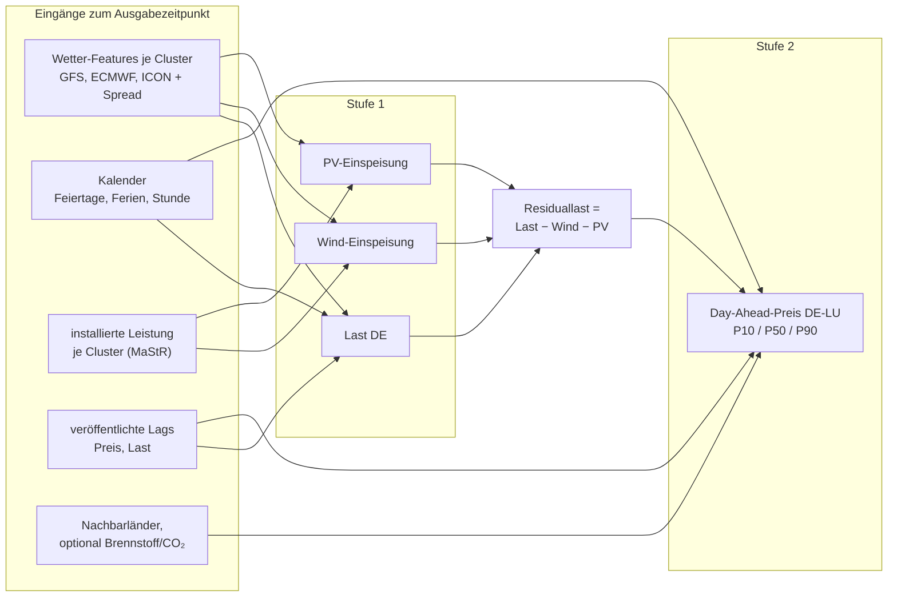

### 7.4 Training, Validierung, Betrieb

- **Leakage-Schutz:** Trainingsbeispiele werden ausschließlich aus Läufen gebildet, die zum Ausgabezeitpunkt verfügbar waren (`run_time + Veröffentlichungsverzug ≤ issue_time`), Marktdaten über `published`.

  ```mermaid
  sequenceDiagram
      participant N as NOAA GFS 06Z
      participant D as PredictionDB
      participant M as Börse (SDAC)
      Note over N: run_time 06:00 UTC
      N->>D: Schritte verfügbar ab ca. 09:30 UTC
      Note over D: issue_time 10:00 UTC:<br/>nur Läufe mit run_time + Verzug ≤ issue_time
      D->>D: Prognose für Liefertag D+1
      Note over M: Gebotsschluss 12:00 MEZ/MESZ
      M->>D: Auktionsergebnis ca. 13:00 MEZ/MESZ<br/>(published) → Ziel für das Training
  ```
- **Validierung:** rollierende Zeitreihen-Kreuzvalidierung (Expanding Window), Metriken MAE/RMSE je Horizont, Pinball-Loss, für Preis zusätzlich Rang-/Spread-Güte (wichtig für Lastverschiebung).
- **Training** als portabler Container-Job (`docker compose run ml-train …` oder auf einer gemieteten GPU), auf der VM CPU-basiert machbar für Regionen-Features. Hardware, Laufzeiten und Ablauf in 7.7.
- **Inferenz** (`ml-predict`): reagiert auf `NOTIFY features_ready`, lädt das in MLflow als `production` markierte Modell, schreibt Quantile nach `fcst.prediction`.
- **Monitoring:** täglicher Abgleich Prognose ↔ Ist in Grafana; Drift-Alarm bei Fehleranstieg.

### 7.5 Anlagenverteilung aus dem MaStR und Gebietscluster

Ziel: Wetterprognosen dort auswerten, wo die Wind-, PV- und anderen EE-Anlagen tatsächlich stehen, und dem Netz pro Gebiet ein Signal „erwartete Einspeisung“ geben.

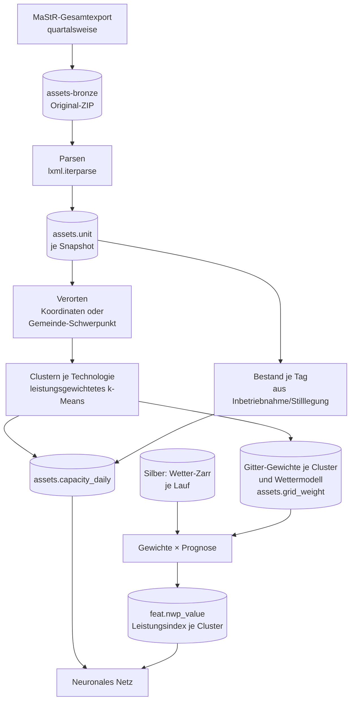

**Abruf (quartalsweise):**

- Quelle: MaStR-Gesamtdatenexport (<https://www.marktstammdatenregister.de/MaStR/Datendownload>), ZIP mit XML-Dateien je Einheitentyp (mehrere GB entpackt), Lizenz DL-DE BY 2.0.
- Dienst `mastr-snapshot` (Paket `services/mastr_ingest`, CLI `mastr-ingest`), prüft alle 6 h, ob im laufenden Quartal schon ein Snapshot liegt, und lädt sonst den Export des Tages (manuell auslösbar). Das Original-ZIP landet in Garage `assets-bronze/mastr/YYYY-MM-DD/` und bleibt erhalten, damit Auswertungen reproduzierbar sind.
- Parsing mit eigenem Streaming-XML-Parser (`lxml.iterparse`, UTF-16), weil `open-mastr` alle Tabellen über pandas in eine eigene DB schreibt und unter AGPL steht. Aufzählungen werden über `Katalogwerte.xml` als Text ausgewertet, damit neue Releases mit verschobenen Ids nichts brechen.
- Relevante Felder je Einheit: Energieträger, Bruttoleistung/Nettonennleistung, Inbetriebnahme- und Stilllegungsdatum, Betriebsstatus, Koordinaten bzw. PLZ/Gemeinde, bei Wind Nabenhöhe, Rotordurchmesser, Hersteller/Typ, on-/offshore, bei PV Hauptausrichtung, Neigung, Freifläche/Dach, Einspeiseart (Voll-/Überschusseinspeisung, Eigenverbrauch).

**Verortung:**

- Koordinaten sind im öffentlichen Export nur für größere Anlagen enthalten; kleine Anlagen (insbesondere Dach-PV) nur mit PLZ bzw. Gemeinde. Diese werden auf den Schwerpunkt der Gemeinde (Geometrien: BKG VG250, frei, DL-DE BY 2.0) oder gleichmäßig auf deren Fläche verteilt. Die genaue Schwelle prüfe ich beim ersten Import.
- Offshore-Wind über Koordinaten bzw. Windpark-Zuordnung zu den Nordsee-/Ostsee-Gebieten.

**Zeitliche Rekonstruktion:**

- Aus Inbetriebnahme- und Stilllegungsdatum ergibt sich für jeden Tag der Historie die installierte Leistung je Gebiet. Damit sieht das Training für 2022 den Anlagenbestand von 2022 und nicht den heutigen (sonst wäre der Zubau, vor allem PV, falsch abgebildet).
- Ein Quartals-Snapshot genügt dafür, weil der Export auch stillgelegte Anlagen mit Datum enthält. Nachmeldungen werden durch spätere Snapshots korrigiert; die Differenz zwischen Snapshots wird geloggt.

**Clustering:**

- Getrennt je Technologie (Wind onshore, Wind offshore, PV Freifläche, PV Dach, Biomasse, Wasser), weil Wetterabhängigkeit und Tagesprofil verschieden sind.
- Leistungsgewichtetes k-Means bzw. Mini-Batch-k-Means auf (lat, lon), optional plus Nabenhöhe bzw. Ausrichtung als Zusatzdimension. Startwert z. B. 20–30 Cluster für Wind onshore, 20–30 für PV, 3–5 für Offshore; die Zahl wird über die Prognosegüte gewählt. Alternative mit festen Grenzen: Regelzonen × Bundesländer (stabil, gut erklärbar, aber gröber).
- Cluster werden nur bei signifikanter Änderung neu gebildet (z. B. jährlich), damit sich die Feature-Definitionen für das Netz nicht jedes Quartal verschieben. Zwischen Neubildungen werden neue Anlagen dem nächstgelegenen bestehenden Cluster zugeordnet. Jede Clusterung bekommt eine Version; das Modell merkt sich, mit welcher Version es trainiert wurde.

**Kombination mit der Wetterprognose:**

- Für jedes Cluster eine Gewichtsmatrix „Leistung je Gitterzelle“ pro Wettermodellgitter (GFS 0,25°, ECMWF 0,25°, ICON-EU 0,0625°). `wx-process` multipliziert jede Prognose mit dieser Matrix und schreibt je Cluster, Lauf und Gültigkeitszeit Kennzahlen nach `feat.nwp_value` (Leistungsindex in MW, mittlere Windgeschwindigkeit bzw. Einstrahlung).
- Region-Codes in `meta.region` erhalten dafür die Form `wind_on:v2025Q4:c07`; Gitter-Gewichte liegen in der Tabelle `assets.grid_weight` (je Gitter, Cluster und Zelle Leistung und Anteil; wenige tausend Zeilen), daraus baut `wx-process` die dichte Matrix.
- Umgesetzt in `services/wx_process`: je Cluster gewichtetes Mittel über die Zellen, nichtlineare Größen (Wind in Nabenhöhe nach Potenzgesetz mit Exponent aus 10 m/100 m und der mittleren MaStR-Nabenhöhe, generische Leistungskurve, einfaches PV-Modell aus Globalstrahlung und Temperatur) erst je Zelle. Features `wind_speed_*`, `wind_cf`, `wind_power` (MW mit `assets.capacity_daily`), `ghi`, `pv_cf`, `pv_power`, `cloud_cover`, `snow_fraction`, `precip`, `t2m`; Aggregation `cluster_cap_weighted`, Zustand je Lauf, Clusterung und Feature-Version in `meta.nwp_feature_run`. Details: `services/wx_process/README.md`.

**Ergänzende Tabellen:**

```sql
CREATE TABLE assets.snapshot (
  snapshot_id serial PRIMARY KEY, export_date date UNIQUE, object_key text, n_units int
);
CREATE TABLE assets.unit (                       -- reduzierte, normalisierte Sicht auf den Export
  snapshot_id int, mastr_nr text, technology text, capacity_kw real,
  commissioned date, decommissioned date, lat real, lon real, geo_precision text,  -- 'coord'|'gemeinde'|'plz'
  hub_height_m real, azimuth text, tilt text,
  PRIMARY KEY (snapshot_id, mastr_nr)
);
CREATE TABLE assets.cluster (
  clustering_version text, technology text, cluster_no int, centroid_lat real, centroid_lon real,
  PRIMARY KEY (clustering_version, technology, cluster_no)
);
CREATE TABLE assets.capacity_daily (             -- rekonstruierte installierte Leistung (Hypertable)
  clustering_version text, technology text, cluster_no int, day date, capacity_mw real,
  PRIMARY KEY (clustering_version, technology, cluster_no, day)
);
```

- **Wasserkraft im Systemmodell:** MaStR führt Wasserkraftanlagen mit Art (Laufwasser, Speicher, Pumpspeicher), Leistung und meist Koordinaten. Laufwasser wird nicht per k-Means geclustert, sondern nach **Flussgebieten** (z. B. Inn, Isar, Lech, Iller, Donau, Hochrhein, Main, Mosel, sonstige), weil Anlagen am selben Fluss denselben Abfluss sehen. Je Cluster gehen ein, jeweils mit den Nachlauf- und Gedächtnis-Features aus 7.6: Abfluss an zwei bis drei Leitpegeln (PEGELONLINE bzw. Landesportale, Ist-Werte), GloFAS-Abflussprognose, gebietsgemittelter Niederschlag und Schneeschmelze aus den Wettermodellen. Zielgröße für das Lernen ist die ENTSO-E-Erzeugung „Hydro Run-of-river and poundage“ für DE. Pumpspeicher und Speicher werden nicht aus dem Wetter prognostiziert. Die Füllstände der Speicher in den Nachbarländern (ENTSO-E „Water reservoirs and hydro storage plants“, wöchentlich, vor allem CH, AT, FR, NO) gehen als Preis-Feature ein, weil sie das Angebot an flexibler Wasserkraft bestimmen.

Umgesetzt in Revision `0002_assets` mit einigen Ergänzungen: `assets.clustering` (Version, Snapshot, Gitter), `assets.cluster_cell` (Zelle → Cluster), `assets.grid_weight` und `assets.gemeinde` (optionale Referenzpunkte, z. B. aus VG250). Geclustert wird auf den Zellen des GFS-0,25°-Gitters (summierte Leistung je Zelle), sodass jede Zelle genau einem Cluster gehört. Ohne Koordinaten wird eine Einheit über Gemeinde, PLZ, Kreis und Bundesland verortet (Mittel der Einheiten mit Koordinaten bzw. Referenzpunkt); `geo_precision` hält die Stufe fest. Wasserkraft wird vorerst wie die übrigen Technologien per k-Means geclustert; die Gruppierung nach Flussgebieten (oben) ersetzt das später. Details: `services/mastr_ingest/README.md`.

**Wirkung im Netz:** Die Cluster-Leistungsindizes sind die wichtigsten Eingänge der Stufe 1 (Wind- und PV-Einspeisung) aus 7.3; deren Summe ergibt mit der Lastprognose die Residuallast für die Preis-Stufe. Die installierte Leistung je Cluster geht zusätzlich als Feature ein, damit das Netz den Zubau lernt.

### 7.6 Prognose für eigene Anlagen (PV, Wind, Wasserkraft) über die API

Ziel: Über die API lässt sich eine einzelne PV-, Windkraft- oder Wasserkraftanlage (vom großen Laufwasserkraftwerk bis zur privaten Kleinanlage) mit ihren Stammdaten anlegen, optional mit rund einem Jahr Messwerten. Die API liefert dann laufend eine Erzeugungsprognose aus den Wetterdaten, die ohnehin geladen werden. Das passt zum Additional Use Grant der Lizenz (Prognose eigener Anlagen an eigenen Standorten, Kap. 12).

Der Ansatz ist zweistufig: Ein **physikalisches Modell** liefert sofort nach dem Anlegen eine Prognose. Sobald Messwerte vorliegen, korrigiert eine **Kalibrierung** dessen systematische Fehler.

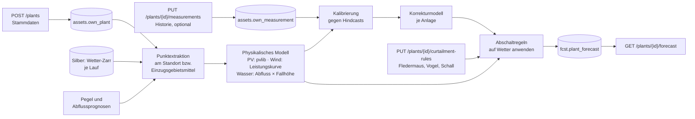

**Endpunkte** (FastAPI, Teil des Dienstes `api`, Auth per API-Schlüssel; jede Anlage gehört einem Schlüssel bzw. Nutzer):

| Methode und Pfad | Zweck |
|---|---|
| `POST /plants` | Anlage anlegen (`type`: `pv`, `wind` oder `hydro`, Stammdaten siehe unten); Antwort mit `plant_id` |
| `GET/PATCH/DELETE /plants/{id}` | Stammdaten lesen, ändern, Anlage samt Messwerten löschen |
| `PUT /plants/{id}/measurements` | Messwerte hochladen (CSV oder JSON: Zeitstempel UTC, Leistung in kW oder Energie je Intervall in kWh, Intervall 15 min oder 1 h). Typischer Umfang ist ein Jahr, mehr ist besser. Mehrfaches Hochladen ergänzt bzw. überschreibt Zeiträume. |
| `POST /plants/{id}/calibrate` | Kalibrierung anstoßen (asynchron, Status über `GET /plants/{id}/calibration`). Läuft auch automatisch nach einem Upload. |
| `GET /plants/{id}/forecast` | Prognose; Parameter `model` (Standard `best`, sonst `gfs`, `ecmwf`, `icon_eu` …), `run` (`latest` oder Zeitpunkt), `horizon_h` (bis 384 bei GFS), `resolution` (15 min / 1 h), `quantiles` |
| `PUT /plants/{id}/curtailment-rules` | Abschaltregeln eintragen (Artenschutz, Schall, Abregelung), siehe unten |
| `GET /plants/{id}/backtest` | Güte der Prognose gegen die hochgeladenen Messwerte (MAE, RMSE, Bias je Vorlauftag) |

**Stammdaten PV:**

- Standort: `lat`, `lon`, optional Höhe über NN.
- Eine oder mehrere **Teilflächen** (Ost/West-Dächer, Fassaden), je Teilfläche `peak_power_kwp`, `azimuth_deg` (Konvention 0 = Nord, 90 = Ost, 180 = Süd, 270 = West) und `tilt_deg` (0 = waagerecht).
- Optional: Wechselrichter-AC-Leistung (Clipping), Einspeisebegrenzung (z. B. 60 % oder 70 %), Modultechnik bzw. Temperaturkoeffizient, Montageart (Aufdach, Freifläche, gebäudeintegriert; bestimmt die Zelltemperatur), Horizont- bzw. Verschattungsprofil, Systemverluste, Inbetriebnahmedatum (Degradation).

**Stammdaten Wind:**

- Standort: `lat`, `lon`, optional Geländehöhe.
- `hub_height_m`, `rotor_diameter_m`, `rated_power_kw`.
- Leistungskurve: entweder Hersteller und Typ (Nachschlagen in einer Turbinen-Bibliothek, z. B. der oedb-Turbinendaten, die `windpowerlib` nutzt) oder eine eigene Kurve als Tabelle (Windgeschwindigkeit → Leistung) bzw. `cp`-Kurve.
- Optional: Ein- und Abschaltgeschwindigkeit, Anzahl gleicher Anlagen (Park), Verfügbarkeit, Rauigkeitslänge bzw. Geländetyp, Abschaltauflagen (Fledermäuse, Vögel, Schall, Schattenwurf) als Regeln, siehe unten.

**Stammdaten Wasserkraft:**

- Standort: `lat`, `lon` der Wasserfassung bzw. des Krafthauses, Gewässername.
- `head_m` (Fallhöhe, brutto bzw. netto), `design_flow_m3s` (Ausbaudurchfluss), `rated_power_kw`, Anzahl Maschinen.
- Turbinentyp (Kaplan, Francis, Pelton, Durchström-/Ossberger, Wasserrad, Wasserkraftschnecke) und optional eine eigene Wirkungsgradkurve (Durchfluss → Wirkungsgrad). Fehlt sie, gilt eine typische Kurve je Turbinentyp.
- Mindestdurchfluss je Maschine (unterhalb steht die Turbine), Restwasser- bzw. Mindestwasserauflage (konstant oder je Monat, z. B. nach Bescheid), Abschaltdurchfluss bei Hochwasser, optional die Fallhöhenabnahme bei hohem Abfluss (steigendes Unterwasser).
- Hydrologischer Bezug, mindestens eine der Angaben:
  - zugehöriger **Pegel** (PEGELONLINE-ID oder Messstellennummer eines Landesportals) samt Flächenverhältnis Anlage zu Pegel,
  - **Einzugsgebiet** als Polygon (GeoJSON) oder als Fläche in km². Ohne Polygon wird es aus einem freien Höhenmodell (Copernicus DEM 30 m) ab dem Standort abgeleitet, z. B. mit `pysheds`.
- Bei Speicher- und Pumpspeicheranlagen zusätzlich Speichergröße. Deren Einsatz folgt aber vor allem dem Strompreis und lässt sich aus dem Wetter allein nicht prognostizieren (siehe unten).

**Abschaltauflagen für Fledermäuse und Vögel (Wind):**

Viele Genehmigungen schreiben Abschaltungen zum Artenschutz vor. Diese Zeiten fehlen in jeder reinen Wetterprognose und müssen deshalb als Regeln je Anlage hinterlegt werden. Der Anwender trägt sie über `PUT /plants/{id}/curtailment-rules` ein, typischerweise aus dem Genehmigungsbescheid.

- **Fledermäuse:** Die Auflagen sind meist rein wetter- und zeitabhängig und lassen sich deshalb vorhersagen. Ein typisches Beispiel: 1. April bis 31. Oktober, von einer Stunde vor Sonnenuntergang bis Sonnenaufgang, wenn die Windgeschwindigkeit auf Nabenhöhe unter 6 m/s liegt, die Temperatur über 10 °C und es nicht regnet. Die Werte stehen im Bescheid und ändern sich oft nach dem Gondelmonitoring der ersten Betriebsjahre (z. B. ProBat). Deshalb sind die Regeln versioniert und haben ein Gültigkeitsdatum.
- **Vögel:** Hier gibt es zwei Arten. Feste Zeitfenster wie Brutzeit oder Zugzeit, tagsüber zwischen Sonnenauf- und -untergang, ggf. mit Wetterbedingung, werden wie bei Fledermäusen gerechnet. Ereignisgesteuerte Abschaltungen, z. B. bei Mahd, Ernte oder Bodenbearbeitung im Umkreis (häufig beim Rotmilan, am Tag des Ereignisses und an den Folgetagen), sind nicht aus dem Wetter ableitbar. Der Anwender trägt sie als konkrete Termine ein, sobald sie bekannt sind. Ohne Termin geht für die Erntemonate optional ein erwarteter Verfügbarkeitsabschlag in die Quantile ein. Kamerabasierte Antikollisionssysteme werden ebenfalls als pauschaler Abschlag je Monat und Tageszeit modelliert.
- **Regelformat** (JSON, per Pydantic validiert; mehrere Regeln je Anlage, verknüpft mit ODER):

```json
{
  "name": "Fledermaus Bescheid 2024",
  "valid_from": "2024-04-01", "valid_to": null,
  "months": [4, 5, 6, 7, 8, 9, 10],
  "time_window": {"start": {"ref": "sunset", "offset_min": -60}, "end": {"ref": "sunrise", "offset_min": 0}},
  "conditions": {"wind_hub_ms": {"lt": 6.0}, "t2m_c": {"gt": 10.0}, "precip_mm_h": {"lt": 0.2}},
  "action": {"type": "stop"}
}
```

`ref` kann `sunrise`, `sunset`, `civil_dawn`, `civil_dusk` oder eine feste Uhrzeit (Ortszeit) sein; Sonnenzeiten rechnet `pvlib` aus dem Standort. `action` ist `stop` oder `limit` mit `max_kw` (z. B. reduzierter Betrieb für Schallschutz). Ereignisse wie Mahd werden als `{"type": "event", "from": …, "to": …}` eingetragen.
- **Anwendung in der Prognose:** Die Regeln werden auf die prognostizierten Wetterwerte am Standort angewandt. Weil die Bedingungen an Schwellen hängen (Wind knapp unter 6 m/s), wird je Quantil bzw. Ensemble-Mitglied geprüft, nicht nur auf dem Median. Die Prognose liefert dadurch Leistung **mit** und **ohne** Abschaltung sowie die Wahrscheinlichkeit, dass eine Abschaltung greift. Das Ergebnis ist auch für die Ertragsplanung nützlich, weil die Abschaltverluste je Monat sichtbar werden.
- **Kalibrierung:** In den Messwerten markieren die Regeln die Zeiträume, in denen die Anlage absichtlich stand. Diese gehen nicht in die Leistungskurve ein. Umgekehrt meldet der Backtest auffällige Stillstände, die zu keiner Regel passen (fehlende Regel, Störung oder Abregelung durch den Netzbetreiber).
- Für PV und Wasserkraft gibt es dieselbe Regel-Schnittstelle, bei Wasserkraft z. B. für monatliche Restwasserauflagen, Fischschutz- bzw. Wanderzeiten oder Revisionen. Bei PV dient sie für Abregelungen, etwa feste Einspeisegrenzen oder Steuerbefehle nach § 14a bzw. Redispatch, soweit sie bekannt sind.

**Physikalisches Modell:**

- **Wetter am Standort:** `wx-process` bzw. `ml-predict` liest je Lauf die benötigten Variablen aus Silber und interpoliert bilinear auf den Standort. Das ist eine kleine Zeitreihe je Anlage und Lauf und kostet kaum Rechenzeit. Standorte außerhalb des Ausschnitts (4.3) werden beim Anlegen abgelehnt, bis der Ausschnitt erweitert ist.
- **PV** (Bibliothek `pvlib`): Globalstrahlung (`DSWRF` bzw. `ssrd`) zerlegen in Direkt- und Diffusanteil (Erbs bzw. DISC, bei ICON direkt `aswdir_s`/`aswdifd_s`), Transposition auf jede Teilfläche (Perez), Einfallswinkelverluste, Zelltemperatur aus 2-m-Temperatur, 10-m-Wind und Montageart, dann DC-Leistung, Wechselrichter, Clipping und Einspeisebegrenzung. Wichtig: GFS liefert `DSWRF` als Mittel über wechselnde Intervalle (Rücksetzen alle 6 h); `wx-process` wandelt das in echte Stundenmittel um, bevor es nach Silber geht. Für 15 min wird mit dem Sonnenstand interpoliert, nicht linear.
- **Wind** (Bibliothek `windpowerlib`): Windgeschwindigkeit auf Nabenhöhe aus 10 m und 100 m (bei GFS zusätzlich 80 m) über das gemessene Höhenprofil (Potenzgesetz mit Exponent aus den beiden Niveaus, ersatzweise logarithmisches Profil mit Rauigkeitslänge), Luftdichtekorrektur aus Temperatur und Bodendruck (`PRES:surface` kommt dafür in die Variablenliste 4.3), dann Leistungskurve. Bei Parks ein einfacher Wake-Abschlag als Parameter.
- **Wasserkraft:** Die Leistung hängt am Abfluss, nicht direkt am Wetter. Gerechnet wird `P = ρ · g · Q_T · H(Q) · η(Q_T)` mit `Q_T = min(Q − Q_Rest, Q_Ausbau)`. Unter dem Mindestdurchfluss ist `P = 0`, über dem Abschaltdurchfluss ebenfalls. Der Abfluss `Q` kommt je nach verfügbaren Daten aus einer von drei Quellen, in dieser Rangfolge:
  1. **Abflussprognose eines Dienstes** für den Pegel, soweit kostenfrei verfügbar: Hochwasser- und Abflussvorhersagen der Landesportale sowie GloFAS (Copernicus, global, bis 30 Tage, kostenlos mit Registrierung). EFAS ist für Europa genauer, Echtzeitprognosen gibt es dort aber nur für Partnerbehörden. Für kleine Bäche gibt es meist keine Prognose.
  2. **Eigenes Niederschlag-Abfluss-Modell** je Einzugsgebiet: gebietsgemittelter Niederschlag und Temperatur aus den Wettermodellen, Schneespeicher mit Grad-Tag-Verfahren (Schneeschmelze, wichtig im Alpenvorland), Boden- und Grundwasserspeicher. Ein konzeptionelles Modell wie GR4J oder HBV (eigene kleine Implementierung oder ein vorhandenes Python-Paket, Auswahl im Spike) wird an der Pegel- oder Erzeugungshistorie kalibriert.
  3. **Persistenz**: Ohne Pegel und ohne Historie wird der letzte bekannte Wert fortgeschrieben, mit Rezessionskurve (Trockenwetterabfall). Mit Niederschlag wird angehoben.
  
  Weil Abfluss träge ist, ist der jüngste Mess- oder Erzeugungswert für die ersten Tage der beste Prädiktor. Laufende Messwerte (Push oder Pegel) verbessern die Wasserkraftprognose daher stärker als bei PV und Wind. Die 384 h von GFS liefern vor allem den Trend (Regenphasen, Schneeschmelze).
  **Nachlauf und Gedächtnis:** Bei Wasserkraft wirkt Wetter oft erst mit erheblicher Verzögerung auf den Ertrag. Die Prognose muss deshalb den Zustand des Einzugsgebiets aus der Vergangenheit mitführen und darf nicht erst beim Prognosestart beginnen.

  | Prozess | typischer Nachlauf | Folge für die Prognose |
  |---|---|---|
  | Oberflächenabfluss im kleinen, steilen Gebiet | Stunden | Niederschlag der nächsten Stunden bis Tage zählt |
  | Hochwasserwelle in mittleren Flüssen | 1–5 Tage | Regen von gestern bestimmt den Ertrag von morgen |
  | Zwischenabfluss, Bodenspeicher | Tage bis Wochen | Bodenfeuchte und kumulierter Niederschlag als Zustand |
  | Grundwasser, Basisabfluss | Wochen bis Monate | bestimmt den Ertrag in Trockenphasen, langsame Rezession |
  | Schneedecke | Wochen bis Monate | Winterniederschlag wird erst bei Schmelze (Frühjahr, im Hochgebirge Sommer) wirksam |

  - **Laufzeit je Einzugsgebiet:** Startwert aus Fläche und Gefälle (Konzentrationszeit), dann aus der Historie geschätzt (Kreuzkorrelation Niederschlag → Abfluss bzw. Erzeugung). Bei Flussgebiets-Clustern (7.5) kommt die Fließzeit zwischen Oberlieger-Pegel und Anlage hinzu; dort ist der Pegel weiter oben selbst der beste Prädiktor.
  - **Zustand mitführen:** Das Niederschlag-Abfluss-Modell läuft durchgehend auf beobachteten Werten (DWD RADOLAN-Radarniederschlag bzw. die Analysen der Wettermodelle, Temperatur aus DWD CDC). Bei jedem Lauf startet die Prognose aus diesem Zustand: Schneespeicher, Bodenfeuchte, Grundwasser. Vor dem ersten Einsatz braucht das Modell eine Einlaufzeit von mindestens einem Jahr Wetterhistorie, besser mehreren. Das gilt auch dann, wenn keine Erzeugungshistorie vorliegt.
  - **Gedächtnis-Features** für das Korrekturmodell und das Systemmodell: kumulierter Niederschlag über 1, 3, 7, 14, 30 und 90 Tage (gebietsgemittelt), Schneewasseräquivalent (`WEASD` bzw. `sd`) und positive Gradtage seit Winterbeginn, Bodenfeuchte aus den Modellen (GFS `SOILW`, ECMWF `swvl1`–`swvl4`), aktueller Abfluss bzw. Erzeugung samt Trend und Rezessionskonstante.
  - **Reichweite:** Wegen des Nachlaufs steckt ein großer Teil der Erträge der nächsten Tage schon im System. Die Prognose ist dort auch bei unsicherem Wetter gut. Die 384 h von GFS decken den Niederschlag der nächsten 16 Tage ab, der sich teils erst danach auswirkt; Prognosen über drei bis vier Wochen sind deshalb in Teilen möglich. Darüber hinaus bleiben Schneevorrat gegen Klimatologie und optional Saisonprognosen (ECMWF SEAS5 über den Copernicus CDS, kostenlos mit Registrierung). Die Ausgabe kennzeichnet ab dem Ende der Wetterprognose, dass klimatologisch weitergerechnet wird.
  - **Historie:** Mit Erzeugungsdaten über ein Jahr lassen sich Laufzeit und Speicherparameter schätzen. Zwei bis drei Jahre sind deutlich besser, weil Schneejahre und Trockenjahre stark schwanken.
- **Unsicherheit:** Quantile aus der Streuung der Modelle (GFS, ECMWF, ICON) und den GEFS- bzw. ECMWF-Ensemble-Mitgliedern, solange keine Kalibrierung vorliegt.

**Kalibrierung mit historischen Daten:**

- **Qualitätsprüfung:** Lücken, Nullwerte bei Strahlung bzw. Wind (Ausfall, Abregelung, Schnee auf den Modulen), Zeitzonen- und Sommerzeitfehler (Verschiebung der Mittagsspitze), Einheitenfehler (kW gegen kWh). Verdächtige Zeiträume werden markiert und nicht zum Lernen verwendet.
- **Hindcast statt Ist-Wetter:** Die Messwerte werden mit den archivierten Prognosen verglichen, die damals tatsächlich vorlagen (gleiche Regel wie in 7.4). So lernt die Korrektur auch die typischen Fehler des Wettermodells. Für Zeiträume vor dem eigenen Archiv dienen die Backfill-Quellen aus 3.1 (GFS-Archiv auf AWS, Open-Meteo Historical Forecast für Prototypen).
- **Stufe 1, Parameter nachschätzen:** bei PV effektive Leistung, Ausrichtung und Neigung, Verlustfaktor und Verschattung je Sonnenstand (Azimut × Höhe), bei Wind eine empirische Leistungskurve aus gebinnten Messwerten sowie eine Korrektur je Windrichtung (Gelände, Nachbaranlagen). Bei Wasserkraft werden Flächenverhältnis zum Pegel, Wirkungsgradkurve und Restwasser aus der Beziehung Abfluss → Leistung geschätzt und die Parameter des Niederschlag-Abfluss-Modells an der Erzeugungshistorie kalibriert. Ein Jahr deckt dabei gerade einen Jahresgang ab; zwei bis drei Jahre sind deutlich besser, weil Trockenjahre und Schneejahre stark schwanken.
- **Stufe 2, Korrekturmodell:** Ab etwa einem Jahr Messwerten ein kleines LightGBM-Quantilmodell je Anlage auf den Rest (Messung − Physik). Eingänge sind Vorlauf, Tageszeit, Sonnenstand bzw. Windrichtung, Wettervariablen und Modell-Spread. Mit weniger Daten bleibt es bei Stufe 1. Jede Kalibrierung wird versioniert in MLflow abgelegt. Die API meldet, auf welcher Kalibrierung eine Prognose beruht.
- Wenn regelmäßig neue Messwerte kommen (z. B. per Push aus dem Wechselrichter oder Home Assistant), läuft die Kalibrierung monatlich neu.

**Betrieb:** Nach jedem vollständigen Lauf (`NOTIFY nwp_run_complete`) berechnet `ml-predict` die Prognosen aller registrierten Anlagen und schreibt sie nach `fcst.plant_forecast`. Die API liest daraus und rechnet nur für neu angelegte Anlagen sofort auf Anfrage. Bei einigen hundert Anlagen bleibt das im Sekundenbereich je Lauf.

**Ergänzende Tabellen:**

```sql
CREATE TABLE assets.own_plant (
  plant_id uuid PRIMARY KEY, owner_id text NOT NULL, type text NOT NULL,   -- 'pv'|'wind'|'hydro'
  name text, lat real NOT NULL, lon real NOT NULL, elevation_m real,
  params jsonb NOT NULL,          -- Teilflächen bzw. Turbine, validiert per Pydantic-Schema je Typ
  calibration_version text, created_at timestamptz DEFAULT now()
);
CREATE TABLE assets.own_measurement (             -- Hypertable
  plant_id uuid, ts timestamptz, power_kw real, flag smallint DEFAULT 0,   -- flag: 0 ok, >0 ausgeschlossen
  PRIMARY KEY (plant_id, ts)
);
CREATE TABLE assets.own_curtailment_rule (
  plant_id uuid, rule_id serial, valid_from date, valid_to date, rule jsonb NOT NULL,
  PRIMARY KEY (plant_id, rule_id)
);
CREATE TABLE fcst.plant_forecast (                -- Hypertable, komprimiert
  plant_id uuid, model text, run_time timestamptz, valid_time timestamptz,
  calibration_version text, p10_kw real, p50_kw real, p90_kw real,
  p50_uncurtailed_kw real, curtailment_prob real,  -- ohne Abschaltregeln; Wahrscheinlichkeit einer Abschaltung
  PRIMARY KEY (plant_id, model, run_time, valid_time)
);
```

**Datenschutz:** Standort und Erzeugungsdaten einer privaten Anlage sind personenbezogene Daten. Sie bleiben in der eigenen Datenbank, werden nicht mit dem MaStR-Bestand verknüpft und mit `DELETE /plants/{id}` vollständig entfernt.

**Bezug zum restlichen System:** Die Anlagenprognose braucht nur Silber (Phase 4) und kein trainiertes Netz. Sie kann deshalb früh als erster sichtbarer Nutzen kommen (Phase 4b in Kap. 11). Umgekehrt dient eine gut kalibrierte eigene Anlage als Referenz, um die PV- und Wind-Indizes der Cluster aus 7.5 zu prüfen.

### 7.7 Trainings-Hardware und Training als portabler Job

**Datenmenge:** Das Training ist klein. Zehn Jahre Stundenwerte sind rund 90 000 Zeitpunkte. Dazu kommen einige hundert bis wenige tausend Features (Wetter je Cluster, installierte Leistung, Kalender, Markt-Lags). Die Last steckt im Datenumfang und in der Zahl der Trainingsläufe, nicht in der Modellgröße. Ein Rechenzentrum ist nicht nötig.

| Aufgabe | Hardware | Größenordnung Laufzeit |
|---|---|---|
| LightGBM-Baseline (7.3) | CPU der VM | Minuten |
| Kleine Sequenzmodelle (LSTM, TFT, N-HiTS, TiDE) über 384 h | CPU oder GPU mit 12–16 GB (z. B. RTX 3060 12 GB, RTX 4060 Ti 16 GB) | CPU: Stunden; GPU: etwa 10–60 min je Lauf |
| Hyperparameter-Suche (viele Läufe, z. B. Optuna) | GPU lohnt sich hier am meisten, notfalls nachts auf CPU | Stunden |
| Kalibrierung eigener Anlagen (7.6) | CPU | Sekunden bis Minuten je Anlage |
| Inferenz je Lauf (`ml-predict`) | CPU | Sekunden |
| Gitter-Modelle (Phase 6+, optional) | GPU zwingend | Stunden |

**Was „annehmbar“ heißt:** Ein neuer GFS-Lauf kommt alle 6 h, die Inferenz liegt mit Sekunden weit darunter. In der Entwicklung sollte ein Trainingslauf möglichst unter 1 h bleiben, damit Experimente zügig gehen. Im Betrieb darf ein Neutraining auch deutlich länger dauern (siehe unten).

**Nachtrainieren statt Neutraining:** Ein bestehendes Modell muss nicht jedes Mal von Grund auf neu trainiert werden. Es wird regulär nachgeführt, und nur bei bestimmten Anlässen wird neu trainiert.

| Verfahren | Wann | Aufwand | Risiko |
|---|---|---|---|
| **Fine-Tuning (Warm-Start)** des Produktionsmodells mit den Daten seit dem letzten Training | Standard, wöchentlich | wenige Epochen, Minuten auch auf CPU | Drift Richtung jüngste Wetterlagen |
| **Laufende Nachführung** (Online-Learning, kleine Gradientenschritte nach jedem neuen Ist-Wert) | optional, z. B. täglich für Bias-Korrektur | Sekunden | Instabilität, katastrophales Vergessen seltener Lagen |
| **Neutraining** von Grund auf | bei Strukturänderungen (siehe unten), sonst etwa jährlich als Referenz | Stunden, ggf. Miet-GPU | gering, aber teuer |

- **Gegen Vergessen:** Beim Fine-Tuning werden die neuen Daten mit einer Stichprobe der gesamten Historie gemischt (Replay), gewichtet nach Saison, damit seltene Lagen wie Dunkelflaute, Hitzewelle und Sturm erhalten bleiben. Die Lernrate ist klein, und je Lauf gibt es nur wenige Epochen. Optional werden die unteren Schichten eingefroren.
- **Laufende Nachführung** bevorzugt als leichte Schicht statt im ganzen Netz: ein kleiner Korrekturterm (Bias je Horizont und Tageszeit) oder ein Online-Lerner auf dem Restfehler, der täglich nachgeführt wird. Das Netz selbst bleibt dabei stabil und reproduzierbar. LightGBM lässt sich ebenfalls fortsetzen (`init_model`), bekommt aber in der Praxis meist ein günstiges Neutraining.
- **Neutraining ist nötig,** wenn sich die Eingänge ändern: neue Clusterversion aus dem MaStR (7.5), neue oder entfallene Features, eine neue Wetterquelle, geänderte Zielauflösung (z. B. 15 min) oder eine geänderte Architektur. Ein Neutraining ist auch nötig, wenn der Fehler trotz Fine-Tuning dauerhaft steigt, etwa bei einem Strukturbruch im Markt.
- **Champion/Challenger:** Jedes nachtrainierte oder neue Modell (Challenger) läuft zunächst im Schatten mit und wird auf demselben Validierungszeitraum gegen das Produktionsmodell (Champion) verglichen. Verglichen werden Pinball-Loss je Horizont und getrennt nach Lagen. Nur wenn der Challenger insgesamt besser ist und in keiner wichtigen Lage deutlich schlechter, wird er in MLflow zu `production`. Der Champion bleibt als Rückfall registriert.
- **Mehrere Modelle parallel:** `ml-predict` inferiert nicht nur den Champion, sondern eine feste Gruppe aktiver Versionen nebeneinander, typischerweise den Champion, ein bis zwei Challenger, den Vorgänger-Champion und die LightGBM-Baseline. Die Prognosen aller Versionen landen in `fcst.prediction` (Schlüssel enthält `model_version`). Der Mehraufwand ist gering, weil die Inferenz nur Sekunden dauert.
  - **Abweichung als Signal:** Je Ausgabezeitpunkt und Horizont wird die Streuung zwischen den Versionen berechnet (Spannweite bzw. Standardabweichung der P50-Werte) und in `fcst.model_spread` gespeichert. Eine große Abweichung zeigt eine Lage, die die Modelle unterschiedlich gelernt haben, oder ein Problem mit einem Modell oder seinen Eingängen. Sie geht als zusätzliches Unsicherheitsmaß in die API-Antwort ein und löst in Grafana einen Alarm aus, wenn sie über einer Schwelle liegt (z. B. mehr als das Doppelte des üblichen Spreads für diesen Horizont).
  - **Auswertung:** Mit dem Ist-Wert zeigt die Tabelle für jede Version, wie gut sie in welcher Lage war. Das ist die Grundlage für den Champion/Challenger-Vergleich und für eine spätere gewichtete Kombination der Versionen (Ensemble), falls die besser abschneidet als der Champion allein.
  - **Aufbewahrung:** Aktiv inferiert werden höchstens etwa fünf Versionen. Alle Versionen bleiben in der MLflow-Registry, die Gewichte ausgedienter Versionen in `ml-artifacts` bleiben mindestens ein Jahr erhalten bzw. dauerhaft für jeden früheren Champion. Ihre gespeicherten Prognosen bleiben dauerhaft in der Datenbank, komprimiert über TimescaleDB, damit sich Vergleiche jederzeit nachvollziehen lassen.

```sql
CREATE TABLE fcst.model_spread (                  -- Hypertable
  target text, issue_time timestamptz, valid_time timestamptz,
  n_models smallint, p50_min real, p50_max real, p50_std real,
  PRIMARY KEY (target, issue_time, valid_time)
);
```

Für den **Produktivbetrieb** ist die Trainingszeit deshalb unkritisch: Das bisherige Modell bleibt brauchbar und verliert nur langsam an Genauigkeit, bis ein Nachfolger fertig und geprüft ist. Kurze Laufzeiten zählen vor allem in der **Entwicklung**, damit sich Ideen schnell testen lassen. Dafür sind die lokale GPU bzw. Miet-GPUs gedacht, und dafür gibt es einen kleinen Entwicklungs-Datensatz (z. B. ein Jahr, reduzierte Cluster), der in Minuten durchläuft.

**Stufen:**

1. **Start auf CPU:** LightGBM und erste Sequenzmodelle laufen auf der VM (8.1). Für Trainingsläufe kann die VM vorübergehend mehr vCPUs bekommen.
2. **GPU lokal:** eine durchgereichte Consumer-GPU an die VM (PCIe-Passthrough auf PVE) oder ein separater Trainingsrechner im LAN.
3. **GPU stundenweise mieten:** für Hyperparameter-Suchen oder wenn lokal keine GPU da ist. Eine RTX 3090/4090 reicht für die Modellgrößen hier deutlich. Grobe Preise (Stand Okt. 2026, schwanken stark, vor Nutzung prüfen):

   | Anbieter | Art | Größenordnung RTX 4090 bzw. vergleichbar |
   |---|---|---|
   | Vast.ai | Marktplatz mit privaten Anbietern | ca. 0,20–0,50 $/h; Zuverlässigkeit und Datenschutz je Anbieter verschieden |
   | RunPod | Marktplatz und eigene Rechenzentren, fertige PyTorch-Images | ca. 0,35–0,70 $/h |
   | Lambda, Paperspace, Jarvislabs | klassische Cloud-GPUs zum Festpreis | eher ab 0,50 $/h |
   | Hetzner GPU-Server | Rechenzentrum in Deutschland, monatliche Abrechnung | lohnt erst bei Dauernutzung |
   | Google Colab, Kaggle | kostenlos bzw. günstig | nur für Experimente, Zeitlimits, nicht automatisierbar |

   Eine Hyperparameter-Suche über einige Stunden kostet damit einige Euro.

**Training als portabler Container-Job:** Damit es egal ist, wo trainiert wird, ist `ml-train` ein in sich geschlossenes Image (CPU- und CUDA-Variante aus demselben Dockerfile) mit klarer Ein- und Ausgabe:

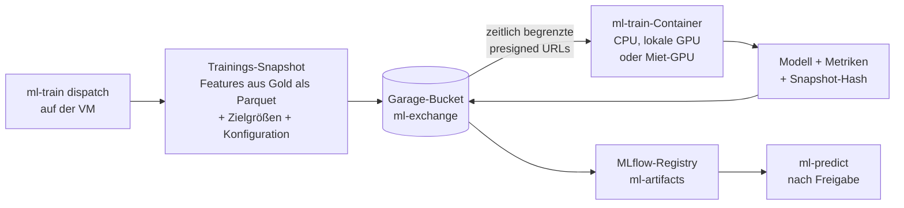

- **Eingabe:** Der Dispatcher (Unterbefehl `ml-train dispatch` im selben Image) auf der VM exportiert einen versionierten Trainings-Snapshot (Features und Zielgrößen aus Gold als Parquet, Clusterversion, Trainingskonfiguration) in den Bucket `ml-exchange`. Der Snapshot ist mit einem Hash versehen, damit sich jedes Modell genau einem Datenstand zuordnen lässt.
- **Ausführung:** lokal mit `docker compose run ml-train`, auf einem Rechner im LAN oder auf einer gemieteten GPU-Instanz (Image aus der Registry ziehen, ein Befehl mit Snapshot-URL). Der Job braucht keine Verbindung zu Postgres und keinen Zugang ins Heimnetz.
- **Zugang von außen:** Der Job bekommt nur zeitlich begrenzte presigned URLs (Lesen für den Snapshot, Schreiben für das Ergebnis), erreichbar über einen Reverse Proxy mit TLS, der nur diesen Bucket freigibt. Alternativ läuft die Verbindung über ein VPN (WireGuard bzw. Tailscale). Garage-Schlüssel mit Vollzugriff verlassen die VM nicht.
- **Ausgabe:** Modell, Metriken und Snapshot-Hash zurück nach `ml-exchange`. Der Dispatcher registriert das Ergebnis in MLflow (`ml-artifacts`). Ein Modell geht erst nach dem Vergleich mit dem aktuellen Produktionsmodell auf dem Validierungszeitraum in `production`.
- **Datenschutz:** Trainings-Snapshots für Miet-GPUs enthalten nur öffentliche Daten (Wetter, Markt, MaStR). Messwerte eigener Anlagen (7.6) werden nur lokal verarbeitet. Bei Marktplatz-Anbietern mit privaten Hosts ist das wichtig.
- **Nachtrainieren im Job:** Für ein Fine-Tuning enthält der Snapshot zusätzlich die Gewichte des Champions und die Replay-Stichprobe. Der Job gibt einen Challenger zurück, der dann den Vergleich oben durchläuft.
- **Kostenbremse:** Der Dispatcher setzt eine maximale Laufzeit je Job. Die Miet-Instanz wird nach dem Upload des Ergebnisses beendet.

### 7.8 Geplant: Wärme, Kälte und Wärmepumpen

Diese Features sind vorgemerkt. Die Architektur wird später ausgearbeitet. Schon jetzt werden aber die nötigen Wetterdaten gesammelt (siehe unten), damit beim Start eine Historie vorliegt.

| Feature | Inhalt | Horizonte |
|---|---|---|
| **Wärme- und Kältelast, Wärme- und Kältebedarf** | Prognose für ein einzelnes Gebäude sowie für ein Nah- oder Fernwärmenetz bzw. Kältenetz (Netzlast inkl. Verluste) | Folgetag, kommende 24 h und 96 h |
| **Strombedarf von Wärmepumpen** | elektrische Leistung einer Wärmepumpe aus Wärmebedarf und Leistungszahl (COP), die von Quellen- und Vorlauftemperatur abhängt | wie oben |
| **Betriebsoptimierung eines Wärmepumpen-Heizsystems** | Fahrplan für Wärmepumpe und Wärmespeicher: wann laden, wann aus dem Speicher heizen. Eingänge sind Strompreise (Day-Ahead bzw. dynamischer Tarif), Speichergröße und -füllstand, PV-Prognose der eigenen Anlage (7.6), COP aus der Wetterprognose und Komfortgrenzen. | rollierend, z. B. 24–96 h |

**Benötigte Wetterdaten** (alle im GFS-Umfang 4.3 enthalten und seit 2026-10-21 in Bronze gesammelt):

| Größe | Zweck | GFS-Feld |
|---|---|---|
| Lufttemperatur 2 m | Heiz- und Kühlgradstunden, Transmissionsverluste, COP von Luft-Wärmepumpen | `TMP:2 m above ground` |
| Taupunkt, relative Feuchte | latente Kühllast, Enthalpie, Abtauverluste von Luft-Wärmepumpen (vor allem bei 0–7 °C und hoher Feuchte) | `DPT`, `RH:2 m above ground` |
| Wind 10 m | Lüftungs- und Infiltrationsverluste, Wärmeübergang an der Fassade | `UGRD/VGRD:10 m above ground` |
| Globalstrahlung | solare Gewinne (Heizen) bzw. solare Last (Kühlen), PV-Prognose | `DSWRF:surface` |
| Langwellige Gegenstrahlung | Abstrahlung von Dach und Fassade, Nachtauskühlung | `DLWRF:surface` |
| Bewölkung, Sonnenscheindauer | Ergänzung zur Strahlung, Aufteilung direkt/diffus | `TCDC:entire atmosphere`, `SUNSD:surface` |
| Bodendruck | Enthalpie, Luftdichte | `PRES:surface` |
| Bodentemperatur 0–0,1 m und 0,1–0,4 m | Quellentemperatur von Sole-Wärmepumpen und Erdkollektoren, Verluste erdverlegter Netzleitungen | `TSOIL` |
| Schneedecke | Dämmwirkung auf dem Dach, Schnee auf PV-Modulen | `WEASD`, `SNOD` |

Für das Training braucht es mehr Historie, als die eigene Sammlung zu Beginn hat. Dafür dienen der GFS-Backfill aus dem AWS-Archiv (gleiche Felder) und ERA5 als Reanalyse (3.1).

**Weitere Daten, die später hinzukommen:** Gebäudestammdaten (beheizte Fläche, Heizlast oder Wärmeverlustkoeffizient, Wärmeabgabesystem und Vorlauftemperatur, Speichergröße), Messwerte (Wärmemengenzähler, Stromzähler der Wärmepumpe, Raum-, Vorlauf- und Rücklauftemperaturen), bei Netzen die Vorlauf- und Rücklauftemperaturen und die Zahl der Abnehmer sowie Strom- und Netzentgelt-Tarife. Die API für eigene Anlagen (7.6) ist dafür die natürliche Erweiterung (neue Typen `building`, `heat_network`, `heat_pump`). Nutzungsrechtlich gilt dasselbe wie in 7.6: abgedeckt sind eigene Gebäude und selbst betriebene Netze.

### 7.9 Analyse-Jobs

Neben Training und Inferenz braucht das Projekt immer wieder Auswertungen, die eine konkrete Frage beantworten: Wie gut ist GFS je Vorlauf? Hat sich ein Modellwechsel gelohnt? Wie weit liegen zwei Quellen auseinander? Wie hätte ein Modell im letzten Winter abgeschnitten? Solche Analysen werden strukturiert beauftragt, laufen reproduzierbar und hinterlassen einen Ergebnisordner im Repo.

**Ablauf:**

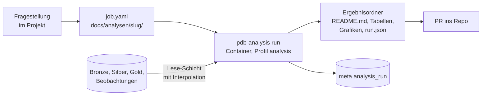

1. **Auftrag:** Die Frage wird als `job.yaml` im künftigen Ergebnisordner `docs/analysen/<slug>/` festgehalten (Beispiel unten). So ist schon vor dem Lauf klar und prüfbar, was verglichen wird.
2. **Lauf:** `pdb-analysis run docs/analysen/<slug>/job.yaml` im gemeinsamen Image (Compose-Profil `analysis`, `restart: "no"`), lokal, auf der VM oder als portabler Job wie in 7.7. Der Lauf liest nur und schreibt nichts in Produktionstabellen außer seinem Eintrag in `meta.analysis_run`.
3. **Ergebnis:** `README.md` mit Fragestellung, Methode, Ergebnis und Einschränkungen, dazu `tables/*.csv`, `figures/*.png` bzw. `.svg`, die unveränderte `job.yaml` und `run.json` (Git-Commit, Image-Version, Zeitpunkt, verwendete Läufe und Stationen samt Hashes der Eingangsobjekte). Große Zwischenergebnisse (z. B. Paare Prognose/Messung je Station) liegen als Parquet in Garage `analysis/<slug>/<run_id>/`, nicht im Repo.
4. **Übergabe:** Der Ergebnisordner kommt per PR ins Repo. Wiederkehrende Jobs (`schedule`) laufen über `maintenance` und aktualisieren ihren Ordner bzw. ein Grafana-Dashboard.

**Job-Definition** (Schema per Pydantic geprüft):

```yaml
id: gfs-v15-v16-verifikation
title: GFS v15 gegen v16, Fehler je Vorlauf
question: Wie groß sind Bias, MAE und RMSE gegenüber Stationsmessungen je Vorlauf, getrennt nach Modellversion?
requested_by: Maulwurf
kind: verification             # verification | comparison | backtest | data_quality | custom
inputs:
  forecast:
    source: gfs_0p25
    versions: [v15, v16]       # aus meta.model_version, siehe unten
    periods:
      - {version: v15, from: 2021-01-01, to: 2021-03-22T06}
      - {version: v16, from: 2022-01-01, to: 2022-03-22T06}   # gleiche Jahreszeit
    runs: [0, 6, 12, 18]
    variables: [t2m, d2m, u10, v10, prmsl, tp]
  observations:
    source: noaa_isd           # oder dwd_cdc
    stations: {country: DE, min_completeness: 0.9}
method:
  horizons_h: [0, 6, 12, 24, 36, 72, 96, 240]
  time_interpolation: linear   # erst beim Lesen; none | linear | solar (Strahlung)
  space_interpolation: bilinear
  metrics: [bias, mae, rmse, n]
  group_by: [version, variable, horizon]
outputs:
  figures: [error_by_horizon]
schedule: once                 # once | monthly | on_new_model_version
```

**Grundsätze, die sich aus der ersten Analyse ergeben haben:**

- **Speichern in nativer Zeitauflösung, interpolieren beim Lesen.** Bronze und Silber halten die Schritte so, wie die Quelle sie liefert (GFS v16: stündlich bis 120 h, danach dreistündlich; ältere Archive teils nur dreistündlich). Zeitliche Interpolation geschieht ausschließlich in der Lese-Schicht (`wxread`, gemeinsam für Analyse, Features und API) und nur auf Anforderung (`time_interpolation`). Momentanwerte werden linear interpoliert. Intervallmittel und -summen werden auf die Teilintervalle verteilt, nicht linear zwischen Stützstellen gezogen. Strahlung wird nach dem Sonnenstand verteilt. Jedes Ergebnis vermerkt, welche Werte interpoliert sind, damit Fehler bei interpolierten Vorläufen nicht mit echten Stundenwerten vermischt werden.
- **Modellversionen explizit führen.** NCEP ändert Modell, Gitter und Archivpfade mit jeder GFS-Version (v15 bis 2021-03-22 06Z unter `gfs.JJJJMMTT/HH/`, v16 ab 12Z desselben Tages unter `.../HH/atmos/`). Eine Tabelle `meta.model_version` (Quelle, Version, gültig ab bis, Archivpfad, Schrittraster) ordnet jeden Lauf einer Version zu. Feature-Pipelines, Training und Analysen können so nach Version filtern bzw. die Version als Feature nutzen.
- **Versionsvergleiche über Zeiträume, nicht über Paare.** Im AWS-Archiv gibt es keinen Lauf, der in beiden Versionen vorliegt. Ein Vergleich läuft daher über Fehlerstatistiken gleicher Jahreszeit in verschiedenen Jahren und ist entsprechend vorsichtig zu lesen (Wetterlagen unterscheiden sich von Jahr zu Jahr).
- **Beobachtungen sind eine eigene Quelle.** Für Verifikation braucht es Messwerte als „Wahrheit“: DWD CDC (Stationen DE, stündlich) und als Ausweichquelle NOAA ISD bzw. Global Hourly (SYNOP-Stationen weltweit, frei auf AWS). Sie landen im Schema `obs` (`obs.station`, `obs.value` als Hypertable mit Station, Variable, Zeit, Wert, Qualitätskennung), mit Quelle und Rang wie bei `energy.*`. Bis dahin lädt ein Analyse-Job sie selbst.

**Ergänzende Tabellen:**

```sql
CREATE TABLE meta.model_version (
  source_id smallint REFERENCES meta.source, version text,
  valid_from timestamptz, valid_to timestamptz,     -- erster und letzter Lauf
  archive_prefix text, step_grid text,              -- z. B. '0-120/1,123-384/3'
  PRIMARY KEY (source_id, version)
);
CREATE TABLE meta.analysis_run (
  run_id uuid PRIMARY KEY, job_id text NOT NULL, job_sha256 text NOT NULL,
  git_commit text, image text, started_at timestamptz, finished_at timestamptz,
  status text, result_prefix text                    -- Garage analysis/<slug>/<run_id>/
);
```

Analyse-Jobs sind bewusst einfach gehalten: eine YAML-Datei, ein Befehl, ein Ordner. Eine eigene Job-Queue oder ein Workflow-System ist erst nötig, wenn regelmäßig viele Jobs parallel laufen.

---

## 8. Deployment auf der PVE-VM

### 8.1 VM-Größe (Startwert)

| Ressource | Wert | Begründung |
|---|---|---|
| vCPU | 6–8 | GRIB-Dekodierung, Zarr-Kompression, LightGBM/CPU-Training |
| RAM | 24–32 GB | xarray auf Europa-Ausschnitten, Postgres-Cache, Training |
| Disk | 500 GB (Daten), separat 50 GB (System) | siehe 5.4; Garage-Metadaten und Postgres idealerweise auf SSD |
| OS | Debian 13 oder Ubuntu 24.04 LTS, Docker Engine + Compose-Plugin | |

### 8.2 Compose-Dienste

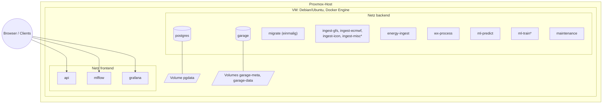

\* über Compose-Profile (`extended`, `train`) nur bei Bedarf gestartet.


```yaml
name: predictiondb

x-app: &app
  image: ghcr.io/the78mole/predictiondb:${TAG:-latest}
  env_file: .env
  restart: unless-stopped
  depends_on:
    postgres: {condition: service_healthy}
    garage:   {condition: service_started}
  networks: [backend]

services:
  postgres:
    image: timescale/timescaledb:latest-pg17     # Version im Lockfile pinnen
    volumes: [pgdata:/var/lib/postgresql/data]
    healthcheck: {test: ["CMD", "pg_isready", "-U", "postgres"], interval: 10s}
    networks: [backend]

  garage:
    image: dxflrs/garage:v2.1.0                  # vor Einsatz aktuelle Version prüfen
    volumes:
      - ./config/garage.toml:/etc/garage.toml:ro
      - garage-meta:/var/lib/garage/meta
      - garage-data:/var/lib/garage/data
    networks: [backend]

  migrate:     {<<: *app, restart: "no", command: ["alembic", "upgrade", "head"]}

  ingest-gfs:   {<<: *app, command: ["wx-ingest", "--source", "gfs_0p25"]}
  ingest-ecmwf: {<<: *app, command: ["wx-ingest", "--source", "ecmwf_ifs"]}
  ingest-icon:  {<<: *app, command: ["wx-ingest", "--source", "icon_eu", "--source", "icon_d2"]}
  ingest-misc:  {<<: *app, command: ["wx-ingest", "--source", "gefs", "--source", "gem"], profiles: ["extended"]}

  energy-ingest: {<<: *app, command: ["energy-ingest"]}
  wx-process:    {<<: *app, command: ["wx-process"]}
  ml-predict:    {<<: *app, command: ["ml-predict"]}
  ml-train:      {<<: *app, restart: "no", command: ["ml-train"], profiles: ["train"]}
  maintenance:   {<<: *app, command: ["maintenance"]}   # Lifecycle, Backups, Konsistenzprüfungen

  api:
    <<: *app
    command: ["uvicorn", "api.main:app", "--host", "0.0.0.0"]
    networks: [backend, frontend]

  mlflow:
    image: ghcr.io/mlflow/mlflow:<version>
    command: >
      mlflow server --backend-store-uri postgresql://.../mlflow
      --artifacts-destination s3://ml-artifacts --host 0.0.0.0
    networks: [backend, frontend]

  grafana:
    image: grafana/grafana-oss:<version>
    networks: [backend, frontend]

  # optional: prometheus, reverse proxy (Caddy/Traefik) mit TLS, Uptime-Kuma

volumes: {pgdata: {}, garage-meta: {}, garage-data: {}}
networks: {backend: {}, frontend: {}}
```

Bemerkungen:

- **Ein Image für alle Python-Dienste** (Multi-Stage-Build mit `uv sync --frozen --no-dev`), unterschieden nur durch den Befehl. Das vereinfacht Updates; bei Bedarf später getrennte Images (z. B. ML-Image mit PyTorch ist groß).
- Ingest je Quellfamilie als eigener Container: Ausfall oder Sperre einer Quelle betrifft die anderen nicht; einzeln skalier- und neu startbar.
- Geheimnisse (ENTSO-E-Token, Garage-Keys, DB-Passwort) in `.env` bzw. Docker Secrets; nie im Repo. Ablage und Zugriff siehe 8.3.
- Provisionierung der VM selbst: Cloud-Init-Template auf PVE oder Ansible-Rolle (Docker installieren, Repo/Compose-Datei ausrollen, `docker compose up -d`). Passt ggf. zu bestehenden Repos wie `it-infra` oder `portainers`, die ich nicht angesehen habe.
- Der aktuelle Betriebsstand (VM 108 auf PVE2, Adressen, Befehle) steht in [BETRIEB-PVE2.md](BETRIEB-PVE2.md).

### 8.3 Geheimnisse und OpenBao

Quelle der Wahrheit für alle Zugangsdaten des Stacks ist das selbst betriebene OpenBao
(`https://openbao.intern.chaintronics.com/`), **Namespace `it-infra`**, KV v2 unter `secret/`.
PredictionDB ist Eigeninfrastruktur, nicht Elektro-Glaser-Geschäft; die Namespaces
`elektro-glaser`, `the78mole-private` und `mcp_tooling` sind tabu.

| Ort | Inhalt | Zweck |
|---|---|---|
| OpenBao `it-infra`, `secret/predictiondb` | `postgres_password`, `garage_rpc_secret`, `garage_admin_token`, `s3_access_key_id`, `s3_secret_access_key`, `entsoe_token`, dazu `url`/`notes` | Quelle der Wahrheit, KeePass-artiger Datensatz |
| `.env` auf der VM (`/opt/predictiondb`, chmod 600) | dieselben Werte als `POSTGRES_PASSWORD`, `GARAGE_*`, `PDB_S3_*`, `PDB_ENTSOE_TOKEN` | Laufzeit für Docker Compose; wird aus OpenBao erzeugt, nie von Hand gepflegt |
| `.env.bao` im lokalen Checkout (chmod 600, gitignored) | `BAO_ADDR`, `BAO_NAMESPACE=it-infra`, `BAO_TOKEN` (scoped, `it-infra-rw`) | Zugriff von der Entwicklungsmaschine |
| `.envrc` (im Repo) | lädt `.env.bao` per direnv | setzt das scoped Token, bevor das Root-Token aus `~/.vault-token` greifen kann |

Regeln:

- Lokal immer über direnv arbeiten (`direnv allow` im Repo). Ohne `.envrc` fiele `bao` auf das
  Root-Token zurück; `unset BAO_TOKEN` ist daher nie die Lösung für ein `403`.
- Werte nur per stdin schreiben (`printf '%s' "$V" | bao kv patch secret/predictiondb feld=-`) und
  nur als Variable lesen (`bao kv get -field=…`), nie ausgeben.
- Neue Geheimnisse (z. B. der ENTSO-E-Token) zuerst in OpenBao, dann die `.env` der VM daraus
  erzeugen und den betroffenen Dienst neu starten.
- Die VM selbst bekommt vorerst kein OpenBao-Token; die `.env` wird von der Entwicklungsmaschine
  aus geschrieben. Bei der Cloud-Migration (Kapitel 9) ersetzt ein Agent mit eigenem, nur
  lesendem Token oder der Secret-Store des Anbieters diesen Schritt.

---

## 9. Migrationspfad in die Cloud

| Baustein | PVE (jetzt) | Cloud (später) | Was sich ändert |
|---|---|---|---|
| Objektspeicher | Garage, 1 Knoten | AWS S3, Cloudflare R2, Hetzner Object Storage oder Garage-Cluster mit 3 Knoten | nur Endpoint/Keys |
| Datenbank | TimescaleDB-Container | Timescale Cloud, oder Postgres auf k8s (CloudNativePG + Timescale) | Verbindungsstring; Migration per `pg_dump`/logischer Replikation |
| Dienste | Docker Compose | Kubernetes (Helm/Kustomize aus derselben Image-Basis) oder ECS/Cloud Run | Deployment-Manifeste |
| Scheduling | APScheduler in-process | unverändert, oder k8s CronJobs | optional |
| Training | CPU auf VM | GPU-Instanzen on demand | nur Laufumgebung |

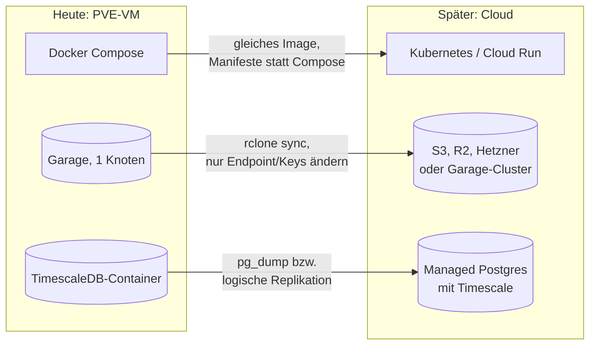

Regeln, die die Migration einfach halten: keine lokalen Dateipfade für Nutzdaten (alles über S3), keine Host-Abhängigkeiten außer Volumes für Postgres/Garage, Konfiguration ausschließlich über Umgebungsvariablen und YAML im Image bzw. ConfigMap, Zustandsführung in Postgres (Container sind austauschbar).

Datenabfluss beachten: Bei S3-Diensten mit Egress-Kosten (AWS) sollten Training und Daten im selben Rechenzentrum liegen; R2 hat keine Egress-Gebühren.

---

## 10. Betrieb und Qualität

- **Logging:** JSON über stdout, gesammelt per Docker-Logtreiber bzw. Loki.
- **Metriken:** Läufe pro Quelle vollständig/verspätet/fehlgeschlagen, Bytes je Lauf, Latenz zwischen Veröffentlichung und Ablage, Prognosefehler je Horizont.
- **Alarme:** „Kein vollständiger GFS-Lauf seit 12 h“, „ENTSO-E-Daten älter als 2 h“, „Garage-Füllstand > 80 %“.
- **Tests:** Unit-Tests für `.idx`-Parser und Range-Merging mit aufgezeichneten Fixtures; Integrationstest gegen echte Endpunkte als separater, manuell ausgelöster CI-Job (nicht in jedem Lauf, wegen Rate-Limits).
- **Analysen:** Auswertungen laufen als Analyse-Jobs mit Ergebnisordner unter `docs/analysen/` (7.9).
- **Lizenzen:** Quellenvermerke (DWD, ECMWF CC BY 4.0, SMARD/Energy-Charts CC BY 4.0, MaStR DL-DE BY 2.0) in API-Antworten und Dashboards mitführen.

---

## 11. Umsetzungsphasen

| Phase | Inhalt | Ergebnis |
|---|---|---|
| **0 – Spike** | Herbie vs. eigenes `gribkit` für GFS + ECMWF; Größen pro Lauf messen; Java-Code sichten | Entscheidung Bibliothek, belastbares Mengengerüst |
| **1 – Fundament** | uv-Workspace, Compose mit Postgres/Timescale + Garage, Alembic-Schema, `core`-Paket, CI (Lint, Tests, Image-Build) | lauffähiger leerer Stack |
| **2 – GFS-Ingest** | GFS mit NOMADS + AWS-Fallback, Bronze, Zustandsführung, Backfill ab 2021 aus AWS | durchgehende GFS-Historie |
| **3 – Energiedaten** | ENTSO-E, SMARD/Energy-Charts, MaStR-Quartalsabruf und Bestandsrekonstruktion, Feiertage | Zielgrößen, Anlagenbestand + Kalender in Gold |
| **4 – Processing** | Silber-Zarr, Anlagen-Cluster und Gitter-Gewichte (7.5), Wind-/PV-/Temperatur-Features | Feature-Tabellen |
| **4b – Anlagenprognose** | API für eigene PV-, Wind- und Wasserkraftanlagen (7.6): Stammdaten, Messwert-Upload, pvlib/windpowerlib, Abflussmodell, Kalibrierung | erste nutzbare Prognose ohne trainiertes Netz |
| **5 – Baseline-ML** | LightGBM für Last und Preis, Evaluierungs-Framework, MLflow | Referenzwerte |
| **6 – NN** | TFT/TiDE zweistufig, Quantile, Inferenzdienst, Grafana | erste produktive Prognose |
| **7 – Weitere Quellen** | ECMWF IFS/AIFS, ICON-EU/D2, GEFS, GEM; Redundanz-Features | robuster Betrieb |
| **8 – API & Härtung** | FastAPI, Auth, Alarme, Backups, Cloud-Probelauf | betriebsbereit |
| **später – Wärme/Kälte** | Wärme-/Kältelast für Gebäude und Netze, Strombedarf von Wärmepumpen, Betriebsoptimierung (7.8); Architektur noch offen | geplant |

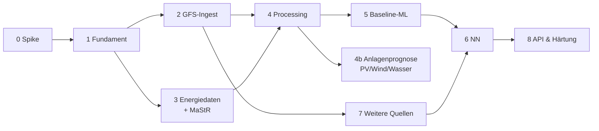

---

## 12. Offene Punkte und Entscheidungen

1. ~~Lizenz~~ **Entschieden (2026-10-20):** Business Source License 1.1 (`LICENSE`). Produktive Nutzung nur intern, für eigene Energieanlagen an eigenen Standorten; ausgeschlossen sind SaaS für Dritte, Steuerung fremder Anlagen, kommerzielles Flottenmanagement und der Verkauf von Prognosedaten. Change Date vier Jahre nach Veröffentlichung, Change License AGPL-3.0-or-later. Lizenzgeber: Daniel (the78mole) Glaser; ein späterer Übergang der kommerziellen Lizenzierung auf die Bizzmark UG (haftungsbeschränkt) ist offen.
2. ~~Verhältnis zu PredictionDB~~ **Entschieden (2026-10-20):** Das Projekt wird im Repo `the78mole/PredictionDB` fortgeführt. Dieser Entwurf liegt dort als `docs/ARCHITEKTUR.md` und ersetzt die Teile der `SPECIFICATION.md` v0.1, die ihm widersprechen (MariaDB, Gitterwerte als Zeilen, Celery).
3. **Kommerzielle Nutzung?** Entscheidet, ob Open-Meteo produktiv genutzt werden darf und ob bestimmte Lizenzauflagen (ENTSO-E-Bedingungen) relevant werden.
4. **Zielauflösung des Preises:** 15 min (aktueller Markt) oder Stunde (einfacher, längere homogene Historie)? Vorschlag: 15 min als Ausgabe, Training mit Stundenmitteln vor Okt. 2025 und Upsampling-Kennzeichnung.
5. **Ausschnitt:** Nur DE oder Mitteleuropa (Nachbarländer beeinflussen Preis über Kuppelflüsse)? Vorschlag: 44–58° N, 0–20° E.
6. **GPU:** Steht auf einem PVE-Host eine GPU für Passthrough bereit (bekannt für PVE2: 12 Threads, 62 GB RAM, GPU unbekannt)? Ohne lokale GPU startet das Training auf CPU, Hyperparameter-Suchen laufen auf stundenweise gemieteten GPUs (7.7).
7. Zu verifizierende Detailwerte vor der Implementierung: exakte NOMADS-Rate-Limits, aktuelle Vorhaltezeiten auf opendata.dwd.de und data.ecmwf.int, Beginn der Archive auf AWS, aktuelle Garage- und TimescaleDB-Versionen, Zugang und Lizenz von GloFAS/EFAS sowie Schnittstellen der Pegelportale der Länder.
8. **Anlagen-API (7.6):** Nur eigene Anlagen oder auch Anlagen weiterer Nutzer? Mehrere Nutzer bzw. fremde Anlagen fallen nicht unter den Additional Use Grant (nur intern). Lizenz der Turbinen-Leistungskurven (oedb) vor Übernahme prüfen.
