# Strompreisprognose – Architekturentwurf

**Version:** 0.4 (Entwurf) · **Stand:** 2026-10-20 · **Status:** zur Diskussion

---

## 0. Kurzfassung

- **Ziel:** Ein Docker-Compose-Stack auf einer PVE-VM, der Wettervorhersagen (allen voran NOAA GFS 384 h) per GRIB-Partial-Download lädt, platzsparend ablegt, mit Last-, Erzeugungs- und Preisdaten für Deutschland (Gebotszone DE-LU) zusammenführt und daraus ein neuronales Netz für **Strombedarf** und **Day-Ahead-Preis** trainiert und betreibt.
- **Speicher in drei Stufen (Medaillon):**
  1. **Bronze:** zugeschnittene Original-GRIB2-Ausschnitte (Europa/DE-Box, nur benötigte Variablen) in **Garage (S3)**. Quelle der Wahrheit, jederzeit neu auswertbar.
  2. **Silber:** einheitliches Gitter je Lauf als **Zarr** (float16/Scale-Offset + Zstd) in Garage. Grundlage für Training und Regionen-Aggregation.
  3. **Gold:** aggregierte Feature-Zeitreihen (DE-weit und je Regelzone/Bundesland, kapazitäts- bzw. bevölkerungsgewichtet) plus Energie-Marktdaten in **PostgreSQL + TimescaleDB** (komprimierte Hypertables).
- **Gitterdaten gehören nicht zeilenweise in die Datenbank.** Eine Zeile pro Gitterpunkt × Variable × Zeitschritt × Lauf (wie im bestehenden PredictionDB-Entwurf) würde allein für GFS über Deutschland mehrere Milliarden Zeilen pro Jahr erzeugen (Rechnung in 5.4).
- **Repository:** `the78mole/PredictionDB` (Nachfolger der dortigen `SPECIFICATION.md` v0.1).
- **Python mit uv**, ein uv-Workspace mit mehreren Paketen; jeder Dienst ein eigenes, schlankes Image.
- **Cloud-Migration** ist von Anfang an mitgedacht: nur S3-API, Postgres-Protokoll und 12-Factor-Konfiguration. Garage → AWS S3/R2/Hetzner, Postgres → Managed Postgres (Timescale Cloud o. Ä.), Compose → Kubernetes/Nomad.

---

## 1. Ausgangslage

### 1.1 Vorgaben (aus dem Projekt-Thread)

| Vorgabe | Umsetzung im Entwurf |
|---|---|
| GRIB-Downloader neu in Python mit uv | uv-Workspace, Paket `wx-ingest` (Kap. 6) |
| Möglichst alle Quellen, nur kostenfreie, auch zur Redundanz | Quellenmatrix mit Primär-/Ausweich-Endpunkten je Modell (Kap. 3) |
| Zunächst separate VM auf PVE, alles in Docker, provisioniert per Docker Compose | Compose-Stack (Kap. 8) |
| Spätere Cloud-Migration | Kap. 9 |
| S3 über Garage, einzelner Knoten genügt | Garage Single-Node, `replication_factor = 1` (Kap. 5.2) |

### 1.2 Vorhandene Grundlagen in den Repos

Als Vorlage dient ein Altsystem aus den Jahren 2012/2013 (Java/OSGi-Clients und serverseitige Shell/CGI-Skripte). Es wird nur konzeptionell ausgewertet, Code wird nicht übernommen.

| Teil des Altsystems | Inhalt | Bedeutung für dieses Projekt |
|---|---|---|
| GRIB-Bundle (Java) | UCAR GRIB-Java 8.0.29, öffnet Dateien nur, kein Parser, kein Downloader. Vier Testdateien: GFS 1,0° 2-m-Temperatur 2012-12-20 00Z (3–192 h), GDAS-Analyse, Nordeuropa-Wind (GRIB1). | Kein Code; Testdateien eignen sich als Fixtures |
| Wetter-Client (Java) | HTTP-Client für den damaligen GFS-Archivserver | Zeigt die damalige Schnittstelle (siehe unten) |
| Assessments (Java) | Bewerten, wie ähnlich ein historischer Tag dem Prognosetag ist (2-m-Temperatur, Globalstrahlung DSWRF), damit die Verbrauchsprognose ähnliche Tage stärker gewichtet | Analog-Tag-Idee als Baseline/Feature (7.3) |
| Server-Dokumentation | Beschreibung der Download- und Abfrageskripte (2012/2013); die Skripte selbst sind nicht erhalten | Ablauf und Lehren, siehe unten |

**Wichtigster Befund:** Einen Java-GRIB-Downloader gab es nicht. Herunterladen und Zerlegen liefen serverseitig in Shell/CGI-Skripten. Die Java-Bundles waren nur Clients dieses Servers:

- `grib_finished.txt`: Liste vollständig geladener Läufe (`yyyyMMddHH`, eine Zeile je Lauf).
- `cgi-bin/get_cgi_data.sh?<inventarID|Kurzname>&<Ort|lon,lat>&<Lauf>`: Zeitreihe eines Parameters an einem Ort, Textformat `# Date: yyyyMMddHH`, dann Zeilen `<Vorlauf h>:<…>:<Wert>`; `?idlist`, `?loclist`, `?help`.
- Datenbasis: GFS global 1,0°, 3-h-Schritte bis 192 h, eine Datei je Lauf und Parameter (`2012122000_195.grb`).
- Ablauf: Cron `20 0,6,12,18 * * *` startete das Download-Skript. Die Daten kamen von NOAA `…/gfs/prod/`, ab August 2013 vom NOMADS-Mirror. Geladen wurde per curl mit **einem Range-Request je GRIB-Nachricht**, das waren ca. 4 200 Requests und etwa 1,5 h je Lauf. Die Werte für einen Punkt holte ein C-Programm (grib_api) heraus.
- Die Konfiguration führte die abzurufenden Parameter als Inventar-Nummern und prüfte, ob NOAA das Produktlayout geändert hatte. Das bestätigt, dass Inventar-Nummern brüchig sind. Neu wird deshalb über Kurzname und Level adressiert (6.5).
- Für Stationsdaten gab es zusätzlich einen DWD-Abruf. Dem entspricht im neuen Entwurf die DWD-CDC-Quelle als Wetter-„Wahrheit“ (3.1).

Lehren für den Neubau: benachbarte Byte-Bereiche zu wenigen Requests zusammenfassen bzw. den NOMADS-Grib-Filter nutzen (4.1). So schrumpfen die ~4 200 Requests auf einige Hundert je Lauf. Außerdem den Platz vor dem Download prüfen und Läufe erst nach Vollständigkeit freigeben (damals `grib_finished.txt`, neu `meta.nwp_run`).

**Spätere Ausbaustufe (2014):** Statusmails aus dem Jahr 2014 zeigen, dass das Altsystem die GFS-Punktwerte später zusätzlich in eine MySQL-Tabelle schrieb (Spalten etwa `id, meta_id, time, Wert`, Metadaten über `meta_id`), statt sie nur bei Abfrage aus den GRIB-Dateien zu lesen. Das ist dieselbe Idee wie `datapoints_*` in der `SPECIFICATION.md` und wie die Gold-Schicht hier. Der Neubau geht aber deutlich weiter: Gitterdaten bleiben als GRIB2/Zarr in Garage, und nur abgeleitete Punkt- und Regionsreihen landen in TimescaleDB-Hypertables mit Kompression (5.3, 5.4). Der Ansatz von 2014 dient nur als Bestätigung des Musters, nicht als Vorlage für das Schema.

Ebenfalls ausgewertet:

| Repo | Inhalt | Bedeutung für dieses Projekt |
|---|---|---|
| `the78mole/PredictionDB` (privat) | Nur `SPECIFICATION.md` v0.1 (Juli 2026): MariaDB + Python-Worker mit Plugin-Konzept je Quelle, Tabellen `pdid_registry` und `datapoints_{int,float,varchar}`, Schlüssel `(pdid, lat, lon, timestamp, offset)`; als Schnittstelle für ein Prognosesystem gedacht. | Direkter Vorläufer. Plugin-Idee, PDID-Register und die Semantik „Gültigkeitszeit + Vorlauf, negativer Offset = Messung“ übernehme ich. Das zeilenweise Speichern von Gitterwerten und MariaDB ersetze ich (Begründung in 5.4). |
| `the78mole/test-meteo` | Streamlit-Demo, Open-Meteo-Abfrage für Wind in 120 m bei Cuxhaven | Bestätigt Open-Meteo als Schnellstart-Quelle |
| `the78mole/eprice-demo` | Rust-Demo, Day-Ahead-Preise DE über `api.energy-charts.info` | Bestätigt Energy-Charts als Preisquelle |

Hinweis zu PredictionDB: Die dort genannte NOMADS-URL `filter_gdas1.pl` bezieht sich auf GDAS (Analyse-System, nur kurze Vorläufe). Für die 384-h-Prognosen ist **GFS** (`filter_gfs_0p25.pl` bzw. `filter_gfs_0p25_1hr.pl`) die richtige Quelle. Die dort aufgeführten „GRIB IDs“ (11, 12, 33 …) sind GRIB1-Parameternummern; GRIB2 wird über Kurznamen + Level (`TMP:2 m above ground`) adressiert.

---

## 2. Gesamtbild

### 2.1 Systemkontext

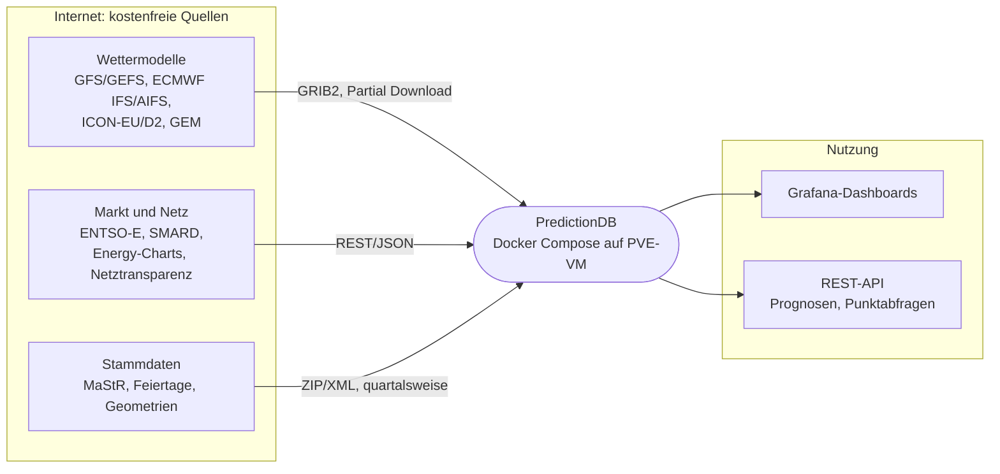

### 2.2 Dienste und Datenflüsse

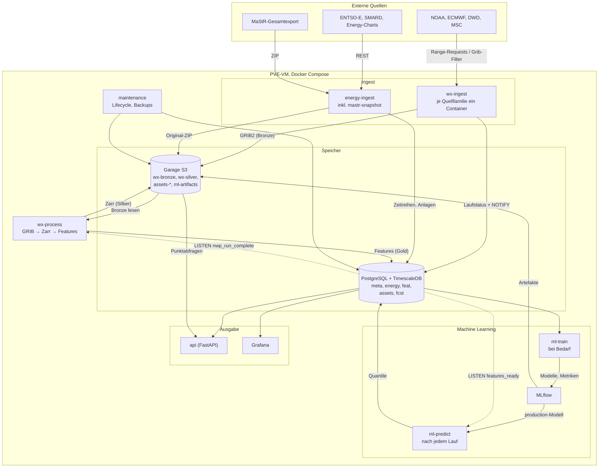

Grundprinzipien:

1. **Idempotent und wiederaufsetzbar.** Jeder Schritt ist über `(quelle, modell, lauf, schritt, variable)` eindeutig adressiert. Ein Neustart holt nur fehlende Teile nach.
2. **Entkopplung über Zustände in Postgres statt Message-Broker.** Ingest schreibt „Lauf X vollständig in Bronze“, Process pollt bzw. lauscht per `LISTEN/NOTIFY`. Kein RabbitMQ/Redis nötig. Wenn später nötig, lässt sich ein Broker ergänzen.
3. **Rohdaten bleiben erhalten.** Feature-Definitionen ändern sich während der ML-Entwicklung ständig; Bronze erlaubt Neuberechnung ohne erneuten Download (viele Quellen halten Daten nur Stunden bis Tage vor).
4. **Prognose so speichern, wie sie zum Entscheidungszeitpunkt bekannt war** (Lauf + Vorlauf). Sonst entsteht beim Training Daten-Leakage.

---

## 3. Datenquellen (nur kostenfrei)

### 3.1 Numerische Wettermodelle

| Modell | Betreiber | Auflösung | Läufe/Tag | Horizont | Zugang (Primär → Ausweich) | Partial-Download-Mechanik | Lizenz | Vorhaltezeit Quelle |
|---|---|---|---|---|---|---|---|---|
| **GFS** | NOAA/NCEP | 0,25° | 4 (00/06/12/18Z) | **384 h** (stündl. bis 120 h, dann 3-stündl.) | NOMADS Grib-Filter → AWS `noaa-gfs-bdp-pds` → Google Cloud `global-forecast-system` → Azure | NOMADS: serverseitig Variablen + Subregion; Clouds: `.idx`-Datei → HTTP-Range | Public Domain | NOMADS ~10 Tage; AWS Archiv ab 2021 |
| **GEFS** (Ensemble) | NOAA/NCEP | 0,25° / 0,5° | 4 | 384 h (Kontrolle + 30 Member) | NOMADS → AWS `noaa-gefs-pds` | wie GFS | Public Domain | wie GFS |
| **ECMWF IFS (Open Data)** | ECMWF | 0,25° | 4 (00/12Z lang, 06/18Z kurz) | 360 h (00/12Z), 144 h (06/18Z) | `data.ecmwf.int` → AWS `ecmwf-forecasts` → Azure / Google | `.index` (JSON-Zeilen mit Offset/Länge) → HTTP-Range; Python-Paket `ecmwf-opendata` | CC BY 4.0 | Portal wenige Tage; AWS-Archiv länger |
| **ECMWF AIFS** | ECMWF | 0,25° | 4 | 360 h | wie IFS | wie IFS | CC BY 4.0 | wie IFS |
| **ICON-EU** | DWD | 0,0625° (~6,5 km), regulär | 8 | 120 h (00/06/12/18Z), sonst 30 h | `opendata.dwd.de` | eine Datei je Variable/Schritt (bz2) → nur gewünschte Dateien laden | DWD Open Data (Quellenvermerk) | **ca. 24 h** – muss zeitnah gezogen werden |
| **ICON-D2** | DWD | ~2,2 km | 8 | 48 h | `opendata.dwd.de` | wie ICON-EU (zusätzlich `regular-lat-lon`-Variante) | wie oben | ca. 24 h |
| **ICON (global)** | DWD | ~13 km, Ikosaeder | 4 | 180 h (00/12Z) | `opendata.dwd.de` | je Variable; Regridding nötig | wie oben | ca. 24 h |
| **GEM Global** | Environment Canada (MSC) | 15 km / 0,24° | 2 | 240 h | MSC Datamart `dd.weather.gc.ca` | je Variable/Schritt eine Datei | Open Government Licence Canada | ca. 24 h |
| **ARPEGE / AROME** | Météo-France | 0,1° / 0,025° | 4 / 8 | 102 h / 51 h | `portail-api.meteofrance.fr` | Paketweise | Etalab 2.0, **kostenloser API-Schlüssel nötig** | kurz |
| **Open-Meteo** | Open-Meteo (Aggregator) | je Modell | – | bis 16 Tage | `api.open-meteo.com` | Punkt-JSON | CC BY 4.0, **nichtkommerziell frei** | Historical-Forecast-API ab 2021/22 |

Empfehlung zur Reihenfolge der Umsetzung:

1. **GFS** (Kernanforderung, längster Horizont, Archiv auf AWS für Backfill).
2. **ECMWF IFS Open Data** (bestes globales Modell; wichtigster Redundanzpartner).
3. **ICON-EU / ICON-D2** (beste Auflösung für DE in den ersten 2–5 Tagen, wo der Day-Ahead-Preis entsteht).
4. GEFS / AIFS / GEM / ARPEGE als Ergänzung bzw. für Unsicherheits-Features.
5. **Open-Meteo** nur für Prototyping und Backfill der Historie (Historical-Forecast-API), nicht als Produktionsquelle, solange die Nutzung kommerziell werden könnte.

Für das **Training** wird Historie benötigt. Archiv-Optionen:

| Zweck | Quelle | Bemerkung |
|---|---|---|
| Historische GFS-Prognosen | AWS `noaa-gfs-bdp-pds` (ab ~2021), NCEI-Archiv (älter) | per `.idx`-Range wie im Live-Betrieb |
| Historische ECMWF-Open-Data-Prognosen | AWS `ecmwf-forecasts` (ab ~2023) | Umfang vorher prüfen |
| Wetter-„Wahrheit“ | ERA5 über Copernicus CDS (kostenloses Konto), DWD-Stationsdaten (CDC) | für Bias-Korrektur und als Ziel bei Hilfsmodellen |
| Schnell-Backfill Punktdaten | Open-Meteo Historical Forecast API | gut für erste Modelle |

### 3.2 Energie- und Marktdaten (Deutschland, Gebotszone DE-LU)

| Daten | Quelle | Zugang | Auflösung | Lizenz |
|---|---|---|---|---|
| Day-Ahead-Preis DE-LU | ENTSO-E Transparency Platform; SMARD (BNetzA); Energy-Charts (Fraunhofer ISE) | ENTSO-E: kostenloser Token per Registrierung; SMARD/Energy-Charts: offen | 15 min (seit Umstellung der SDAC auf 15-min-Produkte im Okt. 2025), davor 60 min | ENTSO-E-Nutzungsbedingungen; CC BY 4.0 |
| Netzlast ist und Prognose (Day-Ahead) | ENTSO-E; SMARD | wie oben | 15 min | wie oben |
| Erzeugung je Energieträger (ist) | ENTSO-E; SMARD; Energy-Charts | wie oben | 15 min | wie oben |
| Wind-/PV-Prognosen der ÜNB | Netztransparenz.de; ENTSO-E | Netztransparenz: kostenlose OAuth-Registrierung | 15 min | frei |
| Grenzkuppelflüsse, Nachbar-Preise | ENTSO-E | Token | 15/60 min | – |
| Installierte Leistung je Standort | Marktstammdatenregister (MaStR), Gesamtdatenexport | offen | Stichtag | DL-DE BY 2.0 |
| Kraftwerksnichtverfügbarkeiten | ENTSO-E (Unavailability) | Token | Ereignis | – |
| Feiertage, Schulferien | Python `holidays`; Ferien-API bzw. statische Tabellen | offen | Tag | – |

Bekannte Lücke: **Brennstoff- und CO₂-Preise** (TTF-Gas, EUA) sind als Echtzeitdaten nicht verlässlich kostenlos zu bekommen. Für den Anfang reicht eine tägliche, verzögerte Reihe (z. B. aus frei veröffentlichten Tagesschlusskursen bzw. Energy-Charts, falls verfügbar). Das wird in Phase 3 geklärt; das Modell funktioniert auch ohne, verliert aber bei Preisregimewechseln an Güte.

### 3.3 Redundanzkonzept

- Je **Modell** mehrere Endpunkte (siehe Tabelle) mit fester Reihenfolge und Circuit-Breaker. Fällt NOMADS aus oder drosselt, geht derselbe Lauf über AWS.
- Je **Zielgröße** mehrere Modelle. Fällt ein Modell ganz aus, rechnet das ML-Modell mit den übrigen weiter (Masking-Features „Quelle verfügbar“, siehe 7.3).
- Je **Energiedatensatz** zwei Quellen (ENTSO-E und SMARD/Energy-Charts) mit Plausibilitätsabgleich.

---

## 4. GRIB-Partial-Download im Detail

### 4.1 Zwei Mechaniken

**a) Serverseitiger Filter (NOMADS Grib-Filter)**

```
https://nomads.ncep.noaa.gov/cgi-bin/filter_gfs_0p25_1hr.pl
  ?dir=/gfs.20261020/12/atmos
  &file=gfs.t12z.pgrb2.0p25.f042
  &var_TMP=on&var_UGRD=on&var_VGRD=on&var_DSWRF=on&var_TCDC=on
  &lev_2_m_above_ground=on&lev_10_m_above_ground=on&lev_100_m_above_ground=on&lev_surface=on
  &subregion=&toplat=58&bottomlat=44&leftlon=0&rightlon=20
```

Vorteil: kleinste Übertragung (nur Variablen und Ausschnitt). Nachteil: NOMADS drosselt bzw. sperrt IPs bei zu vielen Anfragen pro Minute. Konservatives Rate-Limit einplanen (Größenordnung ≤ 1 Anfrage/s; Grenzwert vor Inbetriebnahme verifizieren) und die Anzahl der Anfragen klein halten (alle Variablen eines Schritts in einer Anfrage).

**b) Index-basierte HTTP-Range-Requests (AWS/GCS/Azure, ECMWF)**

1. `…/gfs.t12z.pgrb2.0p25.f042.idx` laden. Zeilen der Form `<n>:<byte_offset>:d=<lauf>:<VAR>:<LEVEL>:<fcst>:`.
2. Gewünschte Nachrichten per Regex auf `VAR:LEVEL` wählen; Länge = Offset der nächsten Zeile minus eigener Offset.
3. Benachbarte Bereiche zusammenfassen und mit einem Multi-Range- bzw. mehreren parallelen Range-Requests laden.
4. Global geladenes Feld lokal auf die Europa-Box zuschneiden, bevor es nach Bronze geht.

ECMWF Open Data liefert statt `.idx` eine `.index`-Datei mit JSON-Zeilen (`_offset`, `_length`, `param`, `levtype`, `step` …); gleiche Logik.

DWD und MSC bieten pro Variable und Schritt eigene Dateien an; dort ist der „Partial Download“ einfach die Auswahl der Dateien.

Ablauf eines index-basierten Downloads je Prognoseschritt:

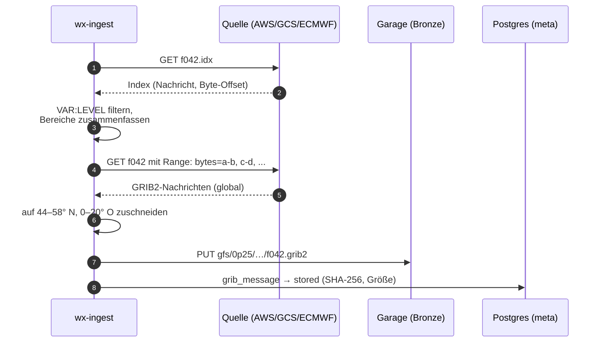

### 4.2 Inventarisierung und Vollständigkeit

Für jeden Lauf wird erwartet, welche Nachrichten kommen (aus der Quellen-Konfiguration abgeleitet). Tabelle `meta.grib_message` (Kap. 5.3) führt Status je Nachricht: `pending → downloaded → stored → processed`. Ein Lauf gilt als vollständig, wenn alle erwarteten Nachrichten mindestens `stored` sind. Verspätete Schritte (GFS veröffentlicht über ca. 1,5 h hinweg schrittweise) werden durch periodisches Nachpollen geholt; erst danach wird der Lauf an `wx-process` übergeben (Teilübergabe für frühe Schritte optional).

Zustände eines Laufs (`meta.nwp_run.status`):

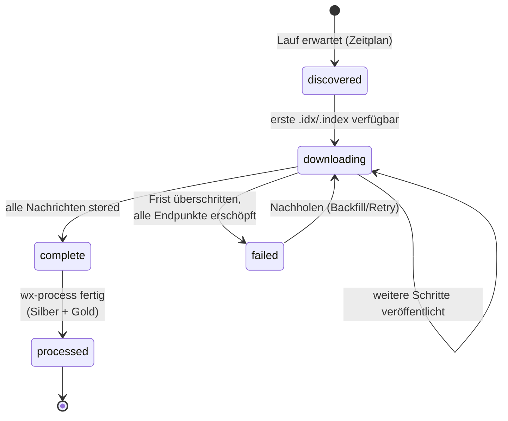

Zustände einer einzelnen Nachricht (`meta.grib_message.status`):

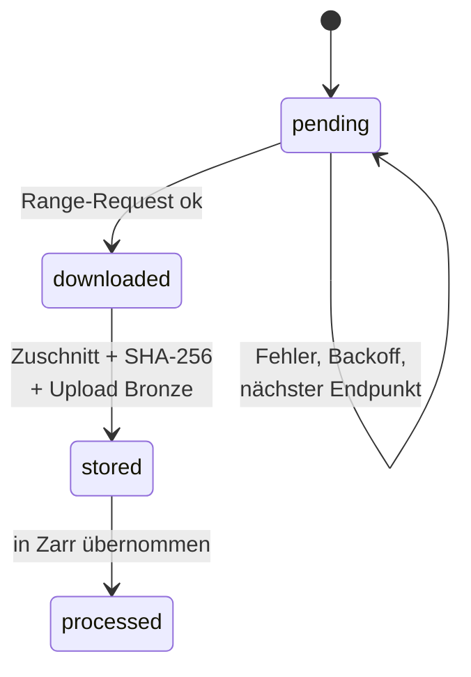

### 4.3 Vorschlag Variablenumfang (Start)

| Zweck | GFS-Kurzname : Level | ECMWF `param` | ICON |
|---|---|---|---|
| Temperatur (Last: Heizen/Kühlen) | `TMP:2 m above ground` | `2t` | `t_2m` |
| Taupunkt/Feuchte | `DPT:2 m above ground` / `RH:2 m` | `2d` | `td_2m` |
| Wind 10 m | `UGRD/VGRD:10 m above ground` | `10u/10v` | `u_10m/v_10m` |
| Wind 100 m (Nabenhöhe) | `UGRD/VGRD:100 m above ground` | `100u/100v` | (über Modellflächen; vorerst 10 m + Böen) |
| Böen | `GUST:surface` | `10fg` | `vmax_10m` |
| Globalstrahlung | `DSWRF:surface` | `ssrd` (akkumuliert) | `aswdir_s` + `aswdifd_s` |
| Bewölkung | `TCDC:entire atmosphere` | `tcc` | `clct` |
| Niederschlag / Schnee | `APCP`, `CSNOW` | `tp`, `sf` | `tot_prec` |
| Bodendruck | `PRMSL:mean sea level` | `msl` | `pmsl` |

Ausschnitt: **44–58° N, 0–20° E** (DE plus Nachbarn, relevant für Kuppelflüsse und Wetterlagen). Bei GFS 0,25° sind das 57 × 81 = 4 617 Gitterpunkte.

---

## 5. Speicherung

### 5.1 Drei Stufen

| Stufe | Format | Ort | Inhalt | Zweck |
|---|---|---|---|---|
| **Bronze** | GRIB2 (Original-Codierung, zugeschnitten) | Garage `wx-bronze` | eine Datei je `modell/lauf/schritt` | Unveränderliche Quelle, Neuberechnung, Audit |
| **Silber** | Zarr v3, Chunks `(lauf, schritt, var, lat, lon)`, float16 bzw. Int16 mit Scale/Offset, Zstd | Garage `wx-silver` | ein Zarr-Store je Modell, Läufe angehängt | Schneller Zugriff für Training, Regridding auf gemeinsames Gitter |
| **Gold** | TimescaleDB-Hypertables, native Kompression | Postgres | Features je Region × Lauf × Gültigkeitszeit, Energiedaten, Prognosen | ML-Eingang, API, Grafana |

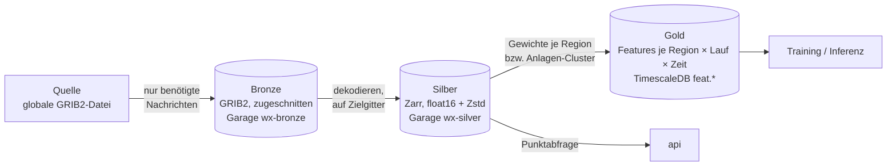

Objekt-Schlüssel (Bronze), sprechend und partitionierbar:

```
wx-bronze/gfs/0p25/2026/10/20/12/f042.grib2
wx-bronze/ecmwf-ifs/0p25/2026/10/20/00/s144.grib2
wx-bronze/icon-eu/2026/10/20/06/t_2m/s017.grib2
```

### 5.2 Garage (Single Node)

- Image `dxflrs/garage`, `replication_factor = 1`, ein Datenverzeichnis und ein Metadatenverzeichnis auf getrennten Volumes (Metadaten möglichst auf SSD).
- Buckets: `wx-bronze`, `wx-silver`, `ml-artifacts` (MLflow), `backups` (pg_dump/WAL-G).
- Zugriff ausschließlich über S3-API (`obstore` oder `s3fs`/`fsspec`), Endpoint, Region und Keys aus Umgebungsvariablen. Damit ist der Wechsel zu jedem S3-kompatiblen Dienst reine Konfiguration.
- Lebenszyklus: Bronze für GFS z. B. 2 Jahre vollständig, danach nur 00Z/12Z behalten; Silber unbegrenzt (klein). Garage unterstützt Lifecycle-Regeln nur eingeschränkt, daher Aufräumjob im `maintenance`-Container.
- Hinweis: Single Node heißt **keine Redundanz auf Speicherebene**. Backups der Buckets auf ein zweites Ziel (anderer PVE-Storage oder externes S3) über `rclone` einplanen, sobald Daten wertvoll werden (z. B. weil Quellen sie nicht mehr vorhalten).

### 5.3 Datenbank: PostgreSQL + TimescaleDB statt MariaDB

Begründung gegenüber dem PredictionDB-Entwurf:

- **Native spaltenorientierte Kompression** der Hypertables (typisch 90–95 % Ersparnis bei Zeitreihen). MariaDB bietet nichts Vergleichbares ohne Zusatz-Engine.
- Continuous Aggregates (z. B. 15 min → Stunde/Tag) und Retention-Policies eingebaut; ersetzt den eigenen Cleanup-Container.
- `LISTEN/NOTIFY` für die Entkopplung der Dienste.
- Gute Cloud-Optionen (Timescale Cloud, oder Managed Postgres mit Timescale-Apache-Variante bzw. Self-Hosting auf k8s).

Schemas (Auszug):

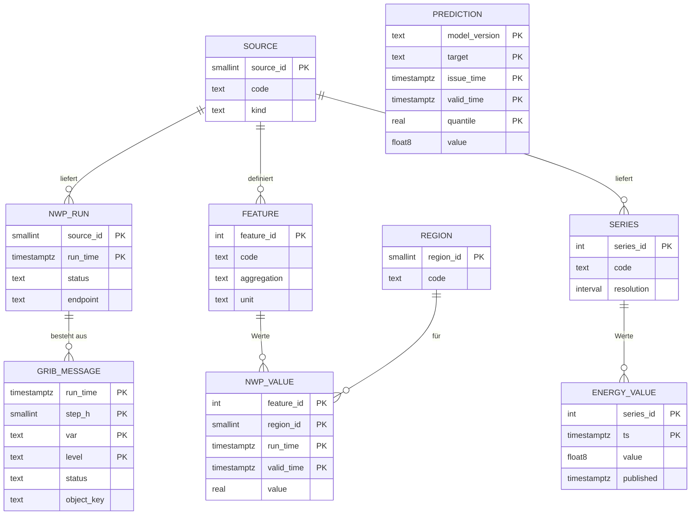


```sql
-- meta: was wurde wann woher geladen
CREATE TABLE meta.source (
  source_id    smallserial PRIMARY KEY,
  code         text UNIQUE NOT NULL,      -- 'gfs_0p25', 'ecmwf_ifs', 'icon_eu', 'entsoe', ...
  kind         text NOT NULL,             -- 'nwp' | 'energy' | 'static'
  license      text
);

CREATE TABLE meta.nwp_run (
  source_id    smallint REFERENCES meta.source,
  run_time     timestamptz NOT NULL,
  status       text NOT NULL,             -- 'discovered'|'downloading'|'complete'|'processed'|'failed'
  endpoint     text,                      -- tatsächlich genutzter Endpunkt (Redundanz nachvollziehbar)
  n_expected   int, n_stored int,
  bytes_stored bigint,
  updated_at   timestamptz DEFAULT now(),
  PRIMARY KEY (source_id, run_time)
);

CREATE TABLE meta.grib_message (
  source_id smallint, run_time timestamptz, step_h smallint,
  var text, level text,
  status text NOT NULL, object_key text, sha256 bytea, size_bytes int,
  PRIMARY KEY (source_id, run_time, step_h, var, level)
);

-- Register der Merkmale (übernimmt die PDID-Idee aus PredictionDB)
CREATE TABLE meta.feature (
  feature_id   serial PRIMARY KEY,
  source_id    smallint REFERENCES meta.source,
  code         text NOT NULL,             -- 'temperature_2m', 'wind_power_index_100m', ...
  aggregation  text NOT NULL,             -- 'pop_weighted', 'wind_cap_weighted', 'pv_cap_weighted', 'area_mean'
  unit         text NOT NULL,
  UNIQUE (source_id, code, aggregation)
);

CREATE TABLE meta.region (
  region_id smallserial PRIMARY KEY,
  code text UNIQUE NOT NULL               -- 'DE', 'DE-50Hertz', 'DE-Amprion', 'DE-TenneT', 'DE-TransnetBW', 'DE-BY', ...
);

-- feat: Wetter-Features (Gold). Lead-Time explizit, wie in PredictionDB (offset)
CREATE TABLE feat.nwp_value (
  feature_id int      NOT NULL,
  region_id  smallint NOT NULL,
  run_time   timestamptz NOT NULL,
  valid_time timestamptz NOT NULL,
  value      real NOT NULL,
  PRIMARY KEY (feature_id, region_id, run_time, valid_time)
);
SELECT create_hypertable('feat.nwp_value', 'valid_time', chunk_time_interval => interval '7 days');
ALTER TABLE feat.nwp_value SET (timescaledb.compress,
  timescaledb.compress_segmentby = 'feature_id, region_id',
  timescaledb.compress_orderby   = 'run_time, valid_time');

-- energy: Ist-Werte und offizielle Prognosen
CREATE TABLE energy.series (
  series_id serial PRIMARY KEY,
  source_id smallint, code text, unit text, resolution interval,
  UNIQUE (source_id, code)
);   -- 'da_price_de_lu', 'load_actual', 'load_da_forecast', 'gen_wind_onshore', ...

CREATE TABLE energy.value (
  series_id  int NOT NULL,
  ts         timestamptz NOT NULL,
  value      double precision,
  published  timestamptz,                 -- wann war der Wert bekannt (Leakage-Schutz)
  PRIMARY KEY (series_id, ts)
);
SELECT create_hypertable('energy.value', 'ts');

-- fcst: eigene Prognosen, je Modellversion und Quantil
CREATE TABLE fcst.prediction (
  model_version text, target text, issue_time timestamptz, valid_time timestamptz,
  quantile real, value double precision,
  PRIMARY KEY (model_version, target, issue_time, valid_time, quantile)
);
SELECT create_hypertable('fcst.prediction', 'valid_time');
```

Unterschied zu PredictionDB: Statt `(lat, lon, timestamp, offset)` steht hier `(region, run_time, valid_time)`. `run_time` ist eindeutig und erspart Rückrechnungen; die Vorlaufzeit ist `valid_time − run_time`. Messungen landen nicht mit negativem Offset in derselben Tabelle, sondern in `energy.value` bzw. einer eigenen `obs`-Tabelle. Das hält die Gitter-/Feature-Tabelle homogen und klein.

### 5.4 Mengengerüst

GFS, Ausschnitt 4 617 Punkte, 10 Variablen, 209 Schritte (0–120 h stündlich = 121, 123–384 h dreistündlich = 88), 4 Läufe/Tag:

| Ablage | Rechnung | pro Jahr |
|---|---|---|
| Zeilen je Gitterwert in SQL (PredictionDB-Ansatz) | 4 617 × 10 × 209 × 4 × 365 ≈ **14 Mrd. Zeilen**; bei ~40–60 B/Zeile inkl. Index | **~600–850 GB** (nur GFS) |
| Bronze GRIB2 (zugeschnitten, GRIB-Packing ~1–1,5 B/Wert) | 9,6 Mio. Werte/Lauf ≈ 10–15 MB/Lauf | **~15–22 GB** |
| Silber Zarr float16 + Zstd (~1 B/Wert) | ≈ 8–10 MB/Lauf | **~12–15 GB** |
| Gold Features (z. B. 40 Features × 10 Regionen × 209 Schritte × 4 Läufe) | 120 Mio. Zeilen, komprimiert ~2–4 B/Wert | **~0,5 GB** |

Mit ECMWF, ICON-EU (höhere Auflösung, aber kürzerer Horizont) und GEFS-Mittel/Streuung liegt die Gesamtmenge realistisch bei **100–200 GB pro Jahr**. Eine VM-Platte von 500 GB reicht für die ersten zwei Jahre. Die Werte sind Abschätzungen und werden nach dem ersten Betriebsmonat durch Messung ersetzt (`meta.nwp_run.bytes_stored`).

---

## 6. Software-Struktur (Python, uv)

### 6.1 Repository-Layout (Vorschlag, ein Monorepo als uv-Workspace)

```
PredictionDB/
├── pyproject.toml              # [tool.uv.workspace] members = ["packages/*", "services/*"]
├── uv.lock
├── compose.yaml                # + compose.override.yaml (dev), compose.prod.yaml
├── .env.example
├── config/
│   ├── sources/                # eine YAML je Quelle (Endpunkte, Variablen, Zeitplan, Ausschnitt)
│   │   ├── gfs_0p25.yaml
│   │   ├── ecmwf_ifs.yaml
│   │   ├── icon_eu.yaml
│   │   └── ...
│   ├── regions/                # GeoJSON/Masken für DE, Regelzonen, Bundesländer
│   └── garage.toml
├── packages/
│   ├── core/                   # Konfiguration (pydantic-settings), Logging, S3-Client, DB-Zugriff, Modelle
│   ├── gribkit/                # .idx/.index-Parser, Range-Merging, Zuschnitt, GRIB→xarray (eccodes)
│   └── features/               # Regionen-Aggregation, Wind-/PV-Proxies, Kalendermerkmale
├── services/
│   ├── wx_ingest/              # Quellen-Plugins + Scheduler
│   ├── wx_process/             # Bronze → Silber → Gold
│   ├── energy_ingest/          # ENTSO-E, SMARD, Energy-Charts, Netztransparenz, MaStR
│   ├── ml/                     # Datasets, Modelle, Training, Evaluierung, Inferenz
│   └── api/                    # FastAPI
├── migrations/                 # Alembic (SQL inkl. Timescale-Befehle)
├── docker/                     # ein gemeinsames Multi-Stage-Dockerfile mit Targets je Dienst
└── tests/                      # inkl. aufgezeichneter .idx-/GRIB-Beispiele als Fixtures
```

### 6.2 Bibliotheken

| Zweck | Wahl | Bemerkung |
|---|---|---|
| HTTP | `httpx` (async, HTTP/2) + `tenacity` (Retry/Backoff) | Range-Requests, Rate-Limit über `aiolimiter` |
| GRIB lesen/schreiben | `eccodes` (Python-Wheels bringen die Bibliothek mit) + `cfgrib`/`xarray` | GRIB-Zuschnitt ohne Dekodieren via eccodes-`sub_area`-Logik bzw. dekodieren → neu packen |
| Referenz/Abkürzung | **Herbie** (`herbie-data`) | Implementiert genau den `.idx`-Partial-Download für GFS, GEFS, ECMWF, ICON, HRRR. Entweder direkt nutzen oder als Referenz für `gribkit`. Empfehlung: im Spike prüfen, ob es unsere Anforderungen (Ausweich-Endpunkte, Zustandsführung) ohne Umbauten trägt. |
| ECMWF | `ecmwf-opendata` | offizieller Client |
| Gitter/Regridding | `xarray`, `numpy`, `xesmf` oder einfache bilineare Interpolation | ICON-Ikosaeder nur bei Bedarf |
| Zarr | `zarr` v3 + `obstore`/`s3fs` | |
| DB | `SQLAlchemy 2` + `psycopg 3`, `alembic` | Bulk-Insert per `COPY` |
| Konfiguration | `pydantic-settings` + YAML | Umgebungsvariablen überschreiben YAML |
| Scheduling | `APScheduler 4` (in-process, Cron-Trigger, Persistenz in Postgres) | kein Celery/Redis nötig |
| Energie-APIs | `entsoe-py`; SMARD/Energy-Charts über eigene dünne Clients | |
| ML | PyTorch + Lightning; `neuralforecast` für Referenzarchitekturen; LightGBM als Baseline | |
| Tracking | MLflow (Backend Postgres, Artefakte in Garage) | |
| Observability | `structlog` (JSON), Prometheus-Metriken via `prometheus-client` | |

### 6.3 Plugin-Schnittstelle (Quelle)

```python
class NwpSource(Protocol):
    code: str

    def expected_runs(self, now: datetime) -> list[datetime]: ...
    def expected_messages(self, run: datetime) -> list[MessageSpec]: ...   # (step, var, level)
    async def is_available(self, run: datetime, step: int, ep: Endpoint) -> bool: ...
    async def fetch(self, run: datetime, step: int,
                    msgs: list[MessageSpec], ep: Endpoint) -> bytes: ...  # GRIB2-Bytes, bereits zugeschnitten
```

Jede Quelle kommt mit einer YAML-Datei (wie im PredictionDB-Entwurf), z. B.:

```yaml
code: gfs_0p25
schedule: "*/10 * * * *"           # alle 10 min auf neue Schritte prüfen
runs: ["00", "06", "12", "18"]
steps: {range: [[0, 120, 1], [123, 384, 3]]}
bbox: {north: 58, south: 44, west: 0, east: 20}
endpoints:
  - {kind: nomads_filter, url: "https://nomads.ncep.noaa.gov/cgi-bin/filter_gfs_0p25_1hr.pl", rate_per_min: 50}
  - {kind: idx_range,     url: "https://noaa-gfs-bdp-pds.s3.amazonaws.com"}
  - {kind: idx_range,     url: "https://storage.googleapis.com/global-forecast-system"}
messages:
  - {var: TMP,   level: "2 m above ground"}
  - {var: UGRD,  level: "100 m above ground"}
  - {var: VGRD,  level: "100 m above ground"}
  - {var: DSWRF, level: surface}
  # ...
```

### 6.4 Ablauf eines Ingest-Zyklus

1. Scheduler löst aus → `expected_runs()` liefert Läufe der letzten n Stunden.
2. Für jeden nicht vollständigen Lauf: fehlende Nachrichten aus `meta.grib_message` bestimmen.
3. Endpunkt nach Priorität wählen; Verfügbarkeit prüfen (`.idx` vorhanden bzw. HTTP 200 auf HEAD).
4. Download (gebündelt je Schritt), Zuschnitt, SHA-256, Upload nach Bronze, Status `stored`.
5. Lauf vollständig → `meta.nwp_run.status = 'complete'` + `NOTIFY nwp_run_complete`.
6. Fehler → Backoff; nach n Fehlschlägen nächster Endpunkt; Metrik `ingest_failures_total{source,endpoint}`.
7. Nachholmodus (`backfill`) nutzt dieselbe Logik über einen Zeitraum, ausschließlich gegen Archiv-Endpunkte (AWS), mit separatem Rate-Limit.

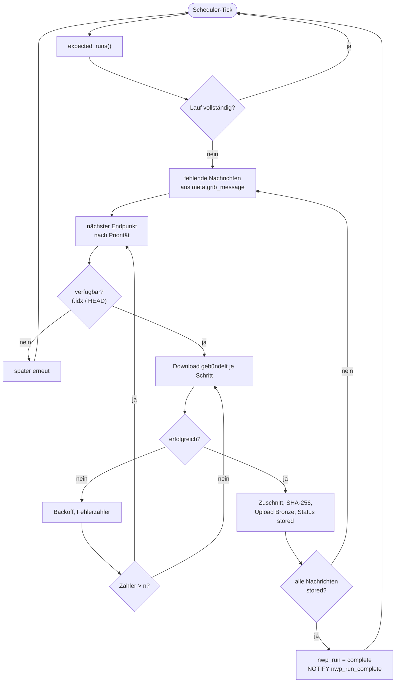

### 6.5 Konzepte aus dem Altsystem

| Altes Konzept | Übernahme |
|---|---|
| `grib_finished.txt` (Liste vollständiger Läufe) | `meta.nwp_run` mit Status `complete`; dieselbe Rolle, aber mit Quelle, Endpunkt und Teilstatus je Nachricht |
| `get_cgi_data.sh?param&ort&lauf` (Punktzeitreihe je Lauf) | API-Endpunkt `GET /forecast/point?model=&param=&lat=&lon=&run=latest` liest aus Silber (Zarr), interpoliert bilinear. Benannte Orte als Tabelle `meta.location`. |
| „Jüngster Lauf, der den Zeitpunkt abdeckt“ (`findMostActualForcast`) | Standardabfrage `run_time = max(run_time) WHERE run_time + Verzug ≤ issue_time`; zugleich der Leakage-Schutz aus 7.4 |
| Inventar-Nummern (195 = T2, 245 = DSWRF) | Ersetzt durch Kurzname + Level (`TMP:2 m above ground`); Nummern sind produktabhängig und haben sich seitdem geändert |
| Assessments (Ähnlichkeit von Tagen über Temperaturmittel und Strahlungssumme) | Analog-Tag-Baseline in Phase 5 (7.3) |
| Testdateien des alten GRIB-Bundles | Fixtures für `gribkit`-Tests (GRIB2 JPEG2000, GRIB1, Einzelnachricht) |

Hinweis zum GRIB-Parsing: Ein eigener GRIB2-Parser in reinem Python lohnt nicht. GRIB2 hat zahlreiche Packungsarten (JPEG2000, CCSDS/AEC, komplexe Packung mit räumlicher Differenzierung), die NOAA, ECMWF und DWD tatsächlich nutzen. `eccodes` (ECMWF, Apache-2.0, Wheels inklusive Bibliothek) deckt das ab. Eigener Code beschränkt sich auf Index-Parsing, Range-Merging und Zuschnitt (`gribkit`).

---

## 7. Machine Learning

### 7.1 Zielgrößen und Horizonte

| Ziel | Auflösung | Horizont | Bemerkung |
|---|---|---|---|
| Netzlast DE (ENTSO-E „Actual Total Load“) | 15 min (Training ggf. stündlich) | 0–16 Tage | Wetter (Temperatur), Kalender, Saison dominieren |
| Day-Ahead-Preis DE-LU | 15 min | D+1 (Kern), D+2 … D+14 (Szenario) | Treiber: Residuallast = Last − Wind − PV, Nachbarländer, Brennstoffpreise |
| Hilfsziele: Wind- und PV-Einspeisung DE | 15 min | 0–16 Tage | verbessern Preisprognose deutlich (Residuallast) |

Ehrliche Erwartung: Für D+1 lässt sich ein guter Preis erreichen; jenseits von etwa 5–7 Tagen wird vor allem die Struktur (Tagesgang, Wochenende, wind-/sonnenreiche Phasen) prognostiziert, nicht der genaue Preis. Deshalb Quantilprognosen (z. B. P10/P50/P90) statt Punktwerten.

### 7.2 Features

- **Wetter je Region bzw. Anlagen-Cluster** (aus Silber berechnet, Details in 7.5):
  - Temperatur bevölkerungsgewichtet (Last),
  - Wind-Leistungsindex je Wind-Cluster: Windgeschwindigkeit 100 m → Leistungskurve (nach Nabenhöhe/Anlagentyp), mal installierte Leistung des Clusters,
  - PV-Index je PV-Cluster: Globalstrahlung × Temperaturkorrektur (Ausrichtung/Neigung, soweit im MaStR angegeben), mal installierte Leistung,
  - Bewölkung, Niederschlag, Schnee (Schneebedeckung von PV).
- **Mehrere Modelle nebeneinander** (GFS, ECMWF, ICON) plus Spread zwischen ihnen und GEFS-Streuung als Unsicherheitsmaß; je Modell ein Verfügbarkeits-Flag.
- **Vorlaufzeit** als explizites Feature (Modellgüte nimmt mit dem Vorlauf ab).
- **Kalender:** Stunde, Wochentag, Feiertag (bundesweit/anteilig je Land), Brückentage, Ferienanteil, Zeitumstellung.
- **Markt:** zuletzt bekannte Preise und Lasten (Lags, nur was zum Ausgabezeitpunkt veröffentlicht war), installierte Kapazitäten, optional Brennstoff-/CO₂-Preise.

### 7.3 Modellansatz

1. **Baseline:** saisonal-naive Prognose, Analog-Tag-Verfahren (die Assessment-Idee aus dem Altsystem: ähnlichste historische Tage nach Wetterprognose suchen und deren Ist-Werte gewichten) und LightGBM je Horizont-Block. Das ist der Maßstab, den jedes NN schlagen muss.
2. **Neuronales Netz:** Multi-Horizont-Encoder-Decoder für Zeitreihen mit bekannten Zukunftskovariaten. Kandidaten: TFT (Temporal Fusion Transformer), TiDE, N-HiTS mit exogenen Variablen. Quantile-Loss, gemeinsames Modell für Last, Wind, PV und Preis (Multi-Task) oder zweistufig: Stufe 1 Last/Wind/PV, Stufe 2 Preis mit Residuallast als Eingang. Empfehlung: zweistufig, weil sich Fehler so besser zuordnen lassen.
3. Später optional: räumliches Modell, das direkt auf den Silber-Gittern arbeitet (CNN-Encoder über das Europa-Gitter), falls die Regionen-Aggregation Information verschenkt.

Zweistufiger Aufbau:

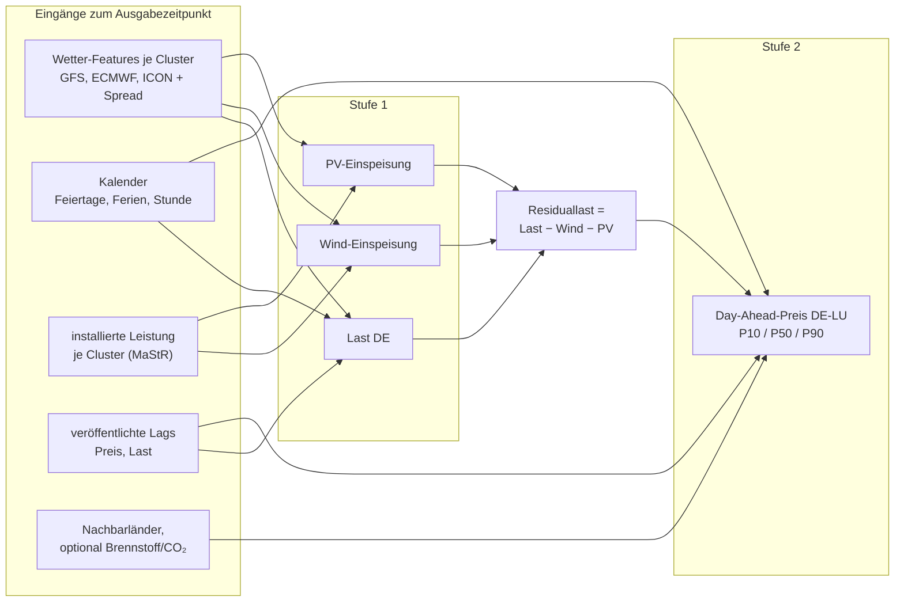

### 7.4 Training, Validierung, Betrieb

- **Leakage-Schutz:** Trainingsbeispiele werden ausschließlich aus Läufen gebildet, die zum Ausgabezeitpunkt verfügbar waren (`run_time + Veröffentlichungsverzug ≤ issue_time`), Marktdaten über `published`.

  ```mermaid
  sequenceDiagram
      participant N as NOAA GFS 06Z
      participant D as PredictionDB
      participant M as Börse (SDAC)
      Note over N: run_time 06:00 UTC
      N->>D: Schritte verfügbar ab ca. 09:30 UTC
      Note over D: issue_time 10:00 UTC:<br/>nur Läufe mit run_time + Verzug ≤ issue_time
      D->>D: Prognose für Liefertag D+1
      Note over M: Gebotsschluss 12:00 MEZ/MESZ
      M->>D: Auktionsergebnis ca. 13:00 MEZ/MESZ<br/>(published) → Ziel für das Training
  ```
- **Validierung:** rollierende Zeitreihen-Kreuzvalidierung (Expanding Window), Metriken MAE/RMSE je Horizont, Pinball-Loss, für Preis zusätzlich Rang-/Spread-Güte (wichtig für Lastverschiebung).
- **Training** als einmaliger Container (`docker compose run ml-train …`), auf der VM CPU-basiert machbar für Regionen-Features. Für Gitter-Modelle GPU nötig: dann Training in der Cloud oder per GPU-Passthrough auf PVE.
- **Inferenz** (`ml-predict`): reagiert auf `NOTIFY features_ready`, lädt das in MLflow als `production` markierte Modell, schreibt Quantile nach `fcst.prediction`.
- **Monitoring:** täglicher Abgleich Prognose ↔ Ist in Grafana; Drift-Alarm bei Fehleranstieg.

### 7.5 Anlagenverteilung aus dem MaStR und Gebietscluster

Ziel: Wetterprognosen dort auswerten, wo die Wind-, PV- und anderen EE-Anlagen tatsächlich stehen, und dem Netz pro Gebiet ein Signal „erwartete Einspeisung“ geben.

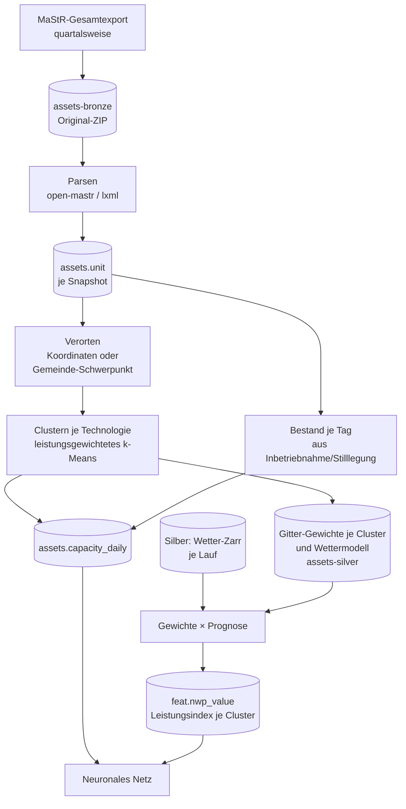

**Abruf (quartalsweise):**

- Quelle: MaStR-Gesamtdatenexport (<https://www.marktstammdatenregister.de/MaStR/Datendownload>), ZIP mit XML-Dateien je Einheitentyp (mehrere GB entpackt), Lizenz DL-DE BY 2.0.
- Job `mastr-snapshot` im Container `energy-ingest`, Cron am ersten Tag jedes Quartals (manuell auslösbar). Das Original-ZIP landet in Garage `assets-bronze/mastr/YYYY-MM-DD/` und bleibt erhalten, damit Auswertungen reproduzierbar sind.
- Parsing mit dem Python-Paket `open-mastr` (OpenEnergyPlatform, lädt den Gesamtexport und schreibt ihn in eine relationale DB) oder eigenem Streaming-XML-Parser (`lxml.iterparse`), falls `open-mastr` zu schwergewichtig ist. Entscheidung im Spike (Phase 0).
- Relevante Felder je Einheit: Energieträger, Bruttoleistung/Nettonennleistung, Inbetriebnahme- und Stilllegungsdatum, Betriebsstatus, Koordinaten bzw. PLZ/Gemeinde, bei Wind Nabenhöhe, Rotordurchmesser, Hersteller/Typ, on-/offshore, bei PV Hauptausrichtung, Neigung, Freifläche/Dach, Einspeiseart (Voll-/Überschusseinspeisung, Eigenverbrauch).

**Verortung:**

- Koordinaten sind im öffentlichen Export nur für größere Anlagen enthalten; kleine Anlagen (insbesondere Dach-PV) nur mit PLZ bzw. Gemeinde. Diese werden auf den Schwerpunkt der Gemeinde (Geometrien: BKG VG250, frei, DL-DE BY 2.0) oder gleichmäßig auf deren Fläche verteilt. Die genaue Schwelle prüfe ich beim ersten Import.
- Offshore-Wind über Koordinaten bzw. Windpark-Zuordnung zu den Nordsee-/Ostsee-Gebieten.

**Zeitliche Rekonstruktion:**

- Aus Inbetriebnahme- und Stilllegungsdatum ergibt sich für jeden Tag der Historie die installierte Leistung je Gebiet. Damit sieht das Training für 2022 den Anlagenbestand von 2022 und nicht den heutigen (sonst wäre der Zubau, vor allem PV, falsch abgebildet).
- Ein Quartals-Snapshot genügt dafür, weil der Export auch stillgelegte Anlagen mit Datum enthält. Nachmeldungen werden durch spätere Snapshots korrigiert; die Differenz zwischen Snapshots wird geloggt.

**Clustering:**

- Getrennt je Technologie (Wind onshore, Wind offshore, PV Freifläche, PV Dach, Biomasse, Wasser), weil Wetterabhängigkeit und Tagesprofil verschieden sind.
- Leistungsgewichtetes k-Means bzw. Mini-Batch-k-Means auf (lat, lon), optional plus Nabenhöhe bzw. Ausrichtung als Zusatzdimension. Startwert z. B. 20–30 Cluster für Wind onshore, 20–30 für PV, 3–5 für Offshore; die Zahl wird über die Prognosegüte gewählt. Alternative mit festen Grenzen: Regelzonen × Bundesländer (stabil, gut erklärbar, aber gröber).
- Cluster werden nur bei signifikanter Änderung neu gebildet (z. B. jährlich), damit sich die Feature-Definitionen für das Netz nicht jedes Quartal verschieben. Zwischen Neubildungen werden neue Anlagen dem nächstgelegenen bestehenden Cluster zugeordnet. Jede Clusterung bekommt eine Version; das Modell merkt sich, mit welcher Version es trainiert wurde.

**Kombination mit der Wetterprognose:**

- Für jedes Cluster eine Gewichtsmatrix „Leistung je Gitterzelle“ pro Wettermodellgitter (GFS 0,25°, ECMWF 0,25°, ICON-EU 0,0625°). `wx-process` multipliziert jede Prognose mit dieser Matrix und schreibt je Cluster, Lauf und Gültigkeitszeit Kennzahlen nach `feat.nwp_value` (Leistungsindex in MW, mittlere Windgeschwindigkeit bzw. Einstrahlung).
- Region-Codes in `meta.region` erhalten dafür die Form `wind_on:v2025Q4:c07`; Gitter-Gewichte liegen als kleine Zarr-Arrays in Garage `assets-silver/`.

**Ergänzende Tabellen:**

```sql
CREATE TABLE assets.snapshot (
  snapshot_id serial PRIMARY KEY, export_date date UNIQUE, object_key text, n_units int
);
CREATE TABLE assets.unit (                       -- reduzierte, normalisierte Sicht auf den Export
  snapshot_id int, mastr_nr text, technology text, capacity_kw real,
  commissioned date, decommissioned date, lat real, lon real, geo_precision text,  -- 'coord'|'gemeinde'|'plz'
  hub_height_m real, azimuth text, tilt text,
  PRIMARY KEY (snapshot_id, mastr_nr)
);
CREATE TABLE assets.cluster (
  clustering_version text, technology text, cluster_no int, centroid_lat real, centroid_lon real,
  PRIMARY KEY (clustering_version, technology, cluster_no)
);
CREATE TABLE assets.capacity_daily (             -- rekonstruierte installierte Leistung (Hypertable)
  clustering_version text, technology text, cluster_no int, day date, capacity_mw real,
  PRIMARY KEY (clustering_version, technology, cluster_no, day)
);
```

**Wirkung im Netz:** Die Cluster-Leistungsindizes sind die wichtigsten Eingänge der Stufe 1 (Wind- und PV-Einspeisung) aus 7.3; deren Summe ergibt mit der Lastprognose die Residuallast für die Preis-Stufe. Die installierte Leistung je Cluster geht zusätzlich als Feature ein, damit das Netz den Zubau lernt.

---

## 8. Deployment auf der PVE-VM

### 8.1 VM-Größe (Startwert)

| Ressource | Wert | Begründung |
|---|---|---|
| vCPU | 6–8 | GRIB-Dekodierung, Zarr-Kompression, LightGBM/CPU-Training |
| RAM | 24–32 GB | xarray auf Europa-Ausschnitten, Postgres-Cache, Training |
| Disk | 500 GB (Daten), separat 50 GB (System) | siehe 5.4; Garage-Metadaten und Postgres idealerweise auf SSD |
| OS | Debian 13 oder Ubuntu 24.04 LTS, Docker Engine + Compose-Plugin | |

### 8.2 Compose-Dienste

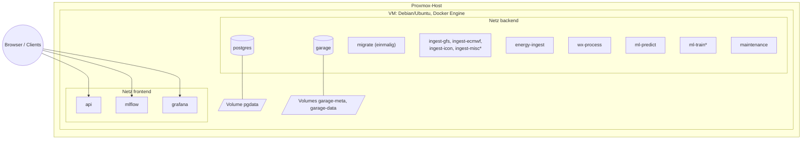

\* über Compose-Profile (`extended`, `train`) nur bei Bedarf gestartet.


```yaml
name: predictiondb

x-app: &app
  image: ghcr.io/the78mole/predictiondb:${TAG:-latest}
  env_file: .env
  restart: unless-stopped
  depends_on:
    postgres: {condition: service_healthy}
    garage:   {condition: service_started}
  networks: [backend]

services:
  postgres:
    image: timescale/timescaledb:latest-pg17     # Version im Lockfile pinnen
    volumes: [pgdata:/var/lib/postgresql/data]
    healthcheck: {test: ["CMD", "pg_isready", "-U", "postgres"], interval: 10s}
    networks: [backend]

  garage:
    image: dxflrs/garage:v2.1.0                  # vor Einsatz aktuelle Version prüfen
    volumes:
      - ./config/garage.toml:/etc/garage.toml:ro
      - garage-meta:/var/lib/garage/meta
      - garage-data:/var/lib/garage/data
    networks: [backend]

  migrate:     {<<: *app, restart: "no", command: ["alembic", "upgrade", "head"]}

  ingest-gfs:   {<<: *app, command: ["wx-ingest", "--source", "gfs_0p25"]}
  ingest-ecmwf: {<<: *app, command: ["wx-ingest", "--source", "ecmwf_ifs"]}
  ingest-icon:  {<<: *app, command: ["wx-ingest", "--source", "icon_eu", "--source", "icon_d2"]}
  ingest-misc:  {<<: *app, command: ["wx-ingest", "--source", "gefs", "--source", "gem"], profiles: ["extended"]}

  energy-ingest: {<<: *app, command: ["energy-ingest"]}
  wx-process:    {<<: *app, command: ["wx-process"]}
  ml-predict:    {<<: *app, command: ["ml-predict"]}
  ml-train:      {<<: *app, restart: "no", command: ["ml-train"], profiles: ["train"]}
  maintenance:   {<<: *app, command: ["maintenance"]}   # Lifecycle, Backups, Konsistenzprüfungen

  api:
    <<: *app
    command: ["uvicorn", "api.main:app", "--host", "0.0.0.0"]
    networks: [backend, frontend]

  mlflow:
    image: ghcr.io/mlflow/mlflow:<version>
    command: >
      mlflow server --backend-store-uri postgresql://.../mlflow
      --artifacts-destination s3://ml-artifacts --host 0.0.0.0
    networks: [backend, frontend]

  grafana:
    image: grafana/grafana-oss:<version>
    networks: [backend, frontend]

  # optional: prometheus, reverse proxy (Caddy/Traefik) mit TLS, Uptime-Kuma

volumes: {pgdata: {}, garage-meta: {}, garage-data: {}}
networks: {backend: {}, frontend: {}}
```

Bemerkungen:

- **Ein Image für alle Python-Dienste** (Multi-Stage-Build mit `uv sync --frozen --no-dev`), unterschieden nur durch den Befehl. Das vereinfacht Updates; bei Bedarf später getrennte Images (z. B. ML-Image mit PyTorch ist groß).
- Ingest je Quellfamilie als eigener Container: Ausfall oder Sperre einer Quelle betrifft die anderen nicht; einzeln skalier- und neu startbar.
- Geheimnisse (ENTSO-E-Token, Garage-Keys, DB-Passwort) in `.env` bzw. Docker Secrets; nie im Repo.
- Provisionierung der VM selbst: Cloud-Init-Template auf PVE oder Ansible-Rolle (Docker installieren, Repo/Compose-Datei ausrollen, `docker compose up -d`). Passt ggf. zu bestehenden Repos wie `it-infra` oder `portainers`, die ich nicht angesehen habe.

---

## 9. Migrationspfad in die Cloud

| Baustein | PVE (jetzt) | Cloud (später) | Was sich ändert |
|---|---|---|---|
| Objektspeicher | Garage, 1 Knoten | AWS S3, Cloudflare R2, Hetzner Object Storage oder Garage-Cluster mit 3 Knoten | nur Endpoint/Keys |
| Datenbank | TimescaleDB-Container | Timescale Cloud, oder Postgres auf k8s (CloudNativePG + Timescale) | Verbindungsstring; Migration per `pg_dump`/logischer Replikation |
| Dienste | Docker Compose | Kubernetes (Helm/Kustomize aus derselben Image-Basis) oder ECS/Cloud Run | Deployment-Manifeste |
| Scheduling | APScheduler in-process | unverändert, oder k8s CronJobs | optional |
| Training | CPU auf VM | GPU-Instanzen on demand | nur Laufumgebung |

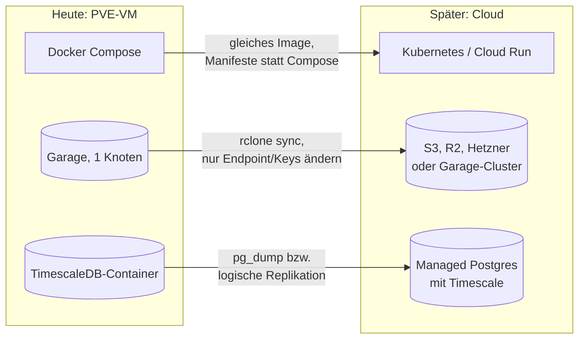

Regeln, die die Migration einfach halten: keine lokalen Dateipfade für Nutzdaten (alles über S3), keine Host-Abhängigkeiten außer Volumes für Postgres/Garage, Konfiguration ausschließlich über Umgebungsvariablen und YAML im Image bzw. ConfigMap, Zustandsführung in Postgres (Container sind austauschbar).

Datenabfluss beachten: Bei S3-Diensten mit Egress-Kosten (AWS) sollten Training und Daten im selben Rechenzentrum liegen; R2 hat keine Egress-Gebühren.

---

## 10. Betrieb und Qualität

- **Logging:** JSON über stdout, gesammelt per Docker-Logtreiber bzw. Loki.
- **Metriken:** Läufe pro Quelle vollständig/verspätet/fehlgeschlagen, Bytes je Lauf, Latenz zwischen Veröffentlichung und Ablage, Prognosefehler je Horizont.
- **Alarme:** „Kein vollständiger GFS-Lauf seit 12 h“, „ENTSO-E-Daten älter als 2 h“, „Garage-Füllstand > 80 %“.
- **Tests:** Unit-Tests für `.idx`-Parser und Range-Merging mit aufgezeichneten Fixtures; Integrationstest gegen echte Endpunkte als separater, manuell ausgelöster CI-Job (nicht in jedem Lauf, wegen Rate-Limits).
- **Lizenzen:** Quellenvermerke (DWD, ECMWF CC BY 4.0, SMARD/Energy-Charts CC BY 4.0, MaStR DL-DE BY 2.0) in API-Antworten und Dashboards mitführen.

---

## 11. Umsetzungsphasen

| Phase | Inhalt | Ergebnis |
|---|---|---|
| **0 – Spike** | Herbie vs. eigenes `gribkit` für GFS + ECMWF; Größen pro Lauf messen; Java-Code sichten | Entscheidung Bibliothek, belastbares Mengengerüst |
| **1 – Fundament** | uv-Workspace, Compose mit Postgres/Timescale + Garage, Alembic-Schema, `core`-Paket, CI (Lint, Tests, Image-Build) | lauffähiger leerer Stack |
| **2 – GFS-Ingest** | GFS mit NOMADS + AWS-Fallback, Bronze, Zustandsführung, Backfill ab 2021 aus AWS | durchgehende GFS-Historie |
| **3 – Energiedaten** | ENTSO-E, SMARD/Energy-Charts, MaStR-Quartalsabruf und Bestandsrekonstruktion, Feiertage | Zielgrößen, Anlagenbestand + Kalender in Gold |
| **4 – Processing** | Silber-Zarr, Anlagen-Cluster und Gitter-Gewichte (7.5), Wind-/PV-/Temperatur-Features | Feature-Tabellen |
| **5 – Baseline-ML** | LightGBM für Last und Preis, Evaluierungs-Framework, MLflow | Referenzwerte |
| **6 – NN** | TFT/TiDE zweistufig, Quantile, Inferenzdienst, Grafana | erste produktive Prognose |
| **7 – Weitere Quellen** | ECMWF IFS/AIFS, ICON-EU/D2, GEFS, GEM; Redundanz-Features | robuster Betrieb |
| **8 – API & Härtung** | FastAPI, Auth, Alarme, Backups, Cloud-Probelauf | betriebsbereit |

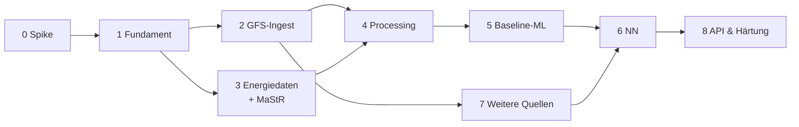

---

## 12. Offene Punkte und Entscheidungen

1. ~~Lizenz~~ **Entschieden (2026-10-20):** Business Source License 1.1 (`LICENSE`). Produktive Nutzung nur intern, für eigene Energieanlagen an eigenen Standorten; ausgeschlossen sind SaaS für Dritte, Steuerung fremder Anlagen, kommerzielles Flottenmanagement und der Verkauf von Prognosedaten. Change Date vier Jahre nach Veröffentlichung, Change License AGPL-3.0-or-later. Lizenzgeber: Daniel (the78mole) Glaser; ein späterer Übergang der kommerziellen Lizenzierung auf die Bizzmark UG (haftungsbeschränkt) ist offen.
2. ~~Verhältnis zu PredictionDB~~ **Entschieden (2026-10-20):** Das Projekt wird im Repo `the78mole/PredictionDB` fortgeführt. Dieser Entwurf liegt dort als `docs/ARCHITEKTUR.md` und ersetzt die Teile der `SPECIFICATION.md` v0.1, die ihm widersprechen (MariaDB, Gitterwerte als Zeilen, Celery).
3. **Kommerzielle Nutzung?** Entscheidet, ob Open-Meteo produktiv genutzt werden darf und ob bestimmte Lizenzauflagen (ENTSO-E-Bedingungen) relevant werden.
4. **Zielauflösung des Preises:** 15 min (aktueller Markt) oder Stunde (einfacher, längere homogene Historie)? Vorschlag: 15 min als Ausgabe, Training mit Stundenmitteln vor Okt. 2025 und Upsampling-Kennzeichnung.
5. **Ausschnitt:** Nur DE oder Mitteleuropa (Nachbarländer beeinflussen Preis über Kuppelflüsse)? Vorschlag: 44–58° N, 0–20° E.
6. **GPU:** Steht auf einem PVE-Host eine GPU für Passthrough bereit? Davon hängt ab, ob Gitter-Modelle lokal trainiert werden.
7. Zu verifizierende Detailwerte vor der Implementierung: exakte NOMADS-Rate-Limits, aktuelle Vorhaltezeiten auf opendata.dwd.de und data.ecmwf.int, Beginn der Archive auf AWS, aktuelle Garage- und TimescaleDB-Versionen.
