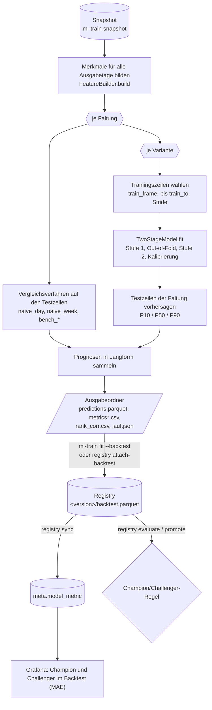
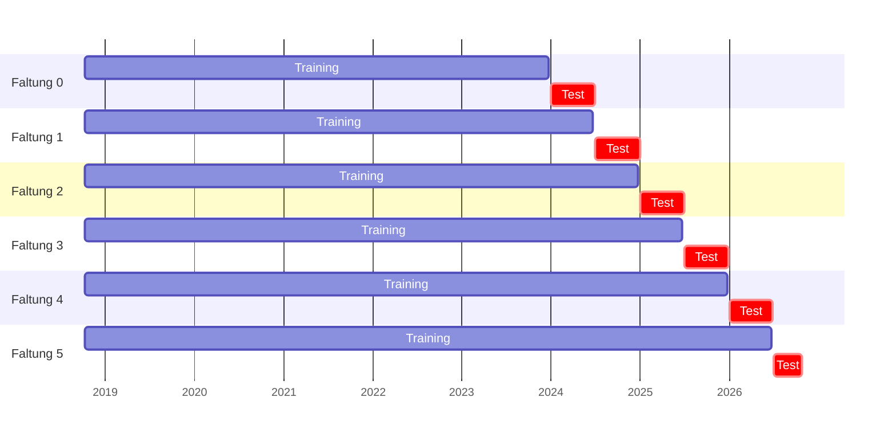
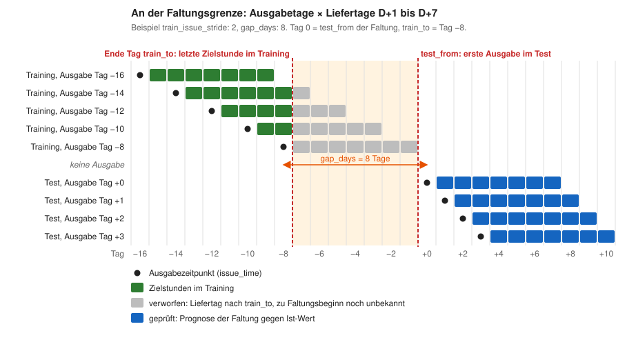
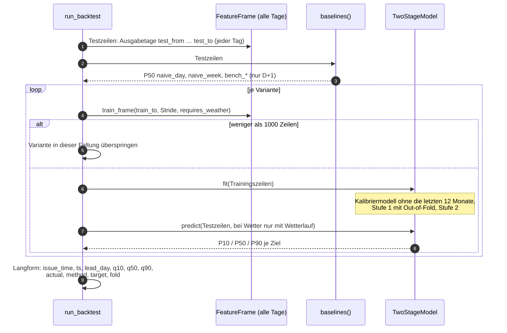
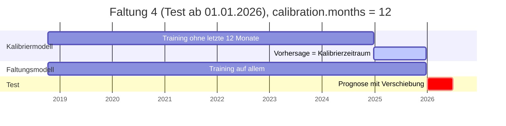
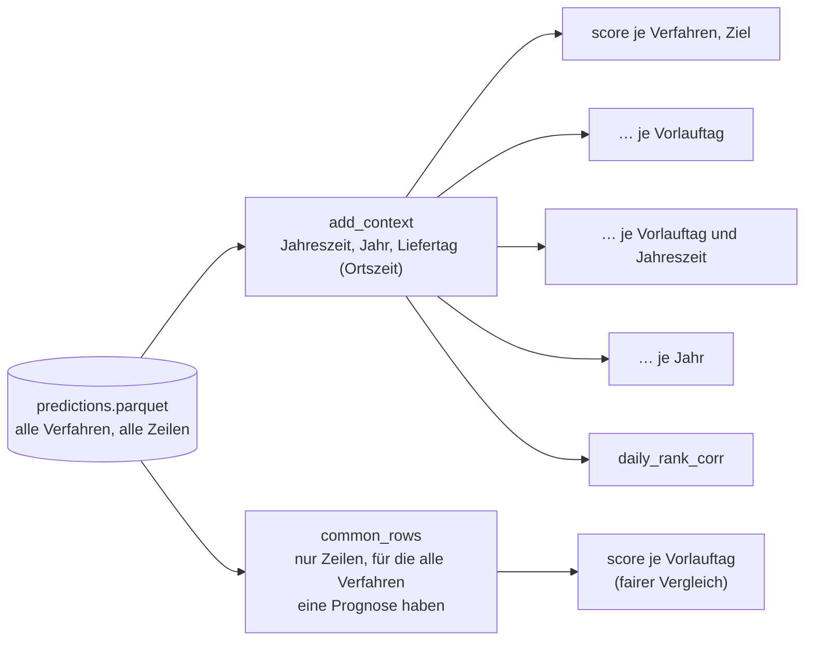
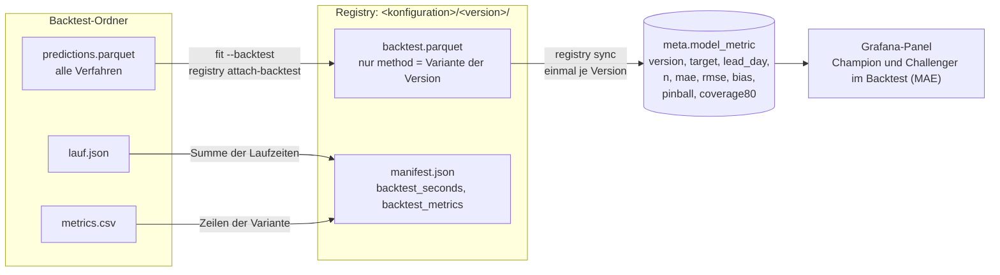
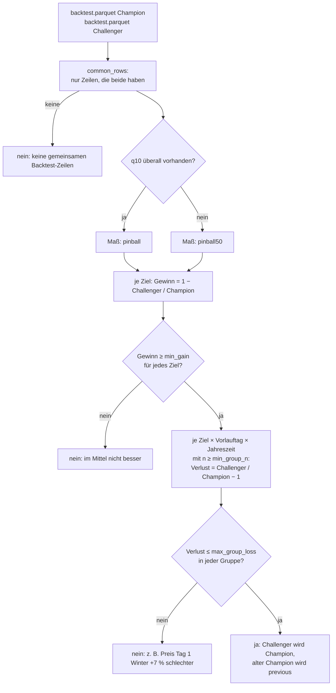

# Backtest: Was er tut und wie man ihn liest

Ein Backtest beantwortet eine Frage: **Wie gut wäre eine Modellvariante gewesen, wenn sie in
der Vergangenheit jeden Tag im Betrieb gelaufen wäre?** Dazu spielt `ml-train backtest` die
Vergangenheit nach. Das Modell wird immer nur mit dem trainiert, was zu einem Zeitpunkt schon
bekannt war, und sagt dann die folgenden Monate vorher. Diese Prognosen werden mit den
Ist-Werten und mit einfachen Vergleichsverfahren verglichen.

Dieses Dokument erklärt den Ablauf Schritt für Schritt am Code in
[`services/ml_train`](../services/ml_train/README.md). Den Überblick über die Modelle selbst gibt
[PROGNOSEMODELLE.md](PROGNOSEMODELLE.md) (Aufbau in Kap. 4, Leakage-Schutz in Kap. 5, Kurzfassung
des Backtests in Kap. 6.3 und 6.4, Freigabe in Kap. 7). Ausgewertete Backtests liegen unter
[`docs/analysen/prognose-de-lu-v1/`](analysen/prognose-de-lu-v1/README.md) und
[`docs/analysen/prognose-de-lu-v2/`](analysen/prognose-de-lu-v2/README.md).

## Inhalt

1. [Der Ablauf im Überblick](#1-der-ablauf-im-überblick)
2. [Eine Zeile: Ausgabezeitpunkt × Zielstunde](#2-eine-zeile-ausgabezeitpunkt--zielstunde)
3. [Faltungen und Zeitfenster](#3-faltungen-und-zeitfenster)
4. [Was in einer Faltung passiert](#4-was-in-einer-faltung-passiert)
5. [Varianten und Vergleichsverfahren](#5-varianten-und-vergleichsverfahren)
6. [Kalibrierung der Quantile im Backtest](#6-kalibrierung-der-quantile-im-backtest)
7. [Kennzahlen](#7-kennzahlen)
8. [Ergebnisdateien](#8-ergebnisdateien)
9. [Vom Backtest in die Registry: `backtest.parquet` und `meta.model_metric`](#9-vom-backtest-in-die-registry-backtestparquet-und-metamodel_metric)
10. [Champion/Challenger auf Basis des Backtests](#10-championchallenger-auf-basis-des-backtests)
11. [Aufruf und Parameter](#11-aufruf-und-parameter)
12. [Was der Backtest zeigt und was nicht](#12-was-der-backtest-zeigt-und-was-nicht)

## 1. Der Ablauf im Überblick



Der Code dazu steht fast vollständig in
[`backtest.py`](../services/ml_train/src/ml_train/backtest.py) (`run_backtest`), die Kennzahlen in
[`metrics.py`](../services/ml_train/src/ml_train/metrics.py), das Schreiben der Ergebnisse in
[`cli.py`](../services/ml_train/src/ml_train/cli.py) (`write_backtest`), der Vergleich zweier
Versionen in [`registry.py`](../services/ml_train/src/ml_train/registry.py) (`compare`) und der
Spiegel in die Datenbank in [`dbsync.py`](../services/ml_train/src/ml_train/dbsync.py).

## 2. Eine Zeile: Ausgabezeitpunkt × Zielstunde

Geprüft wird nicht „eine Stunde“, sondern eine **Prognose für eine Stunde, ausgegeben zu einem
bestimmten Zeitpunkt**. Eine Zeile ist das Paar (`issue_time`, `ts`):

- `issue_time`: wann die Prognose ausgegeben wird. Je Ausgabetag gibt es genau einen Zeitpunkt,
  `issue.hour_utc` (08 UTC) oder mit `issue.hours_utc` reihum eine von mehreren Stunden
  (`de_lu_v2`: 02, 08, 14, 20 UTC; welche, entscheidet das Datum, `FeatureBuilder.issues`).
- `ts`: die Zielstunde (UTC, Intervallbeginn), für alle Stunden der Liefertage
  `issue.lead_days` in Ortszeit. Vorlauftag 1 ist der Folgetag, 0 der Rest des Ausgabetags.
- `lead_day`: der Vorlauftag. Ein Ausgabetag mit D+1 bis D+7 ergibt also etwa 7 × 24 Zeilen je
  Zielgröße.

Alle Merkmale einer Zeile sind mit dem Wissensstand von `issue_time` gebildet (Ist-Werte erst
2 h nach Intervallende, Preise des Folgetags ab 13 Uhr, GFS-Lauf erst 6 h nach Laufzeit, siehe
[PROGNOSEMODELLE.md, Kap. 5](PROGNOSEMODELLE.md#5-wissen-zum-ausgabezeitpunkt-leakage-schutz)).
Das gilt im Backtest genauso wie im Betrieb, weil beide denselben `FeatureBuilder` benutzen.

Werte, die zum Ausgabezeitpunkt schon feststehen, zum Beispiel der Day-Ahead-Preis von D+1 bei
einer Ausgabe nach 13 Uhr, sind kein Lernziel. Sie haben im Backtest keinen Ist-Wert in der
Spalte `actual` und zählen in keiner Kennzahl. Das Modell bekäme dort sonst geschenkte Punkte.

## 3. Faltungen und Zeitfenster

Der Backtest ist ein **Expanding Window**: Der Testzeitraum ab `backtest.test_from` wird in
Faltungen von je `fold_months` Monaten geteilt (`make_folds`). Für jede Faltung wird jede
Variante neu trainiert, mit **allen** Daten von ihrem Beginn bis kurz vor der Faltung. Das
Trainingsfenster wächst also von Faltung zu Faltung, der Anfang bleibt fest.

Mit den Werten aus [`config/ml/de_lu_v2.yaml`](../config/ml/de_lu_v2.yaml) (`test_from:
2024-01-01`, `fold_months: 6`, `gap_days: 8`) und Daten bis Ende Oktober 2026:



Die letzte Faltung ist kürzer: Sie endet am letzten Ausgabetag, für den es Ist-Werte aller
Zielgrößen gibt (`data_days`: letzte Stunde mit Ist-Werten minus einen Tag). Mit `test_to` lässt
sich das Ende auch früher legen.

Aneinandergereiht ergeben die Testzeiträume aller Faltungen eine lückenlose Folge von Prognosen
über den ganzen Testzeitraum, und jede davon stammt von einem Modell, das diese Zeit nicht
gesehen hat.

### Die Faltungsgrenze im Detail

Drei Regeln aus `make_folds` und `train_frame` legen fest, welche Zeilen in das Training einer
Faltung dürfen:

1. **Ausgabetage bis `train_to`**, wobei `train_to = test_from − gap_days`.
2. **Nur jeder `train_issue_stride`-te Ausgabetag** (Vorgabe 2). Aufeinanderfolgende Ausgaben
   überlappen zu sechs Siebteln in ihren Zielstunden, jeder zweite Tag halbiert die Rechenzeit
   bei kaum weniger Information. Getestet wird dagegen **jeder** Ausgabetag.
3. **Nur Zielstunden bis einschließlich Tag `train_to`**. Eine Ausgabe vom Tag −10 hat
   Liefertage bis Tag −3. Der Backtest setzt aber `train_to` als Stichtag für alles, was das
   Faltungsmodell als Ist-Wert kennen darf, deshalb fallen die Liefertage −7 bis −3 aus dem
   Training. Die Ausgabe vom Tag `train_to` selbst trägt so gar keine Zielstunde mehr bei.



Die Lücke von `gap_days` (8 Tage) ist so gewählt, dass auch die längste Prognose (D+7) einer
Trainingsausgabe vor dem ersten Testtag liegt und Training und Test sich in keiner Zielstunde
berühren. Der Preis dafür: Das Modell einer Faltung kennt die letzte Woche vor dem Test nicht.
Im Betrieb ist das ähnlich, denn auch dort trainiert `ml-train fit` nur bis `gap_days` vor dem
letzten Datentag.

Der Beginn des Trainings ist je Variante `train_from` (für die meisten Varianten der Start der
Gebotszone DE-LU am 08.10.2018, für Wettervarianten der Beginn der GFS-Historie am 23.03.2021),
frühestens aber acht Tage nach der ersten Stunde mit Ist-Werten im Snapshot (damit die
Wochen-Lags gefüllt sind).

## 4. Was in einer Faltung passiert



Wichtig ist, was **nicht** passiert: Merkmale werden einmal für alle Ausgabetage gebildet und
nicht je Faltung neu. Das ist zulässig, weil jede Merkmalsspalte nur vom Wissensstand ihres
eigenen `issue_time` abhängt und nichts aus der Zukunft der Faltung enthält. Was die Faltung
trennt, ist allein die Auswahl der Trainingszeilen.

Das Training einer Faltung ist dasselbe `TwoStageModel.fit` wie beim endgültigen Modell:

- **Stufe 1** (Last, Wind onshore/offshore, PV) wird trainiert.
- Für das Training von **Stufe 2** (Preis) bekommt das Modell Stufe-1-Prognosen
  **Out-of-Fold**: Die Trainingsausgaben werden in `oof_folds` (3) zeitlich zusammenhängende
  Blöcke geteilt, und jeder Block wird von einem Stufe-1-Modell der beiden anderen Blöcke
  vorhergesagt. Sonst lernte der Preis mit zu guten Last- und Erzeugungswerten.
- **Stufe 2** lernt den Preis mit diesen Prognosen und der daraus berechneten Residuallast.
- Im Test bekommt Stufe 2 die echten Stufe-1-Prognosen des Faltungsmodells, wie im Betrieb.

Varianten mit Wetter (`requires_weather`) trainieren und testen nur auf Ausgabezeitpunkten, zu
denen ein verarbeiteter GFS-Lauf vorlag. Ihre Kennzahlen beruhen deshalb auf weniger Zeilen als
die der übrigen Varianten. Vergleiche müssen auf gemeinsamen Zeilen laufen (Kap. 7).

## 5. Varianten und Vergleichsverfahren

Eine Konfiguration enthält mehrere **Varianten**, die sich in ihren Merkmalsgruppen
unterscheiden (in `de_lu_v2` etwa `kalender`, `frei`, `preisniveau`, `wetter`,
siehe [PROGNOSEMODELLE.md, Kap. 10](PROGNOSEMODELLE.md#10-modellkonfigurationen-und-varianten)).
Ohne `--variant` prüft der Backtest alle, mit `--variant` nur die genannten. Alle Varianten
sehen dieselben Faltungen, dieselben Testzeilen und dieselben Vergleichsverfahren. Damit ist der
Backtest zugleich ein **Ablationsversuch**: Der Unterschied zwischen `kalender` und
`kalender + Gruppe` ist der Beitrag dieser Gruppe.

Neben den Varianten laufen in jeder Faltung **Vergleichsverfahren** auf denselben Testzeilen
(`models.baselines`):

| Methode im Ergebnis | Prognose | für |
|---|---|---|
| `naive_day` | gleiche Stunde am letzten vollständig bekannten Tag | alle Ziele, alle Vorläufe |
| `naive_week` | gleiche Stunde in der jüngsten bekannten Vorwoche | alle Ziele, alle Vorläufe |
| `bench_<reihe>` | Day-Ahead-Prognose der ÜNB (ENTSO-E/SMARD) | Last, Wind, PV, nur D+1 |

Die Vergleichsverfahren haben nur einen P50, keine Quantile. Sie brauchen kein Training und sind
daher die Messlatte, die jede Variante schlagen muss. Ein Modell, das den Vortagespreis nicht
schlägt, lohnt den Aufwand nicht.

## 6. Kalibrierung der Quantile im Backtest

Quantil-Bäume sind auf ihren eigenen Trainingsdaten zu sicher. Ohne Korrektur enthielt das Band
P10–P90 im Backtest nur 55 bis 70 % statt 80 % der Ist-Werte. Ist `calibration.months` gesetzt
(`de_lu_v2`: 12), korrigiert `TwoStageModel.fit` das in **jeder Faltung** mit:



1. Ein **Kalibriermodell** wird nur mit den Trainingszeilen vor den letzten 12 Monaten trainiert
   (auch die Zielstunden enden davor).
2. Es sagt die letzten 12 Monate vorher, die es nicht gesehen hat.
3. Je Ziel, Vorlauftag und äußerem Quantil wird eine **Verschiebung** bestimmt, sodass P10 dort
   wirklich 10 % und P90 wirklich 90 % der Ist-Werte unterschreitet. Die Quantilstufe wird dabei
   wie bei konformaler Vorhersage für die endliche Stichprobe leicht nach außen gesetzt. Es
   braucht mindestens `calibration.min_rows` (200) Zeilen je Vorlauftag, sonst bleibt dieser
   Vorlauftag unverschoben.
4. Das eigentliche **Faltungsmodell** wird auf allen Trainingszeilen trainiert und bekommt diese
   Verschiebungen. Der Median bleibt unverändert, MAE und RMSE ändern sich durch die
   Kalibrierung also nicht.

Weil auch die Kalibrierung nur Daten vor `train_to` nutzt, ist die Abdeckung im Test eine
ehrliche Messung. Ob die Kalibrierung trägt, zeigt die Kennzahl `coverage80`.

## 7. Kennzahlen

Alle Kennzahlen berechnet `metrics.score` aus den Spalten `actual` und `q50` (sowie `q10`,
`q90`). Zeilen ohne Ist-Wert zählen nicht.

| Spalte | Formel | Bedeutung |
|---|---|---|
| `n` | Zahl der Zeilen | Wie belastbar ist die Gruppe? |
| `mae` | Mittel von \|P50 − Ist\| | mittlerer Fehler in MW bzw. €/MWh, Hauptmaß für die Punktgüte |
| `rmse` | Wurzel aus dem Mittel von (P50 − Ist)² | wie MAE, große Fehler zählen stärker |
| `bias` | Mittel von (P50 − Ist) | positiv = Modell schätzt im Mittel zu hoch |
| `pinball` | Mittel des Pinball-Verlusts über P10, P50, P90 | Güte der ganzen Verteilung, Maß für die Freigabe |
| `pinball50` | MAE / 2 | Pinball nur über den Median, auch für Vergleichsverfahren ohne Quantile definiert |
| `coverage80` | Anteil der Ist-Werte zwischen P10 und P90 | Soll 80 %; darunter ist das Band zu schmal |
| `rank_corr_day` | Spearman-Rangkorrelation der Stunden je Liefertag, gemittelt | trifft die Prognose die Reihenfolge billiger und teurer Stunden? (`daily_rank_corr`, mindestens 12 Stunden je Tag) |

Der **Pinball-Verlust** eines Quantils q bestraft Unter- und Überschätzung ungleich:
`max(q · (Ist − Prognose), (q − 1) · (Ist − Prognose))`. Liegt der Ist-Wert über P90, kostet das
0,9 je Einheit Abstand, liegt er darunter, nur 0,1. Ein zu schmales Band wird so ebenso bestraft
wie ein zu breites.



**Gemeinsame Zeilen.** Die Verfahren decken unterschiedlich viele Zeilen ab: ÜNB-Prognosen nur
D+1, Wettervarianten nur Zeiten mit Wetterlauf, eine Variante kann in einer frühen Faltung
übersprungen sein. Ein MAE über verschiedene Zeilen vergleicht dann auch verschiedene Wetterlagen
und Jahreszeiten. `metrics_common` (Datei `metrics_common_lead.csv`) und der
Champion/Challenger-Vergleich rechnen deshalb nur auf Zeilen (Ziel, `issue_time`, `ts`), für die
alle verglichenen Verfahren eine Prognose haben. Für Aussagen der Art „Variante A ist x % besser
als B“ ist das die richtige Grundlage.

## 8. Ergebnisdateien

`ml-train backtest --out <ordner>` schreibt:

| Datei | Inhalt |
|---|---|
| `predictions.parquet` | alle Prognosen aller Verfahren in Langform, eine Zeile je Verfahren, Ziel, Ausgabe und Stunde |
| `metrics.csv` | Kennzahlen je Verfahren und Ziel über den ganzen Testzeitraum |
| `metrics_lead.csv` | … je Verfahren, Ziel und Vorlauftag |
| `metrics_season.csv` | … je Verfahren, Ziel, Vorlauftag und Jahreszeit |
| `metrics_year.csv` | … je Verfahren, Ziel und Jahr |
| `metrics_common_lead.csv` | wie `metrics_lead.csv`, aber nur auf gemeinsamen Zeilen aller Verfahren |
| `rank_corr.csv` | mittlere Rangkorrelation je Liefertag, je Verfahren, Ziel und Vorlauftag |
| `lauf.json` | Snapshot-ID, Konfig-Hash, Faltungen mit `test_from`, `test_to`, `train_to`, Laufzeiten je Faltung und Variante, Zeilenzahl, Git-Commit, Ende des Laufs |

Spalten von `predictions.parquet`:

| Spalte | Inhalt |
|---|---|
| `issue_time` | Ausgabezeitpunkt (UTC) |
| `ts` | Zielstunde (UTC, Intervallbeginn) |
| `lead_day` | Vorlauftag in Ortszeit |
| `q10`, `q50`, `q90` | Quantile; Vergleichsverfahren haben nur `q50` |
| `actual` | Ist-Wert; leer, wenn der Wert zum Ausgabezeitpunkt schon bekannt war oder fehlt |
| `method` | Variante (`kalender`, `frei`, …) oder Vergleichsverfahren (`naive_day`, `bench_load_da_forecast`, …) |
| `target` | Zielgröße (`load_actual`, `da_price_de_lu`, `gen_wind_onshore`, …) |
| `fold` | Nummer der Faltung |

Damit lässt sich jede Auswertung nachrechnen, die die CSV-Dateien nicht enthalten, etwa Fehler
je Stunde des Tages oder an einzelnen Tagen. Die Auswertungsskripte unter `docs/analysen/*/`
tun genau das.

## 9. Vom Backtest in die Registry: `backtest.parquet` und `meta.model_metric`



`ml-train fit --variant <v> --backtest <ordner>` trainiert das endgültige Modell auf allen
Daten und legt dazu aus dem Backtest-Ordner **die Prognosen derselben Variante** als
`backtest.parquet` in die Registry (`cli.backtest_for`). Ins Manifest kommen die Laufzeit des
Backtests (`backtest_seconds`) und die Gesamtkennzahlen der Variante (`backtest_metrics`). Wurde
eine Version ohne `--backtest` trainiert, reicht `ml-train registry attach-backtest <version>
--backtest <ordner>` die Prognosen nach; der Backtest muss dieselbe Konfiguration und dieselbe
Variante enthalten.

Zu beachten: `backtest.parquet` enthält die Prognosen der **Faltungsmodelle** dieser Variante,
nicht des registrierten Modells selbst. Das endgültige Modell hat alle Daten gesehen und lässt
sich deshalb gar nicht ehrlich auf der Vergangenheit prüfen. Der Backtest bewertet das
**Rezept** (Konfiguration und Variante), das registrierte Modell ist dessen jüngste Anwendung.

`ml-train registry sync` (läuft nach `fit`, `promote` und jedem `ml-predict`-Lauf automatisch)
spiegelt die Registry nach `meta.model_version`, `meta.model_event` und `meta.model_metric`.
Die Kennzahlen entstehen dabei **einmal je Version** aus `backtest.parquet`
(`dbsync.metric_rows`), denn eine Version ändert sich nach dem Ablegen nicht mehr:

- je Ziel und Vorlauftag eine Zeile (`lead_day` 0 bis 7),
- je Ziel eine Zeile über alle Vorläufe mit `lead_day = -1` (0 ist seit `hours_utc` der Rest des
  Ausgabetags),
- Spalten `n`, `mae`, `rmse`, `bias`, `pinball`, `coverage80`.

Diese Kennzahlen laufen über **alle** Zeilen der Version, nicht über die gemeinsamen Zeilen mit
anderen Versionen. Haben zwei Versionen Backtests über verschiedene Zeiträume, ist ihr Vergleich
im Dashboard nur ein Anhaltspunkt. Entscheidend ist der Vergleich in Kap. 10. Versionen ohne
`backtest.parquet` erscheinen im Panel ohne Kennzahlen.

Die Prognosefehler **im Betrieb** (Sicht `fcst.prediction_error`, P50 der laufenden Prognosen
gegen Ist) sind davon getrennt. Sie messen dieselbe Größe, aber erst ab der Registrierung und auf
echten Läufen von `ml-predict`.

## 10. Champion/Challenger auf Basis des Backtests

Ob ein Challenger Champion wird, entscheidet `registry evaluate` bzw. `registry promote` allein
aus den `backtest.parquet` beider Versionen (`registry.compare`):



Vorgaben in beiden Konfigurationen: `min_gain: 0.0`, `max_group_loss: 0.05`,
`min_group_n: 200`. Gibt es noch keinen Champion, wird jeder Challenger angenommen; fehlt einer
der beiden Versionen `backtest.parquet`, wird keiner. `--force` übergeht die Regel und wird im
Verlauf als „erzwungen“ vermerkt.

Damit der Vergleich fair ist, sollten beide Backtests aus **einem** Lauf stammen oder zumindest
denselben Testzeitraum abdecken. Der Vergleich schneidet sie zwar auf gemeinsame Zeilen zu,
überlappen sie aber nur wenige Monate, entscheidet eine einzelne Jahreszeit. Verglichen wird
außerdem nur innerhalb einer Registry-Linie: Jede Konfiguration (`de_lu_v1`, `de_lu_v2`) hat
ihren eigenen Champion. Ein Vergleich über Linien hinweg ist nicht implementiert.

## 11. Aufruf und Parameter

```bash
# Alle Varianten, Zeitfenster aus der Konfiguration
uv run ml-train --config config/ml/de_lu_v2.yaml backtest \
    --snapshot .ml-data/snap --out .ml-data/bt

# Nur zwei Varianten, kurzer Zeitraum mit Monatsfaltungen und ohne Stride
uv run ml-train --config config/ml/de_lu_v2.yaml backtest \
    --snapshot .ml-data/snap --out .ml-data/bt-wx \
    --variant kalender --variant wetter --test-from 2026-09-15 --fold-months 1 --stride 1

# Endgültiges Modell mit den Backtest-Prognosen registrieren
uv run ml-train --config config/ml/de_lu_v2.yaml fit \
    --snapshot .ml-data/snap --variant frei --backtest .ml-data/bt --role challenger
```

| Parameter (YAML `backtest:`) | CLI | Vorgabe | Wirkung |
|---|---|---|---|
| `test_from` | `--test-from` | Pflicht | erster Testtag, Beginn von Faltung 0 |
| `test_to` | `--test-to` | letzter Datentag | letzter Testtag |
| `fold_months` | `--fold-months` | 6 | Länge einer Faltung; kürzer = häufiger neu trainiert, genauer, aber teurer |
| `gap_days` | – | 8 | Abstand von `train_to` zum Faltungsbeginn |
| `oof_folds` | – | 3 | Blöcke für die Out-of-Fold-Prognosen der Stufe 1 |
| `train_issue_stride` | `--stride` | 2 | nur jeder n-te Ausgabetag im Training |
| `issue.hour_utc` | `--issue-hour` | 8 | eine feste Ausgabestunde statt `hours_utc` reihum |
| `calibration.months` | – | 0 (v2: 12) | Kalibrierung der Quantile je Faltung, kostet je Faltung ein zweites Training |

**Rechenaufwand.** Je Faltung und Variante wird ein vollständiges `TwoStageModel` trainiert,
mit Kalibrierung zwei. Bei 6 Faltungen und 15 Varianten sind das 90 bzw. 180 Trainings. Der
Fortschritt erscheint in `meta.ml_job` und im Grafana-Panel „Laufende Trainings und Backtests“,
mit einem Schritt je Faltung und Variante (`Faltung 3/6 · frei · 07/2025`). Für erste Versuche
helfen wenige Varianten (`--variant`), ein später `--test-from` oder längere Faltungen.

## 12. Was der Backtest zeigt und was nicht

**Er zeigt**, wie sich ein Rezept über mehrere Jahre, alle Jahreszeiten und mit wachsender
Historie geschlagen hätte, gemessen an denselben Stunden wie die Vergleichsverfahren und mit
dem Wissensstand des jeweiligen Ausgabezeitpunkts. Die Wettermerkmale stammen aus den damals
tatsächlich gerechneten GFS-Läufen, nicht aus einer Reanalyse, und sind daher so ungenau wie im
Betrieb.

**Er zeigt nicht**

- die Güte genau des registrierten Modells (siehe Kap. 9). Es hat mehr Daten gesehen als das
  Modell der letzten Faltung; wie gut es tatsächlich ist, misst erst `fcst.prediction_error`.
- Ausfälle im Betrieb: fehlende Wetterläufe, verspätete Daten, Lücken in den Quellen. Der
  Snapshot enthält die Daten so, wie sie heute in der Datenbank stehen, also auch nachträglich
  ergänzte oder korrigierte Werte.
- Strukturbrüche nach dem Testzeitraum. Ein Modell, das 2024 bis 2026 gut war, kann bei neuen
  Preisniveaus, mehr Speichern oder einem anderen Marktdesign schlechter werden. Dafür laufen
  Challenger im Schatten mit, und `fcst.prediction_error` misst die Güte im Betrieb.
- kleine Unterschiede sicher. Unterschiede unter etwa 3 % zwischen ähnlichen Varianten lagen in
  den bisherigen Auswertungen im Rauschen der Merkmalsauswahl
  ([`prognose-de-lu-v2`](analysen/prognose-de-lu-v2/README.md)). Belastbar ist, was über
  Vorläufe, Jahreszeiten und Jahre in dieselbe Richtung zeigt.
