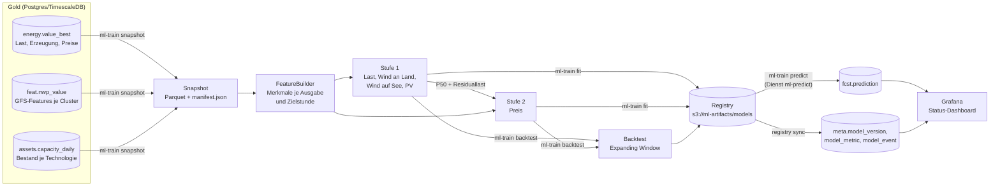
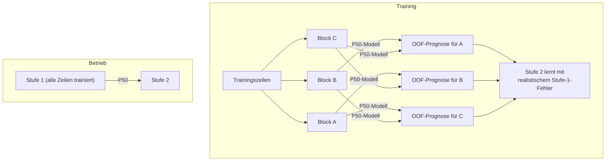
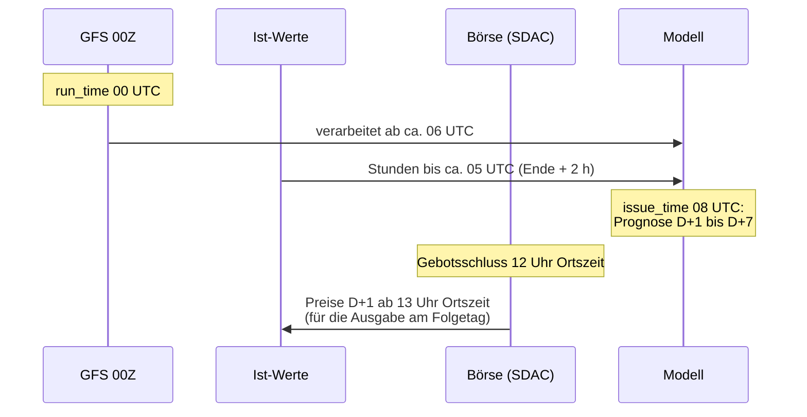
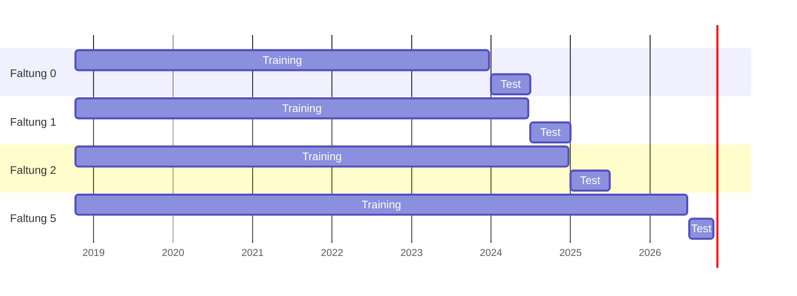

# Prognosemodelle: Last DE und Day-Ahead-Preis DE-LU

Dieses Dokument beschreibt die Prognosemodelle von PredictionDB für Anwender, die den Stack
selbst betreiben: was sie vorhersagen, wie sie aufgebaut sind, welche Daten sie zu welchem
Zeitpunkt sehen, wie Training, Bewertung und Freigabe ablaufen und mit welchen Strategien die
Güte verbessert wird. Die Grundsatzentscheidungen stehen in
[ARCHITEKTUR.md](ARCHITEKTUR.md) Kap. 7.1 bis 7.4 und 7.7, der Code in
[`services/ml_train`](../services/ml_train/README.md), die Backtest-Ergebnisse unter
[`docs/analysen/prognose-de-lu-v1/`](analysen/prognose-de-lu-v1/README.md).

## Inhalt

1. [Steckbrief](#1-steckbrief)
2. [Architektur im Überblick](#2-architektur-im-überblick)
3. [Technische Daten](#3-technische-daten)
4. [Interner Aufbau](#4-interner-aufbau)
5. [Wissen zum Ausgabezeitpunkt (Leakage-Schutz)](#5-wissen-zum-ausgabezeitpunkt-leakage-schutz)
6. [Training](#6-training)
7. [Bewertung, Champion/Challenger und Freigabe](#7-bewertung-championchallenger-und-freigabe)
8. [Betrieb: Inferenz, Registry, Dashboard](#8-betrieb-inferenz-registry-dashboard)
9. [Optimierungsstrategien](#9-optimierungsstrategien)
10. [Modellkonfigurationen und Varianten](#10-modellkonfigurationen-und-varianten)
11. [Bekannte Grenzen](#11-bekannte-grenzen)
12. [Referenz der Konfigurationsdatei](#12-referenz-der-konfigurationsdatei)

## 1. Steckbrief

| | |
|---|---|
| Zielgrößen | Netzlast DE (`load_actual`) und Day-Ahead-Preis DE-LU (`da_price_de_lu`) |
| Hilfsziele | Einspeisung Wind an Land, Wind auf See, PV (`gen_wind_onshore`, `gen_wind_offshore`, `gen_solar`) |
| Ausgabe | Quantile P10, P50, P90 je Stunde |
| Horizont | ganze Liefertage D+1 bis D+7 in Ortszeit (je 23, 24 oder 25 Stunden) |
| Ausgabezeitpunkt | täglich 08 UTC, also vor dem Gebotsschluss der Day-Ahead-Auktion (12 Uhr Ortszeit) |
| Modelltyp | Gradient Boosting (LightGBM) mit Quantil-Verlust, zweistufig |
| Varianten | `kalender` (ohne Wetter, Maßstab) und `wetter` (mit GFS-Features je Technologie) |
| Konfiguration | [`config/ml/de_lu_v1.yaml`](../config/ml/de_lu_v1.yaml) |
| Ergebnis (D+1, 2024 bis 10/2026, ohne Wetter) | Last MAE 1,73 GW (ENTSO-E-Prognose 1,98 GW), Preis MAE 26,3 €/MWh (Vortagespreis 26,1 €/MWh) |

Gradient Boosting ist bewusst das erste Modell: Es trainiert in Minuten auf einer CPU, ist
robust gegen fehlende Werte und setzt den Maßstab, den ein späteres neuronales Netz (TFT, TiDE,
siehe [Abschnitt 9.3](#93-geplant)) schlagen muss.

## 2. Architektur im Überblick



Die Bausteine:

- **Snapshot** (`ml_train.snapshot`): Alle Eingänge eines Trainings als drei Parquet-Dateien
  (`energy`, `weather`, `capacity`) mit `manifest.json` (Zeitraum, Clusterversion, SHA-256 je
  Datei, `snapshot_id`). Training und Backtest lesen nur den Snapshot und brauchen deshalb
  keine Datenbank. Sie laufen auf dem Server, einem Laptop oder einer gemieteten GPU-Instanz.
- **FeatureBuilder** (`ml_train.dataset`): bildet für jeden Ausgabezeitpunkt und jede Zielstunde
  eine Zeile mit genau den Werten, die zum Ausgabezeitpunkt bekannt waren.
- **TwoStageModel** (`ml_train.models`): Stufe 1 und Stufe 2 aus je drei Quantil-Modellen pro
  Zielgröße.
- **Backtest** (`ml_train.backtest`): rollierende Prüfung gegen einfache Verfahren und die
  Prognosen der Übertragungsnetzbetreiber (ÜNB).
- **Registry** (`ml_train.registry`): Ablage der Modellversionen mit Rollen (Champion,
  Challenger, Baseline, Vorgänger) und der Freigaberegel.
- **Inferenz** (`ml_train.predict`, Dienst `ml-predict`): rechnet stündlich alle aktiven
  Versionen und schreibt nach `fcst.prediction`.

## 3. Technische Daten

| Kennwert | `de_lu_v1` |
|---|---|
| Bibliothek | LightGBM 4 (Python-Paket `lightgbm`), Python 3.12, Abhängigkeiten über uv |
| Modelle je Version | 15 Booster: 5 Zielgrößen × 3 Quantile (Stufe 1: 4 × 3, Stufe 2: 1 × 3) |
| Zusätzlich im Training | 12 Hilfs-Booster (4 Stufe-1-Ziele × 3 Blöcke, nur P50) für die Out-of-Fold-Eingänge der Stufe 2; werden nicht gespeichert |
| Bäume je Booster | 400 (`n_estimators`), ohne Early Stopping |
| Blätter je Baum | höchstens 63 (`num_leaves`), mindestens 50 Zeilen je Blatt |
| Lernrate | 0,05 |
| Regularisierung | Zeilen-Stichprobe 80 % je Baum, Merkmals-Stichprobe 80 %, L2 = 1,0 |
| Merkmale | Variante `kalender`: rund 50 in Stufe 1, dazu 5 Stufe-1-Eingänge in Stufe 2; Variante `wetter`: rund 30 Wetterspalten mehr |
| Zeile | ein Paar (Ausgabezeitpunkt, Zielstunde); je Ausgabetag rund 168 Zeilen (7 Liefertage × 24 h) |
| Trainingsumfang | Variante `kalender` ab 08.10.2018, jeder zweite Ausgabetag: rund 240 000 Zeilen bis Mitte 2026 |
| Trainingsdauer | 2 bis 3 Minuten je Variante auf einer üblichen Laptop-CPU (Backtest-Faltungen 2024–2026: 126 bis 165 s) |
| Inferenzdauer | Sekunden je Version und Ausgabezeitpunkt |
| Hardware | CPU genügt; im Compose-Profil `ml` begrenzt `ML_TRAIN_CPUS` (Vorgabe 4) den Trainings-Container |
| Ablageformat | LightGBM-Textmodelle je Ziel und Quantil, `model.json` (Merkmalslisten, Normierung), `manifest.json`, `backtest.parquet` |
| Reproduzierbarkeit | fester Seed 42; jede Version trägt Konfig-Hash, Snapshot-ID, Clusterversion und Git-Commit |

## 4. Interner Aufbau

### 4.1 Zeilen: Ausgabezeitpunkt × Zielstunde

Ein Trainingsbeispiel ist das Paar (`issue_time`, `ts`): eine Prognose, ausgegeben zum Zeitpunkt
`issue_time`, für die Stunde ab `ts` (UTC, Intervallbeginn). Ausgegeben wird einmal täglich zu
`issue.hour_utc`. Für jeden Ausgabetag entstehen Zeilen für die Liefertage in
`issue.lead_days`, jeweils alle Stunden des Tages in Ortszeit Europe/Berlin. Die Zeitumstellung
ergibt daher Tage mit 23 bzw. 25 Zeilen.

Ein einziges Modell deckt alle Vorläufe ab. Der Vorlauf steckt als Merkmal (`lead_day`,
`lead_h`) in jeder Zeile, sodass das Modell selbst lernt, wie viel Gewicht es Lags und Wetter
bei langem Vorlauf noch geben kann.

### 4.2 Merkmalsgruppen

| Gruppe | Spalten | Inhalt |
|---|---|---|
| `calendar` | `hour`, `dow`, `weekend`, `month`, `doy_sin`, `doy_cos`, `holiday_share`, `holiday_national`, `bridge_day`, `christmas`, `dst`, `day_len_h`, `lead_day`, `lead_h` | Stunde und Wochentag in Ortszeit, Jahreszeit als Sinus/Kosinus, Feiertagsanteil (Bevölkerungsanteil der Länder, für die der Tag gesetzlicher Feiertag ist, Destatis 2023), bundesweiter Feiertag, Brückentag, Weihnachten bis Neujahr, Sommerzeit, astronomische Tageslänge bei 51° N, Vorlauf |
| `capacity` | `cap_<technologie>`, `cap_pv` | installierte Leistung je Technologie in DE aus dem MaStR (Clusterversion des Snapshots), am Liefertag |
| `lags` | `lag_<reihe>_day`, `_week`, `_mean_day`, `_mean_7d`, `_last` | für alle Zielgrößen und die Residuallast: gleiche Stunde am letzten vollständig bekannten Tag, gleiche Stunde in der jüngsten bekannten Vorwoche, Tagesmittel des letzten vollständigen Tags, 7-Tage-Mittel, letzter bekannter Stundenwert |
| `weather` | `wx_<technologie>_<feature>`, `wx_interp`, `wx_lead_h` | GFS-Features je Technologie, über die MaStR-Cluster zusammengefasst (siehe unten), Kennzeichen für interpolierte Stunden, Vorlauf des Wetterlaufs |
| `stage1` | `s1_load_actual`, `s1_gen_*`, `s1_residual_load` | nur Stufe 2: P50 der Stufe 1 und daraus Residuallast = Last − Wind an Land − Wind auf See − PV |

**Wetter-Features.** `wx-process` rechnet jeden GFS-Lauf auf die Anlagen-Cluster aus dem MaStR
um (ARCHITEKTUR.md 7.5). Je Technologie stehen bereit:

| Technologie | Features |
|---|---|
| `wind_on`, `wind_off` | `t2m`, `wind_speed_10m`, `wind_speed_100m`, `wind_speed_hub` (Höhenprofil auf Nabenhöhe), `wind_cf` (generische Leistungskurve), `wind_power` (MW), `gust` |
| `pv_ground`, `pv_roof` | `t2m`, `ghi`, `pv_cf` (Strahlung mit Temperaturkorrektur, Performance Ratio 0,85), `pv_power` (MW), `cloud_cover`, `snow_fraction` |
| `hydro` | `t2m`, `precip`, `snow_fraction` |
| `biomass` | `t2m` |

Der Snapshot fasst die Cluster einer Technologie zusammen: Leistungsgrößen (`*_power`) als Summe,
alle anderen mit der installierten Leistung gewichtet gemittelt. Wetter liegt im Snapshot in
den nativen GFS-Schritten (stündlich bis 120 h, danach dreistündlich). Erst die Merkmalsbildung
füllt auf Stunden auf (Interpolation beim Lesen): Momentanwerte linear, Intervallgrößen wie
Strahlung oder Niederschlag gelten für das ganze Intervall bis zum Schritt. Auf die
Energiestunde `[ts, ts+1h)` passen der Intervallwert mit Gültigkeit `ts+1h` und das Mittel der
Momentanwerte bei `ts` und `ts+1h`.

### 4.3 Stufe 1: Last, Wind und PV

Je Zielgröße drei LightGBM-Booster (P10, P50, P90) mit den Gruppen der Variante ohne `stage1`.

- **Last** wird direkt in MW gelernt.
- **Wind und PV** werden als **Kapazitätsfaktor** gelernt: Ziel geteilt durch die installierte
  Leistung (`normalize_by`), die Prognose wird danach wieder mit der Leistung am Liefertag
  multipliziert. Die Spalten `cap_*` sind für diese Ziele kein Merkmal (Begründung in
  [9.1](#91-umgesetzt)).

### 4.4 Stufe 2: Preis

Der Preis bekommt alle Merkmale der Stufe 1 und zusätzlich deren P50-Prognosen sowie die daraus
gerechnete Residuallast. Die Residuallast ist der wichtigste Preistreiber: Je weniger Wind und
PV die Last decken, desto teurere Kraftwerke setzen den Preis.

Der Preis wird **relativ zum Tagesmittel des letzten bekannten Liefertags** gelernt
(`center: lag_da_price_de_lu_mean_day`). Das Modell lernt also Abweichungen vom aktuellen
Preisniveau, nicht absolute Preise.

**Out-of-Fold-Eingänge.** Würde Stufe 2 im Training mit Stufe-1-Prognosen lernen, die auf
denselben Zeilen trainiert wurden, wären diese Eingänge zu gut, und Stufe 2 würde ihnen im
Betrieb zu sehr vertrauen. Deshalb teilt das Training die Ausgabetage in drei zeitlich
zusammenhängende Blöcke (`oof_folds`), trainiert je Block ein P50-Modell auf den beiden anderen
und nutzt dessen Prognose für den ausgelassenen Block. Im Betrieb kommen die Eingänge aus den
regulären Stufe-1-Modellen.



### 4.5 Quantile

Jedes Quantil ist ein eigener Booster mit Pinball-Verlust (LightGBM-Ziel `quantile`, `alpha` =
0,1, 0,5 bzw. 0,9). Weil die drei Booster unabhängig lernen, können sich ihre Werte in
einzelnen Stunden kreuzen. Die Vorhersage sortiert die drei Werte je Zeile deshalb aufsteigend,
sodass immer P10 ≤ P50 ≤ P90 gilt.

### 4.6 Vergleichsverfahren

Im Backtest laufen auf denselben Zeilen mit:

| Verfahren | Methode im Ergebnis | Inhalt |
|---|---|---|
| Letzter bekannter Tag | `naive_day` | gleiche Stunde am letzten vollständig bekannten Tag (beim Preis meist der Liefertag D selbst) |
| Vorwoche | `naive_week` | gleiche Stunde in der jüngsten bekannten Vorwoche |
| ÜNB/ENTSO-E | `bench_<reihe>` | Day-Ahead-Prognosen der ÜNB für Last, Wind und PV, nur für D+1 (so werden sie veröffentlicht) |

Die ÜNB-Prognosen sind in `de_lu_v1` nur Vergleich, nie Merkmal.

## 5. Wissen zum Ausgabezeitpunkt (Leakage-Schutz)

Ein Modell, das im Training Werte sieht, die zum Ausgabezeitpunkt noch gar nicht veröffentlicht
waren, sieht im Backtest besser aus, als es im Betrieb ist. Jede Merkmalsspalte wird deshalb
mit dem Wissensstand von `issue_time` gebildet:

| Daten | bekannt ab | Parameter |
|---|---|---|
| Ist-Werte (Last, Erzeugung, Residuallast) | Intervallende + 2 h | `issue.actual_delay_h` |
| Day-Ahead-Preis eines Liefertags | 13 Uhr Ortszeit am Vortag | `issue.price_known_local_hour` |
| GFS-Lauf | `run_time` + 6 h (vollständig verarbeitet) | `issue.nwp_delay_h` |
| installierte Leistung | Stand des MaStR-Snapshots, auf Tage zurückgerechnet | – |
| Prognosen Dritter | nur Vergleich, kein Merkmal (v1) | – |

Bei Ausgabe um 08 UTC heißt das: Wetter kommt aus dem 00Z-Lauf desselben Tags, der Preis ist
bis einschließlich des laufenden Liefertags D bekannt, Last und Erzeugung bis etwa 05 UTC.
„Letzter vollständiger Tag“ ist für Last und Erzeugung deshalb der Vortag, für den Preis der
Tag D.



Im Backtest gilt zusätzlich: Ziele, deren Stunde nach dem Trainingsende einer Faltung liegt, sind
zum Faltungsbeginn noch nicht bekannt und fallen aus dem Training (siehe 6.2).

## 6. Training

### 6.1 Ablauf

```bash
# 1. Snapshot aus der Datenbank (PDB_DATABASE_URL)
uv run ml-train snapshot --out .ml-data/snap --from 2015-01-01 --weather-from 2021-03-22

# 2. Backtest aller Varianten (Expanding Window)
uv run ml-train backtest --snapshot .ml-data/snap --out .ml-data/bt

# 3. Endgültiges Modell auf allen Daten trainieren und registrieren
uv run ml-train fit --snapshot .ml-data/snap --variant kalender --backtest .ml-data/bt \
    --role challenger

# 4. Gegen den Champion prüfen und ggf. freigeben
uv run ml-train registry evaluate <version>
uv run ml-train registry promote <version>
```

Im Compose-Stack laufen dieselben Befehle mit `docker compose --profile ml run --rm ml-train …`
(Arbeitsordner `/data` im Volume `ml-data`, Registry in `s3://ml-artifacts/models`). Ohne
Datenbankzugang, etwa auf einem Laptop oder einer Miet-GPU, genügt ein kopierter Snapshot. Die
Registry kann dann auch ein lokaler Ordner sein (`--registry` bzw. `PDB_ML_REGISTRY`).

### 6.2 Trainingsdaten

- **Beginn:** `train_from` der Variante, für `kalender` der Start der Gebotszone DE-LU am
  08.10.2018, für `wetter` der Beginn der GFS-Historie (23.03.2021). Ältere Preise gehören zur
  Gebotszone DE-AT-LU und sind nicht vergleichbar.
- **Ende:** letzter Ausgabetag mit Ist-Werten aller Zielgrößen minus `gap_days` (8 Tage). Damit
  liegen alle Zielstunden des Trainings vor dem ersten Ausgabetag, der geprüft wird.
- **Stride:** Nur jeder zweite Ausgabetag geht ins Training (`train_issue_stride: 2`).
  Aufeinanderfolgende Ausgaben überlappen zu sechs Siebteln in ihren Zielstunden. Jeder zweite
  Tag halbiert die Trainingszeit bei kaum weniger Information.
- **Wetter:** Die Variante `wetter` nutzt nur Ausgabezeitpunkte, zu denen ein verarbeiteter
  Wetterlauf vorlag (`requires_weather`).
- **Fehlende Ziele:** Zeilen ohne Ist-Wert (Datenlücken) fallen je Ziel aus dem Training.
  Fehlende Merkmale bleiben leer, LightGBM behandelt sie als eigenen Zweig.

### 6.3 Backtest (Expanding Window)



Ab `backtest.test_from` wird der Zeitraum in Faltungen zu `fold_months` Monaten geteilt. Je
Faltung trainiert jede Variante neu mit allen Ausgabetagen bis 8 Tage vor Faltungsbeginn und
wird auf allen Ausgabetagen der Faltung (jeder Tag, kein Stride) geprüft. So entsteht für den
gesamten Testzeitraum eine Prognose, wie sie im Betrieb entstanden wäre, und das Modell wird
in jeder Jahreszeit mit unterschiedlich viel Historie geprüft.

Für einen kurzen Zeitraum, etwa solange die Wetterhistorie noch dünn ist, lassen sich
Testbeginn, Faltungslänge und Stride überschreiben:

```bash
uv run ml-train backtest --snapshot .ml-data/snap --out .ml-data/bt-wx \
    --variant kalender --variant wetter --test-from 2026-09-15 --fold-months 1 --stride 1
```

Ergebnis im Ausgabeordner: `predictions.parquet` (alle Verfahren in Langform), `metrics.csv`
und `lauf.json` (Snapshot-ID, Konfig-Hash, Faltungen, Laufzeiten, Git-Commit).

### 6.4 Kennzahlen

| Kennzahl | Zweck |
|---|---|
| MAE, RMSE, Bias des P50 | Punktgüte, Ausreißer, systematischer Versatz |
| Pinball-Verlust, gemittelt über P10/P50/P90 | Güte der ganzen Verteilung, Hauptmaß für die Freigabe |
| Abdeckung P10–P90 | Anteil der Ist-Werte im Band; Soll 80 % |
| Rangkorrelation der Stunden je Liefertag (Spearman) | trifft der Preis die Reihenfolge günstiger und teurer Stunden? Wichtig für Lastverschiebung und Speicher |

Alle Kennzahlen werden je Verfahren, Ziel und Vorlauftag berechnet, zusätzlich nach
Jahreszeit und Jahr. Vergleiche zwischen Verfahren laufen nur auf gemeinsamen Zeilen, also
Stunden, für die alle verglichenen Verfahren eine Prognose haben.

## 7. Bewertung, Champion/Challenger und Freigabe

Jede neue Version kommt als **Challenger** in die Registry (oder als `champion` bzw. `baseline`,
wenn ausdrücklich gewünscht). `registry promote` macht einen Challenger nur dann zum Champion,
wenn auf den gemeinsamen Backtest-Zeilen beider Versionen gilt:

1. Je Zielgröße ist der mittlere Pinball-Verlust mindestens um `min_gain` (Vorgabe 0) besser.
2. In keiner Gruppe aus Zielgröße, Vorlauftag und Jahreszeit mit mindestens `min_group_n`
   (200) Werten ist der Challenger mehr als `max_group_loss` (5 %) schlechter.

So kann eine Version, die im Mittel gewinnt, aber etwa im Winter für D+1 deutlich verliert,
nicht unbemerkt Champion werden. `registry evaluate` zeigt die Gründe vorab, `--force`
übergeht die Regel und wird im Verlauf vermerkt.

Rollen in der Registry:

| Rolle | Bedeutung | wird inferiert |
|---|---|---|
| `champion` | Produktionsmodell | ja |
| `challengers` | laufen im Schatten mit | ja |
| `baseline` | LightGBM ohne Wetter als fester Maßstab | ja |
| `previous` | frühere Champions, als Rückfall | der jüngste |

## 8. Betrieb: Inferenz, Registry, Dashboard

- **Inferenz:** Der Dienst `ml-predict` (Compose-Profil `ml`) ruft stündlich `ml-train predict`
  auf. Er liest einen kleinen Live-Snapshot um den Ausgabezeitpunkt (Energie der letzten
  45 Tage, Wetterläufe der letzten 2 Tage, Bestand), bildet die Merkmale wie im Training und
  rechnet alle aktiven Versionen. Jede Version schreibt unter eigenem `model_version` nach
  `fcst.prediction` (Ziel, Ausgabezeitpunkt, Gültigkeitszeit, Quantil, Wert). Ein erneuter Lauf
  zum selben Ausgabezeitpunkt überschreibt. Eine Wetter-Variante wird übersprungen, wenn kein
  passender Lauf vorliegt.
- **Registry:** Verzeichnisbaum lokal oder in Garage:

  ```text
  <root>/<konfiguration>/registry.json               Rollen und Verlauf
  <root>/<konfiguration>/<version>/model.json        Merkmalslisten, Normierung, Variante
  <root>/<konfiguration>/<version>/<ziel>_q10.txt …  LightGBM-Modelle
  <root>/<konfiguration>/<version>/manifest.json     Konfig-Hash, Snapshot, Commit, Kennzahlen
  <root>/<konfiguration>/<version>/backtest.parquet  Backtest-Prognosen für den Vergleich
  ```

  Versionsnamen haben die Form `<konfiguration>-<variante>-<JJJJMMTThhmm>-<snapshot>`, z. B.
  `de_lu_v1-kalender-202610221030-566fdb`.
- **Spiegel für Grafana:** `ml-train registry sync` überträgt Versionen, Rollen, Trainingsdauer
  und Backtest-Kennzahlen nach `meta.model_version`, `meta.model_metric` und `meta.model_event`.
  `fit`, `promote` und jeder `predict`-Lauf gleichen selbst ab. Die Sicht
  `fcst.prediction_error` stellt jede gespeicherte P50-Prognose dem Ist-Wert gegenüber; daraus
  zeigt das Status-Dashboard den Prognosefehler im Betrieb.

| Umgebungsvariable | Vorgabe |
|---|---|
| `PDB_ML_CONFIG` | `config/ml/de_lu_v1.yaml` |
| `PDB_ML_REGISTRY` | `s3://ml-artifacts/models` (oder ein lokaler Ordner) |
| `PDB_ML_CACHE` | `/tmp/ml-train-cache` (geladene Modelle) |
| `ML_TRAIN_CPUS` | 4 (CPU-Grenze des Trainings-Containers) |

## 9. Optimierungsstrategien

### 9.1 Umgesetzt

| Strategie | Problem, das sie löst | Wirkung im Backtest |
|---|---|---|
| **Zweistufiger Aufbau** (Preis nach Last/Wind/PV) | Der Preis hängt vor allem an der Residuallast; ein Modell, das sie nicht kennt, muss sie implizit mitlernen | Fehler lassen sich der Stufe zuordnen; Wind- und PV-Güte wirken direkt auf den Preis |
| **Out-of-Fold-Eingänge für Stufe 2** | Stufe 2 würde perfekten Stufe-1-Werten vertrauen | realistische Gewichtung der Residuallast |
| **Kapazitätsfaktor statt MW für Wind und PV** | Bäume extrapolieren nicht: Ein Zubau über den Trainingsbestand hinaus wäre unerreichbar | Prognosen wachsen mit dem Bestand mit |
| **Bestand nicht als Merkmal für Wind und PV** | Die stetig steigende Leistung wirkte wie ein Zeitindex; außerhalb der Trainingsspanne landete jede Prognose im Blatt der letzten Monate | im ersten Lauf Wind an Land 2024 um +6 GW zu hoch, danach behoben |
| **Preis relativ zum letzten bekannten Liefertag** | Preisniveaus wie 2022 würden als feste Werte gelernt | MAE D+1 21,4 statt 22,3 €/MWh gegenüber dem 7-Tage-Mittel (Halbjahr 07–12/2025) |
| **Training ab 2018 statt nur jüngere Jahre** | Kurze Historie kennt seltene Lagen nicht | Training ab 2023 war schlechter (24,9 statt 21,4 €/MWh) |
| **Ein Modell für alle Vorläufe mit Vorlauf als Merkmal** | sieben getrennte Modelle hätten je ein Siebtel der Daten | gemeinsame Muster (Kalender, Saison) über alle Vorläufe |
| **Lags nach Wissensstand** (letzter vollständiger Tag, jüngste bekannte Vorwoche) | Lags „gestern“ wären für Last und Preis unterschiedlich weit veröffentlicht | kein Leakage, gleiches Verhalten in Backtest und Betrieb |
| **Feiertage als Bevölkerungsanteil, Brückentage** | Landesfeiertage senken die Last nur anteilig | genauere Last an regionalen Feiertagen |
| **Stride 2 im Training** | stark überlappende Zeilen kosten Zeit ohne Information | etwa halbe Trainingszeit |
| **Regularisierung** (Bagging 80 %, Feature-Fraction 80 %, L2, mindestens 50 Zeilen je Blatt) | Überanpassung an einzelne Tage | stabile Ergebnisse über Faltungen |
| **Sortierte Quantile** | sich kreuzende Quantil-Booster | stets P10 ≤ P50 ≤ P90 |
| **Ablation über Varianten** | Was bringt eine Merkmalsgruppe wirklich? | jede Gruppe wird als eigene Variante auf denselben Zeilen geprüft |
| **Champion/Challenger mit Gruppenregel** | Verbesserung im Mittel bei Verschlechterung in einer Lage | Freigabe nur ohne Einbruch in Ziel × Vorlauf × Jahreszeit |

### 9.2 Bewusst noch nicht umgesetzt

- **Keine Hyperparameter-Suche:** Die LightGBM-Parameter sind feste, übliche Werte. Bisher
  kamen die großen Verbesserungen aus Zielnormierung und Merkmalen; eine Suche lohnt sich erst,
  wenn die Merkmale feststehen.
- **Kein Early Stopping:** Die Baumzahl ist fest (400), damit Backtest und endgültiges Modell
  gleich trainiert werden und kein Validierungsabschnitt aus dem Training fehlt.
- **Keine Gewichtung jüngerer Daten:** Das Expanding Window gewichtet alle Jahre gleich. Die
  Zentrierung des Preises fängt Niveauänderungen auf.

### 9.3 Geplant

| Vorhaben | Ziel |
|---|---|
| **Kalibrierung der Quantile** (konformale Korrektur je Vorlauf auf dem letzten Trainingsjahr) | Das Band P10–P90 enthält heute 62–65 % statt 80 % der Ist-Werte |
| **Wetter-Variante bewerten**, sobald die GFS-Historie ab 2021 vollständig ist | Wind und PV sind ohne Wetter nur Klimatologie (Wind an Land MAE 7,4 GW gegen 1,2 GW bei den ÜNB) |
| **Freie Zusatzreihen** (Nachbarpreise, Lastprognose der ÜNB, Brennstoffe, Marktwerte) | Preisniveau und Kopplung an Nachbarzonen, siehe [`de_lu_v2`](#102-de_lu_v2-in-arbeit) |
| **Schulferien, bevölkerungsgewichtete Temperatur** | Last in Ferien und bei Hitze/Kälte |
| **Trend im PV-Kapazitätsfaktor** | PV liegt im Mittel 1 GW zu hoch (Eigenverbrauch, Abregelung wachsen mit dem Bestand) |
| **Hyperparameter-Suche** (z. B. Optuna) auf GPU oder nachts auf CPU | Feinabstimmung nach Abschluss der Merkmalsarbeit |
| **Fine-Tuning statt Neutraining** (LightGBM `init_model`, später Warm-Start beim NN) | wöchentliche Nachführung ohne Volltraining, ARCHITEKTUR.md 7.7 |
| **Neuronales Netz** (TFT, TiDE oder N-HiTS mit bekannten Zukunftskovariaten) | muss den LightGBM-Champion im selben Backtest schlagen |
| **Streuung der aktiven Versionen** (`fcst.model_spread`) und gewichtetes Ensemble | Unsicherheitssignal und mögliche Kombination der Versionen |
| **Inferenz bei `NOTIFY features_ready`** statt stündlich, zusätzliche Ausgabe nach dem 06Z-Lauf | frischere Wetterdaten vor Gebotsschluss |
| **MLflow** statt Datei-Registry | Versionen, Metriken und Artefakte in einer Oberfläche |

## 10. Modellkonfigurationen und Varianten

Eine Konfigurationsdatei unter `config/ml/` beschreibt ein Modell vollständig: Ausgabezeitpunkt,
Zielgrößen beider Stufen, Merkmalsgruppen je Variante, LightGBM-Parameter, Backtest und
Freigaberegel. Ihr SHA-256 geht in jede Version ein. Eine Änderung am Modell ist deshalb immer
eine neue oder geänderte Datei, und jede Version lässt sich genau einer Konfiguration zuordnen.

### 10.1 `de_lu_v1`

| Variante | Gruppen | Training ab | Rolle |
|---|---|---|---|
| `kalender` | `calendar`, `lags`, `capacity`, `stage1` | 08.10.2018 | Champion und Baseline |
| `wetter` | zusätzlich `weather` | 23.03.2021 | Challenger, sobald die Wetterhistorie reicht |

Ergebnisse im Backtest 2024 bis 10/2026 (D+1, gleiche Stunden):

| | MAE | RMSE | Bias | P10–P90 enthält Ist |
|---|---|---|---|---|
| Last: Modell ohne Wetter | 1 726 MW | 2 228 MW | −43 MW | 65 % |
| Last: ENTSO-E Day-Ahead | 1 985 MW | 2 563 MW | +119 MW | – |
| Preis: Modell ohne Wetter | 26,3 €/MWh | 36,0 €/MWh | −9,4 €/MWh | 62 % |
| Preis: letzter bekannter Tag | 26,1 €/MWh | 38,6 €/MWh | −0,1 €/MWh | – |

Für D+2 bis D+7 liegt der Preis-MAE bei 29–30 €/MWh gegenüber 31,6–36,6 €/MWh der einfachen
Verfahren; die Rangkorrelation der Stunden eines Tags bei 0,875 gegenüber 0,79 (Vortag).
Einzelheiten und Grafiken: [`docs/analysen/prognose-de-lu-v1/`](analysen/prognose-de-lu-v1/README.md).

### 10.2 `de_lu_v2` (in Arbeit)

`de_lu_v2` übernimmt `de_lu_v1` unverändert und ergänzt **Reihengruppen** (`series_groups`):
weitere Reihen aus `energy.value_best` als eigene Merkmalsgruppen. Eingebunden werden nur Reihen
aus Quellen, deren Bedingungen eine freie Veröffentlichung des Modells erlauben. Drei Modi legen
fest, wann ein Wert als bekannt gilt:

| Modus | Merkmale | bekannt ab |
|---|---|---|
| `lags` | wie die Lags der Ziele (`lag_<reihe>_day`, `_mean_day`, `_mean_7d` …) | Day-Ahead-Preise (`da_price_*`) wie der Preis DE-LU, alle anderen wie Ist-Werte |
| `forecast` | Prognose Dritter für die Zielstunde selbst (`fc_<reihe>`) | `known_local_hour` am Vortag des Liefertags, sonst leer |
| `asof` | letzter veröffentlichter Wert (`asof_<reihe>`) und Änderung über `change_days` (`_chg`) | Zeitpunkt `published` der Reihe |

| Gruppe | Modus | Reihen |
|---|---|---|
| `nachbarn` | `lags` | Day-Ahead-Preise von 14 Nachbar- und Kopplungszonen (AT, BE, CH, CZ, DK1, DK2, FR, HU, IT-Nord, NL, NO2, PL, SE4, SI) |
| `lastprognose` | `forecast` | Day-Ahead-Lastprognose der ÜNB, ab 10 Uhr am Vortag |
| `brennstoffe` | `asof` | Wechselkurs USD/EUR, Diesel und Heizöl, Erdgas EU, LNG Japan, Henry Hub, Kohle, Brent |
| `marktwerte` | `asof` | Monats- und Jahresmarktwerte nach EEG (Base, Wind an Land, Wind auf See, Solar), selbst aus SMARD berechnet |

Damit wird die Lastprognose der ÜNB erstmals Merkmal, allerdings nur für D+1 und nur, wenn sie
zum Ausgabezeitpunkt veröffentlicht war. Varianten für die Ablation: `kalender` (wie v1), je eine
Gruppe dazu (`nachbarn`, `lastprognose`, `brennstoffe`, `marktwerte`), alle zusammen (`frei`)
sowie `wetter` und `wetter_frei`. Die Ergebnisse der Ablation werden hier ergänzt, sobald sie
vorliegen; sie erscheinen unter `docs/analysen/prognose-de-lu-v2/`.

## 11. Bekannte Grenzen

- **Quantilbänder zu schmal** (62–65 % statt 80 % Abdeckung). Bis zur Kalibrierung sind P10 und
  P90 als Untergrenze der Unsicherheit zu lesen.
- **Preis-Bias** von −9 €/MWh im Mittel, vor allem 2024 und im Frühling. Ohne Brennstoffpreise
  kennt `de_lu_v1` das Preisniveau nur aus den Lags.
- **Ohne Wetter** folgen Wind und PV nur der Klimatologie; der Preis bekommt damit eine grobe
  Residuallast. Die Variante `wetter` braucht eine mehrjährige GFS-Historie, bevor sie
  belastbar bewertet werden kann.
- **MaStR-Rückrechnung:** Der Bestand je Tag stammt aus dem aktuellen MaStR-Snapshot.
  Nachgemeldete Anlagen erscheinen damit auch an früheren Tagen (leichter Vorgriff, betrifft nur
  die Normierung von Wind und PV).
- **Benchmarks** sind die zuletzt veröffentlichten ÜNB-Stände; spätere Revisionen begünstigen
  sie leicht.
- **Stündliche Auflösung:** Ziele sind Stundenmittel. Viertelstündliche Preise (seit der
  Umstellung der Day-Ahead-Auktion) werden gemittelt.

## 12. Referenz der Konfigurationsdatei

| Schlüssel | Bedeutung |
|---|---|
| `name`, `title` | Name der Konfiguration (Präfix der Versionen) und Beschreibung |
| `quantiles` | zu lernende Quantile, Vorgabe `[0.1, 0.5, 0.9]` |
| `issue.hour_utc` | Ausgabestunde (UTC) |
| `issue.lead_days` | Liefertage nach dem Ausgabetag |
| `issue.actual_delay_h` | Verzug, ab dem Ist-Werte bekannt sind |
| `issue.price_known_local_hour` | Stunde (Ortszeit) am Vortag, ab der die Day-Ahead-Preise bekannt sind |
| `issue.nwp_delay_h` | Verzug, ab dem ein Wetterlauf verarbeitet vorliegt |
| `stage1[]`, `stage2[]` | Zielgrößen: `code`, `role` (`load`, `generation`, `price`, `other`), `benchmarks`, `normalize_by`, `center` |
| `lag_series` | weitere Reihen mit Lags (z. B. `residual_load`) |
| `weather_features` | Auswahl der Wetter-Features, leer = alle |
| `series_groups` | ab `de_lu_v2`: Reihengruppen mit `mode`, `codes`, `lags`, `known_local_hour`, `change_days` |
| `variants[]` | `name`, `groups`, `requires_weather`, `train_from` |
| `lgbm` | `num_leaves`, `learning_rate`, `n_estimators`, `min_child_samples`, `subsample`, `subsample_freq`, `colsample_bytree`, `reg_lambda`, `n_jobs` (0 = alle Kerne) |
| `backtest` | `test_from`, `test_to`, `fold_months`, `gap_days`, `oof_folds`, `train_issue_stride` |
| `promotion` | `min_gain`, `max_group_loss`, `min_group_n` |
