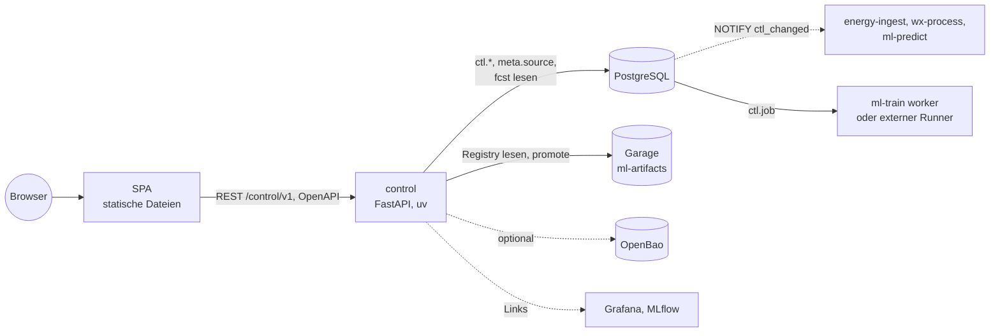

# Steuer-UI: optionales Dashboard mit Control Plane

**Status:** Konzept, nicht umgesetzt · **Stand:** 2026-10-25

Dieses Dokument beschreibt eine optionale Bedienoberfläche (SPA) mit eigenem Backend, über die
Betreiber den Stack steuern können: Prognosen und Modellvarianten aktivieren, Input-Sets wählen,
Zugangsdaten je Quelle hinterlegen, Trainingsläufe anstoßen und Champion/Challenger verwalten.
Die Gesamtarchitektur steht in [ARCHITEKTUR.md](ARCHITEKTUR.md), die Modelle in
[PROGNOSEMODELLE.md](PROGNOSEMODELLE.md), Schlüssel und Lizenzen der Quellen in
[DATENQUELLEN-ZUGANG.md](DATENQUELLEN-ZUGANG.md).

## Inhalt

1. [Grundsätze](#1-grundsätze)
2. [Abgrenzung zu Grafana, MLflow und CLI](#2-abgrenzung-zu-grafana-mlflow-und-cli)
3. [Konfiguration: Vorrang der ENV-Variablen](#3-konfiguration-vorrang-der-env-variablen)
4. [Funktionsumfang](#4-funktionsumfang)
5. [Lizenzmarkierung](#5-lizenzmarkierung)
6. [Zugangsdaten und Geheimnisse](#6-zugangsdaten-und-geheimnisse)
7. [Aufbau: Backend, SPA, Compose](#7-aufbau-backend-spa-compose)
8. [Authentifizierung und Rollen](#8-authentifizierung-und-rollen)
9. [Umsetzungsschritte](#9-umsetzungsschritte)
10. [Offene Punkte](#10-offene-punkte)

## 1. Grundsätze

1. **Das System läuft vollständig ohne UI.** Alles, was die UI kann, geht auch über
   ENV-Variablen, Konfigurationsdateien unter `config/` und die Kommandozeilen
   (`ml-train registry …`, `pdb-model …`, `pdb-analysis …`). Die UI ist eine Bedienschicht
   darüber, keine Voraussetzung.
2. **Zuschaltbar.** Ohne `PDB_CONTROL_UI=true` lesen die Dienste keine UI-Einstellungen und
   verhalten sich genau wie heute. Backend und SPA laufen nur im Compose-Profil `control`.
3. **ENV-Variablen haben Vorrang.** Ein per ENV gesetzter Wert kann in der UI nicht
   überschrieben werden; sie zeigt ihn an und markiert ihn als „durch ENV festgelegt“ (3.).
4. **Keine zweite Logik.** Das Backend ruft dieselben Funktionen wie die CLI auf
   (z. B. die Registry aus `ml_train`, die Quellenfreigabe aus `energy_ingest.config`). Regeln
   wie die Promote-Prüfung oder die Lizenzprüfung gibt es genau einmal.
5. **Lizenz geht vor Bequemlichkeit.** Das Backend erzwingt, dass Modelle mit unfreien Daten
   nicht frei veröffentlicht werden (5.). Kein Schalter und keine Rolle hebt das auf.
6. **Geheimnisse nie im Klartext in der Datenbank** (6.).

## 2. Abgrenzung zu Grafana, MLflow und CLI

| Werkzeug | Aufgabe | bleibt |
|---|---|---|
| Grafana | Monitoring und Auswertung: Status-Dashboard, Prognose-Dashboard (ARCHITEKTUR 7.10), Alarme | ja, unverändert |
| MLflow | Experimente, Läufe, Metriken, Artefakte | ja |
| CLI | vollständige Steuerung, Skripte, Automatisierung | ja, maßgeblich |
| Steuer-UI | Steuern und Konfigurieren: was läuft, mit welchen Daten, welches Modell ist Champion | optional |

Die UI zeichnet keine eigenen Zeitreihen-Diagramme, sondern verlinkt auf die passenden
Grafana-Panels und MLflow-Läufe. Sie zeigt nur Zustände, die sie zum Steuern braucht
(Quellenstatus, letzte Läufe, Rangliste der Modelle).

## 3. Konfiguration: Vorrang der ENV-Variablen

Jeder Dienst ermittelt seine wirksame Konfiguration in dieser Reihenfolge, der erste gesetzte
Wert gewinnt:

| Rang | Ebene | Beispiel | änderbar über |
|---|---|---|---|
| 1 | ENV-Variable | `PDB_ENERGY_SOURCES`, `PDB_PREDICT_MODEL`, `PDB_ALLOW_*` | `.env`, Compose |
| 2 | UI-Einstellung (nur mit `PDB_CONTROL_UI=true`) | Tabelle `ctl.setting` | Steuer-UI, CLI |
| 3 | Konfigurationsdatei im Repo | `config/ml/de_lu_v2.yaml`, `config/sources/*` | Git |
| 4 | Vorgabe im Code | `DEFAULT_REGISTRY` | Code |

Umsetzung:

- Eine gemeinsame Funktion in `core` (Arbeitstitel `core.settings.effective()`) liefert je
  Schlüssel Wert **und Herkunft** (`env`, `ui`, `datei`, `vorgabe`). Dienste und Backend nutzen
  dieselbe Funktion, damit UI-Anzeige und tatsächliches Verhalten nicht auseinanderlaufen.
- Die UI zeigt bei jedem Wert die Herkunft. Felder mit Herkunft `env` sind gesperrt.
- UI-Einstellungen liegen im Schema `ctl` (eigene Alembic-Migration) als Schlüssel/Wert mit
  Version, Autor und Zeitstempel. Änderungen lösen `NOTIFY ctl_changed` aus; Dienste übernehmen
  sie beim nächsten Zyklus, ohne Neustart. Werte, die einen Neustart brauchen, sind als solche
  gekennzeichnet.
- `pdb-ctl export` schreibt alle UI-Einstellungen als YAML bzw. `.env`-Ausschnitt. So lässt sich
  eine per UI gefundene Einstellung jederzeit fest in die Konfiguration übernehmen und die UI
  wieder abschalten.

**Sonderfall Lizenzschalter (entschieden 2026-10-25).** Für die Schalter `PDB_ALLOW_*` (unfreie Quellen) gilt zusätzlich:
Die UI kann **nur einschränken, nie lockern**. Eine unfreie Quelle läuft nur, wenn ihr
`PDB_ALLOW_*` per ENV auf `true` steht; die UI kann sie dann für diese Instanz oder für einzelne
Input-Sets wieder ausschließen, aber eine per ENV nicht freigegebene unfreie Quelle nicht
einschalten. Freie Quellen kann die UI ein- und ausschalten.

## 4. Funktionsumfang

### 4.1 Quellen

- Liste aller Quellen aus `meta.source` mit `free`, `enabled`, Lizenz, Quellenvermerk, letztem
  Abruf und Fehlerstand (dieselbe Sicht wie das Status-Dashboard, als Tabelle).
- Freie Quellen ein- und ausschalten (Rang 2 in 3.); unfreie nur nach der Regel in 3.
- Zugangsdaten hinterlegen bzw. sehen, ob sie gesetzt sind (6.). Link auf die Anleitung in
  `DATENQUELLEN-ZUGANG.md`.

### 4.2 Prognosen, Modellvarianten und Input-Sets

- **Aktive Prognosen:** welche Modellkonfigurationen und Varianten `ml-predict` parallel
  rechnet (ARCHITEKTUR 7.7, höchstens etwa fünf Versionen). Entspricht heute
  `PDB_PREDICT_MODEL` bzw. der Registry-Rolle; ist die ENV gesetzt, ist die Auswahl gesperrt.
- **Input-Sets:** ein Input-Set ist eine benannte Auswahl von Feature-Gruppen
  (`calendar`, `lags`, `capacity`, `weather`, `nachbarn`, `brennstoffe`, …) wie die `variants`
  in `config/ml/*.yaml`. Die UI legt neue Varianten als Overlay auf eine Konfigurationsdatei an,
  ändert die Datei selbst aber nicht. Neben jedem Set steht die abgeleitete Lizenzklasse (5.):
  welche Reihen es nutzt, aus welchen Quellen, frei oder intern.
- Hinweise aus der Konfiguration werden angezeigt, z. B. `requires_weather` und der daraus
  folgende spätere Trainingsbeginn.

### 4.3 Trainingsläufe

- Lauf anstoßen: Konfiguration, Variante(n), Trainingszeitraum, optional Fine-Tuning auf einem
  bestehenden Modell (ARCHITEKTUR 7.7).
- Das Backend startet **keine Container** und bekommt keinen Docker-Socket. Es legt einen
  Auftrag in `ctl.job` an. Abgeholt wird er von einem Worker (`ml-train worker`, Profil `train`)
  auf der VM oder von einem externen Rechner bzw. einer gemieteten GPU, der Aufträge über die
  Control-API abholt (Pull, keine eingehende Verbindung ins Heimnetz nötig). Der Trainingsjob
  selbst bleibt der portable Job aus 7.7.
- Status, Laufzeit, Link auf den MLflow-Lauf, Abbrechen eines wartenden Auftrags.
- Solange die Vorgabe „erst ab drei Jahren GFS-Trainingsdaten“ gilt, bietet die UI kein
  automatisches wöchentliches Neutraining an, nur manuelle Läufe.

### 4.4 Champion und Challenger

- Rangliste je Markt (z. B. `de_lu`) mit Rolle, Kennzahlen gegen Baseline und
  ENTSO-E-Prognose, Lizenzklasse.
- Aktionen wie in der CLI: `promote` (mit derselben Prüfung; `--force` nur mit Pflichtbegründung,
  die in die Champion-Zeitleiste geht, ARCHITEKTUR 7.11.4), Challenger ausscheiden lassen,
  Baseline festlegen.
- Veröffentlichen auf GHCR (`pdb-model publish`) nur für Modelle der Lizenzklasse `frei` (5.)
  und erst, wenn die Veröffentlichung grundsätzlich eingerichtet ist (ARCHITEKTUR 7.11.5).

### 4.5 Protokoll

Jede Änderung (Einstellung, Auftrag, Promote, Veröffentlichung) landet in `ctl.audit` mit
Zeitpunkt, Nutzer bzw. `anonymous` (solange es keine Auth gibt), altem und neuem Wert. Werte von
Geheimnissen werden nie protokolliert, nur dass sie geändert wurden.

## 5. Lizenzmarkierung

Grundlage ist die Regel aus ARCHITEKTUR 7.11.1 und `DATENQUELLEN-ZUGANG.md`: Ein veröffentlichtes
Modell darf nur aus freien Quellen lernen.

- **Lizenzklasse ableiten, nicht setzen.** Jedes Input-Set, jeder Trainingsauftrag und jede
  Modellversion bekommt eine Lizenzklasse `frei` oder `intern`. Sie wird aus den genutzten Reihen
  und deren Quellen (`meta.source.free`) berechnet, bei Modellversionen aus dem
  Snapshot-Manifest. Die UI kann sie anzeigen, aber nicht ändern; auch nicht für Admins.
- **`intern` ist ansteckend.** Ein Fine-Tuning auf einem `intern`-Modell ergibt wieder
  `intern`, ebenso jedes Modell, dessen Snapshot auch nur eine unfreie Reihe enthält.
- **Das Backend erzwingt die Regel**, nicht die SPA: Veröffentlichen eines `intern`-Modells
  oder ein Datenexport mit unfreien Reihen wird mit `409 Conflict` und Begründung (welche Quelle)
  abgelehnt. In der SPA ist der Knopf zusätzlich gesperrt.
- **Zweite Linie bleibt.** `pdb-model publish` prüft das Manifest wie bisher selbst und bricht
  bei einer Quelle mit `free = false` ab, auch wenn das Backend umgangen wird.
- Modelle der Klasse `intern` tragen in UI, Modellkarte und Registry eine sichtbare Markierung
  „nur interne Nutzung“, damit sie nicht versehentlich weitergegeben werden.

## 6. Zugangsdaten und Geheimnisse

Es gilt die Regel aus ARCHITEKTUR 8.3: Nur echte Geheimnisse (Passwort, Token, ggf.
Benutzername) sind geheim; Host, URL, Port, Alarmadresse sind normale Einstellungen.

- **ENV hat Vorrang.** Ist z. B. `PDB_ENTSOE_TOKEN` gesetzt, zeigt die UI nur „gesetzt (ENV)“.
- **Nur schreiben, nie lesen.** Die API nimmt Geheimnisse entgegen, gibt sie aber nie zurück,
  auch nicht teilweise. Angezeigt wird nur, ob ein Wert gesetzt ist, seit wann und von wem.
- **Ablage über ein austauschbares Secret-Backend**, gewählt per `PDB_CONTROL_SECRETS`:

| Wert | Ablage | geeignet für |
|---|---|---|
| `env` (Vorgabe) | keine; UI zeigt nur den Status, Pflege weiter über `.env` | unsere VM, jede Instanz ohne eigenen Secret-Store |
| `openbao` | Backend schreibt per eigenem, auf einen Pfad begrenzten Token in OpenBao/Vault (KV v2); Dienste lesen beim Start von dort | Instanzen mit OpenBao bzw. Cloud-Secret-Store (ARCHITEKTUR 9) |
| `db-verschlüsselt` | `ctl.secret`, verschlüsselt (AES-GCM) mit einem Schlüssel aus `PDB_CONTROL_SECRET_KEY`, der nie in der Datenbank steht | kleine Instanzen ohne Secret-Store |

- Auf unserer VM bleibt es bei `env`: Die `.env` wird weiter aus OpenBao erzeugt
  (`betrieb/env-aus-openbao.sh`), die UI ändert daran nichts.

## 7. Aufbau: Backend, SPA, Compose

- **Backend `control`:** FastAPI in Python mit uv, eigenes Paket `services/control` im
  uv-Workspace, im gemeinsamen App-Image wie die übrigen Dienste. Bewusst getrennt vom
  öffentlichen Dienst `api` (Anlagen-API, ARCHITEKTUR 7.6), damit Steuerfunktionen nie über die
  öffentliche API erreichbar sind. Zustandslos; aller Zustand liegt in `ctl.*`, damit es in der
  Cloud ohne Änderung läuft.
- **Datenbankrolle `pdb_control`:** schreibt nur `ctl.*`, liest `meta`, `energy`, `fcst`.
  Änderungen an `meta.source.enabled` laufen über `ctl.setting`, nicht durch direktes Schreiben.
- **SPA:** statische Dateien, vom Backend unter `/` ausgeliefert, eigenes Verzeichnis `ui/`
  mit eigenem Build. Framework noch offen (10.).
- **Compose:** Dienst `control` im Profil `control`, Port nur an `127.0.0.1` bzw. das interne
  Netz gebunden, solange es keine Auth gibt. Ohne Profil startet nichts davon.
- **Schalter:** `PDB_CONTROL_UI` (Dienste lesen UI-Einstellungen), `PDB_CONTROL_SECRETS` (6.),
  `PDB_CONTROL_AUTH` (8.), `PDB_CONTROL_BIND`.

### API (Skizze)

| Methode und Pfad | Zweck | Rolle |
|---|---|---|
| `GET /control/v1/settings` | wirksame Konfiguration mit Herkunft | Betrachter |
| `PUT /control/v1/settings/{key}` | UI-Einstellung setzen (409 bei Herkunft `env`) | Betreiber |
| `GET /control/v1/sources` | Quellen, Lizenz, Status | Betrachter |
| `PUT /control/v1/sources/{code}/secret` | Geheimnis setzen (nur schreiben) | Admin |
| `GET/POST /control/v1/input-sets` | Input-Sets mit Lizenzklasse | Betrachter / Betreiber |
| `GET/POST /control/v1/jobs` | Trainingsaufträge | Betrachter / Betreiber |
| `POST /control/v1/jobs/claim` | Auftrag abholen (Runner) | Runner |
| `GET /control/v1/models/{markt}` | Rangliste, Rollen, Kennzahlen, Lizenzklasse | Betrachter |
| `POST /control/v1/models/{version}/promote` | Champion setzen (`force` mit Begründung) | Betreiber |
| `POST /control/v1/models/{version}/publish` | auf GHCR veröffentlichen (409 bei `intern`) | Admin |
| `GET /control/v1/audit` | Protokoll | Admin |

## 8. Authentifizierung und Rollen

**Zunächst zurückgestellt.** Die erste Ausbaustufe hat keine Anmeldung
(`PDB_CONTROL_AUTH=none`). Sie ist deshalb nur lokal bzw. über SSH-Tunnel oder VPN erreichbar;
das Backend verweigert den Start mit `none`, wenn `PDB_CONTROL_BIND` keine Loopback- oder private
Adresse ist.

**Später: Keycloak per OIDC als abschaltbare Schicht** (`PDB_CONTROL_AUTH=oidc`):

- Das Backend prüft Access-Tokens (JWT) gegen den Issuer aus `PDB_CONTROL_OIDC_ISSUER`; die SPA
  meldet sich per Authorization Code mit PKCE an. Keine eigene Nutzerverwaltung, keine
  Passwörter im Stack.
- Optional **Federation**: Die Keycloak-Instanz des Stacks bindet eine übergeordnete Instanz als
  Identity Provider ein (Identity Brokering), z. B. eine zentrale Firmen- oder Heim-Instanz.
  Alternativ zeigt `PDB_CONTROL_OIDC_ISSUER` direkt auf die übergeordnete Instanz.
- **Rollen aus Claims**, Claim-Name per `PDB_CONTROL_OIDC_ROLE_CLAIM` (Vorgabe
  Client-Rollen des Clients `predictiondb-control`):

| Rolle | darf |
|---|---|
| Betrachter | alles lesen, keine Geheimnisse |
| Betreiber | zusätzlich Einstellungen, Input-Sets, Trainingsaufträge, Promote |
| Admin | zusätzlich Geheimnisse, Veröffentlichen, Protokoll |

- Externe Runner (4.3) melden sich als Service-Account per Client Credentials an, mit einer
  eigenen Rolle `runner`, die nur Aufträge abholen und Ergebnisse melden darf.
- Die Lizenzregel (5.) gilt unabhängig von der Rolle.

## 9. Umsetzungsschritte

Die Steuer-UI ist nicht Teil der aktuellen Umsetzungsphasen (ARCHITEKTUR 11) und wird erst
angegangen, wenn der Betrieb über ENV und CLI stabil läuft. Sinnvolle Reihenfolge:

1. `core.settings.effective()` mit Herkunft, auch ohne UI nützlich (z. B. `pdb-ctl show`).
2. Schema `ctl`, Backend nur lesend (Einstellungen, Quellen, Modelle, Lizenzklassen).
3. Schreibende Einstellungen, Input-Sets, Promote; Protokoll.
4. Trainingsaufträge mit Worker und externem Runner.
5. Secret-Backends `openbao` und `db-verschlüsselt`.
6. OIDC mit Keycloak, Rollen, Federation.

## 10. Offene Punkte

1. **SPA-Framework:** Vorschlag ein leichtgewichtiges Framework mit statischem Build
   (z. B. Svelte oder Vue); Entscheidung bei Umsetzung.
2. **Mehrere Instanzen:** Soll eine UI mehrere Stacks steuern (etwa VM und spätere Cloud-Instanz)
   oder bleibt es bei einer UI je Instanz? Vorschlag: eine je Instanz, gemeinsame Anmeldung über
   Federation.
3. ~~Einschränken statt lockern~~ **Entschieden (2026-10-25):** Unfreie Quellen werden
   ausschließlich per ENV (`PDB_ALLOW_*`) freigegeben; die UI kann sie nur ausschließen (3.).
4. **Auth-Zeitpunkt:** Ab wann Keycloak Pflicht wird, spätestens bevor die UI außerhalb des
   lokalen Netzes erreichbar ist.
