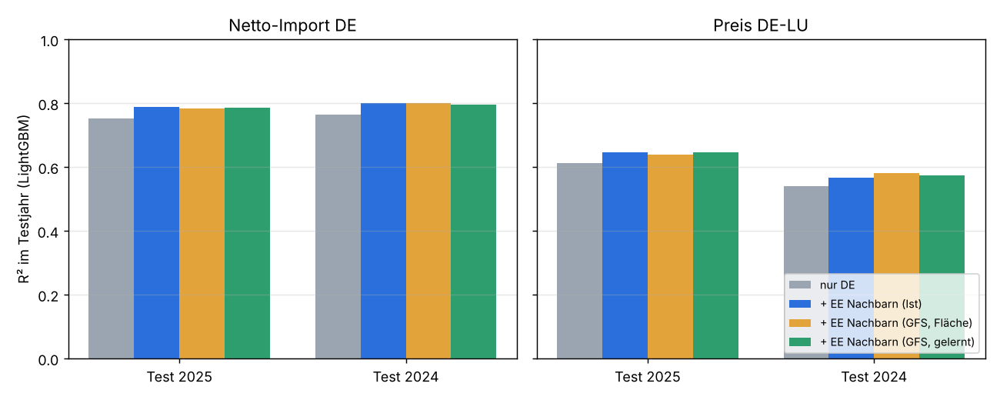
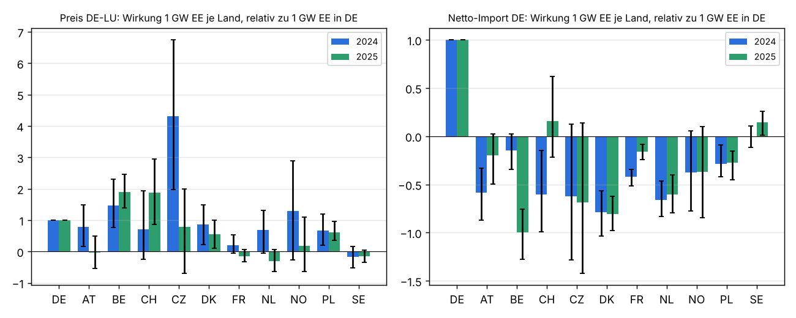

# Im- und Export Deutschlands aus der EE-Erzeugung der Nachbarländer

Einmalige Auswertung vom 2.11.2026, Auftrag in [job.yaml](job.yaml). Frage: Lässt sich die
Gewichtung der europäischen Länder zurückrechnen, um Erzeugung und Im- und Export genauer
abzuschätzen? Eingegrenzt auf das, was die Prognose braucht: die Energieflüsse in Abhängigkeit
der DE-Erzeugung und den Preis DE-LU in Abhängigkeit der Wind- und PV-Erzeugung der
Nachbarländer. Es ist eine Machbarkeitsprüfung, in `ml_train` ist nichts eingebaut.

## Ergebnis in Kürze

- **Machbar, und das GFS reicht dafür.** Wind und PV der zehn Nachbarländer, aus dem GFS
  geschätzt, bringen für Netto-Import und Preis so viel wie die gemessene Ist-Erzeugung. Das
  Wetter der Nachbarn ist also kein Engpass.
- **Netto-Import DE: mäßiger Gewinn.** R² steigt von 0,75 auf 0,79 (Test 2025) bzw. von 0,76
  auf 0,80 (Test 2024), der mittlere Fehler sinkt um etwa 7 % (2,25 → 2,09 GW). Den größten
  Teil erklärt schon die Lage in DE selbst: 1 GW mehr Wind und PV in DE senkt den Netto-Import
  um rund 0,6 GW.
- **Flüsse je Grenze: großer Gewinn.** Ohne Nachbarwetter sind die Flüsse an einzelnen Grenzen
  kaum vorhersagbar, mit ihm deutlich besser, etwa PL R² 0,18 → 0,52, CZ 0,39 → 0,54,
  NL −0,06 → 0,22, BE −0,01 → 0,20 (Test 2025).
- **Preis DE-LU: kleiner Gewinn.** R² +0,03 bis +0,04, mittlerer Fehler etwa −1 EUR/MWh
  (−5 %). In dieser einfachen Form (nur Kalender und Erzeugung, ohne Lags, Brennstoffe,
  Nachbarpreise) ist das eine Obergrenze dessen, was das Nachbarwetter allein beiträgt.
- **Ländergewichte nur teilweise stabil.** Für den Netto-Import sind DK, NL, PL und FR in
  beiden Jahren gleich gerichtet und gut bestimmt: 1 GW Wind und PV in DK erhöht den Import nach
  DE um etwa 0,5 GW, in NL um 0,35 bis 0,4 GW, in PL um 0,16 bis 0,18 GW. Für den Preis sind nur
  BE, DK und PL in beiden Jahren klar von null verschieden (jeweils 0,6 bis 1,9 mal so stark wie
  1 GW in DE). FR, SE, NO, CH und AT schwanken zwischen den Jahren. Dort steuern Kernkraft und
  Speicherwasser, und das Nachbarwetter ist stark mit dem deutschen Wetter korreliert.

**Vorschlag:** Eine Merkmalsgruppe „Wind und PV der Nachbarländer“ in `ml_train` lohnt sich.
Sie besteht aus zehn Ländern mit je zwei Reihen in MW. Wind sollte mit gelernten Gewichten
gerechnet werden, PV als Flächenmittel. Für den Preis ist der Gewinn klein. Für einzelne
Grenzflüsse ist er groß, falls wir die einmal prognostizieren wollen. Feste Ländergewichte
(„effektive europäische Residuallast“) taugen nur für einen Teil der Länder; besser lernt das
Modell die Wirkung je Land selbst.



## Ergebnisse

### Netto-Import und Preis

LightGBM, R² und mittlerer absoluter Fehler (MAE) im Testjahr, Training 2024 → Test 2025 /
Training 2025 → Test 2024 ([tabellen/ergebnis.csv](tabellen/ergebnis.csv), dort auch Ridge):

| Merkmale | Netto-Import R² | Netto-Import MAE (MW) | Preis R² | Preis MAE (EUR/MWh) |
|---|---|---|---|---|
| nur DE (Last, Wind an Land/See, PV, Kalender) | 0,75 / 0,76 | 2245 / 2320 | 0,61 / 0,54 | 22,5 / 22,1 |
| + Wind und PV der Nachbarn, Ist | 0,79 / 0,80 | 2067 / 2180 | 0,65 / 0,57 | 21,5 / 21,2 |
| + Wind und PV der Nachbarn, GFS Flächenmittel | 0,78 / 0,80 | 2091 / 2164 | 0,64 / 0,58 | 21,7 / 20,5 |
| + Wind und PV der Nachbarn, GFS gelernte Gewichte | 0,79 / 0,80 | 2088 / 2168 | 0,65 / 0,58 | 21,7 / 20,6 |

Der Netto-Import lag 2025 im Mittel bei 2,5 GW Import, mit einer Standardabweichung von 5,8 GW
(Viertelstundenwerte). Die
Ridge-Regression kommt beim Netto-Import nur auf R² 0,65 bis 0,67. Beim Preis liegt sie
gleichauf mit LightGBM oder besser (0,68 bis 0,70 im Test 2025). Der Gewinn durch die Nachbarn
ist bei beiden Verfahren ähnlich.

### Flüsse je Grenze

Handel (Energy-Charts `/cbet`, + = Import nach DE), LightGBM, R² im Testjahr
([tabellen/grenzen.csv](tabellen/grenzen.csv)):

| Grenze | Mittel 2025 (MW) | nur DE | + EE Nachbarn Ist | + EE Nachbarn GFS gelernt |
|---|---|---|---|---|
| PL | −391 | 0,18 / 0,02 | 0,51 / 0,38 | 0,52 / 0,42 |
| CZ | −479 | 0,39 / 0,24 | 0,56 / 0,41 | 0,54 / 0,40 |
| DK | 1414 | 0,50 / 0,35 | 0,62 / 0,48 | 0,57 / 0,46 |
| NL | 957 | −0,06 / −0,30 | 0,24 / 0,09 | 0,22 / 0,15 |
| BE | 336 | −0,01 / 0,09 | 0,25 / 0,24 | 0,20 / 0,27 |
| FR | 1281 | −0,13 / −0,01 | 0,07 / 0,28 | 0,07 / 0,29 |
| AT | −1394 | 0,20 / 0,11 | 0,37 / 0,24 | 0,32 / 0,22 |
| SE | 276 | 0,06 / −0,11 | 0,18 / 0,13 | 0,15 / 0,15 |
| NO | 802 | 0,43 / 0,52 | 0,46 / 0,48 | 0,44 / 0,52 |
| CH | 104 | 0,21 / 0,24 | 0,26 / 0,21 | 0,26 / 0,24 |

An den Grenzen zu NL, BE und FR erklärt die Lage in DE allein nichts. Die Flüsse dort hängen
an Wind und PV der Nachbarn und an Größen, die hier bewusst fehlen (Kernkraft FR,
Gaskraftwerke NL/BE). An den Grenzen zu NO und CH bringt das Nachbarwetter nichts, weil dort
Speicherwasser nach Preis gefahren wird.

### Ländergewichte

Lineares Modell auf Kalender, Last DE, Wind+PV DE und Wind+PV je Nachbarland (Ist), je Jahr
getrennt. Die Spannen sind 5- bis 95-%-Bereiche aus einem Wochen-Bootstrap mit 200 Zügen
([tabellen/laendergewichte.csv](tabellen/laendergewichte.csv)).

| Land | Netto-Import je GW EE (MW), 2024 / 2025 | Preis je GW EE (EUR/MWh), 2024 / 2025 | Mittel EE 2025 (GW) |
|---|---|---|---|
| DE | −626 / −586 | −1,9 / −2,3 | 23,0 |
| DK | +492 / +473 | −1,7 / −1,3 | 2,8 |
| NL | +412 / +354 | −1,3 / +0,7 | 2,7 |
| CZ | +389 / +401 | −8,3 / −1,8 | 0,6 |
| PL | +180 / +161 | −1,3 / −1,4 | 4,7 |
| FR | +263 / +94 | −0,4 / +0,3 | 9,0 |
| BE | +92 / +585 | −2,9 / −4,3 | 2,6 |
| AT | +367 / +117 | −1,5 / +0,1 | 1,6 |
| NO | +236 / +215 | −2,5 / −0,4 | 1,5 |
| CH | +379 / −93 | −1,3 / −4,3 | 0,9 |
| SE | +2 / −86 | +0,3 / +0,4 | 4,7 |

Lesart: 1 GW mehr Wind und PV in DK erhöht den Import nach DE um rund 0,48 GW und senkt den
Preis DE-LU um 1,3 bis 1,7 EUR/MWh. 1 GW mehr in DE senkt den Import um rund 0,6 GW und den
Preis um 1,9 bis 2,3 EUR/MWh. Die Werte für CZ und CH beruhen auf wenig EE-Leistung
(0,6 bzw. 0,9 GW im Mittel) und haben breite Spannen.



### Wind und PV der Nachbarn aus dem GFS

R² der GFS-Schätzung gegen die Ist-Erzeugung im Testjahr, Flächenmittel → gelernte Gewichte
([tabellen/wetter_nachbarn.csv](tabellen/wetter_nachbarn.csv)). PV nur Tagblöcke.

- Wind an Land: NO 0,13 → 0,79, AT 0,36 → 0,72, SE 0,47 → 0,68, CZ 0,20 → 0,46,
  FR 0,77 → 0,88, PL 0,70 → 0,81, NL 0,85 → 0,88, DK 0,77 → 0,78 (Test 2025).
- Wind auf See (Seegebiet je Land): FR 0,82 → 0,87, NL 0,79 → 0,86, DK 0,69 → 0,73,
  BE 0,86 → 0,88.
- PV: 0,84 bis 0,92 schon mit dem Flächenmittel, Lernen bringt fast nichts (wie in
  [standortgewichte-lernen](../standortgewichte-lernen/README.md)).

Dass das Flächenmittel trotzdem fast so gut für Import und Preis ist wie die gelernten
Gewichte, liegt daran, dass LightGBM die Zuordnung auch aus schlechteren Indizes selbst lernt.
Für ein lineares Merkmal oder eine Darstellung in MW sind die gelernten Gewichte klar besser.

## Daten und Methode

**Daten** (1.1.2024 bis 31.12.2025):

- **Energy-Charts** `/public_power` für DE und die zehn Nachbarländer AT, BE, CH, CZ, DK, FR,
  NL, NO, PL, SE (Last, Wind an Land, Wind auf See, Solar), `/installed_power` jährlich,
  `/cbet` für DE (Handel je Grenze und Summe, + = Import), `/price` DE-LU. LU gehört zur
  Gebotszone DE-LU und fehlt deshalb als Nachbar.
- **GFS 0,5°** aus dem Silber `ghcr.io/the78mole/predictiondb-data/gfs-0p5-silver`, Lauf 00Z,
  Schritte f000 bis f024, 731 von 731 Läufen; Wind 100 m, Globalstrahlung, Temperatur 2 m.
- **Zonen** aus `config/gefs/regions_v2.json.gz` (Flächenanteile). DK, NO und SE sind aus ihren
  Teilzonen zusammengesetzt, nach Zellenzahl gewichtet.

**Raster:** 8 Blöcke zu 3 h je Tag, Block (Schritt − 3 h, Schritt] für f003 bis f024. Alle
Ist-Werte sind über den Block gemittelt (5845 vollständige Blöcke, 2928 in 2024 und 2917 in
2025). Der GFS-Wind ist der Kapazitätsfaktor an beiden Blockgrenzen gemittelt
(Leistungskurve 3/12/25 m/s). PV kommt aus der 3-h-Mittelstrahlung mit dem `PvModel`.

**Wind und PV der Nachbarn aus dem GFS:** wie in
[standortgewichte-lernen](../standortgewichte-lernen/README.md). Gelernt wird mit NNLS auf
1°-Blöcken, mit Ridge zur Flächenverteilung (λ = 0,03), im jeweiligen Trainingsjahr. Ziel ist
der Kapazitätsfaktor (Jahresendwerte linear interpoliert), das Ergebnis wird mit der
Kapazität zurück in MW gerechnet. Wind auf See wird auf allen Zellen eines Seegebiets je Land
gelernt (FR Ärmelkanal/Atlantik, BE, NL, DK).

**Modelle:** LightGBM (400 Bäume, Lernrate 0,05, wie `ml_train`) mit Blockstunde, Wochentag
und Monat als Zahl. Daneben Ridge mit Kalender-Dummies, Alpha gewählt auf jedem vierten Monat
des Trainingsjahres. Training 2024 und Test 2025, danach vertauscht.

**Ländergewichte:** Kleinste Quadrate des Preises bzw. Netto-Imports auf Kalender-Dummies,
Last DE, Wind+PV DE und Wind+PV je Nachbarland (Ist, GW), je Jahr. Die Unsicherheit kommt aus
einem Bootstrap über ganze Wochen.

## Einschränkungen

- **Bewusst ohne Last und Kraftwerke der Nachbarn.** Kernkraft FR/BE, Speicherwasser NO/CH/AT
  und Gaskraftwerke NL/BE steuern die Flüsse an diesen Grenzen mit. Sie fehlen hier, weil sie
  sich nicht aus dem Wetter ableiten lassen. Die Ergebnisse je Grenze sind deshalb untere
  Schranken.
- **Kein vollständiges Prognosemodell.** Ohne Lags, Brennstoffe und Nachbarpreise. Wie viel
  vom Preisgewinn übrig bleibt, wenn `ml_train` schon alle freien Reihen hat (Variante
  `wetter_frei_gk_skaliert`), zeigt erst ein Backtest dort.
- **Nur Vorlauf bis 24 h.** Gelernt und getestet auf f003 bis f024 des 00Z-Laufs. Für Tag 2
  bis 7 ist die Wetterschätzung schlechter; der Abstand zur Ist-Schranke wird dann größer
  sein.
- **Handel, nicht Fluss.** Ziel ist der kommerzielle Austausch (`/cbet`). Physikalische Flüsse
  (`/cbpf`) laufen durch Ringflüsse anders, vor allem an den Grenzen zu PL, CZ und NL.
- **Kollinearität.** Wind in DE, DK, NL, BE und PL hängt stark zusammen. Deshalb sind die
  Gewichte je Land im linearen Modell für den Preis zwischen den Jahren instabil, und ein Teil
  der Wirkung landet beim Nachbarn statt bei DE oder umgekehrt.
- **Datenlücken:** NL-Solar ist bei Energy-Charts unvollständig (Mittel etwa 0,1 GW bei 29 GW
  Leistung), NO-Solar fehlt größtenteils. Kapazitäten gibt es nur jährlich.
- **Lizenz der Nachbardaten.** Energy-Charts gibt CC BY 4.0 an; die Erzeugung außerhalb DE
  stammt überwiegend aus ENTSO-E (16.1). Für die Veröffentlichung abgeleiteter Gewichte gilt
  derselbe offene Punkt wie in standortgewichte-lernen.

## Quellen

- **Energy-Charts, Fraunhofer ISE** (`api.energy-charts.info`, `/public_power`,
  `/installed_power`, `/cbet`), CC BY 4.0 laut API-Dokumentation; außerhalb DE überwiegend
  ENTSO-E-Transparenzplattform.
- **Day-Ahead-Preis DE-LU:** Bundesnetzagentur | SMARD.de über Energy-Charts `/price`,
  CC BY 4.0.
- **NOAA/NCEP Global Forecast System (GFS)**, gemeinfrei; verdichtet als GFS-0p5-Silber von
  PredictionDB, CC BY 4.0.
- **Zonen:** `config/gefs/regions_v2.json.gz` (Natural Earth, gemeinfrei).

## Nachvollziehen

Rohdaten laden (etwa 16 GB Download, nur lokal) und auswerten. `auswertung.py` schreibt
`tabellen/` und `grafiken/` neu, das Laufprotokoll steht in
[tabellen/lauf.json](tabellen/lauf.json):

```bash
uv run --no-project --with numpy --with numcodecs python -I \
  docs/analysen/austausch-nachbarlaender/abruf.py --cache /tmp/an
uv run --no-project --with numpy --with scipy --with scikit-learn --with lightgbm \
  --with matplotlib --with pyyaml python -I \
  docs/analysen/austausch-nachbarlaender/auswertung.py --cache /tmp/an
```
