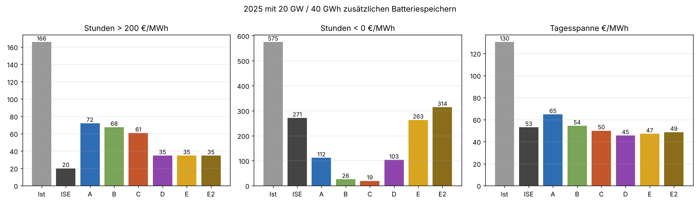
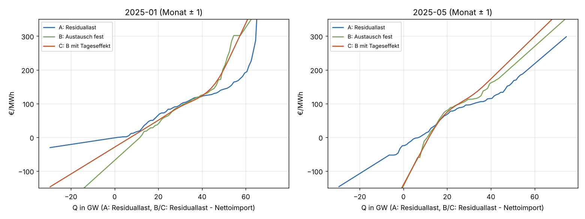
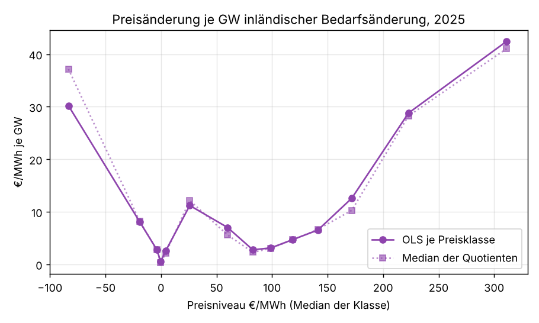
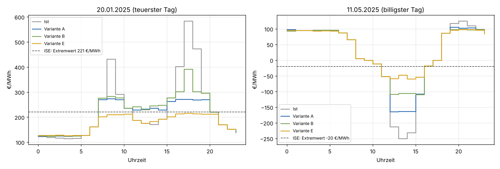
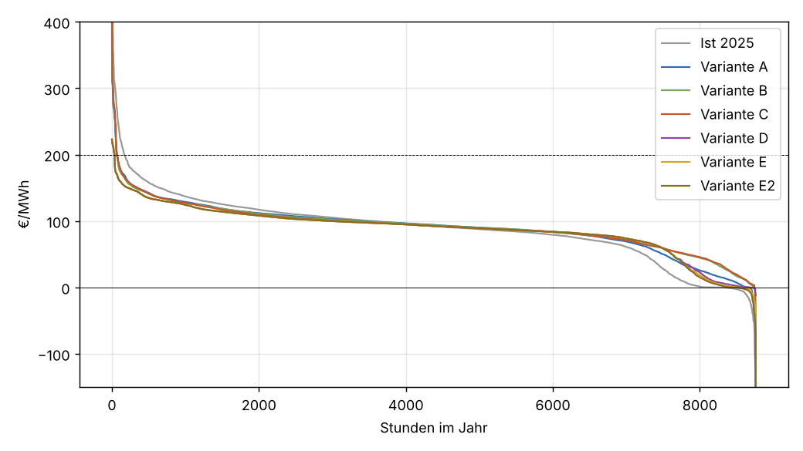

# Batteriespeicher 2025 nachgerechnet: Abgleich mit dem Fraunhofer ISE

Einmalige Auswertung vom 01.11.2026, Auftrag in [job.yaml](job.yaml). Frage: Wie hätten
20 GW / 40 GWh zusätzliche Batteriespeicher den Day-Ahead-Preis DE-LU im Jahr 2025 verändert, und
lässt sich das Ergebnis des Fraunhofer ISE mit freien Daten bestätigen? Das ISE kommt mit den
echten Gebotskurven der EPEX auf 169 → 20 Stunden über 200 €/MWh und 575 → 271 Stunden mit
negativem Preis.

## Ergebnis in Kürze

**Ja, das Ergebnis lässt sich im Wesentlichen bestätigen, aber nur mit einer passenden
Merit-Order-Näherung.** Mit der besten Näherung aus freien Daten (Variante E, unten erklärt) kommt
für 2025 heraus:

| Kennzahl | Ist 2025 | ISE mit 20 GW / 40 GWh | hier, Variante E |
|---|---|---|---|
| Stunden > 200 €/MWh | 166 (ISE: 169) | 20 | 35 |
| Stunden > 220 €/MWh | 123 | (nicht genannt) | 2,5 |
| Stunden < 0 €/MWh | 575 | 271 | 263 |
| mittlere Tagesspanne €/MWh | 130 | 53 | 47 |
| Marktwert Solar €/MWh | 46 (ISE: 45,08) | 61,02 | 61,2 |
| höchster Preis €/MWh (20.01.) | 583 | 221 | 223 |
| tiefster Preis €/MWh (11.05.) | −250 | −20 | −60 |
| mittlerer Preis €/MWh | 89,32 | 89,44 | 87,8 |

Ohne Alterungskosten. Mit 10 €/MWh Alterungskosten je entladener MWh: 35 h über 200, 249 h
negativ, Spanne 52 €/MWh ([tabellen/ergebnis.csv](tabellen/ergebnis.csv)).

Negative Stunden, Tagesspanne, Solar-Marktwert und die Kappung der Preisspitze liegen damit nah am
ISE. Bei den Stunden über 200 €/MWh bleiben 35 statt 20. Das ist aber eine Frage von wenigen
€/MWh: Die übrigen Stunden fallen auf drei Tage (15.01., 20.01. und 25.11.2025), an denen die
Speicher die Spitze über 10 bis 13 Stunden auf 205 bis 223 €/MWh einebnen. Über 220 €/MWh bleiben
nur 2,5 Stunden. Auch beim ISE liegt die gekappte Spitze am 20.01. bei 221 €/MWh, also im selben
Band. Ob diese Plateaus knapp über oder knapp unter 200 liegen, entscheidet über ±15 Stunden, und
genau dort ist eine Näherung der Kurve am ungenauesten.

**Die einfache Näherung aus PR #150 bestätigt das ISE dagegen nicht.** Mit einer monatlichen Kurve
"Preis über Residuallast" (Variante A, so wie in
[batteriespeicher-preiswirkung](../batteriespeicher-preiswirkung/README.md)) bleiben 72 Stunden über
200 €/MWh, und die negativen Stunden fallen auf 112 statt auf 271. Hält man den Außenhandel fest wie
das ISE (B, C), verschwinden die negativen Stunden fast ganz (19 bis 26). Der Fehler liegt, wie
vermutet, in der Merit-Order-Näherung, und zwar an zwei Stellen mit entgegengesetzter Wirkung:

1. **Die Spitzen sind zu flach.** Eine über einen Monat gemittelte Kurve kennt den steilen
   Knappheitsast einzelner Stunden nicht. Bei 583 €/MWh am 20.01. liegt der Markt auf einem Stück
   der Angebotskurve, auf dem wenige GW mehrere hundert €/MWh ausmachen. Die Monatskurve mittelt
   Stunden mit ähnlicher Residuallast, aber viel niedrigerem Preis hinein, und lässt den Preis
   mit 20 GW Entladung nur auf 390 bis 420 €/MWh fallen. Gleichzeitig ist sie im mittleren Bereich
   zu steil: Laden mit 2,5 GW hebt den Mittag des 20.01. von 176 auf 230 €/MWh.
2. **Das Plateau um 0 €/MWh fehlt.** Bei leicht negativen Preisen bieten viele Wind- und
   PV-Anlagen in der Direktvermarktung. Wird mehr verbraucht, regeln sie weniger ab und der Preis
   bleibt fast gleich. Diese Menge sieht man in freien Daten nicht, weil die gemessene Erzeugung
   schon nach der Abregelung steht. Eine Kurve aus den Ist-Werten hält deshalb schon wenige GW
   Ladeleistung für genug, um den Preis über null zu heben.

**Was die Abweichungen nicht erklären:** Das ISE rechnet Blockgebote, die Elastizität der
Nachfrage und Alterungskosten in der Auktion neu. Das fehlt hier, wirkt aber offenbar nur noch auf
wenige Prozent. Der Mittelpreis sinkt bei uns um 1,5 €/MWh, beim ISE steigt er um 0,12 €/MWh. Diese
Größe hängt an der Asymmetrie der Kurve zwischen Lade- und Entladestunden und ist mit freien Daten
nicht belastbar zu treffen.

**Für unsere eigenen Rechnungen:** Die Variante E sollte die empirische Monatskurve aus PR #150
ersetzen, wenn wir Speicherwirkungen schätzen. Die Aussagen aus PR #150 zur Tagesspanne bleiben in
der Richtung richtig, die Wirkung auf die Spitzen war aber unterschätzt. Die dort gezeigte
Empfindlichkeit der negativen Stunden gegenüber der Abregelung (3 bis 6 GW) bestätigt sich: Aus
den Prognosefehlern ergeben sich hier im Mittel 3,6 GW.



## Was das ISE gerechnet hat

Quelle: Fraunhofer ISE, Pressemitteilung "Datenplattform Energy-Charts startet
Strompreissimulator" vom 01.10.2026
(<https://www.ise.fraunhofer.de/en/press-media/press-releases/2026/energy-charts-data-platform-launches-price-simulator.html>),
vorgestellt am 28.09.2026 mit BNE und BVES (Bericht der ZfK vom 28.09.2026,
<https://www.zfk.de/politik/deutschland/fraunhofer-strompreissimulator-speicher-strompreise>).
Alle ISE-Werte in dieser Analyse sind von dort übernommen.

- Eingang sind die aggregierten Kauf- und Verkaufskurven der EPEX-Day-Ahead-Auktion 2025 (nicht
  frei, siehe [merit-order](../merit-order/README.md)).
- 20 GW zusätzliche Batterieleistung mit 2 h (40 GWh), 100 % am Day-Ahead-Markt.
- Wirkungsgrad 86 %, Alterungskosten je gespeicherter MWh (Wert nicht genannt).
- Gewinnmaximierung über eine ganze Woche, jeder Handel verschiebt die Kurven und damit den Preis.
- Blockgebote werden in der Auktion neu gerechnet, der Handel mit den Nachbarländern bleibt fest.
- Auflösung Viertelstunde, nicht abgebildet: Intraday, Regelleistung, Netzengpässe.

Die Ist-Werte stimmen mit unseren Daten überein: 574,75 Stunden mit negativem Preis, Mittelpreis
89,32 €/MWh, Höchstpreis 583,40, Tiefstpreis −250,32 €/MWh. Bei den Stunden über 200 €/MWh zählen
wir 165,75 (≥ 200: 168,5), das ISE 169. Gezählt werden Viertelstunden ab dem 01.10.2025 als
Viertelstunden, davor Stunden.

## Daten und Methode

Daten: Energy-Charts (Fraunhofer ISE), CC BY 4.0: Day-Ahead-Preis DE-LU (Bundesnetzagentur |
SMARD.de), öffentliche Nettoerzeugung, Last, Residuallast und kommerzieller Außenhandel
Deutschlands, Day-Ahead-Prognosen Wind und PV, jeweils in 15 Minuten
([abruf.py](abruf.py)).

Der Speicher wird in die gemessenen Preise gelegt. Er lädt und entlädt so, dass sein Gewinn über
die Woche maximal ist, und berücksichtigt dabei, dass er den Preis selbst verschiebt (lineares
Programm, 24 Leistungsstufen, perfekte Voraussicht je Woche, Speicher zu Wochenbeginn halb voll).
Das entspricht vielen Betreibern im Wettbewerb und kommt der Rechnung des ISE nahe. Januar bis
September in Stunden, ab dem 01.10.2025 in Viertelstunden wie die Auktion. Neuer Preis je
Zeitschritt: gemessener Preis plus die Verschiebung, die die geschätzte Angebotskurve für die
zusätzliche Last x vorhersagt (x > 0 Laden, x < 0 Entladen).

Die Varianten unterscheiden sich nur in dieser Kurve:

| Variante | Mengengröße Q | Kurve | Außenhandel |
|---|---|---|---|
| A | Residuallast (Last − Wind − PV) | monoton, je Monat ± 1 Monat (wie PR #150) | reagiert (steckt in der Kurve) |
| B | Residuallast − Nettoimport | wie A | fest wie beim ISE |
| C | wie B | mit Tages-Festeffekten: nur Unterschiede innerhalb eines Tages zählen | fest |
| D | wie B | Steigung nach Preisniveau, von jedem Ist-Preis aus | fest |
| E | wie D | plus Abregelungsplateau bei negativen Preisen | fest |
| E2 | wie D | Abregelungsplateau doppelt so groß | fest |



Die Monatskurven (A bis C) zeigen das Problem: Um 0 €/MWh laufen B und C steil durch, ein Plateau
gibt es nicht. Oben flachen sie ab, weil Stunden mit gleicher Residuallast je nach Wetterlage,
Kraftwerksverfügbarkeit und Brennstoffpreis sehr verschiedene Preise haben und die Kurve sie
mittelt.

### Steigung nach Preisniveau (D)

Statt einer Kurve über Q wird geschätzt, wie stark sich der Preis je GW ändert, getrennt nach dem
Preisniveau. Grundlage sind Paare aufeinanderfolgender Stunden (Kleinste Quadrate durch den
Ursprung von Δp auf ΔQ, nur |ΔQ| > 0,3 GW). In einer Stunde ändern sich Brennstoffpreise und
Kraftwerkspark kaum, der Vergleich zweier Nachbarstunden misst also die lokale Steigung der
Angebotskurve. Der Preis jeder Stunde wandert dann vom eigenen Ist-Preis aus entlang dieser
Steigung. Eine Stunde bei 583 €/MWh bleibt so auf dem steilen Ast, eine Stunde bei −0,01 €/MWh
auf dem flachen.



| Preisniveau €/MWh | Paare | Steigung €/MWh je GW |
|---|---|---|
| unter −50 | 23 | 30 |
| −50 bis −10 | 78 | 8,1 |
| −10 bis −2 | 125 | 2,8 |
| −2 bis 0,5 | 250 | 0,6 |
| 0,5 bis 10 | 230 | 2,6 |
| 10 bis 40 | 413 | 11 |
| 40 bis 70 | 683 | 7,0 |
| 70 bis 90 | 1650 | 2,8 |
| 90 bis 110 | 2050 | 3,1 |
| 110 bis 130 | 1209 | 4,7 |
| 130 bis 160 | 717 | 6,5 |
| 160 bis 200 | 265 | 12,6 |
| 200 bis 260 | 87 | 29 |
| über 260 | 53 | 42 |

Das ist die bekannte Form der Merit-Order als "Hockeyschläger": flach im Bereich der Kohle- und
Gaskraftwerke (70 bis 130 €/MWh), steil in der Knappheit und bei stark negativen Preisen, fast
waagrecht um 0 €/MWh. Der Buckel bei 10 bis 40 €/MWh ist der Übergang vom Abregelungsplateau zu
den ersten steuerbaren Kraftwerken.

Variante D trifft damit die Spitzen (223 statt 221 €/MWh beim ISE), lässt aber nur 103 negative
Stunden übrig. Die Steigung um 0 €/MWh ist aus den Ist-Werten zu groß geschätzt, weil die
abgeregelte Menge in ΔQ fehlt.

### Abregelungsplateau (E)

Die abgeregelte Menge wird aus freien Daten geschätzt: Day-Ahead-Prognose von Wind und PV minus
gemessene Einspeisung. In Stunden mit Preisen über 30 €/MWh liegt diese Differenz mittags von April
bis September im Mittel bei 1,3 GW (Prognosefehler), bei Preisen unter −5 €/MWh bei 4,9 GW, bei −5
bis 0 €/MWh bei 2,5 bis 2,8 GW. Abzüglich 1 GW Prognosefehler bleiben in den negativen Stunden im
Mittel 3,6 GW. So viel zusätzliche Last deckt in E der abgeregelte Strom zum Ist-Preis, erst
darüber greift die Steigung aus D. Mit dieser Schätzung bleiben 263 negative Stunden (ISE: 271).

Die Schätzung ist eher eine Untergrenze: Anlagen, die schon in der Prognose als abgeregelt geführt
werden, und Gebote knapp unter null, die nicht zum Zuge kommen, fehlen. Mit doppeltem Plateau (E2)
bleiben 314 negative Stunden. Das ISE liegt zwischen E und E2, näher an E. Da der Tiefstpreis am
11.05. in E bei −60 statt −20 €/MWh liegt, ist die Steigung unter −50 €/MWh (aus nur 23 Paaren)
vermutlich zu flach geschätzt.



Am 20.01.2025 ebnet E den Tag von 7 bis 20 Uhr auf 175 bis 216 €/MWh ein, wie das ISE. A und B
kappen nur die oberste Spitze. Am 11.05.2025 hebt E den Mittag auf −48 bis −60 €/MWh, das ISE auf
−20 €/MWh.



## Ergebnisse aller Varianten

Ohne Alterungskosten ([tabellen/ergebnis.csv](tabellen/ergebnis.csv)):

| Variante | h > 200 | h > 220 | h < 0 | Spanne | Mittel | Marktwert PV | Max | Min | Vollzyklen |
|---|---|---|---|---|---|---|---|---|---|
| Ist 2025 | 166 | 123 | 575 | 130 | 89,3 | 46,0 | 583 | −250 | |
| ISE | 20 | | 271 | 53 | 89,4 | 61,0 | 221 | −20 | |
| A | 72 | 54 | 112 | 65 | 90,4 | 61,9 | 396 | −165 | 392 |
| B | 68 | 56 | 26 | 54 | 92,5 | 71,5 | 410 | −110 | 338 |
| C | 61 | 53 | 19 | 50 | 92,0 | 71,9 | 419 | −109 | 305 |
| D | 35 | 2,5 | 103 | 45 | 88,2 | 62,8 | 223 | −12 | 298 |
| E | 35 | 2,5 | 263 | 47 | 87,8 | 61,2 | 223 | −60 | 299 |
| E2 | 35 | 2,5 | 314 | 49 | 87,5 | 59,9 | 223 | −157 | 300 |

Mit 10 €/MWh Alterungskosten laufen die Speicher etwa 50 Vollzyklen weniger, die Spanne liegt 4
bis 5 €/MWh höher, die Stunden über 200 €/MWh ändern sich nicht. Bei E sinken die negativen
Stunden leicht (249 statt 263). Das ist kein echter Effekt: Auf dem Plateau ist der Preis flach,
und das Programm verteilt die Ladung dann beliebig auf gleich teure Stunden.

## Unsicherheit und Einschränkungen

- Alle Varianten verschieben den gemessenen Preis. Sie können eine Stunde nicht über einen Sprung
  der Angebotskurve heben, den es in den Daten nie gab (etwa ein Blockgebot, das ausscheidet).
- Die Steigung in D und E ist eine Jahresgröße. Brennstoffpreise und Kraftwerksverfügbarkeit
  ändern sie über das Jahr, das mittelt sich nur im Jahresergebnis heraus. Über 260 €/MWh und
  unter −50 €/MWh beruht sie auf 53 bzw. 23 Stundenpaaren.
- Die Nachfrage reagiert hier nur über die Steigung, Kauf- und Verkaufskurve werden nicht
  getrennt. Bei der Wirkung auf den Mittelpreis ist das ISE deshalb die bessere Quelle.
- Wie beim ISE: 20 GW vollständig am Day-Ahead-Markt, perfekte Voraussicht je Woche, Austausch
  fest. In der Wirklichkeit würden die Nachbarländer einen Teil der Glättung übernehmen, die
  Wirkung in Deutschland wäre kleiner (zum Vergleich A, wo der Austausch mitreagiert).
- Ein Speicherbestand von 2025 steckt bereits in den Preisen, gerechnet wird der Zubau darüber
  hinaus (wie beim ISE).

## Nachvollziehen

- [job.yaml](job.yaml): Auftrag und alle Parameter (Speicher, Varianten, Preisklassen), die
  `auswertung.py` liest.
- [tabellen/lauf.json](tabellen/lauf.json): Laufprotokoll mit Commit, Hash der `job.yaml`,
  Hashes der Eingangsdateien, Zeitschritten und ersetzten fehlenden Werten.
- [abruf.py](abruf.py): Daten von Energy-Charts (Preis, Erzeugung, Last, Außenhandel,
  Day-Ahead-Prognosen Wind und PV).
- [auswertung.py](auswertung.py): Kurven, Simulation, Tabellen und Grafiken (Laufzeit etwa 8 min).
- [tabellen/ergebnis.csv](tabellen/ergebnis.csv): Kennzahlen aller Varianten und des ISE.
- [tabellen/steigung_preisniveau.csv](tabellen/steigung_preisniveau.csv): Steigung je Preisklasse.
- [tabellen/steigung.csv](tabellen/steigung.csv): Steigung der Monatskurven A bis C.
- [tabellen/profil_2025.csv.gz](tabellen/profil_2025.csv.gz): Preise aller Varianten und
  Fahrplan D/E je Zeitschritt.
- [tabellen/tag_2025-01-20.csv](tabellen/tag_2025-01-20.csv),
  [tabellen/tag_2025-05-11.csv](tabellen/tag_2025-05-11.csv): die beiden Extremtage.

Aufruf aus dem Repository-Wurzelverzeichnis:

```bash
uv run --no-project --with requests python docs/analysen/batteriespeicher-2025-ise/abruf.py ./daten-2025
uv run --no-project --with pandas --with numpy --with scipy --with matplotlib --with pyyaml \
    python docs/analysen/batteriespeicher-2025-ise/auswertung.py --daten ./daten-2025
```
