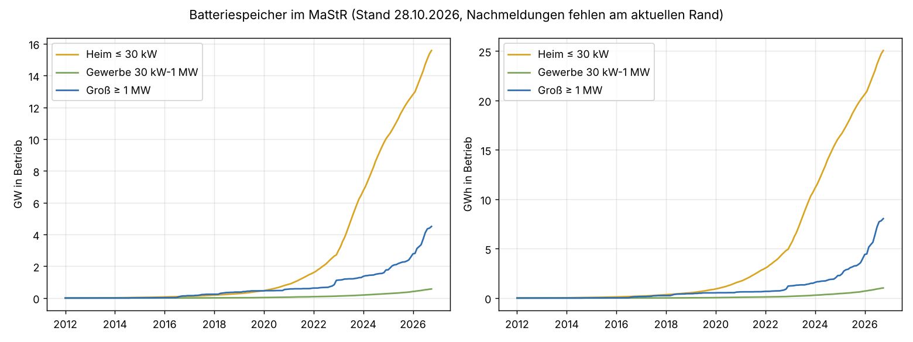
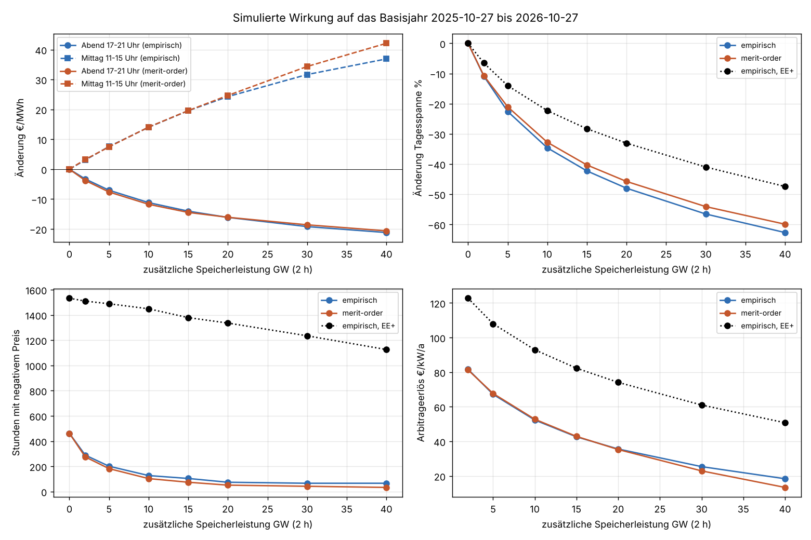
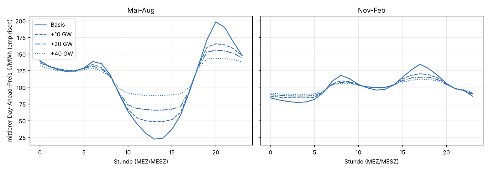
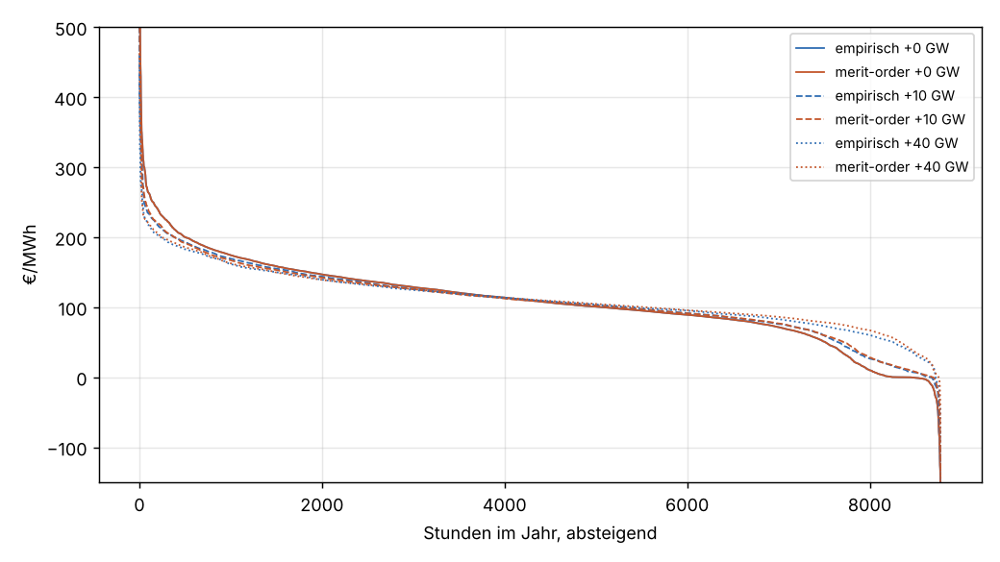
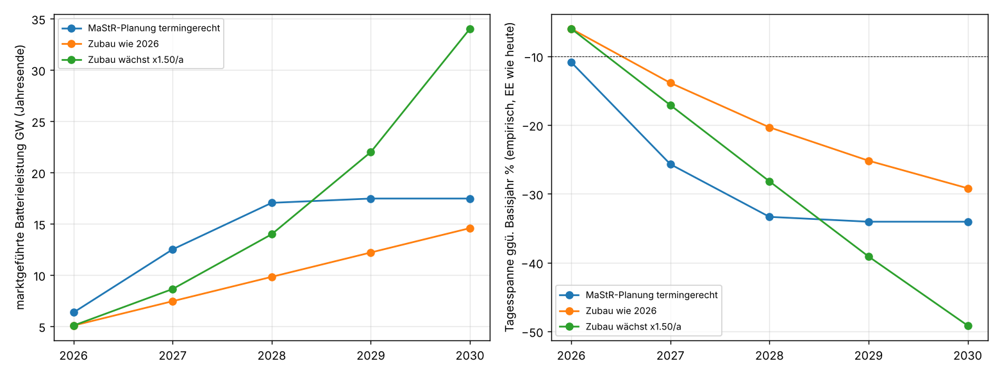
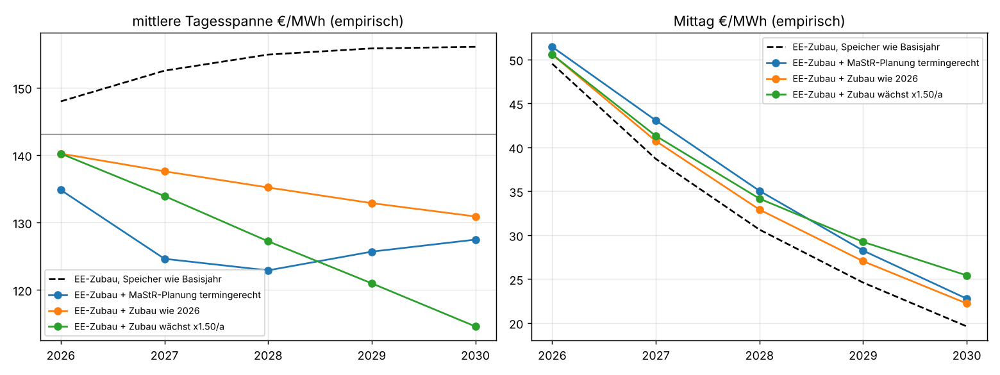
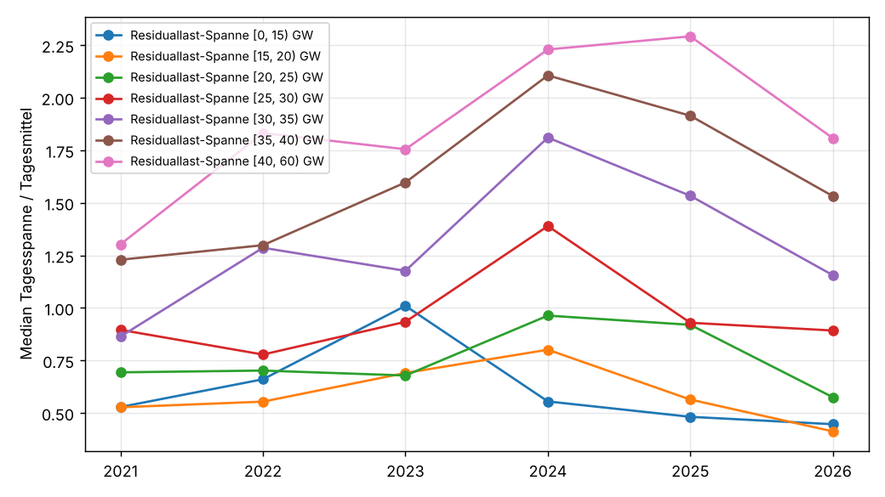
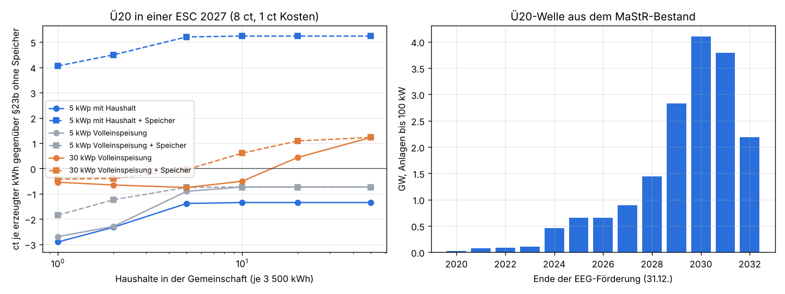
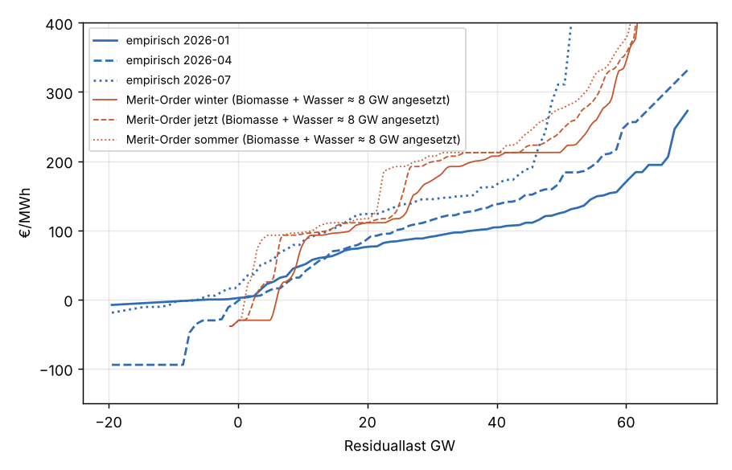

# Preiswirkung von Batteriespeichern am Day-Ahead-Markt

Einmalige Auswertung vom 28.10.2026. Frage: Wie und ab wann verändern Batteriespeicher den
Börsenpreis DE-LU merklich? Der Speicherausbau ist hier nicht aus Prognosen der Bundesregierung
oder des Netzentwicklungsplans abgeleitet, sondern aus dem, was im Marktstammdatenregister
tatsächlich in Betrieb und in Planung steht. Die Preiswirkung kommt aus einer Simulation auf den
SMARD-Stunden des letzten Jahres.

## Ergebnis in Kürze

**Die Wirkung ist schon da und wird 2027 deutlich.** Ein zusätzlicher, am Markt geführter
Speicherpark von rund 2 GW (2 h) drückt die mittlere Tagesspanne des Day-Ahead-Preises im
Basisjahr (27.10.2025 bis 26.10.2026) um 10 %. Ab etwa 3 GW sinkt der Abendpreis um 5 €/MWh, der
Mittagspreis steigt um 5 €/MWh. Der marktgeführte Park ist allein in den zwölf Monaten des
Basisjahres von 2,4 auf 4,7 GW gewachsen. Läuft der Zubau weiter wie 2026, liegt die
Tagesspanne Ende 2027 um 14 %, Ende 2028 um 20 % unter dem Basisjahr. Kommen die im MaStR
gemeldeten Projekte termingerecht, sind es Ende 2027 schon 26 % und Ende 2028 33 %.

| Ende | marktgeführte GW | Tagesspanne | Abend 17–21 Uhr | Mittag 11–15 Uhr |
|---|---|---|---|---|
| 2026 | 5,1 | −6 % | −2 €/MWh | +2 €/MWh |
| 2027, Zubau wie 2026 | 7,5 | −14 % | −4 €/MWh | +4 €/MWh |
| 2027, MaStR-Planung termingerecht | 12,5 | −26 % | −8 €/MWh | +9 €/MWh |
| 2028, Zubau wie 2026 | 9,8 | −20 % | −6 €/MWh | +7 €/MWh |
| 2028, MaStR-Planung termingerecht | 17,0 | −33 % | −11 €/MWh | +13 €/MWh |
| 2030, Zubau wächst um 50 % je Jahr | 34,0 | −49 % | −17 €/MWh | +25 €/MWh |

Empirische Angebotskurve, erneuerbare Erzeugung wie im Basisjahr, 70 % der Leistung am
Day-Ahead-Preis wirksam (Rest Regelleistung, unvollständige Voraussicht). Die Merit-Order-Kurve
liefert fast dieselben Zahlen ([tabellen/zeitachse.csv](tabellen/zeitachse.csv)).

**Speicher glätten, sie senken das Preisniveau kaum.** Abends und in den Morgenspitzen sinkt der
Preis, mittags und nachts steigt er. Der mittlere Preis bleibt bis 10 GW Zubau auf ±0,4 €/MWh
gleich. Darüber steigt er sogar leicht, weil die Verluste (14 % bei Netz zu Netz) als zusätzliche
Last bezahlt werden müssen und der Mittagspreis stärker steigt, als der Abendpreis fällt.

**Mit dem EE-Zubau gerechnet bleibt die Spanne etwa auf heutigem Stand.** Die Tabelle oben hält
Wind und PV auf dem Stand des Basisjahres. Wächst PV weiter um 15,5 % und Wind um 6 % im Jahr und
regeln neue Anlagen bei negativen Preisen ab, wird die Tagesspanne ohne weitere Speicher bis 2030
um 9 % größer und der Mittagspreis fällt von 58 auf 20 €/MWh. Mit dem Speicherzubau liegt die
Spanne 2027 je nach Pfad 4 bis 13 % und 2030 9 bis 20 % unter dem Basisjahr. Speicher fangen den
PV-Zubau also mehr als auf, den Fall des Mittagspreises bremsen sie aber nur um 2 bis 6 €/MWh
(siehe [Abregelung und EE-Zubau](#abregelung-und-ee-zubau)).

**Negative Preise reagieren empfindlich auf die Abregelung.** Mit dem gemessenen Preis allein
reichen 1,3 GW Zubau für 25 % weniger Stunden mit negativem Preis, weil die meisten nur knapp
unter null liegen. Stehen in diesen Stunden aber 3 bis 6 GW abgeregelte Wind- und PV-Leistung
bereit, laden die Speicher zuerst diesen Strom und der Preis bleibt negativ. Dann braucht es 7 bis
14 GW. Auf Tagesspanne und Abendpreis hat die Abregelung kaum Einfluss. Im Markt sieht man
trotzdem schon eine Wende: Von Januar bis September 2026 gab es dreimal so viele Stunden mit
negativer Residuallast wie im Vorjahr (565 statt 185), aber weniger Stunden mit negativem Preis
(460 statt 525). Neben den Speichern wirkt hier das Solarspitzengesetz, die Zahlen trennen
beides nicht.

**Die Erlöse der Speicher fallen schnell.** Der reine Day-Ahead-Arbitrageerlös des Zubaus sinkt
von 82 €/kW/a bei 2 GW auf 53 bei 10 GW und 36 bei 20 GW. Mit mehr PV liegt er bei 20 GW noch bei
63 €/kW/a. Das bremst den Ausbau irgendwo zwischen 15 und 30 GW, wenn nicht Regelleistung,
Intraday und Netzentgeltbefreiung den Rest bezahlen.

**Energy Sharing (§42c EnWG) lohnt sich als Portfolio mit Speicher.** Eine ESC aus Ü20-Prosumern
mit Speicher, Consumern und einer Windanlage nimmt 2027 deutlich mehr ein als heute, vor allem
weil ihr Direktvermarkter die kleinen Speicher nach dem Börsenpreis fährt. Ein Ü20-Speicher ist
damit über 15 Jahre rund 950 statt 630 €/kWh wert. Die Mitglieder sparen 11 bis 16 ct/kWh. Auf
den Börsenpreis wirkt das trotzdem wenig: Rüstet bis 2029 die Hälfte der Ü20-Anlagen nach, sinkt
die Tagesspanne 2030 um 1 bis 3 Prozentpunkte zusätzlich (siehe
[Ergänzung: Energy Sharing](#ergänzung-energy-sharing-42c-enwg)).

**Für das Prognosemodell:** Die Wirkung ist so groß, dass das Modell sie schon 2027 als
systematischen Fehler zeigen wird, vor allem am Mittag zu niedrig und am Abend zu hoch. Ein
Vorschlag für Merkmale steht unten.

## Bestand und Ausbau



Batteriespeicher im MaStR am 28.10.2026 ([tabellen/bestand_jahr.csv](tabellen/bestand_jahr.csv)):

| Klasse | in Betrieb GW | GWh | Zubau 2025 GW | Zubau 2026 (Jan–Okt) GW | in Planung GW / GWh |
|---|---|---|---|---|---|
| Groß ≥ 1 MW | 4,51 | 8,04 | 0,82 | 1,93 | 12,9 / 37,7 |
| Gewerbe 30 kW–1 MW | 0,57 | 1,02 | 0,13 | 0,18 | 0,1 / 0,2 |
| Heim ≤ 30 kW | 15,6 | 25,1 | 2,6 | 3,0 | (nicht gemeldet) |
| zusammen | 20,7 | 34,1 | | | |

Zum Vergleich: Energy-Charts meldet aus demselben Register für Ende September 2026 21,5 GW und
33,7 GWh. Am aktuellen Rand fehlen Nachmeldungen, der Zubau 2026 ist also eher höher.

Die Großspeicher sind der Teil, der den Preis bewegt. Ihr Zubau hat sich 2026 mehr als
verdoppelt (1,9 GW in zehn Monaten nach 0,8 GW im ganzen Jahr 2025). Der Bestand hat im Mittel 1,8 h
Speicherdauer, die Planung 2,9 h. Die Simulation rechnet mit 2 h und unterschätzt damit die
künftigen Projekte etwas. Die gemeldeten Planungen
([tabellen/planung_mastr.csv](tabellen/planung_mastr.csv)) verteilen sich so: 1,7 GW bis Ende
2026, 6,1 GW 2027 (darin 1,2 GW mit überfälligem Termin), 4,5 GW 2028, danach fast nichts, weil
Projekte erst kurz vor dem Bau eingetragen werden.

Die Netzanschlussanfragen zeigen, wie viel dahinter wartet: 2025 gingen bei den Netzbetreibern
laut Bundesnetzagentur 18 158 Anfragen über rund 574 GW ein, zugesagt wurden gut 54 GW
([pv magazine, 25.08.2026](https://www.pv-magazine.de/2026/08/25/netzanschluesse-fuer-batteriespeicher-574-gigawatt-angefragt-54-gigawatt-zugesagt/),
nicht an der Originalquelle geprüft). Die Zusagen sind die realistische Obergrenze bis etwa 2030.
Der genehmigte Szenariorahmen zum Netzentwicklungsplan 2037 rechnete mit 24 GW Großspeichern
im Jahr 2037. Der Pfad mit wachsendem Zubau erreicht das 2029.

**Heimspeicher** sind gemessen an Leistung und Energie dreimal so groß wie die Großspeicher,
wirken aber kaum auf den Börsenpreis. Sie laden vormittags aus der eigenen PV-Anlage, oft schon
voll, bevor der Preis mittags am tiefsten ist, und entladen abends nach dem Hausverbrauch. In den
Ausbaupfaden zählen sie deshalb nicht mit (Anteil 0 %), Gewerbespeicher zu 30 %. Mit
dynamischen Tarifen und der Steuerung nach § 14a EnWG kann sich das ändern. 15 GW, die nur zu
einem Fünftel marktgeführt laufen, wären so viel wie der ganze heutige Großspeicherpark.

## Simulation





Im Sommer füllt der Zubau das Mittagstal und kappt die Abendspitze um 20 Uhr. Im Winter ist der
Tagesgang flacher, die Wirkung entsprechend kleiner.



Zubau mit 2 h Speicherdauer, Basisjahr 27.10.2025 bis 26.10.2026
([tabellen/simulation.csv](tabellen/simulation.csv)):

| Zubau GW | Tagesspanne €/MWh | Abend | Mittag | Mittel | Stunden < 0 | Stunden > 200 | Erlös €/kW/a |
|---|---|---|---|---|---|---|---|
| 0 | 143 | 147 | 58 | 109,0 | 462 | 503 | – |
| 2 | 127 | −3,3 | +3,1 | 108,8 | 289 | 460 | 82 |
| 5 | 111 | −7,0 | +7,6 | 108,9 | 201 | 420 | 67 |
| 10 | 94 | −11,2 | +14,0 | 109,4 | 127 | 383 | 52 |
| 20 | 74 | −16,1 | +24,3 | 110,5 | 74 | 301 | 36 |
| 40 | 53 | −21,2 | +36,9 | 112,2 | 66 | 233 | 18 |
| 10 (1 h) | 109 | −7,0 | +7,6 | 108,9 | 201 | 424 | 34 |
| 10 (4 h) | 82 | −15,5 | +23,4 | 110,3 | 74 | 310 | 72 |

Empirische Kurve. Die Speicherdauer zählt fast so viel wie die Leistung: 10 GW mit 1 h wirken
wie 5 GW mit 2 h.

Ab welchem Zubau (2 h) die Schwellen erreicht sind ([tabellen/schwellen.csv](tabellen/schwellen.csv)):

| Schwelle | EE wie heute | mit 50 % mehr PV, 25 % mehr Wind | 3–6 GW abgeregelt |
|---|---|---|---|
| Tagesspanne −10 % | 1,8–1,9 GW | 3,5 GW | 2,4–2,8 GW |
| Abendpreis −5 €/MWh | 3,0–3,4 GW | 4,4 GW | 3,3–3,6 GW |
| Mittagspreis +5 €/MWh | 3,2–3,3 GW | 8,1–11,7 GW | 4,3–6,0 GW |
| Stunden mit negativem Preis −25 % | 1,2–1,3 GW | nicht erreicht | 7,4–14,6 GW |

Spannen: empirische Kurve und Merit-Order-Kurve. Mit mehr Wind und PV regeln die neuen Anlagen
bei negativen Preisen ab, deshalb bleibt die Zahl der negativen Stunden dort gleich und sinkt
auch mit Speichern kaum.



## Abregelung und EE-Zubau



Jedes Jahr mit dem EE-Zubau bis dahin, einmal ohne weiteren Speicher und einmal mit dem
Speicherpfad, empirische Kurve ([tabellen/zeitachse_ee.csv](tabellen/zeitachse_ee.csv)):

| Ende | PV / Wind ggü. Basisjahr | Spanne ohne Speicherzubau | Spanne mit Zubau wie 2026 / wachsend / MaStR-Planung | Mittag ohne / mit | Abend ohne / mit |
|---|---|---|---|---|---|
| Basisjahr | – | 143 | – | 58 | 147 |
| 2027 | +27 % / +10 % | 153 | 138 / 134 / 125 | 39 / 41–43 | 136 / 129–132 |
| 2028 | +47 % / +17 % | 155 | 135 / 127 / 123 | 31 / 33–35 | 129 / 120–124 |
| 2030 | +96 % / +31 % | 156 | 131 / 115 / 128 | 20 / 22–25 | 115 / 100–107 |

Die Merit-Order-Kurve ist steiler: Ohne Speicher wächst die Spanne bis 2030 auf 165 €/MWh, mit
den Pfaden liegt sie bei 120 bis 138 €/MWh. Die Richtung ist dieselbe.

Drei Dinge folgen daraus:

- Der PV-Zubau drückt vor allem den Mittagspreis, weil die zusätzliche Einspeisung genau dort
  anfällt. Abgeregelte und neue, abregelnde Anlagen machen das Mittagstal breiter, aber nicht
  tiefer als null. Speicher heben es nur wenig, weil sie zuerst den Strom aufnehmen, der sonst
  abgeregelt würde.
- Sturmphasen mit viel Wind dauern oft länger als ein, zwei Tage. 2-h-Speicher verschieben
  Energie innerhalb des Tages und helfen dort wenig. Die Simulation rechnet je Woche und würde
  längere Verschiebungen erlauben, die Speicherdauer begrenzt sie aber.
- Für die Frage „ab wann merklich“ ändert sich wenig: Gegenüber dem Stand ohne weitere Speicher
  ist die Wirkung 2027 so groß wie in der Tabelle oben. Netto gegenüber heute fällt sie kleiner
  aus, weil der EE-Zubau die Spanne gleichzeitig vergrößert.

## Rückblick: Sieht man es schon?

Januar bis September je Jahr ([tabellen/rueckblick_ueberschuss.csv](tabellen/rueckblick_ueberschuss.csv)):

| Jahr | PV TWh | Stunden Residuallast < 0 | Stunden < 5 GW | Stunden Preis < 0 | davon negativ bei < 5 GW | Median Preis bei < 5 GW |
|---|---|---|---|---|---|---|
| 2023 | 50,1 | 31 | 136 | 188 | 68 % | −3,24 |
| 2024 | 57,0 | 66 | 312 | 413 | 75 % | −2,50 |
| 2025 | 66,4 | 185 | 489 | 525 | 76 % | −1,53 |
| 2026 | 76,2 | 565 | 893 | 460 | 49 % | 0,00 |

2026 ist der Bruch: Bei knapper Residuallast ist der Preis nur noch in der Hälfte der Stunden
negativ statt in drei Vierteln. Das passt zur Simulation, lässt sich aber nicht allein den
Speichern zuschreiben. Das Solarspitzengesetz (seit Februar 2025) und die Direktvermarkter
regeln PV bei negativen Preisen ab, was dieselbe Wirkung hat.



Die Tagesspanne im Verhältnis zum Tagesmittel ist 2026 bei gleicher Spanne der Residuallast in
fast allen Klassen kleiner als 2024 und 2025
([tabellen/rueckblick_tagesspanne.csv](tabellen/rueckblick_tagesspanne.csv)). Weil 2026 das
Erdgas teuer war, steigt das Tagesmittel mit, die Kennzahl ist deshalb nur ein Hinweis.

## Ergänzung: Energy Sharing (§42c EnWG)

Frage des Nutzers: Lohnen sich Energy Sharing Communities (ESC) für Ü20-Anlagen mit Speicher und
für Bestandsanlagen, wenn mehrere Anlagen in einer Gemeinschaft erlaubt sind? Die Annahmen dazu
sind 8 bis 9 ct/kWh Erzeugerpreis, 0,5 bis 1 ct/kWh Direktvermarktung und der Strompreisanstieg
2027. Und wie viel zusätzliche Speicherleistung käme dadurch, mit welcher Preiswirkung? Gerechnet
mit `esc.py`, Tabellen `tabellen/esc_*.csv`.

### Kurz

Gerechnet sind zwei Sichten. Erstens die ESC als Portfolio, wie der Nutzer sie beschreibt:
Prosumer (Ü20-PV mit Haushalt und Speicher), mindestens zwei Consumer je Prosumer und ein
Produzent (Windanlage oder PV auf landwirtschaftlichen Dächern). Was die Gemeinschaft nicht selbst
verbraucht, verkauft ein Direktvermarkter an der Börse, die Speicher fahren nach dem Börsenpreis.
Zweitens die einzelne Anlage, die zu einem festen ESC-Preis teilt.

- **Als Portfolio lohnt sich die ESC, und zwar vor allem über die Direktvermarktung des
  Überschusses mit Speicher.** 200 Ü20-Prosumer mit je 10 kWp und 10 kWh, 800 Consumer und eine
  alte Windanlage mit 1,5 MW nehmen 2027 bei 9 ct ESC-Preis rund 74 000 €/a mehr ein als heute
  (Eigenverbrauch mit Speicher, Überschuss nach §23b, Wind einzeln vermarktet). Knapp 38 000 €
  davon kommen allein daher, dass ein Direktvermarkter die Speicher nach dem Börsenpreis fährt.
  Den Rest bringt das Teilen. Die Mitglieder sparen zusätzlich rund 70 000 €/a.
- **Für den Speicher macht das den Unterschied.** Nur für den Eigenverbrauch ist ein Ü20-Speicher
  (1 kWh je kWp) über 15 Jahre rund 630 €/kWh wert. Fährt ihn der Direktvermarkter der ESC
  zusätzlich nach dem Börsenpreis, sind es 940 bis 960 €/kWh, bei 2 kWh je kWp noch 650 bis
  690 statt 320 €/kWh. Das Teilen selbst ändert den Speicherwert kaum. Entscheidend ist, dass die
  ESC kleinen Anlagen eine günstige Direktvermarktung verschafft. Die Annahme des Nutzers, dass
  Ü20-Anlagen unter solchen Bedingungen nachrüsten, ist damit gut begründet.
- **Ohne Speicher bringt die ESC wenig.** Ohne Speicher sind es 24 000 bis 38 000 €/a mehr, das sind
  120 bis 190 € je Prosumer. Die Direktvermarktung allein verliert dann sogar gegen §23b, weil der
  Solarstrom mittags billig ist und bei Preisen unter den Vermarktungskosten abgeregelt wird.
- **Eine einzelne Anlage mit festem ESC-Preis gewinnt wenig.** Gegenüber §23b bringt der
  geteilte Strom 1 bis 3 ct/kWh mehr, bei kleinen Anlagen frisst das Messsystem (50 bis 130 €/a)
  das auf. Bestandsanlagen wechseln nur, wenn ihre Vergütung unter 7 bis 8,5 ct liegt, vor allem
  Anlagen von Mitte 2021 bis Juli 2022.
- **Mitglieder:** Steigt der Börsenpreis 2027 wie erwartet, liegt die Beschaffungskomponente im
  Haushaltstarif bei 18 bis 21 ct/kWh netto. 8 bis 9 ct sparen dann 11 bis 16 ct/kWh brutto, mit
  der regionalen Stromsteuerbefreiung 13 bis 18 ct.
- **Preiswirkung: nur über preisgeführte Speicher.** Bis 2029 fallen 7,2 GW PV bis 100 kW aus der
  Förderung. Rüstet ein Viertel davon mit 0,5 kW je kWp nach und fahren Direktvermarkter diese
  Speicher nach dem Preis, sinkt die Tagesspanne 2030 um weitere 1,5 Prozentpunkte, bei der
  Hälfte um 3 Prozentpunkte. Laufen sie nur im Eigenverbrauch, ist es ein Drittel davon. Der
  Großspeicherzubau bleibt um eine Größenordnung wichtiger. Hebelt die ESC die Direktvermarktung
  für den ganzen Heimspeicherbestand (15,6 GW), wird es mehr: Schon 10 % davon preisgeführt
  entsprechen der Hälfte aller Ü20-Anlagen bis 2029 nachgerüstet.



### Rechtsstand (Oktober 2026)

- **§42c EnWG** ([gesetze-im-internet.de](https://www.gesetze-im-internet.de/enwg_2005/__42c.html)),
  beschlossen im Dezember 2025. Gemeinsame Nutzung von Strom aus EE-Anlagen oder Speichern ist
  ab 1.6.2026 im Bilanzierungsgebiet eines Verteilnetzbetreibers möglich, ab 1.6.2028 auch im
  direkt angrenzenden Gebiet derselben Regelzone. Teilnehmen dürfen natürliche Personen,
  Personengesellschaften, kleine und mittlere Unternehmen und juristische Personen, deren
  Mitglieder Letztverbraucher sind. Der Betrieb darf nicht überwiegend gewerblich sein.
  Speicher dürfen nur EE-Strom aufnehmen.
- **„Eine Anlage“:** Der Gesetzestext spricht durchgehend von „einer Anlage“ bzw. „der Anlage“.
  Ob eine Gemeinschaft mehrere Anlagen bündeln darf, regelt er nicht ausdrücklich. Diese Ergänzung
  nimmt an, dass das geklärt ist, wie vom Nutzer vorausgesetzt.
- **Lieferantenpflichten** entfallen für Anlagen bis 30 kW, im Mehrparteienhaus bis 100 kW. Nötig
  sind Viertelstundenwerte (intelligentes Messsystem oder RLM), ein Vertrag mit
  Aufteilungsschlüssel und ein Preis in ct/kWh.
- **Keine Netzentgeltvorteile.** Netzentgelte, Umlagen und Steuern fallen auf den geteilten Strom
  voll an. Der Bundesrat hatte Ermäßigungen angeregt, die Bundesregierung verwies auf die
  Zuständigkeit der Bundesnetzagentur. Einziger finanzieller Vorteil ist die Stromsteuerbefreiung
  für Strom aus EE-Anlagen unter 2 MW, der im Umkreis von 4,5 km verbraucht wird (§9 Abs. 1 Nr. 3
  StromStG mit §12b StromStV). Quelle: [FfE, Gesetzliche Premiere für Energy Sharing,
  27.2.2026](https://www.ffe.de/wp-content/uploads/2026/03/FfE_Gesetzliche-Premiere-fuer-Energy-Sharing-Regulatorische-Rahmenbedingungen-und-naechste-Schritte.pdf),
  S. 8.
- **Vermarktungsform:** Der geteilte Strom gilt als sonstige Direktvermarktung. Für den Rest
  hebt §21b Abs. 2 EEG die starre Aufteilung nur für die Kombination mit dem Marktprämienmodell
  auf, nicht für die feste Einspeisevergütung (FfE, S. 8). Eine Bestandsanlage, die teilt, muss
  den Rest also über einen Direktvermarkter verkaufen. Massenmarktfähige Direktvermarktung unter
  25 kW fehlt laut FfE noch.
- **Ü20:** Ausgeförderte Anlagen bis 100 kW bekommen bis Ende 2032 den Jahresmarktwert Solar,
  höchstens 10 ct, abzüglich Vermarktungskosten (§23b, §25 Abs. 2 EEG,
  [gesetze-im-internet.de](https://www.gesetze-im-internet.de/eeg_2014/__23b.html)). Der Abzug lag
  2025 bei 0,715 ct (mit intelligentem Messsystem halbiert), 2024 bei 1,808 ct. Die Kombination
  mit sonstiger Direktvermarktung fällt nicht unter die Ausnahme von §21b Abs. 2. Gerechnet ist
  deshalb: Wer teilt, verkauft auch den Rest über einen Direktvermarkter zum Stundenpreis.

### Annahmen

- **Preisniveau 2027** aus freien Daten (keine Terminpreise). Der Day-Ahead-Preis lag 2025 im
  Mittel bei 89 €/MWh, von August bis Oktober 2026 bei 145 €/MWh (SMARD). Der EIA-STEO vom Oktober
  2026 erwartet Brent 2027 im Mittel bei 84 $/bbl, 20 % unter August bis Oktober 2026, Henry Hub
  etwa gleich. Mit einer Elastizität von 1 (der Anstieg 2025 auf 2026 passte dazu) ergibt das
  rund 116 €/MWh („STEO-Richtung“). Als obere Variante bleibt es bei 145 €/MWh. Die Stundenpreise
  2025 werden dafür skaliert, nur die positiven. So bleibt der Solarmittag billig, steigt aber
  mit, wie 2026 beobachtet.
- **Haushaltstarif:** BDEW Strompreisanalyse 08/2026, 37,0 ct/kWh, davon Beschaffung und
  Vertrieb 15,2 ct netto
  ([BDEW](https://www.bdew.de/media/documents/BDEW_Strompreisanalyse_082026.pdf)). Für 2027
  steigt die Beschaffung um die Änderung des H0-gewichteten Börsenpreises (2025: 9,3 ct, 2027:
  12,1 bzw. 15,2 ct), der Arbeitspreis entsprechend auf 40,3 bzw. 44,0 ct brutto.
- **Anlagen:** PV-Form und Preise stündlich aus SMARD 2025, Haushalt mit dem dynamisierten
  H0-Profil (3 500 kWh), Ü20-Ertrag 850 kWh/kWp, Speicher 1 kWh und 0,5 kW je kWp, 90 %
  Rundlaufwirkungsgrad. Der Speicher lädt zuerst für den eigenen Bedarf der nächsten 12 Stunden,
  dann teilt die Anlage, und für die Gemeinschaft lädt er nur, wenn der Stundenpreis unter dem
  ESC-Erlös nach Verlust liegt. Die Gemeinschaft besteht aus 1 bis 50 Haushalten mit
  H0-Profil.
- **Messung:** 100 €/a für das intelligente Messsystem an der Anlage, wenn es nicht ohnehin
  vorhanden ist. Die Preisobergrenzen nach §30 MsbG liegen je nach Leistung und Netzbetreiber bei
  50 bis 130 €/a (z. B. [e-netz Südhessen
  2026](https://www.e-netz-suedhessen.de/fileadmin/download/Preisblatt_smart_meter_rollout_2026.pdf)).
  Bestandsanlagen über 7 kW haben es ohnehin.
- **Bestandsanlagen:** Vergütung für Anlagen bis 10 kWp nach Inbetriebnahme (BSW-Übersicht nach
  EEG 2021, [solarwirtschaft.de](https://www.solarwirtschaft.de/datawall/uploads/2021/02/EEG-Verguetungsuebersicht-Basis.pdf);
  EEG 2023 §48 und §49). Der Rest im Marktprämienmodell bringt den anzulegenden Wert, also die
  Vergütung plus 0,4 ct, abzüglich Direktvermarktungskosten.

### ESC als Portfolio

Aufbau ([tabellen/esc_portfolio.csv](tabellen/esc_portfolio.csv), Funktion `portfolio` in
`esc.py`):

- **Prosumer:** 200 Ü20-Anlagen mit je 10 kWp (850 kWh/kWp) und Haushalt (3 500 kWh). Der
  Eigenverbrauch läuft hinter dem Zähler zum Haushaltspreis (2027: 40,3 ct). Speicher 0, 1 oder
  2 kWh je kWp, Leistung halb so groß. Er lädt nur aus dem eigenen PV-Überschuss.
- **Consumer:** 2 oder 4 Haushalte je Prosumer (400 bzw. 800).
- **Produzent:** keiner, eine Ü20-Windanlage mit 1,5 MW und 1 800 Volllaststunden (Form: SMARD
  Wind an Land 2025) oder 500 kWp PV auf landwirtschaftlichen Dächern.
- **Fahrweise:** je Woche erlösoptimal mit perfekter Voraussicht (lineares Programm). Der Speicher
  deckt den eigenen Haushalt, die Gemeinschaft oder verkauft an der Börse, je nachdem, was mehr
  bringt. Geteilter Strom bringt dem Erzeuger den ESC-Preis abzüglich Kosten, der Rest geht zum
  Stundenpreis abzüglich Kosten an die Börse. Unter den Kosten wird abgeregelt.
- **Heute:** Eigenverbrauch mit demselben Speicher, aber nur für den eigenen Haushalt.
  Überschuss nach §23b, Produzent einzeln in der Direktvermarktung.
- **Nur Direktvermarktung:** wie ESC, aber ohne Teilen. Das trennt den Beitrag des Teilens von
  dem der gemeinsamen Vermarktung.

2027 (STEO-Richtung), 9 ct ESC-Preis, 1 ct Kosten, 4 Consumer je Prosumer, Mehrerlös der
Erzeugerseite gegenüber heute in €/a:

| Produzent | Speicher je kWp | nur Direktvermarktung | ESC | davon Teilen | Ersparnis Mitglieder |
|---|---|---|---|---|---|
| keiner | 0 | −6 400 | +23 800 | +30 200 | 52 200 |
| keiner | 1 kWh | +37 600 | +60 100 | +22 600 | 39 000 |
| keiner | 2 kWh | +91 800 | +101 400 | +9 600 | 17 300 |
| Wind 1,5 MW | 0 | −6 400 | +32 400 | +38 700 | 74 100 |
| Wind 1,5 MW | 1 kWh | +37 600 | +74 200 | +36 700 | 69 600 |
| Wind 1,5 MW | 2 kWh | +91 800 | +123 600 | +31 800 | 61 600 |
| PV 500 kWp Landwirtschaft | 1 kWh | +37 600 | +65 600 | +28 000 | 48 200 |

Speicherwert über 15 Jahre in €/kWh (Mehrerlös gegenüber derselben Konstellation ohne Speicher):

| Speicher je kWp | nur Eigenverbrauch (heute) | mit Direktvermarktung | in der ESC mit Wind |
|---|---|---|---|
| 1 kWh | 631 | 961 | 945 |
| 2 kWh | 320 | 688 | 662 |

- Der Überschuss bringt mit preisgeführtem Speicher im Mittel 13 bis 19 ct/kWh an der Börse
  (`netz_ct_kwh`), ohne Speicher 10 bis 12 ct. Zum Vergleich: §23b zahlt 2027 rund 5,4 ct.
- Das Teilen bringt am meisten mit Windanlage und vielen Consumern, weil Wind auch abends und im
  Winter liefert. Mit großem Speicher geht der Beitrag des Teilens zurück, weil der Speicher den
  Abendstrom lieber an der Börse verkauft, wenn der Preis über dem ESC-Preis liegt.
- Mit den Preisen von 2025 ist das Bild ähnlich (Speicher 845 statt 600 €/kWh), mit
  0,5 ct Kosten etwas besser. Die perfekte Voraussicht überschätzt den Speicherwert. In der
  [PV-Speicher-Arbitrage](../pv-speicher-arbitrage/README.md) kosteten Prognosefehler rund
  15 %.
- Nicht gerechnet: die Aufteilung der Mehrerlöse zwischen Prosumern, Produzent und
  Direktvermarkter, Kosten für Messsysteme bei 200 Prosumern (rund 20 000 €/a bei 100 € je
  Anlage, soweit nicht ohnehin Pflicht) und für Gründung und Abrechnung der Gemeinschaft.

### Einzelanlage mit festem ESC-Preis

Die erste Rechnung: Jede Ü20-Anlage teilt allein zu einem festen Preis, der Rest geht wie bisher
nach §23b oder einzeln an die Börse.


Mehrerlös 2027 (STEO-Richtung) gegenüber §23b ohne Speicher, €/a, 1 ct Kosten
([tabellen/esc_kurz.csv](tabellen/esc_kurz.csv)):

| Anlage | ESC-Preis | 10 Haushalte, ohne Speicher | 10 Haushalte, mit Speicher | nur Speicher, ohne ESC |
|---|---|---|---|---|
| 5 kWp mit Haushalt | 8 ct | −57 | +223 | +302 |
| 5 kWp mit Haushalt | 9 ct | −31 | +239 | +302 |
| 5 kWp mit Haushalt, Messsystem vorhanden | 9 ct | +69 | +339 | +302 |
| 5 kWp Volleinspeisung | 9 ct | +11 | +11 | 0 |
| 30 kWp Volleinspeisung | 8 ct | −129 | +154 | 0 |
| 30 kWp Volleinspeisung | 9 ct | +12 | +336 | 0 |
| 30 kWp Volleinspeisung, 50 Haushalte | 9 ct | +568 | +568 | 0 |

- Ohne Speicher teilt eine 5-kWp-Anlage schon mit fünf Haushalten fast ihren ganzen Überschuss.
  Mehr Mitglieder bringen nichts mehr. Je geteilter kWh gewinnt sie gegenüber §23b nur
  8 − 1 − (6,1 − 0,7) = 1,6 ct.
- Der Speicher ist bei der Ü20-Anlage mit Haushalt der eigentliche Gewinn, aber nicht wegen der
  ESC. Er ersetzt Netzstrom zu 40 ct. Was er über 15 Jahre wert ist: ohne ESC 906 €/kWh, mit
  ESC 740 bis 870 €/kWh, weil er dann Überschuss verbraucht, der sonst zu 7 bis 8 ct geteilt
  würde ([tabellen/esc_speicherwert.csv](tabellen/esc_speicherwert.csv)). Die Annahme des
  Nutzers, dass Ü20-Anlagen bei günstigen Bedingungen nachrüsten, ist damit gut begründet. Die
  Bedingung ist aber der Wechsel in den Eigenverbrauch, nicht die ESC.
- Bei Volleinspeisung (kein Haushalt am Anlagenzähler) ist ein Speicher für die ESC 0 bis 200
  €/kWh wert. Er verschiebt Mittagsstrom (Spotwert 2027 rund 6 ct) in den Abend, bekommt dort aber
  auch nur den festen ESC-Preis. Ein fester Preis je kWh belohnt die Verschiebung nicht. Ein nach
  Tageszeit gestaffelter ESC-Preis würde das ändern. §42c verlangt nur einen Preis in ct/kWh und
  schließt das nicht aus.
- Mit dem höheren Niveau (145 €/MWh) wird es für Erzeuger enger: Der Jahresmarktwert steigt auf
  7,7 ct, und 8 ct ESC-Preis bringen bei Volleinspeisung durchweg weniger als §23b. Ab 2033
  entfällt §23b. Dann ist die Alternative nur noch die Direktvermarktung zum Stundenpreis, und
  die ESC wird für Ü20-Anlagen wichtiger.

### Bestandsanlagen

10 kWp, 10 kWh Speicher, 10 Haushalte in der Gemeinschaft, Mehrerlös in €/a gegenüber der festen
Einspeisevergütung ([tabellen/esc_bestand.csv](tabellen/esc_bestand.csv)):

| Vergütung (Inbetriebnahme) | 8 ct, 1 ct Kosten | 9 ct, 0,5 ct Kosten | 11 ct, 1 ct Kosten |
|---|---|---|---|
| 6,2 ct (Juli 2022) | +24 | +118 | +211 |
| 6,8 ct (Januar 2022) | −12 | +81 | +174 |
| 7,5 ct (Juli 2021) | −51 | +42 | +134 |
| 7,8 ct (Februar 2026) | −70 | +22 | +115 |
| 8,2 ct (August 2022, EEG 2023) | −94 | −2 | +90 |
| 9,9 ct (Januar 2020) | −195 | −104 | −15 |

Die Gemeinschaft nimmt rund 6 200 der 6 300 kWh Einspeisung ab. Wer wechselt, verliert auf dem
Rest 0,1 bis 0,6 ct (Marktprämie plus 0,4 ct, minus Direktvermarktung) und gewinnt auf dem
geteilten Strom die Differenz zwischen ESC-Preis abzüglich Kosten und seiner Vergütung. Die
Bestandsanlagen bis 100 kW von Mitte 2021 bis Juli 2022 kommen laut MaStR auf grob 2,5 bis 3 GW
(Jahrgang 2021: 2,4 GW, 2022: 3,4 GW bis 100 kW; der Anteil vor August 2022 ist geschätzt). Ihr Speicher ändert durch die ESC kaum seine Fahrweise, weil er weiter zuerst den
eigenen Haushalt versorgt.

### Mitglieder

Ersparnis je geteilter kWh gegenüber Beschaffung und Vertrieb im Haushaltstarif
([tabellen/esc_mitglied.csv](tabellen/esc_mitglied.csv)):

| Preisniveau | Beschaffung + Vertrieb netto | ESC 8 ct | ESC 9 ct | ESC 11 ct | 9 ct mit Stromsteuerbefreiung |
|---|---|---|---|---|---|
| 2025 | 15,2 ct | 8,6 ct | 7,4 ct | 5,0 ct | 9,8 ct |
| 2027 STEO-Richtung | 18,0 ct | 11,9 ct | 10,7 ct | 8,3 ct | 13,2 ct |
| 2027 Niveau Aug–Okt 2026 | 21,1 ct | 15,5 ct | 14,4 ct | 12,0 ct | 16,8 ct |

Brutto, Netzentgelte und Umlagen sind auf beiden Seiten gleich. Das bestätigt die Aussage des
Nutzers: Bei steigendem Strompreis werden 8 bis 9 ct für Abnehmer sehr günstig. Der Vorteil
überzeichnet aber: Der geteilte Strom kommt vor allem mittags. Sein Börsenwert liegt 2027 bei
3 bis 12 ct/kWh (`spotwert_geteilt` in [tabellen/esc_ue20.csv](tabellen/esc_ue20.csv)), und der
Reststromlieferant wird den teureren Rest (Abend, Winter) einpreisen.

### Mobilisierte Speicher und Preiswirkung

Ü20-Welle aus dem MaStR-Bestand in Betrieb, Anlagen bis 100 kW
([tabellen/esc_ue20_welle.csv](tabellen/esc_ue20_welle.csv), Abruf mit `mastr_pv_jahrgaenge.py`):
Ende 2026 sind 2,1 GW aus der Förderung, Ende 2027 3,0 GW, Ende 2029 7,2 GW und Ende 2032
17,3 GW. Die großen Jahrgänge 2009 bis 2012 fallen 2029 bis 2032 heraus.

Zusätzliche Speicher bei Nachrüstung (0,5 kW und 1 kWh je kWp) und ihre Wirkung, eingesetzt in
die Simulation oben (empirische Kurve, 2 h, auf dem Pfad „Zubau wie 2026“ mit 70 % am
Day-Ahead-Preis wirksam; [tabellen/esc_mobilisierung.csv](tabellen/esc_mobilisierung.csv)):

| Jahr | Nachrüstquote | Speicher GW / GWh | Tagesspanne zusätzlich, lastfolgend | preisgeführt |
|---|---|---|---|---|
| 2027 | 25 % | 0,26 / 0,52 | −0,2 Prozentpunkte | −0,7 Prozentpunkte |
| 2027 | 50 % | 0,52 / 1,03 | −0,4 | −1,4 |
| 2030 | 25 % | 0,90 / 1,81 | −0,5 | −1,5 |
| 2030 | 50 % | 1,81 / 3,61 | −0,9 | −3,0 |

„Lastfolgend“ heißt: Der Speicher deckt Eigenverbrauch und Gemeinschaft, wirkt also nur zu 30 %
wie ein marktgeführter Speicher. „Preisgeführt“ heißt: Ein Direktvermarkter fährt ihn nach dem
Börsenpreis, zu 100 %. Zum Vergleich: Der Pfad selbst senkt die Spanne bis 2030 schon um 29 %.
Aus den Ü20-Speichern wird so kein großer Preisfaktor. Die Portfolio-Rechnung zeigt aber, dass
die ESC als Direktvermarktung den preisgeführten Betrieb der kleinen Speicher wirtschaftlich
macht.
Dann zählt nicht nur die Ü20-Nachrüstung, sondern der ganze Heimspeicherbestand von 15,6 GW.
Schon 10 % davon preisgeführt wären so viel wie die Hälfte aller Ü20-Anlagen bis 2029
nachgerüstet.

Nicht gerechnet: Netzentgeltvorteile (gibt es nicht), Stromsteuer beim Erzeuger, Kosten für
Gründung und Abrechnung der Gemeinschaft, Prognosefehler im Speicherbetrieb, Wolken (die
SMARD-Form glättet über ganz Deutschland, der geteilte Anteil ist deshalb eher zu hoch).

## Modell

1. **Speicherbestand:** öffentliche Einheitenübersicht des MaStR (`mastr_abruf.py`). Einheiten
   über 30 kW vollständig mit Status, Inbetriebnahme, geplanter Inbetriebnahme und Stilllegung.
   Einheiten bis 30 kW sind 2,85 Millionen. Von ihnen zählt das Skript die Anzahl je
   Inbetriebnahmemonat und zieht je Monat eine Stichprobe von 500 Einheiten für die mittlere
   Leistung und Kapazität (2026: 5,5 kW und 8,7 kWh).
2. **Ausbaupfade** für den marktgeführten Park (Groß 100 %, Gewerbe 30 %, Heim 0 %):
   - *Zubau wie 2026:* der hochgerechnete Zubau 2026 (2,4 GW/a) jedes Jahr wieder,
   - *Zubau wächst:* derselbe Zubau, um 50 % je Jahr wachsend (2026 war es das 2,8-Fache von
     2025, der Faktor ist auf 1,5 gedeckelt),
   - *MaStR-Planung termingerecht:* Bestand plus alle gemeldeten Projekte zum geplanten Termin,
     überfällige im Jahr 2027.

   Wirksam am Day-Ahead-Preis ist der Zuwachs gegenüber dem Mittel des Basisjahres (3,5 GW),
   davon 70 %.
3. **Preis je Stunde als Funktion einer Zusatzlast x** (Laden positiv, Entladen negativ):
   `p_neu = p_gemessen + g(R + x) − g(R)` mit der Residuallast R (Last minus Wind und PV, SMARD).
   Zwei Kurven g:
   - *empirisch:* je Monat aus den Stunden des Monats und der Nachbarmonate, Preis über
     Residuallast monoton angepasst (isotone Regression). Sie enthält den Austausch mit den
     Nachbarländern. Streuung macht sie flacher, sie ist eher die untere Schranke.
   - *Merit-Order:* die Treppe aus [merit-order](../merit-order/README.md) für Winter, Ende
     Oktober und Sommer, über 1 GW geglättet, mit der dortigen Korrektur von +9,25 GW. Ohne
     Austausch ist sie steiler, eher die obere Schranke. Unterhalb der steuerbaren Treppe
     (Überschuss) gilt auch hier die empirische Kurve.

   

4. **Fahrplan:** Bei vollständigem Wettbewerb betreibt ein großer Speicherpark sich so, als
   minimiere er die Summe der Erzeugungskosten. Das ist ein lineares Programm je Woche (168 h,
   Zusatzlast in 40 Stufen je Richtung, Speicherstand am Wochenanfang halb voll und am Ende
   mindestens wieder halb voll, Wirkungsgrad 86 % Netz zu Netz). Es rechnet mit perfekter
   Voraussicht und überschätzt die Wirkung damit etwas. Deshalb zählen in den Ausbaupfaden nur
   70 % der Leistung.
5. **EE-Zubau:** zusätzliche Solar- und Windeinspeisung als Vielfaches der gemessenen, als
   negative Zusatzlast vor dem Speicher. Einmal als feste Variante (50 % mehr PV, 25 % mehr
   Wind), einmal je Jahr (PV +15,5 %/a wie die SMARD-Einspeisung Januar–September 2024 bis 2026,
   Wind +6 %/a nach Zubau, gerechnet ab der Mitte des Basisjahres). Neue Anlagen drücken den
   Preis nicht unter min(gemessen, 0), weil sie nach Solarspitzengesetz und § 51 EEG bei
   negativen Preisen abregeln. Die Kurve wird unter die gemessene Residuallast verlängert.
6. **Abregelung:** SMARD misst die Einspeisung nach der Abregelung. In Stunden mit Preis ≤ 0
   können 3 oder 6 GW abgeregelte Leistung (Sensitivität, frei veröffentlichte Mengen gibt es
   nicht) zusätzliche Last zum gemessenen Preis decken, erst darüber greift die Kurve.
   Netzbedingte Abregelung (Redispatch) wirkt nicht auf den Day-Ahead-Preis und ist nicht
   modelliert.

Nicht im Modell: Speicher in den Nachbarländern, Intraday- und Regelleistungsmärkte als eigene
Erlösquellen, Netzengpässe und netzdienliche Fahrweise, Pumpspeicher als eigener Akteur (sie
stecken mit ihrem heutigen Verhalten in den gemessenen Preisen), Rückwirkung auf
Kraftwerkseinsatz und Brennstoffpreise. Der Bestand des Basisjahres steckt in den gemessenen
Preisen, simuliert wird nur der Zubau darüber hinaus.

## Vorschlag: Speicher als Merkmal in `ml_train`

Nur ein Vorschlag, nicht umgesetzt.

1. **Bestand in die Datenbank.** `mastr_ingest` liest bisher Wind, Solar, Biomasse und Wasser.
   Dazu kämen `EinheitenStromSpeicher` und `AnlagenStromSpeicher` (nutzbare Kapazität) als
   Technologien `bess_gross`, `bess_gewerbe` und `bess_heim` in `assets.capacity_daily`, mit
   Leistung und Energie. Für die Historie reichen Inbetriebnahme- und Stilllegungsdatum, für die
   nahe Zukunft die gemeldeten Planungen. Die Merkmalsgruppe `capacity` bekäme damit
   automatisch `cap_bess_*`.
2. **Bestand allein reicht nicht.** LightGBM extrapoliert nicht: Was über dem höchsten
   Bestandswert der Trainingsdaten liegt, behandelt der Baum wie diesen Höchstwert. Bei einem
   Park, der sich jedes Jahr verdoppelt, lernt das Modell die Wirkung also immer zu spät.
3. **Besser: speicherbereinigte Residuallast.** Für jeden Prognosetag wird die vorhergesagte
   Residuallast aus `stage1` mit dem wirksamen Park (Leistung und Energie aus Punkt 1 mal
   Marktanteil) geglättet, ohne Preise, als Tal-Auffüllen und Spitzen-Kappen. Als Merkmale
   dienen die geglättete Residuallast und der Fahrplan x je Stunde. Das Modell kennt den
   Zusammenhang Preis über Residuallast aus allen Jahren, der Speicher verschiebt nur, wo es
   auf dieser Kurve landet. Damit wächst die Wirkung mit dem Bestand, ohne dass das Modell sie
   aus wenigen Jahren mit Speichern lernen muss.
4. **Alternative als Nachkorrektur:** die Prognose wie hier mit `p + g(R + x) − g(R)` und der
   empirischen Kurve der letzten Wochen korrigieren. Das braucht kein neues Training und lässt
   sich direkt im Backtest gegen das heutige Modell prüfen.
5. **Prüfen:** Backtest über 2025 und 2026, als sich der marktgeführte Park verdoppelt hat,
   getrennt nach Mittags- und Abendstunden. Erwartet wird, dass die Variante ohne Speicher
   2026 mittags zu tief und abends zu hoch liegt.

## Daten

- [Marktstammdatenregister](https://www.marktstammdatenregister.de), öffentliche
  Einheitenübersicht, Abruf 28.10.2026, Datenlizenz Deutschland – Namensnennung – 2.0. Der
  Gesamtdatenexport wäre vollständiger. Er lag aber auf `download.marktstammdatenregister.de`,
  das aus der Cloud-Umgebung nicht erreichbar war. Der Stack hat ihn im Bronze-Bucket, die
  Speichertabellen werden dort aber noch nicht ausgewertet.
- [SMARD](https://www.smard.de) (Bundesnetzagentur), Stundenwerte ab 2019 für Day-Ahead-Preis
  DE-LU, Netzlast, Residuallast und Erzeugung je Energieträger, CC BY 4.0 (`smard_abruf.py`).
- MaStR-Einheitenübersicht Solar (in Betrieb) je Inbetriebnahmejahr und Größenklasse, Abruf
  28.10.2026 (`mastr_pv_jahrgaenge.py`).
- [EIA Short-Term Energy Outlook](https://www.eia.gov/outlooks/steo/) Oktober 2026, Tabelle 2
  (Brent, Henry Hub), gemeinfrei. H0-Profil aus
  [pv-speicher-szenario-2027/daten](../pv-speicher-szenario-2027/daten).
- Merit-Order-Treppen aus [merit-order/tabellen](../merit-order/tabellen) (Stand 27.10.2026).
- Von Hand übernommen, nur zur Einordnung: Netzanschlussanfragen und -zusagen 2025 (pv
  magazine, s. o.), Bestand Ende September 2026 von
  [Energy-Charts](https://www.energy-charts.info), Szenariorahmen NEP 2037 (Genehmigung 2023).
  Für die Energy-Sharing-Ergänzung: Haushaltsstrompreis und Beschaffungsanteil (BDEW
  Strompreisanalyse 08/2026), EEG-Vergütungssätze (BSW-Übersicht, EEG 2023), Abzug nach §23b,
  Preisobergrenzen für intelligente Messsysteme (Preisblatt e-netz Südhessen 2026) und die
  Einordnung der FfE, alle mit Link im Abschnitt.

## Nachrechnen

Rohdaten holen (MaStR rund 30 Minuten, SMARD wenige Minuten):

```bash
uv run --no-project --with requests python docs/analysen/batteriespeicher-preiswirkung/mastr_abruf.py ./speicher-daten/mastr
uv run --no-project --with requests python docs/analysen/batteriespeicher-preiswirkung/smard_abruf.py ./speicher-daten/smard
```

Auswerten (gut zwei Minuten, Tabellen und Grafiken landen in diesem Ordner):

```bash
uv run --no-project --with pandas --with numpy --with scipy --with matplotlib \
    python docs/analysen/batteriespeicher-preiswirkung/auswertung.py --daten ./speicher-daten
```

Energy-Sharing-Ergänzung: PV-Jahrgänge aus dem MaStR holen (rund 20 Minuten), dann `esc.py`
(rund zwei Minuten, vor allem die Portfolio-Rechnung). `esc.py` liest `tabellen/simulation.csv` und `tabellen/zeitachse.csv` aus
`auswertung.py`:

```bash
uv run --no-project --with requests python docs/analysen/batteriespeicher-preiswirkung/mastr_pv_jahrgaenge.py ./speicher-daten/mastr
uv run --no-project --with pandas --with numpy --with scipy --with matplotlib \
    python docs/analysen/batteriespeicher-preiswirkung/esc.py --daten ./speicher-daten
```

Annahmen (Basisjahr, Wirkungsgrad, Speicherdauer, Marktanteile, Schwellen) stehen oben in
`auswertung.py`. Die Stichprobe der Heimspeicher zieht zufällige Seiten, ein neuer Abruf
liefert deshalb leicht andere Mittelwerte.
