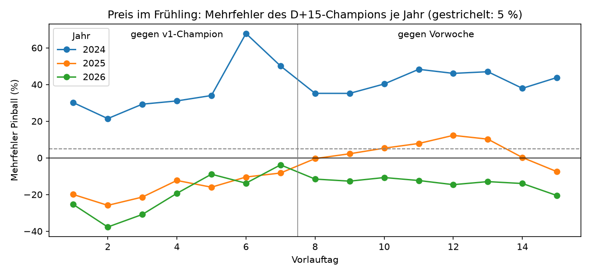
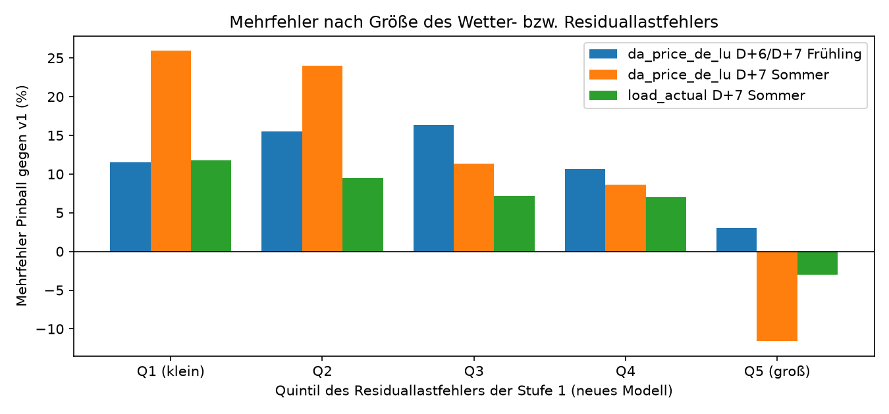
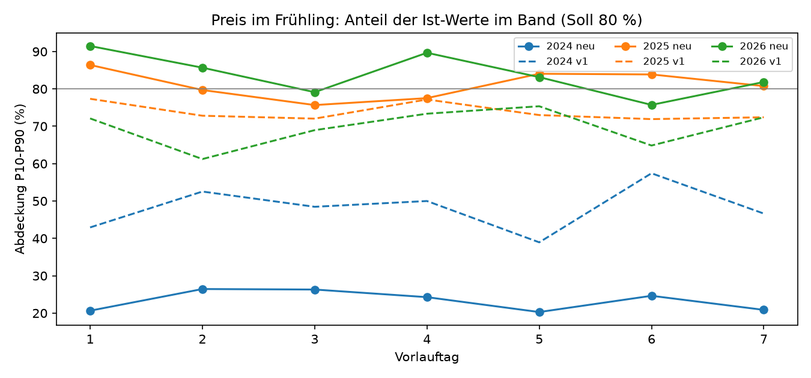

# Schwächen des D+15-Champions: Frühjahr 2024, nicht das Wetter

Einmalige Auswertung vom 10.11.2026, Auftrag in [job.yaml](job.yaml). Frage: Warum ist der
neue Champion `de_lu_v2-wetter_frei-202611082227-53e301` in einzelnen Gruppen schlechter als
der v1-Champion `de_lu_v1-kalender-202610270115-7e355b` (Preis D+6/D+7 im Frühling, D+7 im
Sommer, Last D+7 im Sommer) bzw. als die Vorwoche (Preis D+10 bis D+13 im Frühling)? Liegt es
an Wetterumschwüngen, die die GFS-Prognose nicht vorhersieht?

## Ergebnis in Kürze

**Nein, am Wetter liegt es nicht.** Die Schwächen stammen fast ganz aus **einem Zeitraum**:
dem Frühjahr 2024, der ersten Testfaltung des Backtests. Dort lag das neue Modell beim Preis
auf **jedem** Vorlauftag um 23 bis 33 €/MWh zu tief. In den Frühjahren 2025 und 2026 ist es in
denselben Gruppen besser als beide Gegner.

| Gruppe (Mehrfehler Pinball) | 2024 | 2025 | 2026 | alle |
|---|---|---|---|---|
| Preis D+6/D+7 Frühling, gegen v1 | **+58 %** | −9 % | −9 % | +11 % |
| Preis D+7 Sommer, gegen v1 | **+21 %** | −2 % | +4 % | +8 % |
| Last D+7 Sommer, gegen v1 | +19 % | +17 % | −10 % | +6 % |
| Preis D+10 bis D+13 Frühling, gegen Vorwoche | **+45 %** | +9 % | −13 % | +9 % |

Quelle: [tabellen/gruppen.csv](tabellen/gruppen.csv), je Jahr über die Vorlauftage der Gruppe
gemittelt. Die Freigaberegel (höchstens +5 % je Gruppe) mittelt über alle drei Jahre und sieht
deshalb nur die Spalte „alle“.

- **Konzentriert, nicht breit:** Beim Preis D+6/D+7 im Frühling bringen die schlechtesten 7 von
  70 Ausgabetagen 90 % des Mehrfehlers, alle zwischen Ende Februar und Mai 2024. Ohne 2024
  wäre die Gruppe klar besser als v1 ([tabellen/konzentration.csv](tabellen/konzentration.csv),
  [tabellen/episoden.csv](tabellen/episoden.csv)).
- **Unabhängig vom Wetterfehler:** Der Fehler der Residuallast aus Stufe 1 ist beim neuen
  Modell auf allen Vorlauftagen kleiner als bei v1 (D+7: 8,2 statt 9,1 GW). Der Mehrfehler beim
  Preis ist dort am größten, wo die Wetterprognose **gut** war (Quintil 1: +12 %), und am
  kleinsten bei großen Wetterfehlern (Quintil 5: +3 %).
- **Kein Bandbreitenproblem im Allgemeinen:** In den Frühjahren 2025 und 2026 enthält das Band
  P10–P90 bei D+6/D+7 82 bzw. 79 % der Ist-Werte (Soll 80 %), v1 nur 72 bzw. 69 %. Im Frühjahr
  2024 waren es 23 % (v1: 52 %): Das Band war breit genug, lag aber zu tief.
- **Feiertage, Ostern, Zeitumstellung und Preissprünge erklären es nicht:** 2024 ist das Modell
  auch an gewöhnlichen Tagen 59 % schlechter, an Feiertagen 53 %.

~~Wahrscheinliche Ursache: kurze Trainingshistorie~~ **Korrigiert am 12.11.2026, siehe
[Nachtrag](#nachtrag-vom-12112026-gegenproben-zur-faltung-0106-2024):** Die Gegenproben
widerlegen die kurze Trainingshistorie als Ursache. Mit Training ab 10/2018 wird es deutlich
schlechter. Die Ursache ist ein Fehler in der Kalibrierung der Quantile. Er verschiebt nicht nur
das Band, sondern über das Umsortieren der Quantile auch den Median. Ohne Kalibrierung ist
dasselbe Modell im Frühjahr 2024 besser als v1. Der Fehler betrifft auch den Live-Champion.
Ein offener Punkt steht unter [Grenzen](#grenzen): Faltung 6 (07 bis 11/2026) zeigt erneut
einen großen Preis-Bias.



## Wetterfehler

Für jede gemeinsame Zeile ist der Fehler der Residuallast (Last − Wind an Land − Wind auf See −
PV, je P50 der Stufe 1, gegen Ist) ein Maß dafür, wie gut das Modell die Wetterlage kannte. Beim
neuen Modell steckt darin die GFS-Prognose, bei v1 nur Klimatologie.

| Vorlauftag | 1 | 3 | 5 | 6 | 7 |
|---|---|---|---|---|---|
| Fehler Residuallast neu (MW) | 3 699 | 5 156 | 7 004 | 7 771 | 8 246 |
| Fehler Residuallast v1 (MW) | 8 095 | 8 985 | 8 914 | 8 847 | 9 133 |

| Preis D+6/D+7 Frühling, Quintil des Residuallastfehlers | Q1 (klein) | Q2 | Q3 | Q4 | Q5 (groß) |
|---|---|---|---|---|---|
| mittlerer Residuallastfehler (MW) | 1 162 | 3 613 | 6 219 | 9 594 | 16 653 |
| Mehrfehler Pinball gegen v1 | +12 % | +15 % | +16 % | +11 % | +3 % |

Wären überraschende Wetterumschwünge die Ursache, stiege der Mehrfehler mit dem Wetterfehler.
Er fällt aber. Dasselbe gilt für Preis und Last D+7 im Sommer
([tabellen/wetterfehler.csv](tabellen/wetterfehler.csv)).



## Bias und Bänder

Preis, D+6 und D+7, Frühling, gemeinsame Zeilen (Ausgabe 08 UTC):

| Jahr | Abdeckung neu | Abdeckung v1 | Breite neu | Breite v1 | Bias neu | Bias v1 |
|---|---|---|---|---|---|---|
| 2024 | 23 % | 52 % | 97 €/MWh | 55 €/MWh | −26,8 €/MWh | −20,1 €/MWh |
| 2025 | 82 % | 72 % | 85 €/MWh | 94 €/MWh | −8,4 €/MWh | +7,2 €/MWh |
| 2026 | 79 % | 69 % | 104 €/MWh | 83 €/MWh | −6,5 €/MWh | −10,1 €/MWh |

Das neue Modell ist bei langem Vorlauf nicht zu selbstsicher. Sein Band wird mit dem Vorlauf
breiter (Frühling D+1: 74, D+7: 97 €/MWh), das von v1 kaum (70 bzw. 78 €/MWh). Im Frühjahr 2024
lagen beide Modelle zu tief. Das neue Modell lag dort aber tiefer, und vor allem lag sein P90
im Mittel unter dem Ist. Der mittlere Fehler (MAE) war 2024 nur um 13 % höher, der
Pinball-Verlust der Quantile um 58 %.

Der Bias stammt nicht aus dem langen Vorlauf: Schon für D+1 lag der Preis im Frühjahr 2024 im
Mittel 23,5 €/MWh zu tief, für D+15 32,8 €/MWh. 2025 waren es 3 bis 7 €/MWh, 2026 4 bis
10 €/MWh. Das ist ein Niveaufehler der ganzen Faltung, kein Wetterfehler.



## Andere Faktoren

Preis D+6/D+7 im Frühling, Mehrfehler gegen v1 ([tabellen/andere.csv](tabellen/andere.csv)):

| Faktor | 2024 | 2025 | 2026 |
|---|---|---|---|
| Feiertag (Bevölkerungsanteil > 0) | +53 % | −11 % | −29 % |
| kein Feiertag | +59 % | −9 % | −6 % |
| 7 Tage ab Zeitumstellung | +196 % | −20 % | −10 % |
| übrige Tage | +52 % | −8 % | −9 % |
| Preissprung Zieltag gegen Ausgabetag: klein / mittel / groß | +61 / +97 / +18 % | −9 / −3 / −16 % | +5 / −6 / −15 % |

Die Woche nach der Umstellung 2024 enthält Ostern (29.03. bis 01.04.) und den schlimmsten
Ausgabetag (24.03.2024, Ziel 30./31.03., Bias −48 €/MWh). Mit nur 71 Zeilen ist das ein
Einzelfall, kein Muster: 2025 und 2026 ist die Woche unauffällig. Auch große Preissprünge
erklären es nicht; 2024 war der Mehrfehler bei kleinen und mittleren Sprüngen am größten.

## Vorschläge

1. **Freigaberegel je Jahr prüfen:** Eine Gruppe nur dann als Grund gegen eine Freigabe werten,
   wenn sie in mehr als einer Testfaltung bzw. einem Jahr schlechter ist. Sonst kann eine
   einzelne frühe Faltung mit kurzer Trainingshistorie jede Wettervariante blockieren.
2. **Erste Faltung der Wettervarianten mit Vorsicht lesen:** Für Vergleiche mit Modellen ohne
   Wetter die Faltung 01–06/2024 getrennt ausweisen (Trainingshistorie 2,8 statt 5,2 Jahre).
3. **Kein stärkerer Rückfall zur Klimatologie ab D+6 nötig:** Das neue Modell schlägt v1 bei
   D+6/D+7 im Frühling 2025 und 2026 und ist dort besser kalibriert. Ein Rückfall würde die
   guten Jahre verschlechtern.
4. **GEFS-Streuung bleibt sinnvoll:** Sie verbessert den Preis auf allen Vorlauftagen um 1,8 bis 4,7 %
   (Teilergebnis des GEFS-Backtests vom 09.11.2026). Gegen den Niveaufehler von 2024 hilft sie
   nicht.

## Daten und Methode

- **Prognosen:** Backtest-Prognosen beider Versionen aus der Registry (`backtest.parquet`). Das
  neue Modell testet ab 01.01.2024 in Halbjahresfaltungen mit vier Ausgabestunden (02, 08, 14,
  20 UTC), v1 ab 01.01.2024 mit Ausgabe 08 UTC. `daten.py` holt beide auf der VM, die Datei
  bleibt im Cache.
- **Gemeinsame Zeilen:** Gleiche Zielgröße, Ausgabezeitpunkt und Stunde in beiden Versionen,
  also nur die Ausgaben um 08 UTC: 215 880 Zeilen für D+1 bis D+7. Für D+8 bis D+15 alle
  966 963 Zeilen des neuen Modells mit Vorwochenwert.
- **Maße:** wie die Freigaberegel (`ml_train.registry.compare`): Pinball über P10/P50/P90 gegen
  v1 bzw. nur P50 gegen die Vorwoche (`week_reference`). Die Jahreszeit ist meteorologisch nach
  Ortszeit der Zielstunde (`ml_train.metrics`). Mehrfehler = Pinball neu / Pinball Gegner − 1.
- **Konzentration:** Summe der Mehrfehler je Ausgabetag. Die Anteile in
  [tabellen/konzentration.csv](tabellen/konzentration.csv) beziehen sich auf die Netto-Summe.
  Weil es Tage mit Minderfehler gibt, können sie über 100 % liegen.
- **Wetterfehler:** Residuallast aus den P50 der Stufe 1, je Version gegen Ist, Quintile nach
  dem Betrag des Fehlers beim neuen Modell.

## Grenzen

- Für D+1 bis D+7 zählen nur die Ausgaben um 08 UTC (etwa ein Viertel des neuen Backtests). Je
  Gruppe und Jahr sind das rund 550 bis 1 100 Stunden.
- (Überholt durch den [Nachtrag](#nachtrag-vom-12112026-gegenproben-zur-faltung-0106-2024).)
  Die Ursache „kurze Trainingshistorie“ ist naheliegend, aber nicht durch einen eigenen Lauf
  belegt. Den Beleg brächte ein Backtest der Faltung 01–06/2024 mit `wetter_frei` ab 10/2018
  ohne Wetter für die Jahre davor.
- **Faltung 6 (07–11/2026):** Dort liegt der Preis des neuen Modells über alle Vorlauftage im
  Mittel 41 €/MWh zu tief (v1 ähnlich, MAE im Herbst 2026 beide etwa 55 €/MWh). Das betrifft
  das hohe Preisniveau im Herbst 2026 (vgl.
  [preisabweichung-2026-10-29](../preisabweichung-2026-10-29/README.md)) und ist eine eigene
  Frage.
- Die Last D+7 im Sommer ist 2024 und 2025 schlechter, ohne Zusammenhang mit dem Wetterfehler
  oder der Ausgabestunde. Der Effekt ist klein (+6 % über alle Jahre); hier fehlt eine Erklärung.

## Nachtrag vom 12.11.2026: Gegenproben zur Faltung 01–06/2024

Auftrag in [nachtrag-job.yaml](nachtrag-job.yaml), Protokoll in
[tabellen/lauf-nachtrag.json](tabellen/lauf-nachtrag.json). Zwei Backtests derselben Faltung auf
demselben Snapshot, gleiche Konfiguration bis auf je eine Änderung:

- `ab2018`: `wetter_frei` mit Training ab 08.10.2018. Vor 03/2021 gibt es kein Wetter, die
  Wettermerkmale sind dort leer.
- `ohne_kal`: `wetter_frei` wie im Champion, aber ohne Kalibrierung der Quantile
  (`calibration.months: 0`).

Gemeinsame Zeilen aller vier Verfahren (Ausgabe 08 UTC), D+1 bis D+7
([tabellen/nachtrag_vergleich.csv](tabellen/nachtrag_vergleich.csv)):

| Preis | Pinball | MAE | Bias | Abdeckung | gegen v1 |
|---|---|---|---|---|---|
| v1 | 9,32 | 29,4 €/MWh | −15,4 €/MWh | 56 % | – |
| Champion (mit Kalibrierung) | 12,20 | 27,4 €/MWh | −23,1 €/MWh | 31 % | +31 % |
| **ohne Kalibrierung** | **7,32** | **20,6 €/MWh** | **−12,4 €/MWh** | 54 % | **−21 %** |
| Training ab 2018 | 19,16 | 59,0 €/MWh | −58,4 €/MWh | 21 % | +106 % |

Preis D+6/D+7 im Frühling 2024 (die Gruppe, die die Freigabe blockierte): Champion +58 % gegen
v1, ohne Kalibrierung −6 %, mit Training ab 2018 +147 %. Bei der Last sind alle drei Varianten
besser als v1 (−4 bis −11 %), die Variante ab 2018 am deutlichsten.

**Die kurze Trainingshistorie ist nicht die Ursache.** Die längere Historie macht den Preis viel
schlechter. Die Jahre 2018 bis 2021 haben ein ganz anderes Preisniveau und kein Wetter; das
Modell lernt dort Zusammenhänge, die 2024 nicht mehr gelten.

**Die Ursache ist die Kalibrierung, genauer ein Fehler darin.** `QuantileModel.predict` addiert
die Verschiebung je Vorlauftag auf P10 und P90 und sortiert danach die drei Quantile, damit sie
sich nicht kreuzen. Für die Faltung 2024 wurde die Verschiebung auf 2023 bestimmt, als die
Preise fielen und das Modell meist zu hoch lag. Die Verschiebung von P90 war deshalb stark
negativ. Liegt das verschobene P90 unter P50, gibt das Sortieren den verschobenen Wert als
Median aus. Die Kalibrierung sollte den Median nie verändern (`CalibrationConfig`), tut es aber:

| Ziel, Faltung 01–06/2024 | Median verschoben (Anteil Stunden) | mittlere Verschiebung |
|---|---|---|
| Preis | 78 % | −10,7 €/MWh |
| PV | 19 % | −3,3 MW |
| Last | 4 % | +5,0 MW |
| Wind an Land | 5 % | +37,6 MW |
| Wind auf See | 3 % | −0,3 MW |

Quelle: [tabellen/nachtrag_median.csv](tabellen/nachtrag_median.csv), Median des Champions gegen
den desselben Modells ohne Kalibrierung. Beim Preis wirkt zusätzlich die Verschiebung der
Stufe-1-Mediane (Last, Wind, PV) als Eingang. Weil der Live-Champion ebenfalls Verschiebungen
trägt, betrifft der Fehler auch seine Prognosen; wie stark, hängt von seinen Verschiebungen ab.

**Vorschlag:** In `QuantileModel.predict` P50 unverändert lassen und nur P10 und P90 begrenzen,
also P10 = min(P10 + Verschiebung, P50) und P90 = max(P90 + Verschiebung, P50), statt alle drei
zu sortieren. Die Verschiebungen sind in den Modellen gespeichert, der Fix wirkt daher ohne
neues Training. Dazu ein Test, der prüft, dass P50 mit und ohne Kalibrierung gleich bleibt.
Danach den Champion-Backtest neu rechnen; erst dann ist die Freigaberegel für die D+15-Linie
wieder aussagekräftig.

### Energiekrise im Modell

Die Krise steckt bisher nur indirekt im Modell:

- **Brennstoffe** (Gruppe `brennstoffe`, im Champion): Erdgas EU, LNG Japan, Henry Hub, Kohle
  und Brent als Monatswerte der Weltbank, verfügbar etwa einen Monat später; Diesel und Heizöl
  wöchentlich (EU Oil Bulletin), Diesel USA täglich (EIA), Wechselkurs täglich (EZB). Heizöl
  und Diesel folgen dem Öl, nicht dem Gas. Der Gaspreis, der in Deutschland meist den
  Strompreis setzt, kommt also nur als verspäteter Monatswert an. Täglicher TTF- und CO₂-Preis
  wären passender, sind aber nicht frei.
- **Preis relativ zum Vortag:** Das Modell lernt die Abweichung vom Tagesmittel des letzten
  bekannten Tags, nicht den absoluten Preis.
- **Grenzkostenindex** (Gruppe `grenzkosten`, nicht im Champion): ein täglicher, freier Ersatz
  für das Gas- und CO₂-Niveau aus SMARD; die Variante `wetter_frei_gk_skaliert` lernt den Preis
  zusätzlich relativ zu diesem Niveau.

Wie man die Krise besser abbildet, nach erwartetem Nutzen:

1. Den Kalibrierfehler beheben (oben). Er macht aus einem Niveaufehler nach einer Krise einen
   noch größeren.
2. `grenzkosten` und Skalierung in die D+15-Linie nehmen. Der D+15-Challenger
   `wetter_frei_gk_skaliert` wird gerade trainiert.
3. Die Krisenjahre im Training geringer gewichten. Die Gegenprobe zeigt, dass mehr alte Jahre
   ohne Gewichtung nicht helfen.

Ein Merkmal „Krise ja/nein“ hilft nicht, weil es für die Zukunft niemand kennt.

## Quellen

- Backtest-Prognosen und Ist-Werte aus PredictionDB (`energy.value_best`: Last, Erzeugung und
  Day-Ahead-Preis aus SMARD, Bundesnetzagentur | SMARD.de, CC BY 4.0, und ENTSO-E
  Transparency). Im Repository liegen nur aggregierte Kennzahlen.
- Wetter in den Modellen: NOAA GFS 0,25° (gemeinfrei).

## Nachvollziehen

```bash
# auf der VM (Registry in Garage)
docker compose --profile ml run --rm --no-deps -T --entrypoint nice ml-train -n 19 \
    python - --out /data/analysis/champion-schwaechen-d15/zeilen.parquet \
    < docs/analysen/champion-schwaechen-d15/daten.py
# Datei nach .ml-data/champion-schwaechen-d15/ holen, dann lokal
uv run --with matplotlib python docs/analysen/champion-schwaechen-d15/auswertung.py \
    --cache .ml-data/champion-schwaechen-d15
```
