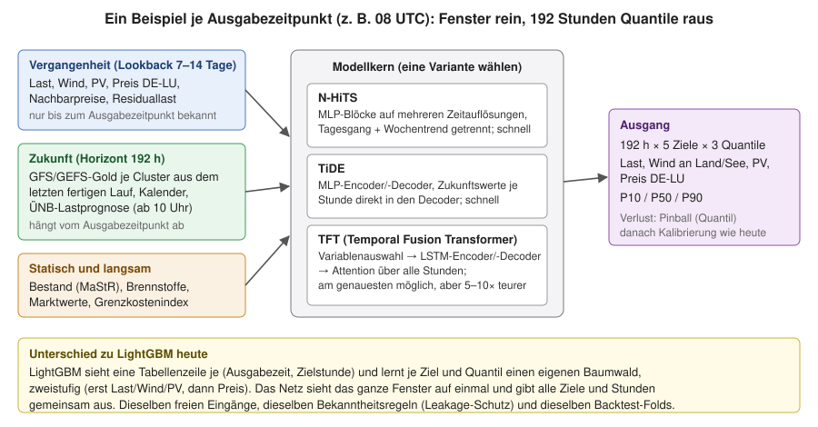
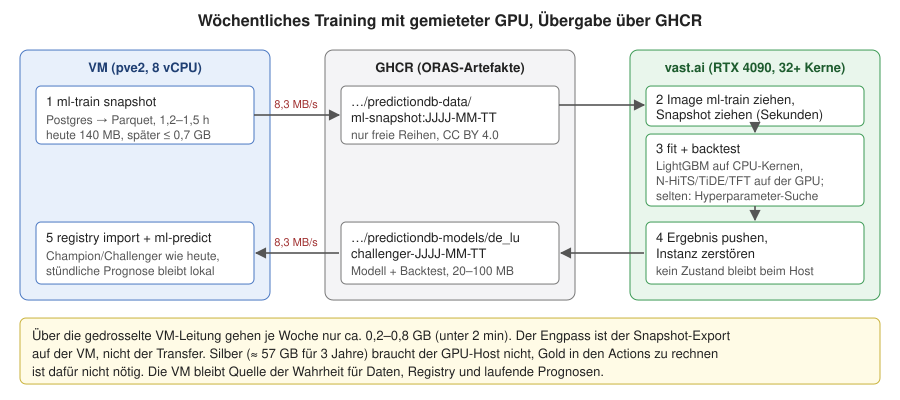

# Training auf einer gemieteten Cloud-GPU: Datenmengen, Zeit und Kosten

Einmalige Abschätzung vom 29.10.2026. Frage: Welche Datenmengen entstehen und welchen
Zeitvorteil hätte es, die Prognosemodelle (LightGBM wie heute, dazu die neuronalen Netze TFT,
TiDE und N-HiTS) auf einer gemieteten Cloud-GPU zu trainieren statt auf der VM? Was kostet das
am Beispiel vast.ai, und welche GPU passt?

Grundlage sind Messungen auf der VM vom 29.10.2026 (nur lesend: Snapshot-Größen, Manifeste,
`meta.ml_job`, `lauf.json` der Backtests) und die Konfiguration `config/ml/de_lu_v2.yaml`. Für
LightGBM sind die VM-Zeiten gemessen. **Für TFT, TiDE und N-HiTS gibt es noch keinen Code; alle
Werte dazu sind Schätzungen** aus Modellgröße und Datenmenge und können um den Faktor 2 daneben
liegen. Preise sind vast.ai-Angebote vom 29.10.2026 je GPU-Stunde (On-Demand, schwanken).

## Ergebnis in Kürze

- **Die Datenmenge ist kein Engpass.** Ein Trainings-Snapshot ist heute 140 MB groß (17 s bei
  8,3 MB/s), mit GFS EU 0,5° und GEFS voraussichtlich 0,5–0,7 GB (gut 1 min). Zurück kommen
  Modell und Backtest mit 20–100 MB. Länger als der Transfer dauert der Snapshot-Export auf der
  VM (1,2–1,5 h), und der bleibt.
- **GHCR als Übergabe passt.** Die VM schiebt den Snapshot einmal als ORAS-Artefakt hoch, der
  GPU-Host zieht ihn schnell, das Ergebnis geht als Modell-Artefakt zurück. Silber braucht der
  GPU-Host nicht (≈ 57 GB für 3 Jahre statt 140 MB Gold-Snapshot), Gold in den Actions zu
  rechnen ist dafür nicht nötig.
- **LightGBM** gewinnt in der Cloud vor allem durch mehr und modernere CPU-Kerne, kaum durch die
  GPU: Backtest 30–45 min statt 3,8 h, Kosten um 0,15 $ je Lauf.
- **N-HiTS und TiDE** sind kleine MLP-Netze: auf der VM möglich, aber Stunden bis halbe Tage
  je Backtest; auf einer RTX 4090 etwa 1 h für unter 0,30 $.
- **TFT** ist auf der VM wöchentlich nicht machbar (Backtest mehrere Tage). Auf einer RTX 4090
  dauert ein Backtest 6–12 h für 1–2 $.
- **Passende GPU: RTX 4090** (0,13 $/h). Die Modelle sind klein und passen locker in 24 GB.
  Wichtig ist ein Angebot mit 32 oder mehr CPU-Kernen, weil LightGBM und die Datenaufbereitung
  auf der CPU laufen.
- **Monatlich** bei wöchentlichem Neutraining: LightGBM ~0,60 $, N-HiTS/TiDE je ~1 $, TFT 5–8 $.
  Eine Hyperparameter-Suche kostet einmalig unter 1 $ (LightGBM, N-HiTS, TiDE) bzw. 3–8 $ (TFT).

## Gemessene Grundlage auf der VM

| Größe | Wert |
|---|---|
| CPU | 8 vCPU Intel Xeon E5-2620 @ 2,0 GHz (Sandy Bridge, ohne AVX2) |
| RAM | 23 GB, davon ca. 10 GB frei |
| Snapshot `snap-v2-20261029` | 140 MB: `weather.parquet` 127 MB (18,75 Mio. Zeilen, GFS 0,25°, 00/12Z, bis 216 h), `energy.parquet` 20 MB (2,74 Mio. Zeilen, 54 Reihen), `capacity.parquet` 0,15 MB |
| Snapshot-Export (`ml-train snapshot`) | 1 h 12 min bzw. 1 h 28 min |
| Fit `wetter_frei` / `wetter_frei_gk_skaliert` | 41 min / 49 min |
| Backtest eine Variante (`wetter_frei`, 4 Folds) | 3 h 47 min (Merkmale 9 min, Folds 44–58 min) |
| Backtest fünf Varianten | 13 h 58 min |
| Feature-Frame je Variante | ca. 1,86 Mio. Zeilen (Ausgabezeit × Zielstunde) |
| Backtest-Ausgabe (`predictions.parquet`) | 22 MB (eine Variante) bis 77 MB (fünf Varianten) |

Ein Fit trainiert je Ziel (Last, Wind an Land, Wind auf See, PV, Preis) und Quantil einen
Baumwald mit 400 Runden, dazu Out-of-Fold-Modelle für Stufe 2 und ein zweites Modell für die
Kalibrierung. Das sind etwa 50 Boosting-Läufe nacheinander, jeder mit 8 Threads.

## Aufbau eines neuronalen Netzes für diese Aufgabe

Ein Trainingsbeispiel ist ein **Ausgabezeitpunkt** (heute 02, 08, 14 und 20 UTC). Das Netz
bekommt drei Arten von Eingängen:

- **Vergangenheit:** die letzten 7–14 Tage der Zielreihen und verwandter Reihen, nur soweit
  sie zum Ausgabezeitpunkt bekannt sind (dieselben Regeln wie heute: Ist-Werte 2 h nach
  Intervallende, Day-Ahead-Preis ab 13 Uhr).
- **Zukunft:** für jede der 192 Stunden die Wetter-Features je Cluster aus dem **letzten fertigen
  GFS/GEFS-Lauf**, den Kalender und ab 10 Uhr die Lastprognose der ÜNB.
- **Statisch und langsam:** installierte Leistung, Brennstoff-Niveau, Marktwerte,
  Grenzkostenindex.

Ausgegeben werden alle fünf Ziele für alle 192 Stunden mit P10/P50/P90 auf einmal. Gelernt wird
mit dem Pinball-Verlust; die Nachkalibrierung der Quantile je Vorlauftag bleibt wie heute.

| Kern | Aufbau | Größe | Rechenaufwand |
|---|---|---|---|
| N-HiTS | gestapelte MLP-Blöcke auf mehreren Zeitauflösungen (Tagesgang, Wochentrend) | 1–5 Mio. Parameter | gering |
| TiDE | MLP-Encoder und -Decoder, Zukunftswerte je Stunde direkt in den Decoder | 1–3 Mio. Parameter | gering |
| TFT | Variablenauswahl, LSTM-Encoder/-Decoder, Attention über alle Stunden | 1–5 Mio. Parameter | 5–10× höher |

**Eine Besonderheit:** Bibliotheken wie Darts oder NeuralForecast erwarten Zukunftswerte als
eine durchgehende Reihe. Unsere Wetterwerte hängen aber vom Lauf ab: Für dieselbe Zielstunde
gibt es je Ausgabezeitpunkt einen anderen Wert. Dafür braucht es einen eigenen
Datensatz-Aufbau, der je Beispiel das passende Lauf-Fenster aus `weather.parquet` schneidet.
Das ist der größte Teil der Umsetzungsarbeit.

## Einbindung ins Training

Vorschlag, nicht umgesetzt:

1. Die VM erzeugt wie heute den Snapshot (`ml-train snapshot`) und legt ihn als ORAS-Artefakt
   auf GHCR ab (z. B. `predictiondb-data/ml-snapshot:JJJJ-MM-TT`).
2. Eine gemietete Instanz startet das `ml-train`-Image und zieht den Snapshot.
3. Dort laufen `fit` und `backtest` mit denselben Folds wie heute. Das Netz wäre eine weitere
   Modellfamilie in der Konfiguration (z. B. `model: nhits`), damit Champion/Challenger
   Netze und LightGBM direkt vergleicht.
4. Modell und Backtest gehen als Challenger-Artefakt nach GHCR
   (`predictiondb-models/de_lu:challenger-JJJJ-MM-TT`, siehe
   [Modell-Release-Tags](../../ARCHITEKTUR.md)), die Instanz wird danach zerstört.
5. Die VM übernimmt das Artefakt in die Registry; `ml-predict` rechnet wie heute stündlich
   lokal. Für die Prognose eines fertigen Netzes reicht die CPU der VM (Sekunden je Lauf).

Die VM bleibt damit Quelle der Wahrheit für Daten, Registry und laufende Prognosen. Laut
Nutzervorgabe vom 24.10.2026 wird das wöchentliche Neutraining erst eingerichtet, wenn
mindestens 3 Jahre GFS-Trainingsdaten vorliegen.

## Datenmengen

| Schritt | heute | mit GFS EU 0,5° + GEFS (geschätzt) | Dauer bei 8,3 MB/s |
|---|---|---|---|
| Snapshot hoch (VM → GHCR) | 140 MB | 0,5–0,7 GB | 17 s – 1,5 min |
| Snapshot runter (GHCR → GPU-Host) | 140 MB | 0,5–0,7 GB | Sekunden (nicht gedrosselt) |
| Modell zurück: LightGBM | 5–20 MB | 5–20 MB | < 3 s |
| Modell zurück: Netz-Checkpoint | 5–50 MB | 5–50 MB | < 6 s |
| Backtest-Vorhersagen | 20–80 MB | 20–80 MB | < 10 s |
| Hyperparameter-Suche, 50 Durchläufe | bis 1 GB (Kennzahlen, beste Checkpoints, Validierungsvorhersagen) | | ca. 2 min |

Je Woche gehen damit 0,2–0,8 GB über die gedrosselte Leitung. Im Speicher braucht der
Merkmalsrahmen einer Variante 2–3 GB (1,86 Mio. Zeilen in float32), das passt auf jede der
Instanzen.

## Laufzeit und Kosten je Lauf

Annahme Cloud: RTX 4090 mit 32 oder mehr modernen CPU-Kernen, 0,13 $/h, plus ca. 10 min für
Start, Image und Snapshot.

| Modell | VM-CPU Fit / Backtest | Cloud Fit / Backtest | Kosten je Lauf | Kosten je Monat (wöchentlich) |
|---|---|---|---|---|
| LightGBM | 45 min / 3,8 h (gemessen) | 5–8 min / 30–45 min | ~0,15 $ | ~0,60 $ |
| N-HiTS | 1–3 h / 6–15 h | 10–15 min / ~1 h | ~0,20 $ | ~1 $ |
| TiDE | 2–4 h / 10–20 h | 15–20 min / 1–1,5 h | ~0,25 $ | ~1 $ |
| TFT | 15–40 h / mehrere Tage | 1–3 h / 6–12 h | 1–2 $ | 5–8 $ |

Bei LightGBM bringt die GPU kaum etwas: Die Quantil-Ziele und die vielen kleinen
Boosting-Läufe nacheinander profitieren mehr von schnellen Kernen. Der Gewinn kommt daher, dass
ein aktueller Kern mit AVX2 etwa 2–3× schneller ist als ein Sandy-Bridge-Kern und vier- bis
achtmal so viele Kerne verfügbar sind. Bei den Netzen ist die GPU je nach Modell 5–40× schneller
als die 8 VM-Kerne ohne AVX2.

## Hyperparameter-Suche

Annahme: Je Durchlauf wird nur ein Validierungsblock trainiert (ohne Kalibrierung und volle
Folds), schwache Durchläufe bricht die Suche früh ab (Pruning, z. B. Optuna). Eingabe ist
derselbe Snapshot, einmal geladen.

| Modell | Durchläufe | VM-CPU | Cloud (RTX 4090) | Kosten |
|---|---|---|---|---|
| LightGBM | 100 | ~10 min je Durchlauf → 15–20 h | 1–2 min, mehrere parallel auf 32 Kernen → 1–3 h | < 0,50 $ |
| N-HiTS | 50 | 1–3 h → 3–6 Tage | 5–10 min → 3–5 h | < 1 $ |
| TiDE | 50 | 2–4 h → 1–2 Wochen | 10–15 min → 6–8 h | ~1 $ |
| TFT | 30–50 | Monate, nicht machbar | 30–90 min → 20–60 h | 3–8 $ |

Für TFT lohnt ein Angebot mit 4× RTX 4090: Die Wandzeit sinkt auf 5–15 h bei gleichen Kosten.
Die Suche gehört nicht ins wöchentliche Neutraining, sondern läuft einmal je Modell und danach
bei neuen Merkmalsgruppen oder etwa vierteljährlich. Das wöchentliche Training nutzt die
gefundenen Parameter.

## Welche GPU

| GPU | Preis/h | Einschätzung |
|---|---|---|
| Tesla T4 (eigener Server) | Strom | etwa 4–6× langsamer als die 4090, 3–10× schneller als die VM-CPU (siehe unten) |
| RTX 3090 | 0,12 $ | geht, aber etwa halb so schnell wie die 4090 bei fast gleichem Preis |
| **RTX 4090** | **0,13 $** | **beste Wahl:** 24 GB reichen, bestes Preis-Leistungs-Verhältnis |
| RTX 5090 | 0,39 $ | etwa 1,4× schneller als die 4090, aber dreimal so teuer |
| H100 | 1,65 $ | 2–3× schneller als die 4090, je Durchlauf teurer; nur wenn es eilt |
| H200 | 2,76 $ | mehr Speicher, den diese Modelle nicht brauchen |

Bei vast.ai teilen sich Instanzen die CPU-Kerne eines Rechners. Für LightGBM und die
Datenaufbereitung sollte das Angebot ausdrücklich 32 oder mehr Kerne und mindestens 32 GB RAM
bieten.

## Eigene GPU: NVIDIA Tesla T4 im Server

Die T4 (Turing, 16 GB GDDR6, 320 GB/s, 8,1 TFLOPS FP32, 65 TFLOPS FP16 mit Tensor-Kernen,
70 W, passiv gekühlt) wäre per PCI-Passthrough an die VM durchzureichen. Gegenüber der
RTX 4090 (1 TB/s, 83 TFLOPS FP32, 165 TFLOPS FP16) ist sie beim Training kleiner Netze etwa
**4–6× langsamer**, gegenüber den 8 VM-Kernen ohne AVX2 aber etwa **3–10× schneller**. Mit
Mixed Precision (FP16) nutzt sie ihre Tensor-Kerne; ohne fällt sie weiter zurück.

| Modell | VM-CPU | T4 im Server | RTX 4090 (Cloud) |
|---|---|---|---|
| LightGBM Fit / Backtest | 45 min / 3,8 h | kaum Gewinn, bleibt auf der CPU | 5–8 min / 30–45 min (CPU-Kerne) |
| N-HiTS Fit / Backtest | 1–3 h / 6–15 h | 45–75 min / 4–6 h | 10–15 min / ~1 h |
| TiDE Fit / Backtest | 2–4 h / 10–20 h | 1–1,5 h / 5–8 h | 15–20 min / 1–1,5 h |
| TFT Fit / Backtest | 15–40 h / mehrere Tage | 5–15 h / 1,5–3 Tage | 1–3 h / 6–12 h |
| Suche N-HiTS (50) | 3–6 Tage | 15–25 h | 3–5 h |
| Suche TiDE (50) | 1–2 Wochen | 30–40 h | 6–8 h |
| Suche TFT (30–50) | nicht machbar | 4–12 Tage | 20–60 h |

Einordnung:

- **Wöchentliches Neutraining** von N-HiTS und TiDE samt Backtest passt mit der T4 bequem in
  eine Nacht, TFT-Fit auch, ein TFT-Backtest dauert dagegen 1,5–3 Tage.
- **LightGBM** hat nichts von der T4: Die Quantil-Ziele und vielen kleinen Boosting-Läufe
  bleiben auf den 8 alten Kernen. Hier hilft nur mehr CPU.
- **Engpass Datenaufbereitung:** Mit nur 8 alten Kernen kann das Füttern der GPU bremsen. Der
  Merkmalsrahmen (2–3 GB) passt aber ganz in die 16 GB der T4; einmal hochgeladen, entfällt
  der CPU-Datenlader.
- **Kosten:** gebraucht ca. 200–400 €. Strom bei ca. 10 h Volllast je Woche: 0,7 kWh, rund
  1 € im Monat (0,30 €/kWh). Gegenüber 1–8 $ Cloud-Kosten im Monat rechnet sich die Karte erst
  nach Jahren; ihr Vorteil ist, dass nichts gemietet, eingerichtet oder übertragen werden muss.
- **Einbau:** Die T4 ist passiv und braucht den Luftstrom eines Servergehäuses mit
  ausreichend hoher Lüfterstufe. Das Board braucht VT-d/IOMMU für das Durchreichen an die VM;
  der Treiber läuft dann in der VM bzw. im `ml-train`-Container (NVIDIA Container Toolkit).

Mischbetrieb wäre naheliegend: N-HiTS und TiDE wöchentlich auf der T4, LightGBM auf der CPU,
TFT-Backtests und große Suchen gelegentlich auf einer gemieteten 4090.

## Freie Daten auf fremden Hosts

Nach dem Leitprinzip werden nur frei lizenzierte Reihen eingebunden, und die dürfen auch auf
einen fremden Host. Die vast.ai-Rechner gehören Dritten; das ist für freie Daten unkritisch.
Vor dem ersten Upload sollte einmal geprüft werden, dass alle 54 Energiereihen im Snapshot aus
freien Quellen stammen (keine `PDB_ALLOW_*`-Reihen). Dann kann der Snapshot auch öffentlich auf
GHCR liegen (CC BY 4.0 mit Quellenangaben), und der GPU-Host braucht kein GHCR-Token zum Lesen.
Zum Schreiben des Modell-Artefakts braucht er ein Token mit `write:packages`, das nur für die
Dauer der Instanz übergeben wird.

## Grenzen der Abschätzung

- Die Zeiten der Netze sind geschätzt; erst ein erster Fit auf echten Daten zeigt die
  tatsächliche Laufzeit.
- Ob die Netze genauer sind als LightGBM, ist offen. Bei rund 8.000 Ausgabezeitpunkten seit
  2021 ist die Datenmenge für Netze eher klein; Bäume sind bei solchen Datenmengen oft
  gleichauf oder besser.
- vast.ai-Preise schwanken stündlich; Angebote unter 0,20 $/h sind oft unterbrechbar
  (Interruptible). Für mehrstündige TFT-Läufe braucht es dann Checkpoints.
