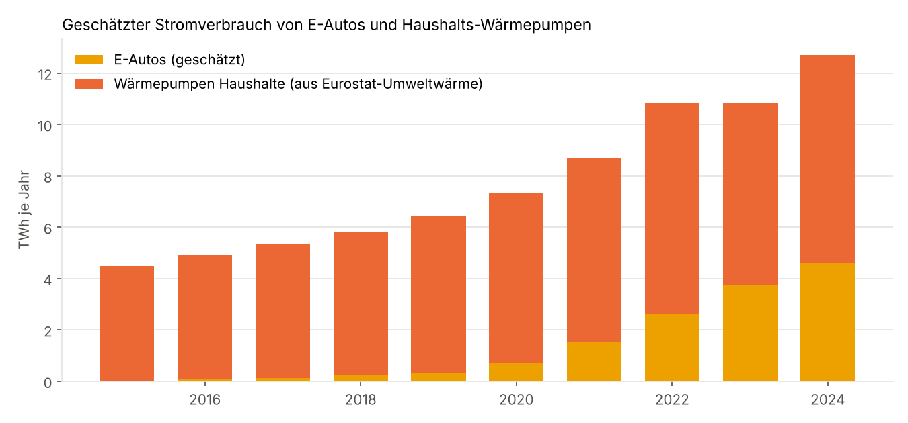
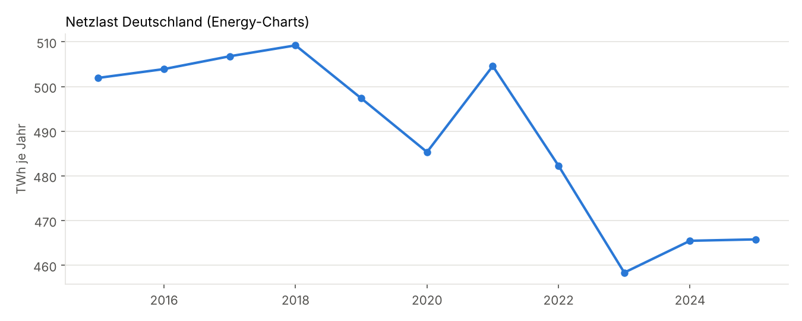
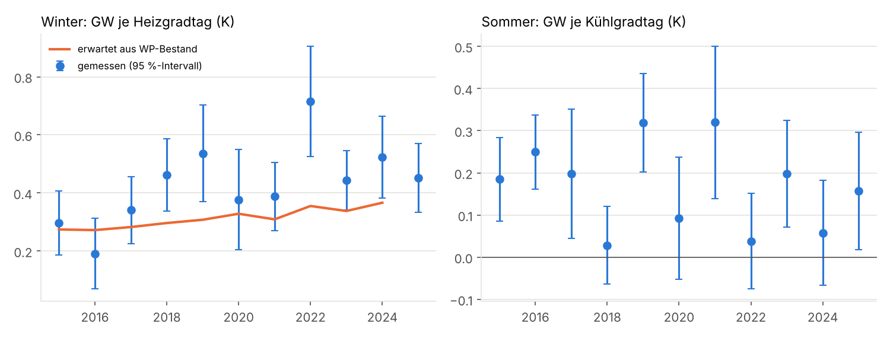
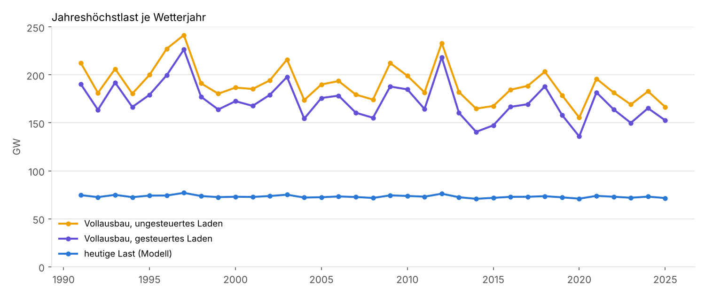
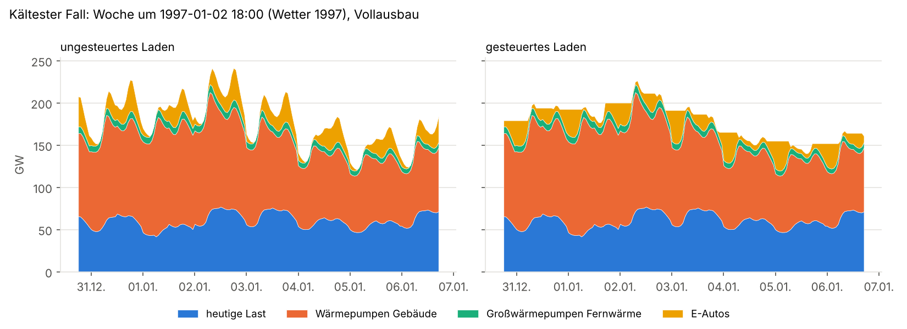
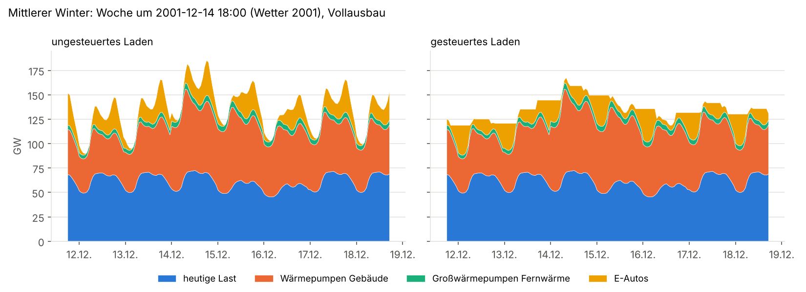
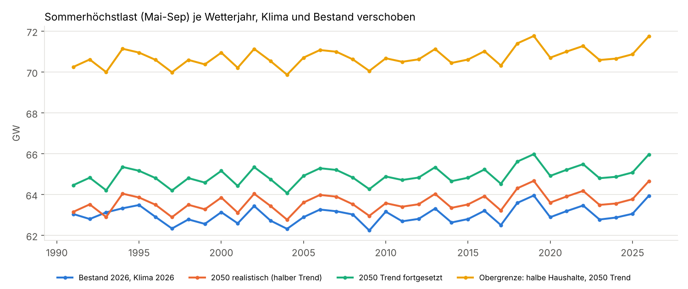
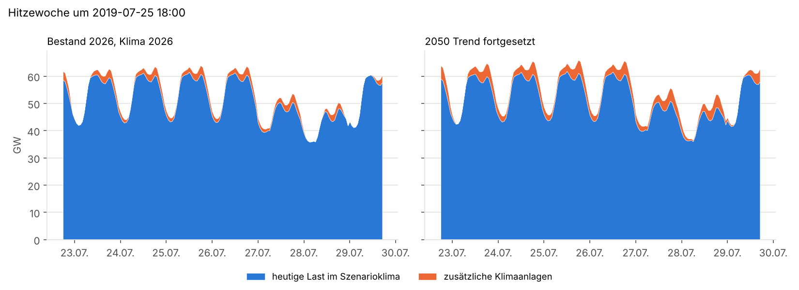
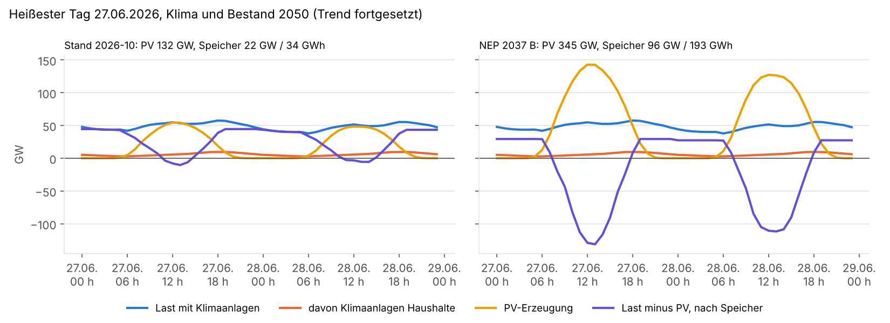

# E-Autos, Wärmepumpen und Klimageräte: Einfluss auf Strombedarf und Lastspitzen

Einmalige Auswertung vom 26.10.2026. Vier Fragen:

1. Wie stark haben die Zulassungen von E-Autos und die Verkäufe von Wärmepumpen und
   Klimageräten die deutsche Netzlast bis 2025 verändert?
2. Was bedeutet es für Jahresbedarf und Lastspitzen, wenn fast alle Pkw elektrisch fahren
   und Wärmepumpen überall heizen, wo keine nicht-fossile Alternative zum Einsatz kommt?
   Als Alternative zählen hier nur Wärmenetze (Biomasse, Biogas, Müllverbrennung,
   Abwärme, Flusswasser-Großwärmepumpen) und die heute schon nicht fossilen Heizungen.
3. Wie entwickelt sich die Sommerlast, wenn Klimaanlagen so verbreitet sind, wie es ein
   realistisches Klimaszenario für 2050 erwarten lässt? Wie viel davon kann das Handwerk
   überhaupt installieren?
4. Wie wirken PV- und Speicherausbau auf diese Last, die vor allem abends anfällt?

Keine der Reihen geht in die Datenbank. Werte, die nur als Webseite oder PDF vorliegen,
sind von Hand mit Quelle übernommen (Liste unten und in [daten.py](daten.py)).

## Ergebnis in Kürze

**Bisher ist der Effekt klein und steckt im Rauschen.** E-Autos haben 2025 etwa 5,4 TWh
verbraucht, die Wärmepumpen der Haushalte 2024 etwa 8,1 TWh. Zusammen sind das knapp 3 % der
Netzlast von 466 TWh. Die Last ist seit 2018 trotzdem um 43 TWh gefallen, weil die Industrie
weniger verbraucht. Klimageräte sind in der Last nicht zu sehen: Eurostat weist für die
Kühlung der Haushalte 1,3 TWh aus, und die Empfindlichkeit der Sommerlast auf Hitze ist
nicht gestiegen.

**Die Winterlast reagiert heute stärker auf Kälte als 2015.** Je Kelvin Heizgradtag steigt
die Tageslast um 0,41 GW (Mittel 2015–2025). Der Wert wächst um 0,022 ± 0,006 GW je Jahr.
Aus dem Wärmepumpenbestand der Haushalte allein wären 0,010 GW je Jahr zu erwarten. Den Rest
erklären vermutlich Wärmepumpen in Gewerbe und Nichtwohngebäuden, die Eurostat nicht ausweist,
und der wachsende PV-Eigenverbrauch, der die Last an hellen Tagen senkt.

**Im Vollausbau steigt der Bedarf um rund 290 TWh auf etwa 755 TWh je Jahr (+61 %).** Davon
entfallen 157 TWh auf Wärmepumpen in Gebäuden, 17 TWh auf Großwärmepumpen in Wärmenetzen und
113 TWh auf E-Autos (Mittel über die Wetterjahre 1991–2025). Die Wärmepumpen erreichen eine
Jahresarbeitszahl von 3,2.

**Die Jahreshöchstlast steigt von gut 73 GW auf 185 GW im mittleren Winter und bis 242 GW
in einer Kältewelle wie Januar 1997.** Sie wird von den Wärmepumpen bestimmt: Bei −14 °C im
Tagesmittel brauchen sie bis zu 130 GW, weil der Wärmebedarf hoch und die Leistungszahl
niedrig ist. Gesteuertes Laden der E-Autos senkt die Spitze nur um 15–20 GW, denn die
Kältespitze dauert Tage und lässt den Autos kaum Täler zum Ausweichen.

| Kennzahl | heute (Modell) | Vollausbau, ungesteuert | Vollausbau, gesteuert |
|---|---|---|---|
| Jahresbedarf (TWh, Mittel der Wetterjahre) | 468 | 755 | 755 |
| Jahreshöchstlast, Median der Wetterjahre (GW) | 73 | 185 | 168 |
| Jahreshöchstlast, 90. Perzentil (GW) | 75 | 215 | 196 |
| Jahreshöchstlast, kältestes Wetterjahr 1997 (GW) | 77 | 242 | 226 |

Die Spanne der Annahmen ist groß, ändert aber die Größenordnung nicht. Die Spitze im
Median liegt zwischen 168 und 195 GW (ungesteuert), im Extremjahr zwischen 213 und 259 GW
(Tabelle unten). Der stärkste Hebel ist der Wärmebedarf: 25 % weniger Raumwärme durch
Sanierung senkt die Extremspitze um 29 GW.

**Klimaanlagen bleiben national ein Sommerthema, kein Spitzenlastproblem.** Der Sommer
2026 war der heißeste der Messreihe, mit 19 Tagen über 24 °C im Tagesmittel. Trotzdem lag
die Netzlast an diesen Tagen nur 0,3 GW höher als an milden Tagen, abends praktisch gar
nicht. Wenn sich der Sommertrend (+0,54 K je Jahrzehnt) bis 2050 fortsetzt, steigt der
Anteil der Haushalte mit Klimaanlage von 23 % auf 31 %. Der Kühlstrom wächst von 2,5 auf
4,7 TWh, die Sommerhöchstlast um gut 2 GW auf 65–66 GW. Selbst wenn jeder zweite Haushalt
kühlt, bleibt die Sommerspitze mit 71–72 GW unter der heutigen Winterspitze.

**Das Handwerk begrenzt den Ausbau fest installierter Geräte.** Mit gut 320.000 Raumklima-
geräten im Jahr und 15 Jahren Lebensdauer pendelt sich der Bestand bei 4,8 Mio. ein. Das
2050er-Ziel von 6 Mio. Haushalten mit Split-Gerät wird damit nie erreicht, erst mit
480.000 Installationen im Jahr nach 19 Jahren. Die Lücke füllen mobile Monoblockgeräte,
die mehr Strom je Kühlleistung brauchen.

**PV allein hilft am Abend nicht, Speicher schon.** Die Residuallast (Last minus PV) hat
ihre Sommerspitze nach Sonnenuntergang. Ob 132 GW PV wie heute oder 345 GW wie im NEP 2037,
sie liegt bei 59 GW, und Klimaanlagen heben sie 2050 um 2,5–3,8 GW. Die heutigen Batterien
(22 GW, 34 GWh) fangen davon zwei Drittel ab. Mit dem Speicherausbau des NEP 2037
(97 GW, 193 GWh) sinkt die Sommerspitze der Residuallast auf 37 GW in die Nacht, die
Klimaanlagen tragen dann höchstens 0,4 GW bei, in der Obergrenze 2 GW.

**Folgerung für die Prognose:** Für die Lastprognose zählt vor allem, dass die
Temperaturempfindlichkeit im Winter zunimmt. Ein Modell, das auf 2015–2020 gelernt hat,
unterschätzt kalte Tage heute um etwa 0,1 GW je Kelvin Heizgradtag, an einem Tag mit 20 K
also um 2 GW. Ein Trend in der Temperaturwirkung (oder kurze Trainingsfenster) ist deshalb
wichtiger als Zulassungszahlen als Merkmal. E-Autos verschieben die Last bisher nicht
messbar. Im Sommer ist der Kühlgradtag als Merkmal ausreichend; ein eigener Klimaanlagen-
Bestand als Merkmal lohnt sich erst, wenn die Hitzetage abends sichtbar mehr Last zeigen.

## Rückblick 2015–2025





E-Autos: Bestand an batterieelektrischen Pkw und Plug-in-Hybriden aus Eurostat (31.12.),
Jahresmittel aus zwei Stichtagen, 12.309 km je Pkw und 20 kWh/100 km ab Netz; Plug-in-Hybride
fahren 40 % elektrisch. Wärmepumpen: Eurostat weist die Umweltwärme der Haushalts-
Wärmepumpen aus. Bei einer Jahresarbeitszahl von 3,2 kostet jede kWh Umweltwärme
1/2,2 kWh Strom. Für Gewerbe gibt es diese Reihe nicht. Die Absatzzahlen des BWP stehen zum
Vergleich in [tabellen/rueckblick_jahre.csv](tabellen/rueckblick_jahre.csv): 2,2 Mio.
Heizungswärmepumpen von 2007 bis 2025, davon 1,2 Mio. seit 2021.



Je Jahr eine Regression der Tageslast auf den Heizgradtag (Nov–Feb) bzw. den Kühlgradtag
(Jun–Aug), mit Wochentag, Feiertag, Weihnachten und Tageslänge als Kontrollgrößen.
Heizgradtag: 15 °C minus gedämpfte Tagesmitteltemperatur (Gewichte 1, ½, ¼, ⅛ der letzten
vier Tage). Kühlgradtag: Tagesmittel über 18 °C. Die Temperatur ist das einwohnergewichtete
Mittel von 22 DWD-Stationen. Die orange Linie ist der Anstieg, den der Wärmepumpenbestand der
Haushalte erwarten lässt, auf das Niveau 2015–2017 gesetzt. 2022 fällt nach oben heraus. Das war der Winter der Gaspreiskrise, vermutlich haben
viele mit Heizlüftern geheizt.

Klimageräte: Der FGK nennt über 330.000 verkaufte Split-Außengeräte 2020 und über 250.000
2024. Selbst eine Million zusätzlicher Geräte mit 300 kWh im Jahr wären 0,3 TWh. Das ist
in der Sommerlast nicht nachweisbar. Die Steigung je Kühlgradtag schwankt zwischen 0,03 und
0,32 GW und hat keinen Trend (−0,009 ± 0,006 GW je Jahr).

## Hochrechnung Vollausbau







Für jedes Wetterjahr 1991–2025 wird stündlich gerechnet:

1. **Heutige Last:** Stundenmodell der Netzlast 2023–2025 auf dem Niveau 2025 (Stunde ×
   Tagtyp, Monat, Heiz- und Kühlgradtag je Tageszeit, Weihnachten, Tageslänge; R² 0,94,
   mittlerer Fehler 2,3 GW). Es enthält die heutigen E-Autos und Wärmepumpen. Die
   Jahresspitze unterschätzt das Modell um 0–5 GW, seit 2020 meist um 3 GW
   ([tabellen/basismodell_spitzen.csv](tabellen/basismodell_spitzen.csv)).
2. **Wärmepumpen in Gebäuden:** Raumwärme und Warmwasser, die 2024 mit Gas, Öl oder Kohle
   erzeugt wurden (AGEB: Haushalte, GHD, Raumwärme der Industrie; 1.715 PJ), mal 0,9
   Kesselwirkungsgrad. Die Raumwärme wird auf die mittleren Heizgradtage der Wetterjahre
   umgerechnet (442 TWh Nutzwärme), Warmwasser bleibt konstant (68 TWh). Die Stundenwärme
   folgt dem Heizgradtag des Tages mit einem flachen Tagesgang. Die Leistungszahl hängt von
   der Stundentemperatur ab (Kurven aus when2heat, Ruhnau et al. 2019, mit 0,85 Praxisabschlag):
   85 % Luft-, 15 % Sole-Wärmepumpen, 75 % Heizkörper (Vorlauf 40 °C − Außentemperatur),
   25 % Flächenheizung, Warmwasser 50 °C.
3. **Wärmenetze:** Gebäude an Fernwärme bleiben dort. Vom fossilen Teil der Fernwärme
   (62 % von 133 TWh, BDEW) kommt die Hälfte aus Großwärmepumpen an Flüssen (Gütegrad 0,5,
   Vorlauf 70–95 °C), die andere Hälfte aus Abwärme, Geothermie, Biomasse oder Solarthermie
   ohne Strom.
4. **E-Autos:** 594 Mrd. km Pkw-Fahrleistung mit 20 kWh/100 km ab Netz, abzüglich der 5 %,
   die heute schon elektrisch sind (113 TWh). Im Winter bis 25 % mehr Verbrauch. Laden: 60 %
   zu Hause, 15 % am Arbeitsplatz, 10 % öffentlich tagsüber, 15 % Schnellladen. Ungesteuert
   lädt jedes Auto drei Stunden ab Ankunft. Gesteuert verteilt sich das Laden zu Hause auf
   17–7 Uhr und am Arbeitsplatz auf 8–17 Uhr so, dass die Gesamtlast möglichst flach bleibt.

Die Wärmepumpen bestimmen die Spitze. Im Januar 1997 sinkt das Tagesmittel auf −13,9 °C, die
Leistungszahl der Luft-Wärmepumpen an Heizkörpern auf etwa 2. In einem mittleren Winter
(Dezember 2001, −7 °C) liegt die Spitze bei 185 GW. Davon kommen 79 GW von Wärmepumpen und
36 GW von ungesteuert ladenden E-Autos um 18 Uhr. Gesteuert verschiebt sich das Laden in die
Nacht, die Spitze sinkt auf 168 GW.

Empfindlichkeit (Zusatzbedarf im Mittel der Wetterjahre, Spitzen in GW):

| Variante | Zusatzbedarf (TWh) | Spitze Median ungesteuert | Spitze Max ungesteuert | Spitze Median gesteuert | Spitze Max gesteuert | JAZ |
|---|---|---|---|---|---|---|
| Mitte | 287 | 185 | 242 | 168 | 226 | 3,2 |
| Sanierung −25 % Raumwärme | 253 | 168 | 213 | 148 | 194 | 3,2 |
| mehr Sole-WP (40 %) | 276 | 179 | 233 | 161 | 218 | 3,5 |
| mehr Flächenheizung (50 %) | 282 | 182 | 235 | 164 | 219 | 3,3 |
| COP ohne Praxisabschlag | 263 | 174 | 223 | 155 | 206 | 3,8 |
| COP-Abschlag 0,75 | 308 | 195 | 259 | 179 | 245 | 2,9 |
| E-Auto 17 kWh/100 km | 270 | 180 | 238 | 167 | 225 | 3,2 |
| E-Auto 24 kWh/100 km | 309 | 192 | 249 | 169 | 228 | 3,2 |
| Fernwärme ohne Großwärmepumpen | 270 | 179 | 233 | 162 | 217 | 3,2 |
| fossile Fernwärme ganz aus Großwärmepumpen | 304 | 191 | 251 | 174 | 236 | 3,2 |

## Klimaanlagen im Klimaszenario





**Was der Sommer 2026 zeigt.** Das Stundenmodell der Netzlast (gelernt auf 2023–2025) sagt
die Last aus Wetter, Tagtyp und Uhrzeit voraus. Wenn die vielen neuen Klimaanlagen die Last
an Hitzetagen erhöhen, liegt die gemessene Last dort über dem Modell, und zwar stärker als
an milden Tagen
([tabellen/hitze_sommer_2023_2026.csv](tabellen/hitze_sommer_2023_2026.csv)):

| Sommer (Jun–Aug) | Tage ≥ 24 °C | Mehrlast heiß gegen mild (GW) | Abweichung heiß 18–22 Uhr (GW) |
|---|---|---|---|
| 2023 | 5 | 0,2 | −0,9 |
| 2024 | 2 | 1,2 | 1,4 |
| 2025 | 7 | 0,3 | 0,5 |
| 2026 | 19 | 0,3 | 0,0 |

Die Nachfrage nach Geräten war 2026 hoch: Laut Verivox-Umfrage haben 23,4 % der Haushalte
eine Klimaanlage (2025: 17,9 %), weitere 24,9 % planen eine. Der Kältefachverband VDKF nennt
Wartezeiten von gut drei Monaten auf Installateure. In der Netzlast kommt das kaum an. Ein
Grund: 69 % der Geräte sind mobile Monoblockgeräte, die nur an wenigen Tagen laufen. Ein
anderer: PV-Anlagen auf dem eigenen Dach decken einen Teil des Kühlstroms, den Energy-Charts
nicht sieht. Am Abend gibt es diesen Effekt aber nicht, und auch dort fehlt der Ausschlag.

**Klimaszenarien.** Grundlage ist der beobachtete Trend der Sommermitteltemperatur
(Jun–Aug, 1991–2026): +0,54 K je Jahrzehnt. Das passt zu den RCP4.5- bis RCP8.5-Läufen für
Deutschland bis zur Jahrhundertmitte. Die Wetterjahre 1991–2026 werden um eine feste
Differenz verschoben, so dass ihr Mittel dem Zieljahr entspricht:

| Szenario | Sommermittel (°C) | Kühlgradtage | Haushalte mit Klimaanlage | davon mobil |
|---|---|---|---|---|
| Bestand 2026, Klima 2026 | 19,6 | 234 | 23 % | 69 % |
| 2050 realistisch (halber Trend ab 2026) | 20,3 | 289 | 27 % | 45 % |
| 2050 Trend fortgesetzt | 20,9 | 350 | 31 % | 45 % |
| Obergrenze: halbe Haushalte, 2050 Trend | 20,9 | 350 | 50 % | 40 % |

Die Ausstattung folgt der Sättigungskurve von McNeil und Letschert (2007), die den Anteil
gekühlter Haushalte aus den Kühlgradtagen schätzt, hier auf die 23,4 % von 2026 geeicht.
Ein Gerät zieht 0,90 kW (mobil) oder 0,65 kW (Split). Es läuft, sobald die gedämpfte
Temperatur (Mittel aus Stundenwert und 24-Stunden-Mittel) 22 °C übersteigt, mit voller
Leistung ab etwa 24 °C. Die Nutzung folgt der Anwesenheit: nachts und tagsüber halb so oft
wie zwischen 17 und 20 Uhr. Die Steigung ist so geeicht, dass 2024 bei angenommenen 14 %
Ausstattung die 1,33 TWh Kühlstrom der Haushalte aus Eurostat herauskommen. Die heutige
Last im Modell enthält den Bestand 2024 schon, gezählt wird nur der Zuwachs.

| Szenario | Kühlstrom (TWh/a) | Sommerspitze ohne Zuwachs, Median (GW) | Sommerspitze, Median (GW) | Sommerspitze, Max (GW) | alle Klimaanlagen zur Spitze (GW) |
|---|---|---|---|---|---|
| Bestand 2026, Klima 2026 | 2,5 | 62,6 | 63,0 | 64,0 | 7,9 |
| 2050 realistisch | 3,4 | 62,4 | 63,6 | 64,7 | 8,4 |
| 2050 Trend fortgesetzt | 4,7 | 62,1 | 64,9 | 66,0 | 9,5 |
| Obergrenze | 7,6 | 62,1 | 70,6 | 71,8 | 15,3 |

Die Sommerspitze liegt um 18 Uhr an Hitzetagen. Ohne Klimaanlagen sinkt sie in wärmerem
Klima leicht, weil die Heizgrad-Anteile im Mai und September wegfallen. Zum Vergleich: Die
Winterspitze liegt heute bei 73 GW und im Vollausbau der Wärmepumpen bei 185 GW.

**Installationsleistung.** Fest installierte Split-Geräte brauchen einen Kältetechniker. Der
FGK meldet 350.000 Raumklimageräte 2020, 260.000 2023 und 320.000 2025, darin sind auch
Gewerbe und Ersatz enthalten. Gerechnet ist, wie schnell der Bestand der Haushalte mit
Split-Gerät (heute 2,9 Mio.) das Ziel aus „2050 realistisch“ (6,05 Mio.) erreicht, wenn
alle Installationen in Haushalte gehen und jedes Gerät 15 Jahre hält
([tabellen/klima_ausbaupfad.csv](tabellen/klima_ausbaupfad.csv)):

| Installationen je Jahr | Jahre bis 6,05 Mio. | Bestand im Gleichgewicht (Mio.) |
|---|---|---|
| 320.000 (heute) | nie | 4,8 |
| 480.000 (+50 %) | 19 | 7,2 |
| 640.000 (doppelt) | 10 | 9,6 |

Der Engpass bremst also den Umstieg auf effiziente Split-Geräte, nicht den Kühlbedarf
selbst. Wer nicht warten will, kauft ein mobiles Gerät. Für die Netzlast ist das ungünstiger
(0,90 statt 0,65 kW), der Unterschied macht in der Obergrenze aber nur etwa 1 GW aus.

## PV und Speicher



Für die Sommer 2015–2026 wird das stündliche PV-Profil aus Energy-Charts (Erzeugung
geteilt durch installierte Leistung des Monats) auf vier Ausbaustufen hochgerechnet und
von der Last mit Klimaanlagen abgezogen. Speicher entladen sich jeden Tag so, dass die
höchste Residuallast möglichst tief fällt, und laden in den Stunden mit dem meisten
PV-Überschuss (Wirkungsgrad 90 %, ideale Voraussicht für den Tag):

| Ausbaustufe | PV (GW) | Speicher (GW / GWh) |
|---|---|---|
| Stand 10/2026 (Energy-Charts) | 132 | 22 / 34 |
| PV wie NEP 2037 B, Speicher wie heute | 345 | 22 / 34 |
| NEP 2037 B | 345 | 97 / 193 |
| NEP 2045 B | 400 | 101 / 202 |

Großspeicher aus dem Szenariorahmen (67,6 GW) mit zwei Stunden Kapazität, Heimspeicher
wachsen mit der PV (heute 22 GWh, 0,5 C).

Höchste Residuallast im Sommer, Median der Wetterjahre, Szenario „2050 Trend fortgesetzt“
([tabellen/pv_speicher_szenarien.csv](tabellen/pv_speicher_szenarien.csv)):

| Ausbaustufe | ohne Speicher, ohne Klimazuwachs (GW) | ohne Speicher, mit Klimazuwachs (GW) | mit Speicher, ohne Klimazuwachs (GW) | mit Speicher, mit Klimazuwachs (GW) | Stunde der Spitze |
|---|---|---|---|---|---|
| Stand 10/2026 | 59,1 | 62,9 | 51,4 | 52,7 | 6 Uhr |
| PV NEP 2037, Speicher heute | 59,0 | 61,6 | 50,4 | 51,3 | 6 Uhr |
| NEP 2037 B | 59,0 | 61,6 | 37,4 | 37,8 | 0 Uhr |
| NEP 2045 B | 59,0 | 61,5 | 36,6 | 36,9 | 0 Uhr |

In der Obergrenze (halbe Haushalte) steigt die Spitze mit heutigen Speichern auf 57,2 GW um
18 Uhr, mit dem Speicherausbau des NEP 2037 nur auf 39,5 GW.

Drei Dinge fallen auf:

1. **Ohne Speicher bringt mehr PV am Abend nichts.** Die Residualspitze liegt immer nach
   18 Uhr und bleibt bei 59 GW, egal wie viel PV installiert ist. Die Klimaanlagen kommen
   voll obendrauf.
2. **Heutige Speicher reichen schon für den Zuwachs bis 2050.** Mit 34 GWh wandert die
   Residualspitze in den frühen Morgen, die Klimaanlagen erhöhen sie nur noch um 1,3 GW.
   Der Speicher muss den Abend allerdings fast vollständig decken und ist dann leer.
3. **Mit dem NEP-Speicherausbau verschwindet das Abendproblem.** Die Spitze liegt um
   Mitternacht bei 37 GW, also mehr als 20 GW unter heute. Die Klimaanlagen spielen dann
   praktisch keine Rolle mehr.

Wohngebäude mit eigener PV und Heimspeicher kühlen am Abend zu einem großen Teil aus dem
eigenen Speicher. Das ist im Modell enthalten, weil die Heimspeicher mitgerechnet sind, aber
nur unter der Annahme, dass sie netzdienlich entladen.

## Grenzen

- Der Wärmebedarf wächst linear mit dem Heizgradtag, auch bei −14 °C. Echte Gebäude sind
  auf eine Normaußentemperatur von −12 bis −16 °C ausgelegt, die Annahme passt also bis in
  diesen Bereich. Heizstäbe in Wärmepumpen sind nicht abgebildet. Sie würden die Spitze an
  den kältesten Tagen weiter erhöhen.
- Die Wetterjahre 1991–2025 enthalten den Klimatrend. Künftige Winter werden im Mittel milder
  sein, Kältewellen wie 1997 oder 2012 bleiben aber möglich.
- Nicht enthalten: leichte Nutzfahrzeuge, Lkw und Busse, Prozesswärme der Industrie,
  Wasserstoff, Ausbau der Wärmenetze über den heutigen Stand, Wärmespeicher und
  Lastverschiebung bei Wärmepumpen. Ein Wegfall der Gas-KWK in Wärmenetzen ändert die
  Erzeugung, nicht die Last.
- Die heutige Last ist als fest angenommen. Effizienzgewinne bei Geräten und Industrie
  sind nicht fortgeschrieben.
- Die Netzlast von Energy-Charts enthält keinen Eigenverbrauch hinter dem Zähler. Wärmepumpen
  und Wallboxen, die PV-Strom vom eigenen Dach nutzen, fehlen im Rückblick zum Teil. Dasselbe
  gilt für die PV-Erzeugung im Teil „PV und Speicher“.
- Klimaszenarien verschieben das ganze Wetterjahr um eine feste Differenz. Hitzeextreme
  nehmen in den Klimamodellen stärker zu als das Mittel, die Spitzen sind daher eher
  unterschätzt. Gleichzeitig laufen im Modell alle Klimaanlagen um 18 Uhr an Hitzetagen
  zugleich auf voller Leistung, das überschätzt die Spitze.
- Die Ausstattung 2024 (14 %) ist geschätzt. Bei 10 % wäre die Leistung je Gerät höher, bei
  18 % niedriger; die Eichung auf 1,33 TWh hält den Kühlstrom gleich.
- Gewerbe und Büros sind nur über die heutige Last enthalten. Ihr Kühlbedarf liegt tagsüber
  und fällt mit der PV zusammen.
- Der Speichereinsatz ist ideal: volle Voraussicht für den Tag und nur auf die nationale
  Residualspitze optimiert. Im Markt laden Speicher nach Preis, Heimspeicher nach
  Eigenverbrauch. Netzengpässe, Im- und Export sowie Pumpspeicher sind nicht abgebildet.
- Im Vollausbau aus Teil 2 laden ungesteuerte E-Autos abends mit bis zu 36 GW. Das ist
  deutlich mehr als jeder Klimazuwachs und braucht dieselben Speicher.
- Alle Ergebnisse gelten für Deutschland als Ganzes. In einzelnen Ortsnetzen mit vielen
  Klimaanlagen und ohne Speicher kann die Abendlast deutlich stärker steigen.

## Quellen

Frei, maschinell geladen:

- Netzlast stündlich 2015–2026: [Energy-Charts](https://api.energy-charts.info) `/public_power`
  (Fraunhofer ISE, CC BY 4.0)
- Lufttemperatur stündlich, 22 Stationen ab 1991:
  [DWD Open Data](https://opendata.dwd.de/climate_environment/CDC/observations_germany/climate/hourly/air_temperature/)
  (CC BY 4.0)
- Pkw-Bestand und Neuzulassungen nach Antrieb: Eurostat
  [road_eqs_carpda](https://ec.europa.eu/eurostat/databrowser/view/road_eqs_carpda/default/table),
  [road_eqr_carpda](https://ec.europa.eu/eurostat/databrowser/view/road_eqr_carpda/default/table)
  (CC BY 4.0)
- Endenergie der Haushalte nach Anwendung, auch Kühlstrom: Eurostat
  [nrg_d_hhq](https://ec.europa.eu/eurostat/databrowser/view/nrg_d_hhq/default/table) (CC BY 4.0)
- PV-Erzeugung stündlich und installierte Leistung von PV und Batteriespeichern:
  [Energy-Charts](https://api.energy-charts.info) `/public_power`, `/installed_power`
  (Fraunhofer ISE, CC BY 4.0)

Von Hand übernommen (nur für diese Analyse):

- Absatz Heizungswärmepumpen 2007–2025: [Bundesverband Wärmepumpe](https://www.waermepumpe.de/presse/zahlen-daten/absatzzahlen/)
- Absatz Split-Klimageräte 2020 und 2024: [FGK über haustechnikdialog.de](https://www.haustechnikdialog.de/News/30725/Marktentwicklung-Raumklimageraete-und-Luft-Luft-Waermepumpen)
- Raumwärme und Warmwasser nach Sektor und Energieträger 2024: [AGEB, Anwendungsbilanzen](https://ag-energiebilanzen.de/wp-content/uploads/EBD24e_AnwBil.pdf),
  Warmwasser der Haushalte 2023: [AGEB/RWI, Tab. 5](https://ag-energiebilanzen.de/wp-content/uploads/2024/11/AGEB_AnwBilanzen_2023_Endbericht_2025-04.pdf)
- Fernwärmeerzeugung 2025 nach Energieträgern: [BDEW Statusreport Wärme 2026, S. 56](https://www.bdew.de/media/documents/2026_07_10_Statusreport_Waerme_final_1.pdf)
- Pkw-Fahrleistung 2024 (KBA): [dpa über autohaus.de](https://www.autohaus.de/nachrichten/autohandel/trendwende-menschen-in-deutschland-fahren-wieder-mehr-auto-3688922)
- Pkw-Bestand 1.1.2026: [Destatis](https://www.destatis.de/DE/Presse/Pressemitteilungen/2026/07/PD26_N050_46_85.html)
- Ladeverluste 10–25 %: [ADAC über ecomento.de](https://ecomento.de/2020/07/23/adac-ermittelt-elektroauto-ladeverluste/)
- Haushalte mit Klimaanlage 2025 und 2026, Anteil mobiler Geräte (Verivox/Innofact):
  [heidelberg24.de](https://www.heidelberg24.de/politik-und-wirtschaft/klimaanlagen-boom-immer-mehr-haushalte-kaufen-geraete-zr-94393480.html)
- Absatz Raumklimageräte 2020, 2023, 2025 (FGK) und Wartezeit auf Installateure (VDKF):
  [dpa-AFX über boerse-online.de](https://www.boerse-online.de/dpa-afx/roundup-begehrte-kuehlgeraete-vielerorts-vergriffen-und-nun-538041.html)
- Privathaushalte 2024 (Mikrozensus): [drweb.de](https://www.drweb.de/41-millionen-haushalte-wie-deutschland-wirklich-wohnt/)
- PV und Großspeicher 2037/2045, Szenario B: [BNetzA, Genehmigung Szenariorahmen NEP Strom 2025](https://www.netzentwicklungsplan.de/sites/default/files/2025-04/Genehmigung%20Szenariorahmen%202025_0.pdf)
- Heimspeicherkapazität Juli 2026 (battery-charts): [solarserver.de](https://www.solarserver.de/2026/07/06/batteriekapazitaet-in-deutschland-waechst-auf-298-gwh-rekordtempo-beim-speicherausbau/)
- Sättigungskurve der Klimaanlagen: McNeil, Letschert (2007), *Future air conditioning energy
  consumption in developing countries and what can be done about it*, ECEEE Summer Study
- Leistungszahlkurven: Ruhnau, Hirth, Praktiknjo (2019), *Time series of heat demand and
  heat pump efficiency for energy system modeling*, Scientific Data 6:189

## Aufruf

Aus dem Repository-Wurzelverzeichnis. Der erste Lauf lädt DWD-, Energy-Charts- und
Eurostat-Daten (einige Minuten) in den Cache:

```bash
uv run --no-project --with pandas --with matplotlib --with httpx --with holidays \
    python docs/analysen/elektrifizierung-last/auswertung.py --cache /tmp/el
```

Ergebnisse: [tabellen/](tabellen/) (Jahreswerte, Temperaturempfindlichkeit, Wetterjahre,
Empfindlichkeit, Klimaszenarien, PV und Speicher, `lauf.json` mit Kennzahlen) und [grafiken/](grafiken/).
