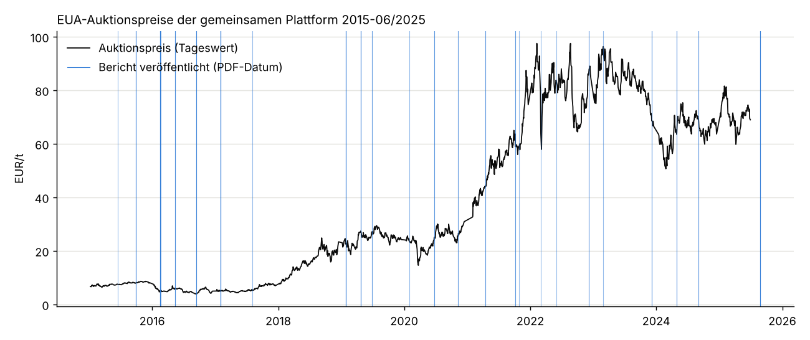
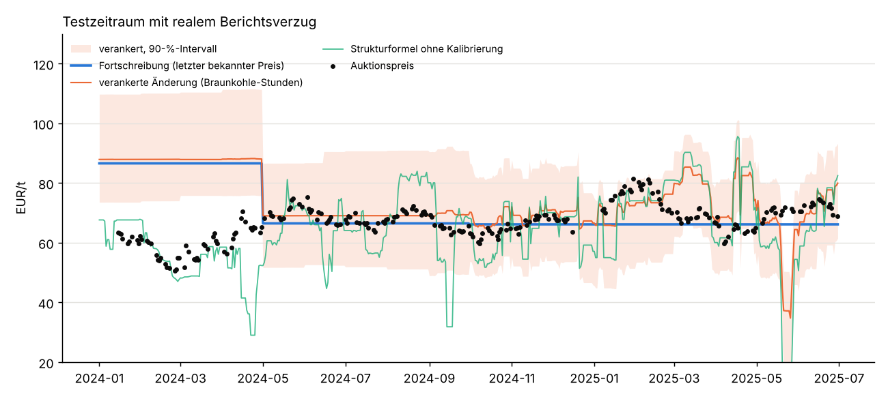
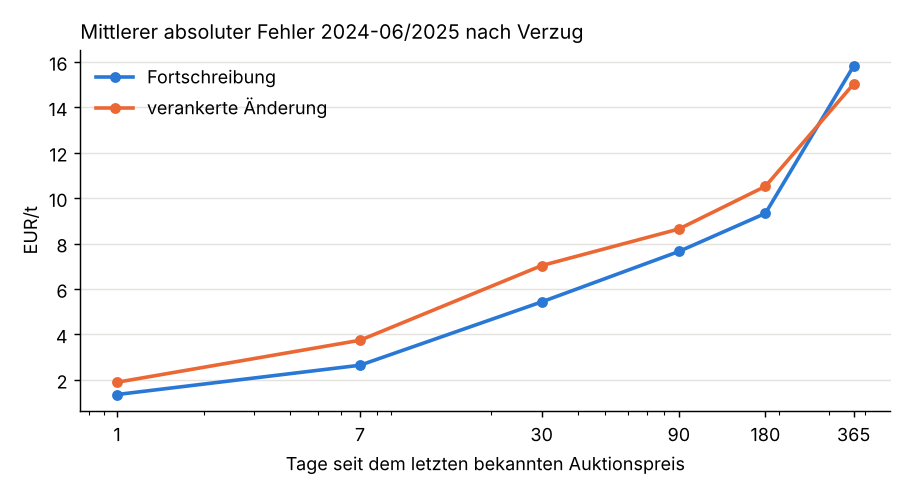
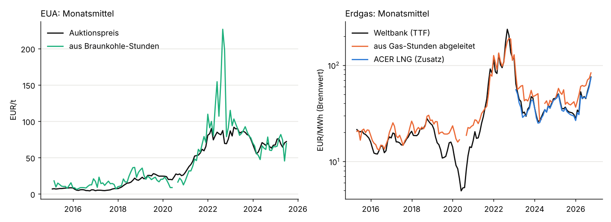
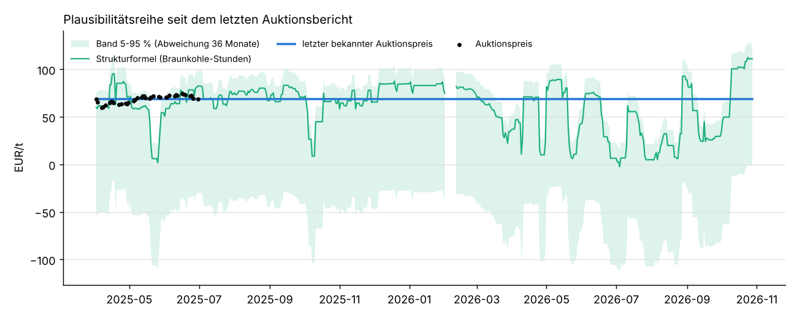

# EUA-Preis aus Strompreisen zurückrechnen: Machbarkeit mit freien Daten

Einmalige Auswertung vom 28.10.2026, Auftrag in [job.yaml](job.yaml). Frage: Lässt sich der Preis für EU-Emissionsberechtigungen
(EUA) täglich und mit kurzem Verzug aus frei lizenzierten Strommarktdaten zurückrechnen? Den
Referenzpreis liefern die Auktionsberichte der EU-Kommission.

## Ergebnis in Kürze

**Empfehlung: nicht produktiv betreiben.** Mit freien Daten gelingt keine Rückrechnung, die
die Fortschreibung des letzten bekannten Auktionspreises verlässlich schlägt. Was bleibt, ist
eine Plausibilitätsprüfung, die in ruhigen Marktphasen das Niveau auf etwa ±5–8 €/t trifft.

1. **Es gibt keinen täglichen, frei nutzbaren Gaspreis.** Trading Hub Europe verlangt für jede
   Vervielfältigung eine schriftliche Zustimmung. Die tägliche LNG-Preisbewertung von ACER hat
   einen widersprüchlichen Lizenzhinweis und bleibt deshalb ungeklärt. Weltbank, Destatis und
   BAFA sind monatlich oder eingestellt. Einzelheiten stehen unter [Quellen](#quellen).
2. **Der Ausweg über Braunkohle trägt nur in ruhigen Phasen.** Braunkohle hat keinen
   gehandelten Brennstoffpreis, ihre Grenzkosten bestehen fast nur aus CO2. Aus dem Strompreis
   der Stunden, in denen Braunkohle den Preis setzt, folgt eine Schätzung ohne Gaspreis.
   Außerhalb der Gaskrise lag sie 2018–2025 im Monatsmittel 5–9 €/t neben dem Auktionspreis.
   2022 lag sie 46 €/t daneben.
3. **Gegen die Pflicht-Baseline verliert sie im Test.** Im Test 01/2024–06/2025 mit realem
   Berichtsverzug liegt die Fortschreibung bei 8,9 €/t mittlerem absolutem Fehler (MAE). Die
   unkalibrierte Strukturformel liegt bei 8,9 €/t, alle kalibrierten Varianten bei 9,3–14,0
   €/t. In 2018–2023 sind die kalibrierten Varianten 20–125 % schlechter als die
   Fortschreibung.
4. **Gas- und CO2-Preis lassen sich gemeinsam nur grob schätzen.** Der aus Gas-Stunden
   abgeleitete Gaspreis folgt dem Weltbank-Monatswert 2015–2018 auf 2–3 €/MWh genau. Seit 2019
   liegt er 6–13 €/MWh darüber. Für eine Rückrechnung des CO2-Preises ist das zu ungenau: 10
   €/MWh Gas entsprechen bei einem GuD-Kraftwerk etwa 50 €/t CO2.
5. **ACER würde wenig ändern.** Mit dem täglichen LNG-Preis von ACER gelingt die beste
   Variante. Sie ist um 21 % besser als die Fortschreibung, aber nur wenn die Auktionsberichte
   sofort erscheinen. Beim tatsächlichen Verzug der Berichte bleibt kein Vorteil (+0,6 %).

Die Gaspreisfrage ist damit negativ beantwortet. Wie im Auftrag vorgesehen, endet die Analyse
bei einer Plausibilitätsprüfung. Eine tägliche Schätzreihe wird nicht empfohlen. Eine
Plausibilitätsreihe mit Qualitätskennzeichen liegt trotzdem bei
([tabellen/plausibilitaetsreihe_tag.csv](tabellen/plausibilitaetsreihe_tag.csv)).

## Referenzpreis: Auktionsreihe 2015–06/2025



Die Reihe umfasst 1.761 Auktionen der gemeinsamen Auktionsplattform (CAP, einschließlich
Polens) aus 56 Berichten. Sie reicht vom 08.01.2015 bis zum 30.06.2025 und ergibt 1.695
Auktionstage. Den Abgleich beschreibt das Datenblatt [daten/README.md](daten/README.md):

- Alle 125 Monatsmittel (volumengewichtet, Allgemeinzertifikate) und alle 125 Monatsvolumina
  stimmen exakt mit Table 1 der Berichte überein (±0,01 €/t). Die Jahresmittel 2015–2024
  stimmen ebenfalls.
- Zwei Druckfehler wurden mit Beleg aus demselben Bericht korrigiert, eine im Annex fehlende
  Auktion (28.02.2017) wurde aus der Monatssumme abgeleitet.
- **Der Verzug der Berichte ist groß.** Zwischen der letzten Auktion eines Berichts und dem
  PDF-Datum lagen 28–669 Tage, bei den Berichten ab 2023 56–329 Tage. Der jüngste Bericht (Q2 2025) trägt das Datum 25.08.2025.
  Seitdem ist keiner erschienen, heute ist der letzte bekannte Preis also 16 Monate alt.
  Daraus folgt der "reale Berichtsverzug" der Evaluation.

Nicht enthalten sind die Auktionen der deutschen Plattform (EEX für Deutschland). Darüber
berichtet die DEHSt getrennt. Der Plattformwechsel Ende 2026 lässt sich noch nicht prüfen. Das
Strommodell braucht keine Auktionsdaten außer zur Kalibrierung, also nur die Fortführung der
Berichtsreihe.

## Methode

**Stundenklassen.** Je Stunde wird die Auslastung von Braunkohle, Steinkohle und Gas relativ
zum 5- und 95-%-Quantil der letzten 30 Tage bestimmt (SMARD, Erzeugung je Energieträger).
"Braunkohle preissetzend" heißt: Braunkohle läuft in Teillast (20–80 %), Steinkohle und Gas
sind nahe ihrem Minimum (unter 20 %), und der Preis ist positiv. Steinkohle und Gas sind analog
definiert. Für jeden Handelstag T ist das Merkmal der Median des Preises dieser Stunden über
die Liefertage bis T+1 (der Day-Ahead-Preis für T+1 steht am Mittag von T fest). Das Fenster
ist 14 Tage, bei weniger als 6 Stunden 28 und dann 56 Tage.

**Strukturformel (ohne Kalibrierung).**

    EUA = (η · Preis_Braunkohle − Brennstoff) / EF

Annahmen:

| Größe | Wert | Spanne (Empfindlichkeit) | Beleg |
|---|---|---|---|
| EF Braunkohle | 101 t/TJ = 0,364 t/MWh_th | 90,9–115 t/TJ | IPCC 2006 Guidelines, Bd. 2, Kap. 1, Tab. 1.4 |
| EF Steinkohle | 94,6 t/TJ = 0,341 t/MWh_th | 89,5–99,7 | ebd. ("Other Bituminous Coal") |
| EF Erdgas | 56,1 t/TJ = 0,202 t/MWh_th | 54,3–58,3 | ebd. |
| η Braunkohle | 0,39 | 0,345–0,435 | Formel aus [merit-order](../merit-order/README.md) für Baujahre 1975–2012 |
| η Gas (GuD) | 0,55 | 0,45–0,60 | ebd. |
| Brennstoff Braunkohle | 4 €/MWh_th | 0–10 | Annahme aus [merit-order](../merit-order/README.md) |
| Heizwert/Brennwert Gas | 0,9 | | IPCC 2006, Kap. 1.4.1.2 ("NCV is about 10 percent less") |
| Zeitzone | Liefertage in Europe/Berlin | | SMARD-Zeitstempel UTC |

Die Wirkungsgrade und der Braunkohlepreis sind Projektannahmen, keine Messwerte.

**Modelle im Test.**

| Modell | Beschreibung |
|---|---|
| Fortschreibung | Pflicht-Baseline: letzter Auktionspreis aus einem bereits veröffentlichten Bericht |
| Struktur | Strukturformel oben, ohne Kalibrierung |
| Struktur korrigiert | Strukturformel plus mittlere Abweichung der letzten zehn bekannten Auktionstage |
| Regel | Strukturformel, wenn das 14-Tage-Fenster reicht und der Weltbank-Gaspreis unter 50 €/MWh liegt, sonst Fortschreibung |
| Kalibriert | EUA = a + b · Preis_Braunkohle, OLS über die bekannten Auktionen der letzten 24 Monate |
| Verankert | Mittel der letzten zehn bekannten Auktionstage plus b · Änderung von Preis_Braunkohle seitdem |
| Gemeinsam | EUA aus Braunkohle-Stunden, Gas-Stunden und Weltbank-Gas (Vormonat), OLS |
| ACER (Zusatz) | wie "Gemeinsam", mit dem täglichen LNG-Preis von ACER statt Weltbank |

Kalibriert wird am Monatsersten, nur mit Auktionen aus Berichten, deren PDF-Datum davor liegt.
Weltbank-Werte gelten ab dem 5. des Folgemonats als bekannt. Merkmalsfenster (14 Tage) und
Kalibrierlänge (24 Monate) wurden allein auf 2018–2023 gewählt
([tabellen/parameterwahl_2018_2023.csv](tabellen/parameterwahl_2018_2023.csv)).
Keine der neun Kombinationen schlägt dort die Fortschreibung.

Die 90-%-Intervalle von Fortschreibung und verankertem Modell sind die empirischen 5-/95-%-
Quantile ihrer Fehler im Kalibrierfenster, getrennt nach Verzug (bis 30, 90, 180, 365 Tage,
darüber).

## Evaluation

### Test 01/2024–06/2025, realer Berichtsverzug



MAE in €/t auf 250 Auktionstagen ([tabellen/kennzahlen_test.csv](tabellen/kennzahlen_test.csv)):

| Modell | alle | 2024 | 2025 | normal | viele negative Preise | kaum Braunkohle preissetzend | Abdeckung 90-%-Intervall |
|---|---|---|---|---|---|---|---|
| Fortschreibung | **8,9** | 10,5 | **5,6** | 10,4 | **4,5** | 14,9 | 52 % |
| Struktur | **8,9** | **7,2** | 12,4 | 8,1 | 11,0 | **6,7** | |
| Regel | 9,3 | 8,9 | 10,1 | **6,8** | 10,8 | 14,2 | |
| Struktur korrigiert | 10,7 | 9,4 | 13,4 | 10,9 | 11,6 | 8,1 | 86 % |
| Verankert | 10,3 | 11,2 | 8,4 | 12,4 | 6,1 | 13,6 | 73 % |
| Kalibriert | 12,7 | 15,2 | 7,7 | 14,4 | 11,0 | 10,9 | 59 % |
| Gemeinsam | 14,0 | 17,7 | 7,4 | 15,3 | 12,3 | 13,9 | |
| ACER (Zusatz) | 12,8 | 14,9 | 9,1 | 14,1 | 10,2 | 14,3 | |

Regime: "viele negative Preise" sind Tage, an denen über 8 % der Stunden der letzten Woche
negativ waren. "Kaum Braunkohle preissetzend" heißt, dass das 14-Tage-Fenster nicht reicht.

- Kein Modell ist in beiden Testjahren besser als die Fortschreibung. Die Strukturformel
  gewinnt 2024, als der bekannte Preis von 86,6 €/t (Juni 2023) weit über dem Ist lag. 2025
  verliert sie deutlich.
- An Tagen mit vielen negativen Preisen hilft das Modell nicht. Die Fortschreibung ist dort am
  besten.
- Die Intervalle decken zu wenig ab: 52–86 % statt 90 %. Bei der Fortschreibung liegt das an
  der Kalibrierung auf 2022–2023, als die Preise wenig schwankten.
- Mit anderen Parametern (7 Tage, 36 Monate) läge "Verankert" im Test bei 7,0 €/t. Das ist
  kein Vorteil, sondern zeigt, wie stark das Ergebnis von den Parametern abhängt.

### Rückblick 2018–06/2025

[tabellen/kennzahlen_2018_2025.csv](tabellen/kennzahlen_2018_2025.csv), MAE in €/t:

| Modell | realer Verzug | Quartalsbericht sofort |
|---|---|---|
| Fortschreibung | 10,3 | **5,1** |
| Regel | **8,6** | 6,9 |
| Verankert | 12,9 | 8,5 |
| Struktur | 13,9 | 13,9 |
| Kalibriert | 14,2 | 10,9 |
| Gemeinsam | 15,0 | 11,1 |

Nach Regime, realer Verzug: In normalen Phasen ist die Strukturformel mit 7,2 €/t besser als
die Fortschreibung mit 9,8 €/t. In der Gaskrise 2021/22 liegt sie bei 30,2 €/t, die
Fortschreibung bei 15,0 €/t. Die "Regel" nutzt genau das und ist 2018–2025 um 16 % besser als
die Fortschreibung, im Test aber 4 % schlechter. Die Schwelle von 50 €/MWh ist nach Sicht auf
2021/22 gesetzt. Der Vorteil im Rückblick ist deshalb eine Obergrenze.

### Verzug: Tage ohne Auktion, Auktionspausen, verzögerte Berichte



Bei festem Abstand zum letzten bekannten Auktionspreis, 2024–06/2025
([tabellen/fester_verzug.csv](tabellen/fester_verzug.csv)):

| Tage | 1 | 7 | 30 | 90 | 180 | 365 |
|---|---|---|---|---|---|---|
| Fortschreibung | **1,4** | **2,6** | **5,4** | **7,7** | **9,3** | 15,8 |
| Verankert | 1,9 | 3,7 | 7,0 | 8,6 | 10,5 | **15,0** |

An Tagen ohne Auktion und in Pausen (Weihnachten, August), also bei 1–20 Tagen Abstand, ist die
Fortschreibung klar besser. Erst ab etwa einem Jahr Verzug bringt das Strommodell 5 %.

### Weitere Varianten

[tabellen/aenderungsmodelle.csv](tabellen/aenderungsmodelle.csv): Die Log-Änderung des EUA seit
dem Anker wird aus Log-Änderungen von Merkmalen geschätzt. Varianten: nur Braunkohle-Stunden,
dazu Weltbank-Gas, dazu Weltbank-Kohle, dazu Gas-Stunden, Tagesmittel und Gas, ACER. Alle
Varianten ohne ACER sind 4–125 % schlechter als die Fortschreibung. Mit ACER (Gas-Stunden + LNG)
ergeben sich +21 % bei sofortiger Veröffentlichung und +0,6 % beim realen Verzug.

### Empfindlichkeit

Strukturformel im Test, Variation einer Annahme
([tabellen/empfindlichkeit.csv](tabellen/empfindlichkeit.csv)):

| Variante | MAE €/t | Verzerrung €/t |
|---|---|---|
| Basis (η 0,39, EF 0,364, 4 €/MWh) | 8,9 | −2,4 |
| η 0,345 / 0,435 | 12,3 / 11,5 | −11,1 / +6,3 |
| EF 90,9 / 115 t/TJ | 10,8 / 11,7 | +4,8 / −10,2 |
| Brennstoff 0 / 10 €/MWh | 12,2 / 19,4 | +8,6 / −18,9 |

Die Annahmen innerhalb ihrer belegten Spanne verschieben das Niveau um ±10–20 €/t. Die Formel
eignet sich deshalb für die Richtung und das grobe Niveau, nicht für eine Rückrechnung auf
wenige Euro.

## Plausibilitätsprüfung



Monatsmittel der Strukturformel gegen den Auktionspreis
([tabellen/plausibilitaet_monat.csv](tabellen/plausibilitaet_monat.csv)):

| Jahr | 2015 | 2016 | 2017 | 2018 | 2019 | 2020 | 2021 | 2022 | 2023 | 2024 | 2025 |
|---|---|---|---|---|---|---|---|---|---|---|---|
| MAE €/t | 4,2 | 5,6 | 8,0 | 8,4 | 5,2 | 8,1 | 9,4 | 45,8 | 4,6 | 5,2 | 10,0 |
| Verzerrung €/t | +4,1 | +5,6 | +7,9 | +8,4 | −2,3 | −8,1 | +3,4 | +45,8 | +3,5 | −3,0 | −2,4 |

Der abgeleitete Gaspreis ist (η_Gas · Preis_Gas-Stunden − EF_Gas · EUA_Struktur) / 1,11. Er
liegt gegenüber dem Weltbank-Monatswert (TTF) 2015–2018 um 2–3 €/MWh daneben, 2019–2021 um 7–9,
2022 um 18 (bei 132 €/MWh) und 2023–2026 um 7–13 €/MWh, immer darüber.

**Wo die Rückrechnung versagt:**

- **Gaskrise 2021/22:** Bei hohen Gaspreisen enthalten auch die Braunkohle-Stunden
  Knappheitsprämien. Exporte und Ausfälle verschieben die Preissetzung. Die Formel lag 2022 im
  Mittel 46 €/t zu hoch.
- **Hohe EE-Anteile, negative Preise:** Braunkohle fährt dann oft gar nicht in Teillast.
  Die Merkmale stützen sich auf wenige Stunden und schwanken stark (Juni 2025: 35 €/t).
- **Ohne kohlegeführte Preissetzung** (Sommer mit viel Solar, seit 2024 häufiger) fehlt das
  Merkmal oder kommt aus 28–56 Tagen.
- **2015–2018** überschätzt die Formel den niedrigen EUA-Preis um 4–8 €/t. Die Annahme über die
  Brennstoffkosten der Braunkohle wiegt bei 5 €/t CO2 stärker als der CO2-Anteil.
- **Seit 07/2026** liefert die Formel 26–87 €/t von Monat zu Monat. Der Gaspreis ist auf
  50–80 €/MWh gestiegen, also wieder im Krisenregime.

## Laufender Betrieb

Nicht empfohlen. Wer eine tägliche Plausibilitätsprüfung will, findet sie in
[tabellen/plausibilitaetsreihe_tag.csv](tabellen/plausibilitaetsreihe_tag.csv) (ab 90 Tage vor
dem letzten bekannten Auktionstag bis heute):

- `eua_struktur` mit Band `eua_struktur_lo/hi`: 5-/95-%-Quantile der Abweichung der letzten 36
  bekannten Monate. Das Band ist derzeit 0–129 €/t breit, weil 2022/23 darin liegt.
- `letzter_bekannter_auktionspreis` und `datenstand_auktionen` (heute 30.06.2025, 485 Tage)
- `qualitaet`: A = Merkmal aus 14 Tagen, B = 28 Tage, C = 56 Tage oder Weltbank-Gas über 50
  €/MWh, "-" = keine Braunkohle-Stunden. Seit August 2026 steht sie auf C.



Wenn ein neuer Bericht erscheint, rechnet `auktionen.py` die Reihe neu und `auswertung.py`
kalibriert damit neu. Das bleibt ein manueller Schritt, weil die Berichte nur als PDF mit
wechselnder URL vorliegen. Als regelmäßiger DB-Input kommen sie deshalb nicht in Frage.

**Was die Lage ändern würde:** eine Lizenzklärung durch ACER für die LNG-Preisbewertung (ohne
Benchmark-Spalte) oder eine freie Quelle für Sekundärmarktpreise der EUA. Die erste brächte
nach diesem Test wenig, solange die Berichte so spät erscheinen.

## Quellen

Verwendet (alle mit Quellenangabe weiterverwendbar):

| Quelle | Inhalt | Lizenz | Fundstelle | Attribution |
|---|---|---|---|---|
| EU-Kommission, DG CLIMA | Auktionsberichte "Auctions by the Common Auction Platform" 2015–Q2 2025 (PDF, einmalig) | CC BY 4.0 nach Beschluss 2011/833/EU | [Auktionierungsseite](https://climate.ec.europa.eu/eu-action/eu-emissions-trading-system-eu-ets/auctioning_en), [Legal notice](https://commission.europa.eu/legal-notice_en) | "Quelle: Europäische Kommission, DG CLIMA, Auctions by the Common Auction Platform; Daten der EEX als Auktionsplattform" |
| Bundesnetzagentur, SMARD | Day-Ahead-Preis DE-AT-LU (Filter 251, bis 30.09.2018) und DE-LU (4169), Netzlast, Residuallast, Erzeugung Braunkohle, Steinkohle, Erdgas, Kernenergie, Wind, Solar (stündlich) | CC BY 4.0 | [smard.de](https://www.smard.de/home/datennutzung), Chart-API | "Bundesnetzagentur \| SMARD.de" |
| Weltbank, Pink Sheet | Monatspreise "Natural gas, Europe" (ab 04/2015 TTF), "Coal, South African" | CC BY 4.0 | [CMO-Historical-Data-Monthly.xlsx](https://www.worldbank.org/en/research/commodity-markets) | "World Bank, Commodity Price Data (The Pink Sheet)". Die Weltbank nennt als Rohdatenquelle u. a. Bloomberg. Verwendet werden nur die veröffentlichten Monatsmittel. |
| Eurostat `ert_bil_eur_m` | Monatsmittel USD je EUR | CC BY 4.0 | [Eurostat](https://ec.europa.eu/eurostat/databrowser/view/ert_bil_eur_m/default/table) | "Quelle: Eurostat" |
| IPCC | Emissionsfaktoren, Heizwert/Brennwert | Zitat aus Veröffentlichung | [2006 Guidelines, Bd. 2, Kap. 1](https://www.ipcc-nggip.iges.or.jp/public/2006gl/pdf/2_Volume2/V2_1_Ch1_Introduction.pdf) | "IPCC 2006 Guidelines for National Greenhouse Gas Inventories, Vol. 2, Ch. 1, Table 1.4" |

Nur Zusatzvariante (Lizenz ungeklärt, nicht in Empfehlung oder Ausgabereihe):

| Quelle | Inhalt | Lizenzlage | Zu klären |
|---|---|---|---|
| ACER, TERMINAL | LNG-Preisbewertung DES Spot EU/NWE/SE, werktäglich ab 13.01.2023, [CSV](https://aegis.acer.europa.eu/terminal/price_assessments/historical_data) | Der [Legal notice](https://www.acer.europa.eu/legal-notice) verbietet das Herunterladen von "Licensed Material" außer zum persönlichen Gebrauch, erlaubt im nächsten Satz aber die kommerzielle Weiterverwendung veröffentlichter Informationen mit Quellenangabe. "Licensed Material" ist nicht definiert. Die Spalte "LNG Benchmark" ist LNG minus ICE-TTF und wird nicht gelesen. | Ob die Preisbewertung (ohne Benchmark) unter die allgemeine Weiterverwendung fällt. Veröffentlicht wird sie nach REMIT Art. 7a–7e. |

Verworfen oder nicht verwendbar:

| Quelle | Grund |
|---|---|
| Trading Hub Europe (Ausgleichsenergiepreise, VTP-Tagesdurchschnitt) | [Disclaimer](https://www.tradinghub.eu/de-de/Start/Disclaimer): "Die Vervielfältigung von Informationen oder Daten … bedarf der vorherigen schriftlichen Zustimmung". Preise stammen aus EEX-Geschäften. |
| ACER Market Correction Mechanism (Referenzpreis 02/2023–01/2025) | Korb aus LNG-Indizes, enthält TTF-Front-Month (ICE). Endet 01/2025, für den Betrieb unbrauchbar. |
| Destatis Einfuhrpreisindex Erdgas | dl-de/by-2-0, monatlich. Die GENESIS-API lässt seit der Umstellung keinen Gastzugang mehr zu (Fehler 15), es braucht ein kostenloses Konto. Nicht abgerufen; als Monatswert ersetzt durch die Weltbank. |
| BAFA Grenzübergangspreis Erdgas, Drittlandskohlepreis | Eingestellt mit Berichtsjahr 2022 bzw. 2018. Texte unter CC BY-ND 3.0 DE (keine Bearbeitung). |
| Weltbank Carbon Pricing Dashboard | Aus der Cloud nicht erreichbar (HTTP 403, auch `data-latest.xlsx`). Laut Weltbank stammen die ETS-Daten von ICAP, deren Downloads ausgeschlossen sind. Das wäre zu klären. Die Auktionsreihe ist stattdessen gegen die Monats- und Jahresmittel der Berichte selbst abgeglichen. |
| EEX/EEX DataSource, ICE/TTF-Futures, Montel, LSEG, Bloomberg, Energy-Charts-Futures, ICAP, Yahoo/Investing, Trading Economics | Ausgeschlossen laut Auftrag, auch nicht zur Validierung genutzt. |
| Energy-Charts `public_power` | Ohne `license_info` in der Antwort. Für die Erzeugung wurde SMARD verwendet. |

## Aufruf

Aus dem Repository-Wurzelverzeichnis. Der erste Lauf lädt 56 PDFs (mit Pausen wegen
Ratenbegrenzung, etwa 20 Minuten) und gut 4.000 SMARD-Wochenblöcke:

```
uv run --no-project --with pandas --with httpx \
    python docs/analysen/eua-rueckrechnung/auktionen.py --cache /tmp/eua
uv run --no-project --with pandas --with matplotlib --with httpx --with openpyxl --with pyarrow \
    python docs/analysen/eua-rueckrechnung/auswertung.py --cache /tmp/eua
```

`auktionen.py` braucht `pdftotext` und `pdfinfo` (poppler-utils). `auswertung.py` rechnet die
Parametertabelle mit; `--ohne-parameterwahl` überspringt sie.

Dateien: [daten/](daten/) (Auktionsreihe, Datenblatt), [tabellen/](tabellen/) (alle
Kennzahlen, Merkmale je Tag, Backtest je Tag), [grafiken/](grafiken/).

## Einschränkungen

- Das PDF-Datum ist nur eine Näherung für den Veröffentlichungstag. Erschienen die Berichte
  später, ist der reale Verzug eher unterschätzt.
- Die Stundenklassen beruhen auf der Erzeugung je Energieträger, nicht auf der tatsächlichen
  Grenzanlage. Importe, KWK-Fahrweise und Speicher bleiben unberücksichtigt.
- Die Schwellen der Klassen (20/80 %, 30 Tage) und die Regime-Grenzen sind vorab gesetzt und
  nicht optimiert. Andere Werte verschieben die Zahlen. Das Grundergebnis hat sich in allen
  geprüften Varianten nicht geändert: kein robuster Vorteil gegenüber der Fortschreibung.
- Die Auktionsreihe umfasst nur die gemeinsame Plattform. Für Deutschland gibt es eigene
  Auktionen auf der EEX. Die Preise liegen am selben Tag praktisch gleich, sind hier aber nicht
  abgeglichen.
