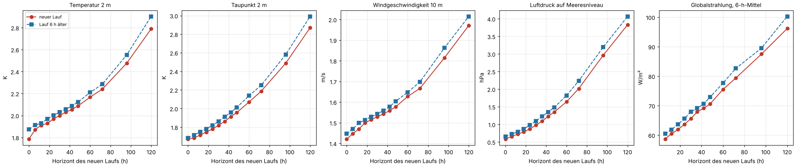
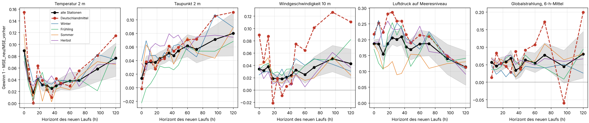

# GFS-Folgelauf: Was bringt der 6 h spätere Lauf?

Einmalige Auswertung vom 21.10.2026, Auftrag in [job.yaml](job.yaml). Frage: Wie viel genauer
ist ein GFS-Lauf als der 6 h ältere Lauf für dieselben Zielzeiten? Daran hängt, ob es sich
lohnt, Features schon aus einem Teillauf zu rechnen (sobald die ersten Stunden veröffentlicht
sind), statt mit dem vorherigen vollständigen Lauf zu arbeiten.

## Ergebnis in Kürze

**Der neuere Lauf ist besser, aber nur wenig.** Für Temperatur, Taupunkt, Wind und Strahlung
sinkt der mittlere quadratische Fehler (MSE) an den Stationen um 2–8 %, die RMSE also um
1–4 %. Nur beim Luftdruck sind es 15–20 %. Der Grund: Der größte Teil des Stationsfehlers
steckt schon in der Analyse (lokale Lage, Gelände, systematische Modellfehler). Bei der
Temperatur sind es 82 % des MSE bei 24 h. Ein neuerer Lauf verkleinert nur den Teil, der mit
dem Horizont wächst.

| Größe | Gewinn MSE, 6–48 h | Day-Ahead (06Z statt 00Z), Stationen | Day-Ahead, Deutschlandmittel |
|---|---|---|---|
| Temperatur 2 m | 2–4 % | 2,6 % (RMSE 2,03 → 2,01 K) | 2,5 % |
| Taupunkt 2 m | 4–5 % | 5,3 % (1,84 → 1,79 K) | 7,1 % |
| Wind 10 m | 2–4 % | 1,6 % (1,54 → 1,53 m/s) | 0,3 %, nicht signifikant |
| Luftdruck | 15–21 % | 18 % (1,10 → 1,00 hPa) | 23 % |
| Globalstrahlung | 4–7 % | 7,3 % (64,5 → 62,1 W/m²) | 8,7 % (25,1 → 24,0 W/m²) |

**Was der Teillauf an Zeit bringt, ist kürzer als 6 h.** Nach den Zeitstempeln im AWS-Archiv
liegen die ersten 48 h etwa 3¾ h nach dem Laufzeitpunkt vor, der vollständige Lauf (384 h)
nach etwa 5¼ h. Ein Teillauf spart also rund 1½ h gegenüber dem Warten auf den vollständigen
Lauf. Gegenüber dem vorherigen Lauf ist er 6 h aktueller.

**Wo das zählt: Day-Ahead.** Der 06Z-Lauf ist erst gegen 11:15 UTC vollständig, also nach dem
Gebotsschluss der Day-Ahead-Auktion (12:00 Ortszeit = 10:00 UTC im Sommer, 11:00 UTC im
Winter). Ohne Teillauf geht jedes Day-Ahead-Gebot mit dem 00Z-Lauf raus. Mit Teillauf steht
der 06Z-Lauf für den Folgetag (Horizont 18–42 h) gegen 09:45 UTC bereit. Das bringt 7–9 %
weniger MSE bei der Strahlung und praktisch nichts beim Wind.

**Folgerung für den Umbau:** Der Teillauf ist für Day-Ahead-Prognosen mit PV-Anteil sinnvoll,
weil er dort erst den 06Z-Lauf nutzbar macht. Für alles andere (Intraday, Wind, Temperatur)
bringt er wenig: 1½ h früher und einige Prozent MSE. Gleichzeitig zeigt die Auswertung, wo der
größere Hebel liegt. Der lokale und systematische Fehler, der schon in der Analyse steckt, ist
viel größer als der Unterschied zwischen zwei Läufen. Eine Korrektur gegen Messungen
(Bias- und Stationskorrektur, MOS, oder das neuronale Netz selbst) holt dort mehr heraus.

## Wann welcher Schritt vorliegt

Zeitstempel (`LastModified`) der GRIB-Dateien im AWS-Archiv `noaa-gfs-bdp-pds` für die Läufe
vom 19. und 20.10.2026, Abstand zum Laufzeitpunkt:

| Schritt | f000 | f006 | f024 | f048 | f120 | f240 | f384 |
|---|---|---|---|---|---|---|---|
| verfügbar nach | 3:31–3:36 h | 3:33–3:51 h | 3:38–3:56 h | 3:45–3:59 h | 4:04–4:22 h | 4:35–4:53 h | 5:12–5:30 h |

`wx-ingest` fragt alle 10 Minuten nach und lädt jeden veröffentlichten Schritt sofort. Die
Wartezeit entsteht nur in `wx-process`, das erst bei vollständigem Lauf rechnet.

## Daten und Methode

| | |
|---|---|
| Modell | NOAA GFS 0,25° v16 aus dem AWS-Archiv (`.idx` + Range-Anfragen) |
| Zeitraum | 20.09.2025–19.09.2026 (ein Jahr, alle Jahreszeiten) |
| Läufe | 00, 06, 12, 18Z; jeder Lauf ist einmal "neu" und einmal "vorher" |
| Paare | neuer Lauf R mit Horizont h gegen Lauf R−6 h mit Horizont h+6, dieselbe Zielzeit |
| Horizonte (neuer Lauf) | 0, 6, 12, 18, 24, 30, 36, 42, 48, 60, 72, 96, 120 h |
| Day-Ahead | 06Z-Lauf, Horizonte 18–42 h (Folgetag) gegen 00Z-Lauf, 24–48 h |
| Messungen | DWD Climate Data Center, Stundenwerte: Temperatur, Taupunkt, Wind, Druck, Globalstrahlung |
| Stationen | 173 Wetter- und 40 Strahlungsstationen mit mindestens 80 % Stundenwerten ([Wetter](tabellen/stationen_met.csv), [Strahlung](tabellen/stationen_sol.csv)) |
| Fehlerpaare | 13,5 Mio.; kein Schritt fehlt, keiner musste interpoliert werden ([lauf.json](tabellen/lauf.json)) |

Räumliche und zeitliche Behandlung wie in [gfs-v16-jahre](../gfs-v16-jahre/README.md):
bilinear auf die Station, Temperatur mit 0,0065 K/m auf Stationshöhe, Strahlung als 6-h-Mittel
des endenden Fensters ohne reine Nachtfenster. Neuer und alter Lauf werden immer auf exakt
denselben Stationen und Stunden verglichen.

**Gewinn** = 1 − MSE<sub>neu</sub> / MSE<sub>vorher</sub>, also der Anteil des quadratischen
Fehlers, den der neuere Lauf vermeidet. 5 % Gewinn im MSE sind etwa 2,5 % in der RMSE. Das
95-%-Intervall stammt aus einem Bootstrap über die Läufe.

**Deutschlandmittel:** Je Zielzeit wird der Fehler über alle Stationen gemittelt, bevor er
quadriert wird. Lokale Fehler heben sich so weitgehend auf, und übrig bleibt der großräumige
Teil. Das kommt einer Prognose für die deutsche PV- oder Windeinspeisung näher als der
einzelne Stationswert. Es bleibt aber eine Näherung: Windleistung hängt nichtlinear vom Wind
in Nabenhöhe ab, und die Stationen sind nicht nach installierter Leistung gewichtet.

## Ergebnisse

Vollständige Tabelle mit allen Gruppen (Jahreszeit, Laufstunde, Deutschlandmittel, Day-Ahead):
[gewinn.csv](tabellen/gewinn.csv).



Die RMSE-Kurven zeigen das Muster: Der neuere Lauf liegt bei Horizont h etwa dort, wo der
ältere bei h liegt. Weil die Kurven bis 48 h flach verlaufen (Temperatur 1,79 K bei 0 h,
1,97 K bei 24 h), ist der Abstand klein.



- **Temperatur:** Den größten Gewinn gibt es bei 0 h (9 %): Die neue Analyse kennt die
  Messungen der Zielzeit. Danach sind es 2–4 %, ab 96 h 6–8 %.
- **Taupunkt:** 4–5 % bis 48 h, danach steigend.
- **Wind:** 2–4 % an den Stationen. Im Deutschlandmittel ist der Gewinn bei 18–42 h nicht von
  null zu unterscheiden. Der großräumige Windfehler für den nächsten Tag ändert sich zwischen
  zwei Läufen also kaum. Ab 48 h steigt der Gewinn im Deutschlandmittel auf 7–13 %, dort trifft
  der neuere Lauf die Lage besser.
- **Luftdruck:** 15–21 %, im Deutschlandmittel bis 29 %. Die großräumige Wetterlage wird mit
  jedem Lauf deutlich besser getroffen. Für die Einspeisung zählt sie aber nur indirekt.
- **Globalstrahlung:** 4–7 % an den Stationen, im Deutschlandmittel 1–9 % bis 48 h (stark
  schwankend) und 17 % bei 72 h. Bei Bewölkung bringt der neuere Lauf am meisten.

Nach Laufstunde gibt es keine klare Regel. 06Z- und 18Z-Läufe, die weniger Radiosonden
assimilieren, bringen gegenüber dem vorherigen Lauf nicht systematisch weniger als 00Z und
12Z.

## Grenzen

- Ein Jahr, ein Modell (v16). Mit GFS v17 kann sich das Verhältnis verschieben.
- Gemessen wird an Stationen, nicht an der Einspeisung. Wie sich 7–9 % weniger MSE bei der
  Strahlung im PV-Prognosefehler und dann im Preis niederschlagen, zeigt erst das Modell.
- Wind auf 10 m statt Nabenhöhe. GFS-Wind auf 100 m (falls später geladen) könnte sich anders
  verhalten.
- Die Veröffentlichungszeiten stammen aus zwei Tagen. NOAA veröffentlicht sehr gleichmäßig,
  bei Störungen kann es aber deutlich länger dauern.

## Nachvollziehen

```sh
uv run --with matplotlib python docs/analysen/gfs-folgelauf/auswertung.py
```

Laufzeit etwa 75 Minuten mit leerem Zwischenspeicher. Commit und Prüfsumme des Auftrags stehen
in [lauf.json](tabellen/lauf.json).
