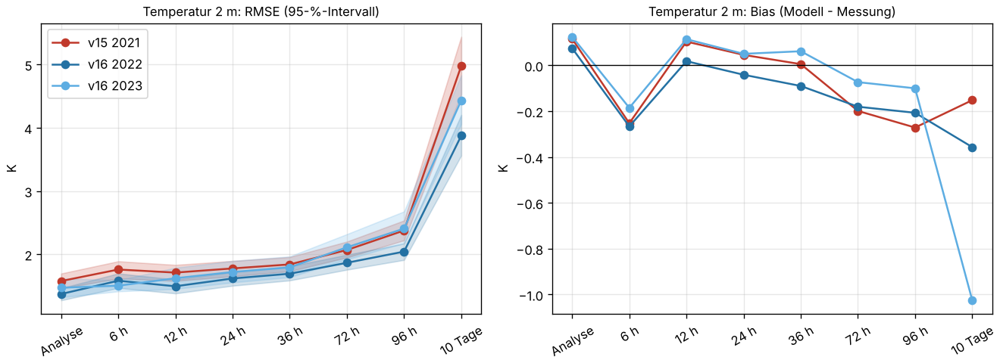
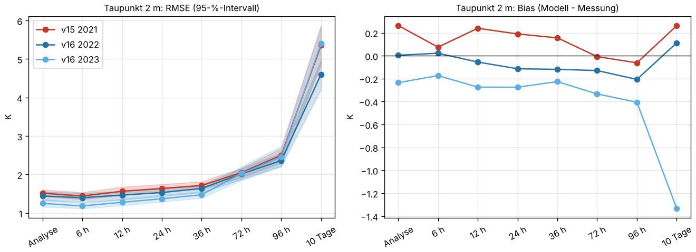
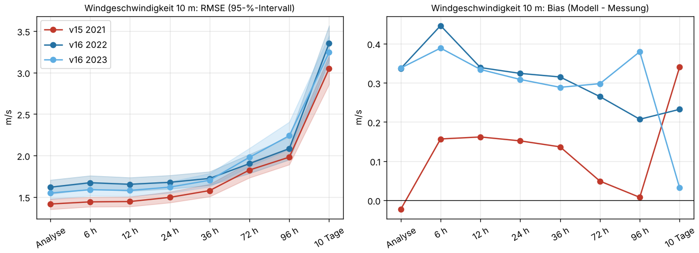
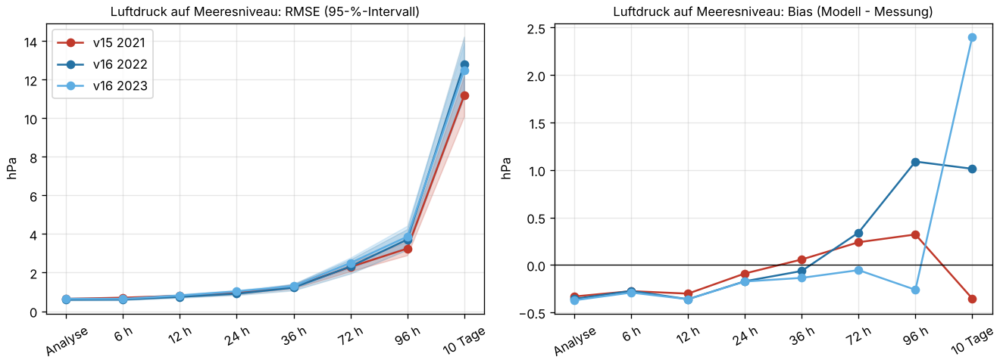
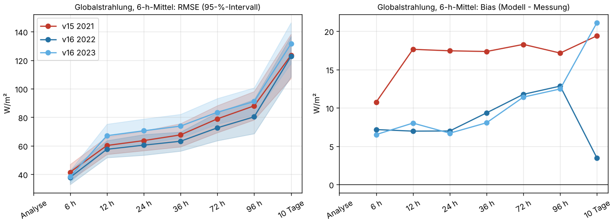

# GFS v15 gegen v16: Prognosefehler an DWD-Stationen

Einmalige Auswertung vom 21.10.2026. Frage: Wie stark unterscheiden sich die Fehler von GFS v15
(bis 22.03.2021 06Z) und GFS v16 (ab 22.03.2021 12Z) gegenüber Messungen, von der Analyse bis
10 Tage Vorhersage? Das entscheidet, ob ältere v15-Läufe ohne Weiteres in dieselbe
Trainingshistorie dürfen.

## Ergebnis in Kürze

- **Temperatur und Taupunkt:** v16 ist etwas besser, vor allem kurzfristig. Die RMSE der
  2-m-Temperatur sinkt in Analyse bis 36 h um etwa 0,1–0,2 K. Der Unterschied liegt aber in
  derselben Größenordnung wie der Unterschied zwischen den beiden v16-Wintern 2022 und 2023.
  Es gibt keinen Bias-Sprung.
- **Wind 10 m:** v16 ist systematisch schlechter. Der Bias steigt in beiden v16-Jahren
  übereinstimmend von etwa +0,15 auf +0,3 bis +0,45 m/s, die RMSE um 0,1–0,2 m/s. Das ist der
  einzige klare Versionsbruch, und er betrifft direkt die Windstrom-Features.
- **Luftdruck:** praktisch gleich. Beide Versionen liegen am Boden etwa 0,3 hPa unter den
  Stationswerten; ab 72 h ist v16 nicht besser.
- **Globalstrahlung:** v16 hat den kleineren Bias (+7 bis +13 statt +17 W/m², 6-h-Mittel). Die
  RMSE ist vergleichbar und schwankt zwischen den Jahren stärker als zwischen den Versionen.

**Folgerung:** v15-Läufe sind für das Training brauchbar, aber nicht nahtlos. Kommen sie dazu
(etwa aus NCAR/RDA, siehe unten), sollte die Modellversion als Merkmal mitlaufen oder der Wind
je Version biaskorrigiert werden. Für den laufenden Backfill ab v16 ändert sich nichts.

## Daten und Methode

| | |
|---|---|
| Modell | NOAA GFS 0,25° aus dem AWS-Archiv `noaa-gfs-bdp-pds` (`.idx` + Range-Anfragen) |
| Läufe | 00Z und 12Z |
| Horizonte | Analyse (f000), 6, 12, 24, 36, 72, 96 h, 10 Tage (240 h) |
| Zeiträume | v15: 01.01.–22.03.2021 · v16: dieselben Kalendertage 2022 und 2023 |
| Messungen | DWD Climate Data Center, Stundenwerte (opendata.dwd.de): Lufttemperatur, Taupunkt, Wind, Luftdruck auf Meeresniveau, Globalstrahlung |
| Stationen | 171 Wetter- und 31 Strahlungsstationen ([Liste Wetter](tabellen/stationen_met.csv), [Liste Strahlung](tabellen/stationen_sol.csv)), jeweils mit mindestens 80 % Stundenwerten in allen drei Zeiträumen |
| Fehlerpaare | 2,66 Mio. (Modell − Messung) |

**Warum gleiche Kalendertage in anderen Jahren?** Im AWS-Archiv gibt es v15 nur vom 01.01. bis
22.03.2021, und v15 und v16 überlappen sich dort nicht. Ein Vergleich am selben Termin ist also
nicht möglich. Zwei v16-Winter zeigen, wie stark allein das Wetter eines Jahres die Werte
verschiebt. Nur was in beiden v16-Jahren gleich vom v15-Wert abweicht, ist ein Versionseffekt.

**Räumlich:** bilinear vom 0,25°-Gitter auf die Station. Die 2-m-Temperatur wird mit 0,0065 K/m
von der Modellhöhe (`HGT` am Boden) auf die Stationshöhe korrigiert; Taupunkt, Wind und Druck
bleiben unkorrigiert.

**Zeitlich:** Die ausgewerteten Horizonte liegen alle auf nativen Modellschritten (bis Ende
Februar 2021 hatte v15 im Archiv oft nur 3-stündliche Schritte). Fehlt ein Schritt, würde das
Skript erst beim Abruf linear zwischen den Nachbarschritten interpolieren. Im Zwischenspeicher
liegen nur native, auf Deutschland zugeschnittene Schritte. In dieser Auswertung war das nicht
nötig. Fünf v15-Läufe fehlen im Archiv ganz (02.–07.02.2021) und zählen nicht mit
([lauf.json](tabellen/lauf.json)).

**Strahlung:** GFS liefert `DSWRF` als Mittel über Intervalle. An jedem Horizont wird das
6-h-Mittel genommen, das dort endet, und mit dem Mittel der sechs DWD-Stundensummen
(J/cm² → W/m²) desselben Fensters verglichen. Reine Nachtfenster (Modell und Messung 0) zählen
nicht. Für die Analyse gibt es keinen Strahlungswert.

**Unsicherheit:** Das 95-%-Intervall der RMSE (Bänder in den Grafiken, Spalten `rmse_ki_*` in
[fehler.csv](tabellen/fehler.csv)) stammt aus einem Bootstrap über die Modellläufe. Fehler
derselben Läufe an verschiedenen Stationen sind stark korreliert und werden deshalb gemeinsam
gezogen.

## Ergebnisse je Größe

RMSE und Bias (Modell − Messung) je Horizont, dazu Grafik mit Intervall.

### Temperatur 2 m (K)



| Horizont | RMSE v15 2021 | RMSE v16 2022 | RMSE v16 2023 | Bias v15 2021 | Bias v16 2022 | Bias v16 2023 |
|---|---:|---:|---:|---:|---:|---:|
| Analyse | 1,58 | 1,37 | 1,47 | +0,12 | +0,07 | +0,12 |
| 6 h | 1,76 | 1,58 | 1,50 | -0,25 | -0,27 | -0,18 |
| 12 h | 1,71 | 1,50 | 1,62 | +0,10 | +0,02 | +0,11 |
| 24 h | 1,78 | 1,62 | 1,72 | +0,04 | -0,04 | +0,05 |
| 36 h | 1,84 | 1,69 | 1,79 | +0,01 | -0,09 | +0,06 |
| 72 h | 2,07 | 1,87 | 2,11 | -0,20 | -0,18 | -0,07 |
| 96 h | 2,38 | 2,04 | 2,41 | -0,27 | -0,21 | -0,10 |
| 10 Tage | 4,98 | 3,87 | 4,43 | -0,15 | -0,36 | -1,02 |

### Taupunkt 2 m (K)



| Horizont | RMSE v15 2021 | RMSE v16 2022 | RMSE v16 2023 | Bias v15 2021 | Bias v16 2022 | Bias v16 2023 |
|---|---:|---:|---:|---:|---:|---:|
| Analyse | 1,51 | 1,44 | 1,25 | +0,26 | +0,01 | -0,23 |
| 6 h | 1,44 | 1,40 | 1,18 | +0,07 | +0,02 | -0,17 |
| 12 h | 1,56 | 1,47 | 1,28 | +0,24 | -0,06 | -0,27 |
| 24 h | 1,64 | 1,53 | 1,37 | +0,19 | -0,11 | -0,28 |
| 36 h | 1,71 | 1,64 | 1,47 | +0,16 | -0,12 | -0,23 |
| 72 h | 2,05 | 2,02 | 2,03 | -0,01 | -0,13 | -0,33 |
| 96 h | 2,50 | 2,36 | 2,46 | -0,06 | -0,21 | -0,41 |
| 10 Tage | 5,36 | 4,60 | 5,40 | +0,26 | +0,11 | -1,33 |

### Windgeschwindigkeit 10 m (m/s)



| Horizont | RMSE v15 2021 | RMSE v16 2022 | RMSE v16 2023 | Bias v15 2021 | Bias v16 2022 | Bias v16 2023 |
|---|---:|---:|---:|---:|---:|---:|
| Analyse | 1,42 | 1,62 | 1,55 | -0,02 | +0,34 | +0,34 |
| 6 h | 1,44 | 1,67 | 1,59 | +0,16 | +0,45 | +0,39 |
| 12 h | 1,45 | 1,65 | 1,58 | +0,16 | +0,34 | +0,33 |
| 24 h | 1,50 | 1,68 | 1,62 | +0,15 | +0,32 | +0,31 |
| 36 h | 1,58 | 1,73 | 1,70 | +0,14 | +0,32 | +0,29 |
| 72 h | 1,83 | 1,90 | 1,98 | +0,05 | +0,27 | +0,30 |
| 96 h | 1,98 | 2,08 | 2,24 | +0,01 | +0,21 | +0,38 |
| 10 Tage | 3,05 | 3,35 | 3,24 | +0,34 | +0,23 | +0,03 |

### Luftdruck auf Meeresniveau (hPa)



| Horizont | RMSE v15 2021 | RMSE v16 2022 | RMSE v16 2023 | Bias v15 2021 | Bias v16 2022 | Bias v16 2023 |
|---|---:|---:|---:|---:|---:|---:|
| Analyse | 0,64 | 0,59 | 0,64 | -0,33 | -0,36 | -0,37 |
| 6 h | 0,70 | 0,60 | 0,64 | -0,28 | -0,27 | -0,29 |
| 12 h | 0,80 | 0,74 | 0,81 | -0,30 | -0,36 | -0,36 |
| 24 h | 0,95 | 0,90 | 1,03 | -0,09 | -0,17 | -0,17 |
| 36 h | 1,27 | 1,22 | 1,30 | +0,06 | -0,06 | -0,14 |
| 72 h | 2,29 | 2,32 | 2,50 | +0,24 | +0,34 | -0,05 |
| 96 h | 3,25 | 3,71 | 3,86 | +0,32 | +1,09 | -0,26 |
| 10 Tage | 11,17 | 12,80 | 12,49 | -0,35 | +1,01 | +2,40 |

### Globalstrahlung, 6-h-Mittel (W/m²)



| Horizont | RMSE v15 2021 | RMSE v16 2022 | RMSE v16 2023 | Bias v15 2021 | Bias v16 2022 | Bias v16 2023 |
|---|---:|---:|---:|---:|---:|---:|
| 6 h | 42 | 38 | 38 | +11 | +7 | +7 |
| 12 h | 60 | 58 | 67 | +18 | +7 | +8 |
| 24 h | 64 | 60 | 71 | +17 | +7 | +7 |
| 36 h | 68 | 63 | 74 | +17 | +9 | +8 |
| 72 h | 79 | 73 | 84 | +18 | +12 | +11 |
| 96 h | 88 | 80 | 91 | +17 | +13 | +12 |
| 10 Tage | 123 | 123 | 131 | +19 | +3 | +21 |

## Einschränkungen

- Es wurde nur der Winter (Januar bis März) ausgewertet, weil es v15 im AWS-Archiv nur dann gibt.
  Sommerliche Konvektion und hohe Einstrahlung sind nicht abgedeckt.
- Der DWD-Wind ist ein Stundenmittel, GFS liefert einen Momentanwert. Das trifft beide Versionen
  gleich und erklärt nicht den Unterschied zwischen ihnen.
- Die Taupunkte sind nicht höhenkorrigiert.
- Die Stationen stehen nicht gleichmäßig verteilt; die Werte sind ungewichtete Mittel über alle
  Stationspaare.

## Ältere Daten

Vor 2021 liegt GFS 0,25° bei NCAR GDEX/RDA (Datensatz d084001, ab 15.01.2015). Die Schritte sind
dort 3-stündlich bis 240 h, danach 12-stündlich. Für die Trainingshistorie wären das sechs
weitere Jahre, mit einem eigenen Adapter und der Zeitinterpolation beim Abruf.

## Wiederholen

```bash
uv run --with matplotlib python docs/analysen/gfs-v15-v16/auswertung.py
```

Der Zwischenspeicher liegt standardmäßig unter `~/.cache/predictiondb/gfs-v15-v16` (etwa 400 MB
DWD-Auszüge und zugeschnittenes GRIB2). Der erste Lauf braucht rund eine halbe Stunde, ein
zweiter aus dem Zwischenspeicher deutlich weniger.

| Datei | Inhalt |
|---|---|
| [auswertung.py](auswertung.py) | Abruf, Interpolation, Statistik, Grafiken |
| [tabellen/fehler.csv](tabellen/fehler.csv) | n, Bias, MAE, RMSE und 95-%-Intervall je Zeitraum, Größe und Horizont |
| [tabellen/stationen_met.csv](tabellen/stationen_met.csv), [tabellen/stationen_sol.csv](tabellen/stationen_sol.csv) | verwendete DWD-Stationen |
| [tabellen/lauf.json](tabellen/lauf.json) | Parameter und Umfang dieses Laufs |
| [grafiken/](grafiken/) | RMSE und Bias je Größe |
