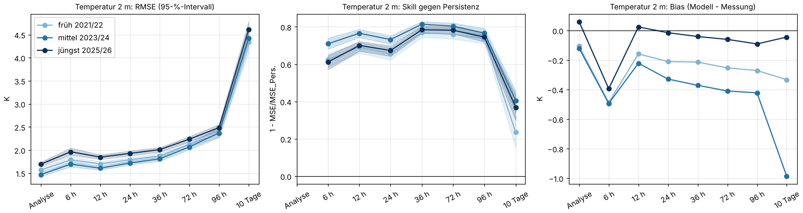
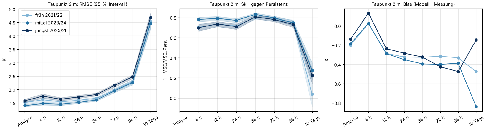
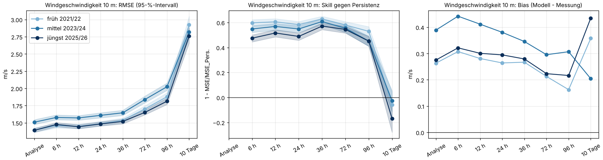
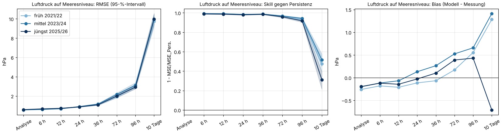
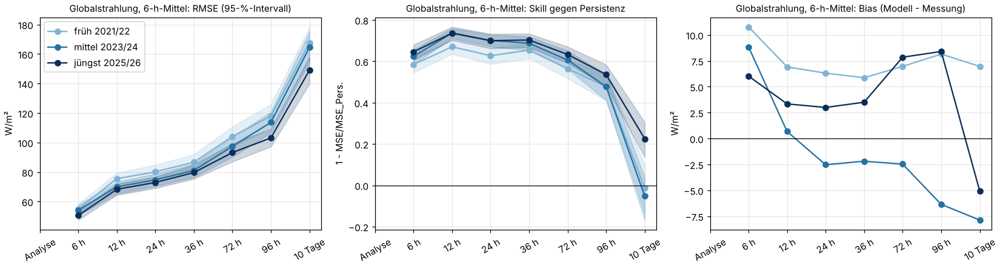
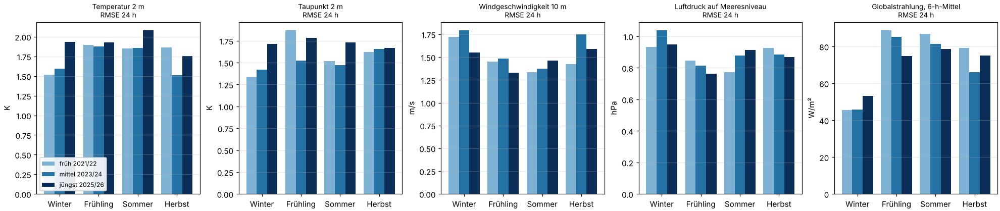
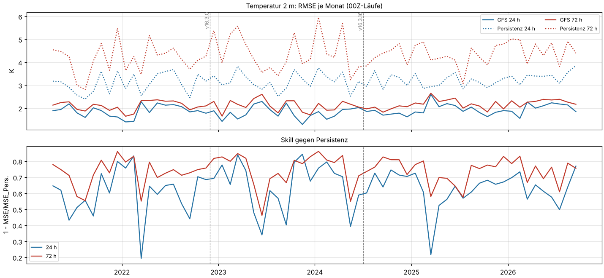
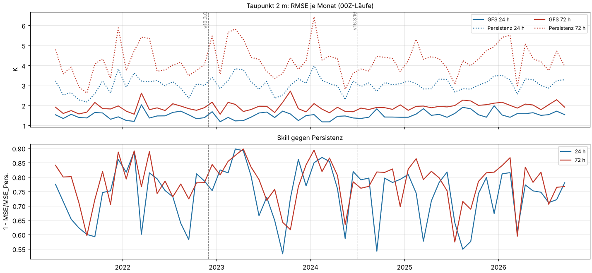
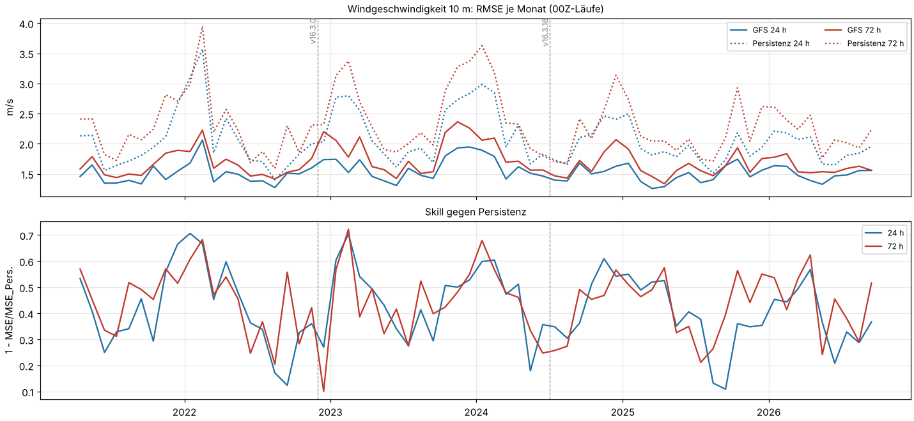
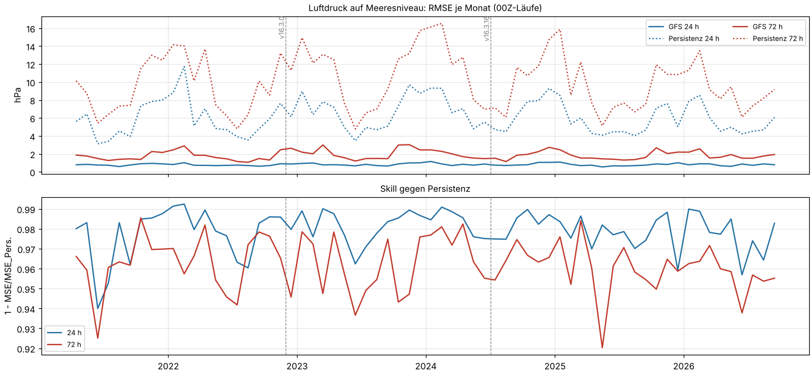

# GFS v16 über die Jahre: früh gegen mittel gegen jüngst

Einmalige Auswertung vom 21.10.2026, Auftrag in [job.yaml](job.yaml). Frage: Ist GFS v16
zwischen 2021 und 2026 an deutschen Stationen besser oder schlechter geworden? Und wenn sich
etwas ändert: liegt es am Modell (Updates, Tuning) oder am Wetter (Klimawandel, mehr
Extremlagen)?

## Ergebnis in Kürze

**Kein Trend im Modell.** Gemessen an dem, was das Wetter eines Zeitraums schwierig macht,
ist GFS v16 2025/26 so gut wie 2021/22. Die Fehler sind bei Temperatur und Taupunkt leicht
gestiegen, aber die Wetterlage ist im selben Maß schwerer vorherzusagen geworden. Die
Vermutung "schlechter durch Klimawandel" stimmt also für die absoluten Fehler ein wenig, für
das Modell selbst nicht.

- **Temperatur 2 m:** RMSE bei 24 h 1,79 / 1,72 / 1,93 K (früh / mittel / jüngst). Über die
  Monatsreihe steigt die RMSE um etwa +0,03 K pro Jahr, die der Persistenz aber um +0,06 K pro
  Jahr. Der Skill bleibt flach (+0,007 pro Jahr, 95 %: −0,011 bis +0,026). Der kalte Bias
  schrumpft von −0,2…−0,3 K auf etwa 0 K.
- **Taupunkt 2 m:** wie die Temperatur: RMSE 1,60 / 1,52 / 1,73 K, Skill ohne Trend.
- **Wind 10 m:** RMSE 1,49 / 1,61 / 1,48 m/s, kein Trend. Der Mittelzeitraum war windiger und
  der Bias dort am größten (+0,38 statt +0,26…0,30 m/s). Der Skill ist 2025/26 niedriger, weil
  dieser Zeitraum ruhig war und schon Persistenz gut abschneidet.
- **Luftdruck:** 0,87 / 0,91 / 0,88 hPa bei 24 h, 2,98 / 3,12 / 2,92 hPa bei 96 h. Kein
  Unterschied, der über die Schwankung hinausgeht.
- **Globalstrahlung:** der einzige echte Fortschritt. RMSE bei 24 h 80 / 75 / 73 W/m², bei
  96 h 118 / 114 / 103 W/m², der Skill steigt bei 96 h von 0,48 auf 0,54, und der positive
  Bias halbiert sich bei 6 h (+10,8 → +6,0 W/m²).
- **Updates v16.3.0 (29.11.2022) und v16.3.16 (02.07.2024):** keine sichtbaren Sprünge. Wo
  sich RMSE oder Bias im Jahr nach einer Marke verschieben, verschiebt sich die Persistenz
  gleich mit, es ist also Wetter.

**Folgerung für das Training:** Die ganze v16-Historie seit März 2021 kann ohne
Versionsmerkmal in eine Trainingsmenge. Für den Strompreis wichtiger: Die Unsicherheit der
Wettereingänge hängt stärker an Jahreszeit und Wetterlage als am Jahr. Ein Modell sollte
deshalb lieber die Wetterlage (Persistenz, Ensemble-Streuung, falls später verfügbar) als
Feature bekommen als das Jahr.

## Wie Wetter und Modell getrennt werden

Ein Jahr mit vielen Wetterwechseln erzeugt größere Prognosefehler, auch wenn das Modell
gleich gut ist. Deshalb läuft eine Referenz mit, die vom Modell nichts weiß: **Persistenz**,
also die letzte Messung zur gleichen Tageszeit vor dem Lauf (für 24 h die Messung einen Tag
vor dem Gültigkeitstermin, für 72 h drei Tage davor). Ihre RMSE misst, wie schwer das Wetter
des Zeitraums war.

Der **Skill** = 1 − MSE<sub>GFS</sub> / MSE<sub>Persistenz</sub> sagt, welchen Anteil des
Persistenzfehlers GFS vermeidet. Steigen beide Fehler gemeinsam, bleibt der Skill gleich: dann
ist es das Wetter. Sinkt der Skill, ist das Modell relativ schlechter geworden.

Der Skill ist nicht perfekt: In sehr ruhigen Zeiträumen ist Persistenz ungewöhnlich gut, und
der Skill sinkt, obwohl GFS gleich gut ist (Wind 2025/26). Darum stehen RMSE, Persistenz-RMSE
und Skill immer nebeneinander.

## Daten und Methode

| | |
|---|---|
| Modell | NOAA GFS 0,25° v16 aus dem AWS-Archiv `noaa-gfs-bdp-pds` (`.idx` + Range-Anfragen) |
| Zeiträume | früh 01.04.2021–31.03.2022 · mittel 01.10.2023–30.09.2024 · jüngst 20.09.2025–19.09.2026, je ein volles Jahr |
| Läufe | 00Z und 12Z in den drei Zeiträumen; 00Z für die Monatsreihe 04/2021–09/2026 |
| Horizonte | Analyse (f000), 6, 12, 24, 36, 72, 96 h, 10 Tage (240 h); Monatsreihe 24 h und 72 h |
| Messungen | DWD Climate Data Center, Stundenwerte (opendata.dwd.de), `historical` bis 31.12.2025, danach `recent` |
| Stationen | 168 Wetter- und 30 Strahlungsstationen ([Wetter](tabellen/stationen_met.csv), [Strahlung](tabellen/stationen_sol.csv)), je mit mindestens 80 % Stundenwerten in allen drei Zeiträumen |
| Modellschritte | 21 532, keiner fehlt im Archiv, keiner musste zeitlich interpoliert werden |
| Fehlerpaare | 14,7 Mio. (Modell − Messung) |

Die Methode ist dieselbe wie in [gfs-v15-v16](../gfs-v15-v16/README.md): bilinear auf die
Station, 2-m-Temperatur mit 0,0065 K/m auf Stationshöhe, Strahlung als 6-h-Mittel des endenden
Fensters ohne reine Nachtfenster, zeitliche Interpolation fehlender Schritte nur beim Abruf.
Die Jahreszeiten richten sich nach dem Gültigkeitstermin (Winter = Dez–Feb).

**Unsicherheit:** 95-%-Intervalle für RMSE und Skill aus einem Bootstrap über die Läufe
(Spalten `*_ki_unten`, `*_ki_oben`). Tageweise Läufe sind nicht unabhängig, die Intervalle sind
daher eher zu eng.

**Trend und Sprünge** ([trend.csv](tabellen/trend.csv)): In der Monatsreihe wird je
Kalendermonat der Mittelwert über alle Jahre abgezogen, damit der Jahresgang nicht als Trend
erscheint. Der Trend ist die Steigung einer Geraden pro Jahr; das Intervall berücksichtigt,
dass benachbarte Monate korrelieren. Der Sprung an einer Update-Marke ist die mittlere Anomalie
der 12 Monate danach minus der 12 Monate davor.

## Ergebnisse nach Zeitraum

Vollständige Tabelle: [fehler.csv](tabellen/fehler.csv). Ausgewählt 24 h und 96 h:

| Größe | Horizont | RMSE früh | mittel | jüngst | Persistenz früh | mittel | jüngst | Skill früh | mittel | jüngst |
|---|---|---|---|---|---|---|---|---|---|---|
| Temperatur (K) | 24 h | 1,79 | 1,72 | 1,93 | 3,05 | 3,32 | 3,37 | 0,66 | 0,73 | 0,67 |
| | 96 h | 2,36 | 2,37 | 2,49 | 4,61 | 4,91 | 4,93 | 0,74 | 0,77 | 0,75 |
| Taupunkt (K) | 24 h | 1,60 | 1,52 | 1,73 | 3,00 | 3,18 | 3,20 | 0,72 | 0,77 | 0,71 |
| | 96 h | 2,29 | 2,26 | 2,47 | 4,57 | 4,49 | 4,76 | 0,75 | 0,75 | 0,73 |
| Wind (m/s) | 24 h | 1,49 | 1,61 | 1,48 | 2,30 | 2,39 | 2,07 | 0,58 | 0,55 | 0,49 |
| | 96 h | 1,88 | 2,02 | 1,81 | 2,74 | 2,74 | 2,45 | 0,53 | 0,45 | 0,45 |
| Druck (hPa) | 24 h | 0,87 | 0,91 | 0,88 | 6,80 | 7,22 | 6,17 | 0,98 | 0,98 | 0,98 |
| | 96 h | 2,98 | 3,12 | 2,92 | 11,0 | 13,0 | 10,2 | 0,93 | 0,94 | 0,92 |
| Strahlung (W/m²) | 24 h | 80,1 | 74,7 | 72,9 | 131 | 136 | 133 | 0,63 | 0,70 | 0,70 |
| | 96 h | 118 | 114 | 103 | 163 | 157 | 151 | 0,48 | 0,48 | 0,54 |







Beim 10-Tage-Horizont ist die Streuung groß. Der Skill liegt für Temperatur und Taupunkt bei
0,0–0,4 und für Wind und Strahlung um 0; nur die Strahlung 2025/26 sticht mit 0,23 heraus.
Auf einzelne Zahlen dort würde ich nichts geben.

## Jahreszeiten

Vollständige Tabelle: [fehler_jahreszeit.csv](tabellen/fehler_jahreszeit.csv).



- **Winter 2025/26** ist für Temperatur und Taupunkt der auffälligste Wert: RMSE 1,93 statt
  1,51–1,59 K, Skill 0,61 statt 0,74–0,76, und anders als sonst ist die Persistenz nicht
  schwieriger. Hier war GFS also tatsächlich schlechter. Der Bias ist positiv (+0,4 K, GFS zu
  warm), typisch für Lagen mit Schnee oder Kaltluft am Boden, die GFS schlecht trifft. Ein
  Winter ist aber kein Trend, und der Winter 2021/22 war bei gleichem Modell gut.
- **Sommer:** Die Temperatur-RMSE steigt leicht (1,85 → 1,86 → 2,08 K), die Persistenz noch
  stärker (2,97 → 3,52 → 3,74 K): wechselhaftere Sommer, Skill gleich oder besser.
- **Wind im Herbst 2023:** der windigste Zeitraum (Persistenz 2,57 m/s) mit dem größten
  Wind-Bias (+0,56 m/s). GFS überschätzt den Wind bei Sturmlagen stärker, das ist ein
  Lageneffekt, kein Jahreseffekt.
- **Strahlung:** im Frühjahr und Sommer von Zeitraum zu Zeitraum besser (24 h: 89 → 85 →
  75 W/m² im Frühjahr), im Winter 2025/26 schlechter (53 statt 45 W/m²). Im Winter sind die
  Werte klein und von Nebel und Hochnebel bestimmt.

## Monatsreihe mit Update-Marken

00Z-Läufe, 24 h und 72 h, April 2021 bis September 2026. Gestrichelt die Modell-Updates.
Strahlung fehlt hier: Bei 00Z-Läufen enden die 24-h- und 72-h-Fenster um Mitternacht, dort ist
es dunkel.






Trend pro Jahr ohne Jahresgang ([trend.csv](tabellen/trend.csv), 95 %-Intervall in Klammern):

| Größe | Horizont | RMSE GFS | RMSE Persistenz | Skill |
|---|---|---|---|---|
| Temperatur | 24 h | +0,029 K (0,000…0,058) | +0,058 K (0,009…0,106) | +0,007 (−0,011…0,026) |
| | 72 h | +0,029 K (0,003…0,056) | +0,062 K (−0,010…0,133) | +0,002 (−0,008…0,013) |
| Taupunkt | 24 h | +0,027 K (0,002…0,052) | +0,040 K (−0,012…0,092) | +0,001 (−0,012…0,014) |
| | 72 h | +0,036 K (0,009…0,063) | +0,043 K (−0,042…0,128) | −0,002 (−0,012…0,007) |
| Wind | 24 h | −0,002 m/s (−0,027…0,024) | −0,040 m/s (−0,102…0,021) | −0,013 (−0,033…0,006) |
| | 72 h | −0,014 m/s (−0,048…0,020) | −0,040 m/s (−0,099…0,020) | −0,006 (−0,019…0,006) |
| Druck | 24 h | +0,003 hPa (−0,011…0,016) | −0,057 hPa (−0,225…0,111) | 0,000 (−0,001…0,001) |
| | 72 h | +0,015 hPa (−0,038…0,068) | −0,090 hPa (−0,331…0,152) | −0,001 (−0,003…0,001) |

Bei Temperatur und Taupunkt steigen die Fehler knapp signifikant, um 0,03 K pro Jahr oder rund
0,15 K über fünf Jahre. Die Persistenz-Fehler steigen mindestens ebenso schnell, der Skill
bewegt sich nicht. Beim Bias der Temperatur gibt es einen Trend von +0,04 K pro Jahr: Der
kalte Bias von GFS (vor allem nachts im Frühsommer) wird kleiner. Ob das an den Updates liegt oder
daran, dass wärmere Lagen den Bias anders treffen, lässt sich hier nicht trennen.

An den Update-Marken (Spalten `sprung_*`) ist nichts zu sehen, was sich nicht auch in der
Persistenz zeigt. Das größte Beispiel: Nach v16.3.16 sinkt die Wind-RMSE bei 72 h um
0,22 m/s, die Persistenz-RMSE aber um 0,36 m/s, der Skill bleibt fast gleich. Die Updates
v16.2.x im Jahr 2021/22 sind nicht markiert, weil das genaue Datum nicht gesichert ist; sie
fallen in den frühen Zeitraum.

## Grenzen

- **Drei Jahre sind wenige Stichproben für Klima.** Fünf Jahre reichen, um einen großen
  Modellbruch zu sehen, aber nicht, um einen Klimawandeleffekt auf die Vorhersagbarkeit sicher
  zu messen. Der Persistenz-Anstieg bei der Temperatur passt zu wechselhafterem Wetter, kann
  aber auch Zufall der Jahre sein.
- **Messdaten 2026 sind vorläufig.** Ab 2026 kommen die DWD-Werte aus `recent` und sind noch
  nicht endgültig geprüft. Das kann die Fehler im jüngsten Zeitraum leicht erhöhen; die höhere
  Analyse-RMSE der Temperatur 2025/26 (1,70 statt 1,47–1,57 K) könnte zum Teil daher kommen.
- **Persistenz ist eine grobe Referenz.** Besser wäre ein festes Referenzmodell über alle
  Jahre (etwa ERA5-Reanalyse oder ein eingefrorenes Modell). Das ist hier nicht verfügbar.
- **Extremereignisse** sind nicht eigens ausgewertet. Die Jahreszeit- und Monatswerte mitteln
  über sie. Eine Auswertung nur der stärksten Wind- oder Hitzetage wäre ein eigener Auftrag.
- Die Stationen sind dieselben wie beim Vergleich v15/v16, eingeschränkt auf die, die in allen
  drei Zeiträumen vollständig messen.

## Nachvollziehen

```sh
uv run --with matplotlib python docs/analysen/gfs-v16-jahre/auswertung.py
```

Laufzeit etwa 25 Minuten mit leerem Zwischenspeicher. Commit und Prüfsumme des Auftrags stehen
in [lauf.json](tabellen/lauf.json).
