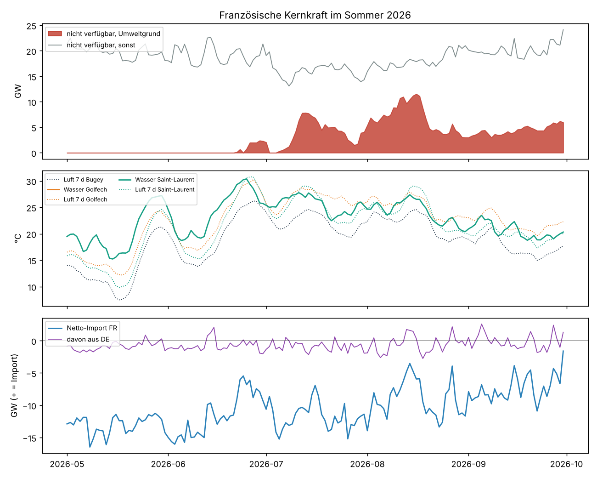
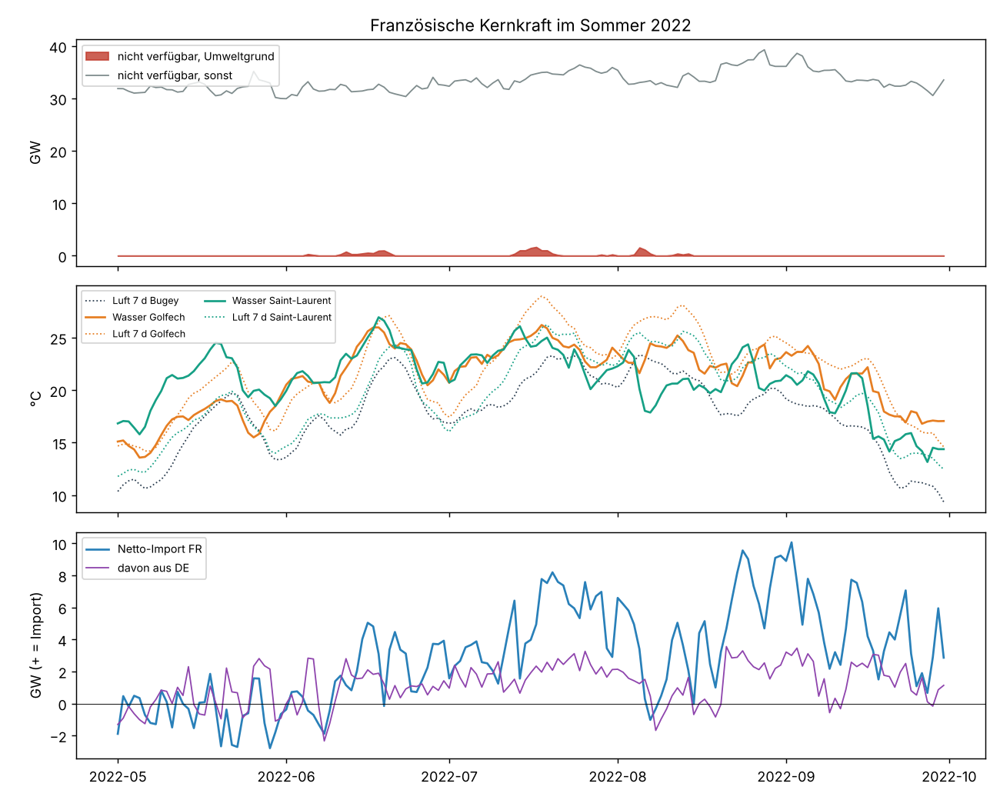
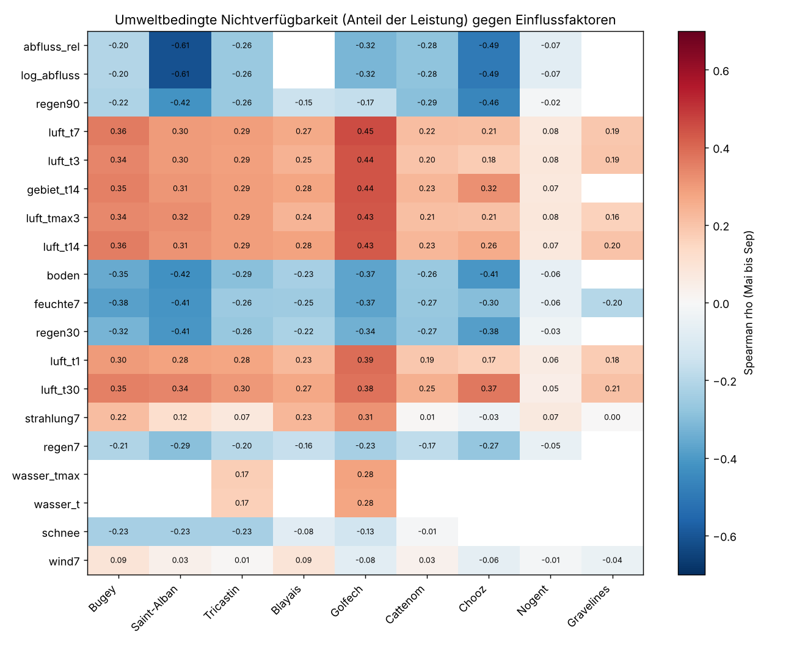
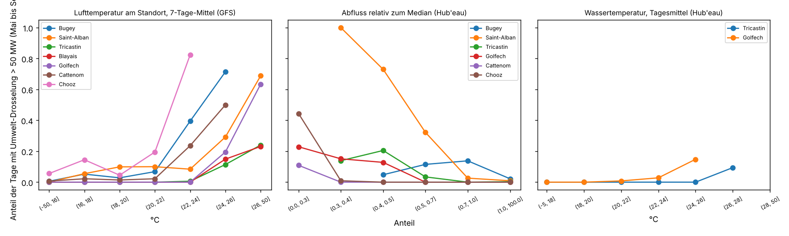
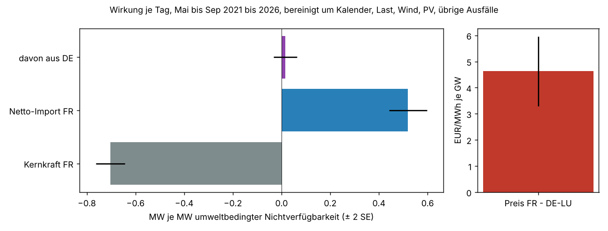

# Kühlwasserbedingte Drosselung französischer Kernkraftwerke

Einmalige Auswertung vom 4.11.2026, Auftrag in [job.yaml](job.yaml). Frage: Lässt sich aus den
Wetterdaten (Niederschlag, Luft- und Wassertemperatur und deren Verlauf) nachvollziehen, wann
französische Kernkraftwerke wegen der Erwärmung der Gewässer gedrosselt werden, und wie wirkt
sich das auf Erzeugung, Im- und Export aus? Dazu eine einfache Korrelationsanalyse und die
Bewertung, ob unsere Silber- und Gold-Daten reichen oder weitere Datenpunkte nötig sind,
einschließlich freier Gewässerdaten.

## Ergebnis in Kürze

- **Bis 2025 eine Randerscheinung, 2026 erstmals erheblich.** Mit Umweltgrund gemeldete
  Nichtverfügbarkeit (ENTSO-E 15.1) kostete im Sommerhalbjahr (Mai bis September) 2022 bis
  2025 jeweils 0,2 bis 0,5 TWh, also 0,2 bis 0,5 % der Kernkrafterzeugung. 2026 waren es
  11,3 TWh oder 8,2 %, mit bis zu 11,5 GW an einem Tag (Mitte August). Allein Chooz an der
  Meuse stand von Juli bis Ende Oktober fast durchgehend still (7,2 TWh im Jahr).
- **Betroffen sind wenige Standorte.** Bugey, Saint-Alban, Tricastin (Rhône, Durchlaufkühlung),
  Golfech (Garonne), Blayais (Gironde) und 2025/26 Chooz und Cattenom. Die Loire-Standorte,
  Civaux und Cruas meldeten nie einen Umweltgrund, Nogent nur einmal 2025; an der Küste traf es
  2026 Gravelines (August) und in geringem Umfang Flamanville und Paluel.
- **Zwei Auslöser, je nach Standort.** An Bugey, Tricastin, Golfech und Blayais hängt die
  Drosselung an der Lufttemperatur der Vortage (Spearman ρ 0,27 bis 0,45 für das 7-Tage-Mittel
  am Standort). Ab etwa 22 °C im 7-Tage-Mittel steigt der Anteil der Tage mit Drosselung
  steil an, in Bugey auf 40 % (22 bis 24 °C) und 71 % (24 bis 26 °C), in Golfech auf 63 %
  über 26 °C. An Saint-Alban und Chooz zählt dagegen vor allem **niedriger Abfluss**
  (ρ −0,61 bzw. −0,49): Unter 40 % des Median-Abflusses war Saint-Alban an 100 % der Tage
  gedrosselt, bei 40 bis 50 % an 73 %.
- **Wassertemperatur folgt der Lufttemperatur fast vollständig.** Aus GFS-Lufttemperatur
  (gleitend 3, 14 und 30 Tage), Abfluss und Strahlung lässt sich die gemessene Flusstemperatur
  mit R² 0,95 bis 0,98 und rund 1 K mittlerem Fehler nachbilden. Eine eigene Messreihe bringt
  wenig zusätzliche Information, zumal Hub'eau nur an drei passenden Stationen seit 2021 misst.
- **Wirkung auf den Austausch.** Je MW umweltbedingter Nichtverfügbarkeit sinkt die
  Kernkrafterzeugung um 0,7 MW (1,1 MW ohne 2026) und der Netto-Export Frankreichs um 0,5 MW
  (0,9 MW ohne 2026). Der Preis FR liegt je GW um 4,6 EUR/MWh höher relativ zu DE-LU. Der
  Austausch mit Deutschland reagiert kaum (0,02 ± 0,02 MW je MW, ohne 2026 0,19 ± 0,11); der
  Rückgang des Exports verteilt sich auf die übrigen Grenzen (nicht einzeln ausgewertet).

**Bewertung der Datenbasis:** Das GFS-0p5-Silber reicht für den Wetterteil, es enthält alle
nötigen Größen an allen Standorten. Gold reicht nicht, weil FR dort nur als Fläche (`gefs:FR:area`)
vorliegt und die Drosselung an den Bedingungen am Standort und im Einzugsgebiet hängt. Es fehlt
eine Größe, die kein Wettermodell liefert: der **Abfluss**. Er ist an den Rhône- und
Meuse-Standorten der stärkste Einzelfaktor und lässt sich aus Niederschlag und Bodenfeuchte des
GFS nur grob ersetzen (ρ −0,42 statt −0,61 in Saint-Alban).

**Vorschlag:** (1) Hub'eau-Abfluss als neue freie Quelle aufnehmen (Licence Ouverte 2.0, API ohne
Schlüssel, Tagesmittel und Echtzeitwerte), zunächst die 12 Pegel aus
[tabellen/stationen.csv](tabellen/stationen.csv), wenige KB je Tag. Umgesetzt als Quelle
`hubeau` in `energy_ingest` (Reihen `river_flow_<pegel>` und `river_flow_<pegel>_h`), dazu
Ternay für die Historie von Saint-Alban und Onzain, weil Blois seit 09/2026 keine Werte mehr
liefert. (2) Gold um Standortmerkmale
für die 14 Binnenkraftwerke ergänzen: Lufttemperatur am Gitterpunkt (gleitend 3/7/14/30 Tage)
und Niederschlag und Schnee über dem Einzugsgebiet, gerechnet aus dem vorhandenen Silber.
(3) Wassertemperatur nicht als Quelle speichern, sie ist aus (2) und (1) ableitbar. Die
nicht-freien ENTSO-E-Meldungen bleiben ausgeschlossen; ein Modell kann die
Nichtverfügbarkeit nur indirekt über Kernkrafterzeugung und Austausch lernen.



## Ergebnisse

### Umfang je Jahr und Standort

Summe der mit Umweltgrund gemeldeten Nichtverfügbarkeit über das Jahr in GWh
([tabellen/umweltereignisse.csv](tabellen/umweltereignisse.csv), Monatswerte je Gruppe in
[tabellen/monate.csv](tabellen/monate.csv)):

| Standort | 2022 | 2023 | 2024 | 2025 | 2026 |
|---|---:|---:|---:|---:|---:|
| Bugey (Rhône) | 40 | 37 | 39 | 174 | 863 |
| Saint-Alban (Rhône) | 141 | 14 | 30 | 20 | 2 108 |
| Tricastin (Rhône) | 68 | – | 7 | 20 | 399 |
| Blayais (Gironde) | 1 | 0 | – | 1 | 435 |
| Golfech (Garonne) | 201 | 159 | 279 | 203 | 989 |
| Chooz (Meuse) | – | – | – | 81 | 7 173 |
| Cattenom (Moselle) | – | – | – | – | 1 088 |
| Nogent (Seine) | – | – | – | 12 | – |
| Gravelines (Küste) | – | – | – | – | 552 |
| Flamanville, Paluel (Küste) | – | – | – | – | 95 |

2021 gab es nur zwei kleine Meldungen (Bugey, Blayais, zusammen 7 GWh). Die Zahlen sind eine
Untergrenze, siehe [Einschränkungen](#einschränkungen). Die Küstenmeldungen 2026 haben andere
Ursachen als die Flusserwärmung (vermutlich Meerwassertemperatur oder Ansaugprobleme), die
Meldungen nennen nur „Environmental issues“.



2022 war die Kernkraft durch die Korrosionsprüfungen ohnehin auf 18 bis 20 TWh im Monat
gefallen (im Sommer im Mittel 33 GW aus anderen Gründen nicht verfügbar, bis zu 39 GW). Die Hitzewelle im Juli kam dazu, ist in
den Meldungen aber nur zum Teil als Umweltgrund ausgewiesen.

### Einflussfaktoren

Spearman-Korrelation des Tagesanteils umweltbedingt nicht verfügbarer Leistung mit den
Faktoren, Mai bis September 2021 bis 2026
([tabellen/korrelation.csv](tabellen/korrelation.csv), dort auch gegen die Ausnutzung der
Standorte aus der Ist-Erzeugung je Block):



| Faktor | Bugey | Saint-Alban | Tricastin | Blayais | Golfech | Cattenom | Chooz |
|---|---:|---:|---:|---:|---:|---:|---:|
| Luft 7-Tage-Mittel am Standort | 0,36 | 0,30 | 0,29 | 0,27 | 0,45 | 0,22 | 0,21 |
| Luft 30-Tage-Mittel | 0,35 | 0,34 | 0,30 | 0,27 | 0,38 | 0,25 | 0,37 |
| Abfluss relativ zum Median | −0,20 | −0,61 | −0,26 | – | −0,32 | −0,28 | −0,49 |
| Niederschlag Einzugsgebiet 90 Tage | −0,22 | −0,42 | −0,26 | −0,15 | −0,17 | −0,29 | −0,46 |
| Bodenfeuchte Einzugsgebiet | −0,35 | −0,42 | −0,29 | −0,23 | −0,37 | −0,26 | −0,41 |
| Relative Feuchte 7 Tage | −0,38 | −0,41 | −0,26 | −0,25 | −0,37 | −0,27 | −0,30 |
| Schnee Einzugsgebiet (Alpen) | −0,23 | −0,23 | −0,23 | −0,08 | −0,13 | −0,01 | – |
| Wind 10 m | 0,09 | 0,03 | 0,01 | 0,09 | −0,08 | 0,03 | −0,06 |

Alle Fenster der Lufttemperatur (1 bis 30 Tage) liegen nah beieinander; das 7-Tage-Mittel ist
an Bugey, Golfech und Blayais am stärksten, an Chooz, Saint-Alban und Tricastin das
30-Tage-Mittel. Wind hat
keinen Einfluss. Der Schnee in den Alpen wirkt nur schwach auf die Rhône-Standorte.

### Schwellen

Anteil der Sommertage mit mehr als 50 MW umweltbedingter Nichtverfügbarkeit je Klasse
([tabellen/schwellen.csv](tabellen/schwellen.csv)):



Die Schwelle liegt je Standort anders: Bugey ab 22 °C im 7-Tage-Mittel, Golfech, Tricastin und
Blayais erst ab 24 bis 26 °C, Chooz schon bei 22 °C, wenn zugleich die Meuse wenig Wasser
führt. Beim Abfluss reagiert Saint-Alban am stärksten (unter 50 % des Medians), Chooz unter
30 %, Golfech und Tricastin schwächer schon unter 50 %. An den Hub'eau-Stationen mit
Wassertemperatur beginnt die Drosselung ab 24 °C (Garonne, St-Aignan, oberhalb Golfech) bzw.
26 °C (Rhône, Roquemaure, unterhalb Tricastin).

### Wassertemperatur aus dem GFS

Lineare Regression der Tagesmittel an den Hub'eau-Stationen, die ersten 60 % der Tage gelernt,
der Rest geprüft ([tabellen/wassertemperatur_modell.csv](tabellen/wassertemperatur_modell.csv)):

| Station (Standort) | nur Luft 7 Tage | Luft 3/14/30 Tage | + Abfluss | + Strahlung | MAE Sommer |
|---|---:|---:|---:|---:|---:|
| Rhône, Roquemaure (Tricastin) | 0,947 | 0,970 | 0,979 | 0,980 | 0,89 K |
| Garonne, St-Aignan (Golfech) | 0,935 | 0,946 | 0,939 | 0,954 | 1,26 K |
| Loire, Muides (Saint-Laurent) | 0,910 | 0,924 | 0,923 | 0,966 | 1,11 K |

Der Wert ist R² im Prüfzeitraum. Die Flusstemperatur ist also im Wesentlichen eine geglättete
Lufttemperatur. Das GFS-Silber liefert sie in ausreichender Güte; Abfluss und Strahlung
verbessern den Sommerfehler um 0,1 bis 0,3 K.

### Austausch und Preis

Tageswerte Mai bis September, lineare Regression mit Monat, Wochentag, Jahr, Last, Wind, PV und
übrigen Ausfällen als Kontrollen ([tabellen/austausch.csv](tabellen/austausch.csv)):



| Zielgröße | je Einheit | 2021 bis 2026 | nur 2021 bis 2025 |
|---|---|---:|---:|
| Kernkrafterzeugung FR | MW je MW | −0,70 ± 0,03 | −1,06 ± 0,14 |
| Netto-Import FR | MW je MW | +0,52 ± 0,04 | +0,87 ± 0,18 |
| davon aus DE | MW je MW | +0,02 ± 0,02 | +0,19 ± 0,11 |
| Preis FR − DE-LU | EUR/MWh je GW | +4,6 ± 0,7 | +6,0 ± 3,2 |

Ohne Kontrollen ist kein Zusammenhang zu sehen (R² ≈ 0), weil die Drosselung in die Sommer fällt,
in denen die Last niedrig und die PV-Erzeugung hoch ist. Mit 2026 wird eine gemeldete
Drosselung nur zu 70 % in der Erzeugung sichtbar; vermutlich hätten die Blöcke in einem Teil
der Stunden ohnehin moduliert (nicht geprüft). Für Deutschland ist der Effekt klein: Der Fluss DE→FR ändert sich kaum.

## Daten und Methode

- **Zeitraum:** 1.3.2021 bis 31.10.2026 (Beginn des GFS-0p5-Silbers), Tageswerte UTC.
  Korrelationen, Schwellen und Austausch nur Mai bis September.
- **Zielgröße Umweltdrosselung:** ENTSO-E 15.1.A/B (Nichtverfügbarkeit der
  Erzeugungseinheiten, A80), 7 020 Meldungen zu Kernkraftblöcken, je Meldung die letzte
  Revision ohne Stornos. Umweltgrund heißt: Der Freitext enthält „environment“,
  „environnement“, thermische Grenzen, Abfluss oder Hitzewelle, oder den Hinweis, dass RTE bei
  einer Ausnahmesituation mehr Leistung anfordern darf (das kommt nur im Sommer an
  Flussstandorten vor). Das trifft auf 264 Meldungen zu. Fehlleistung = Nennleistung −
  verfügbare Leistung je Abschnitt (Kurventyp A03). Überlappende Meldungen eines Blocks zählen
  je Viertelstunde mit dem Höchstwert, nicht als Summe.
- **Leistung je Standort:** Summe der 99,5-%-Quantile der Ist-Erzeugung je Block (ENTSO-E
  16.1.A, A73) im Jahr; dient als Nenner für Anteil und Ausnutzung.
- **Wetter:** GFS-0p5-Silber von GHCR, 00Z-Läufe, Schritte f003 bis f024 als Tageswert (2 049
  Läufe, 22 Tage fehlen). Lufttemperatur, Strahlung, Feuchte und Wind am nächsten
  0,5°-Gitterpunkt, Niederschlag, Schnee und Bodenfeuchte als Mittel über einen Kasten über dem
  Einzugsgebiet ([daten.py](daten.py)). Gleitende Mittel und Summen daraus.
- **Gewässer (Hub'eau):** Abfluss als Tagesmittel (QmnJ) am nächsten Pegel desselben Flusses
  unter denen mit mindestens 20 % des größten Einzugsgebiets im Umkreis von 0,6°. Für
  Tricastin ist Viviers fest eingetragen, weil Bourg-Saint-Andéol nur den Alt-Rhône misst.
  Wassertemperatur an der nächsten Station desselben Flusses mit Daten seit 2021 (≤ 1°); nur
  drei Stationen erfüllen das, die Garonne-Station endet Anfang 2024.
- **Austausch und Preise:** Energy-Charts `/public_power` (Kernkraft, Last, Wind, PV), `/cbet`
  (+ = Import nach FR) und `/price` für FR und DE-LU.
- **Gruppen:** Durchlaufkühlung an Flüssen und Ästuar (Bugey, Saint-Alban, Tricastin, Blayais),
  Kühltürme an Flüssen (übrige Binnenstandorte), Meerwasser (Gravelines, Penly, Paluel,
  Flamanville) als Vergleich ([tabellen/standorte.csv](tabellen/standorte.csv)).

## Einschränkungen

- **Untergrenze.** Die Klassifikation hängt am Freitext der Meldungen. Vor 2022 fehlen dort oft
  Gründe ganz; die Hitzedrosselung von Golfech im Juli 2022 etwa steht nur als
  „Ausnahmesituation“ im Text, andere Fälle laufen als Modulation oder ohne Text. Wirtschaftliche
  Modulation (Absenkung bei niedrigen Preisen) ist ausgeschlossen, auch wenn sie im Sommer mit der
  Hitze zusammenfällt.
- **2026 dominiert.** Ein Jahr trägt über 90 % der gemeldeten Menge; die Koeffizienten zum
  Austausch hängen daran (siehe Gegenprobe ohne 2026). Für belastbare Schwellen je Standort sind
  die Fallzahlen klein (an Bugey z. B. 28 Tage mit 24 bis 26 °C).
- **Korrelation, keine Ursache.** Hitze, Trockenheit, niedrige Last und hohe PV-Erzeugung
  treten gemeinsam auf. Die Regression kontrolliert Last, Wind, PV und Kalender, aber nicht
  Exportkapazitäten oder Preise der Nachbarn.
- **Wetter aus der Vorhersage.** Die Tageswerte stammen aus dem 00Z-Lauf (f003 bis f024), nicht
  aus Beobachtungen. Für die Prognose ist das passend, für die Rückschau etwas unscharf.
- **Einzugsgebiete grob.** Die Kästen sind Rechtecke; Zuflüsse aus der Schweiz (Rhône oberhalb
  Genf) sind nur teilweise erfasst.
- **Stammdaten von Hand.** Koordinaten und Kühlart in [daten.py](daten.py) sind nicht Zeile für
  Zeile gegen Wikipedia geprüft (aus der Analyseumgebung nicht erreichbar); die Auswertung
  braucht nur den Gitterpunkt und die Gruppe.

## Quellen

- **ENTSO-E-Transparenzplattform:** 15.1.A/B Nichtverfügbarkeit der Erzeugungseinheiten,
  16.1.A Ist-Erzeugung je Block. Nicht auf der Liste der frei weiterverwendbaren Daten; die
  Rohdaten bleiben lokal, hier stehen nur Summen je Standort, Jahr oder Monat.
- **Hub'eau, OFB/BRGM** (`hubeau.eaufrance.fr`), API Hydrométrie und Température des cours
  d'eau, Licence Ouverte 2.0 (Etalab), Namensnennung: Hub'eau / eaufrance.
- **Energy-Charts, Fraunhofer ISE** (`api.energy-charts.info`), CC BY 4.0 laut
  API-Dokumentation; FR-Reihen stammen von der ENTSO-E-Transparenzplattform. Day-Ahead-Preis
  DE-LU: Bundesnetzagentur | SMARD.de.
- **NOAA/NCEP Global Forecast System (GFS)**, gemeinfrei; verdichtet als GFS-0p5-Silber von
  PredictionDB, CC BY 4.0.
- **Wikipedia (fr)**, Artikel „Centrale nucléaire de …“, CC BY-SA 4.0, für Standort und
  Kühlart ([daten.py](daten.py)).

## Nachvollziehen

Freie Rohdaten laden (etwa 44 GB GFS-Download, nur lokal, plus Hub'eau und Energy-Charts),
ENTSO-E mit Token laden (auf der VM, Rohdaten nur lokal), dann auswerten. `auswertung.py`
schreibt `tabellen/` und `grafiken/` neu, das Laufprotokoll steht in
[tabellen/lauf.json](tabellen/lauf.json):

```bash
uv run --no-project --with numpy --with numcodecs python -I \
  docs/analysen/kkw-kuehlwasser-fr/abruf.py --cache /tmp/kkw
ssh daniel@172.22.7.162 'set -a; . /opt/predictiondb/.env; set +a; python3 - /tmp/kkw_entsoe' \
  < docs/analysen/kkw-kuehlwasser-fr/abruf_entsoe.py
# /tmp/kkw_entsoe von der VM nach /tmp/kkw/entsoe kopieren
uv run --no-project --with pandas --with numpy --with scipy --with matplotlib --with pyyaml \
  python docs/analysen/kkw-kuehlwasser-fr/auswertung.py --cache /tmp/kkw --entsoe /tmp/kkw/entsoe
```
