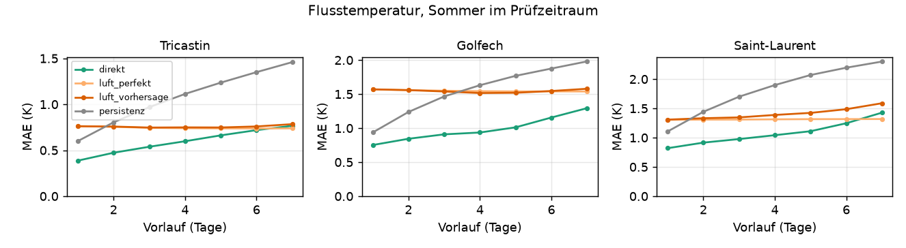
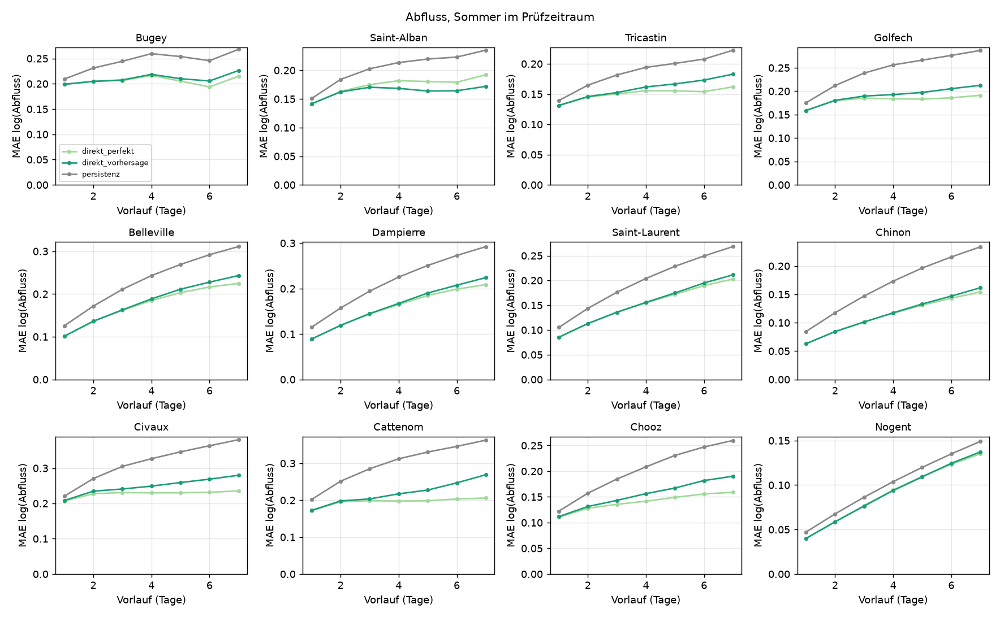

# Vorhersage von Flusstemperatur und Abfluss an französischen Kernkraftwerken

Einmalige Auswertung vom 8.11.2026, Auftrag in [job.yaml](job.yaml). Frage: Wie gut lassen sich
Wassertemperatur (aus GFS-Größen) und Abfluss (aus den Niederschlägen der Vorwochen und den
Abflussdaten) an den französischen Kernkraftwerken mit echten Vorläufen von D+1 bis D+7
vorhersagen, und lohnt sich damit ein Modell für die kühlwasserbedingte Drosselung? Fortsetzung
von [kkw-kuehlwasser-fr](../kkw-kuehlwasser-fr/README.md).

## Ergebnis in Kürze

- **Wassertemperatur: brauchbar bis D+7, wenn die letzte Messung einfließt.** Das Modell
  „Direkt“ (letzte Messung plus GFS-Luft und -Strahlung) erreicht im Sommer 0,39 bis 0,82 K MAE
  bei D+1 und 0,77 bis 1,43 K bei D+7. Es schlägt die Persistenz der letzten Messung an allen drei
  Stationen ab D+1, bei D+7 um 0,7 bis 0,9 K.
- **Ohne Messung bleibt ein fester Fehler.** Aus Luft allein liegt der Fehler über alle Vorläufe
  bei 0,75 bis 1,6 K, kaum abhängig vom Vorlauf. Die Vorhersagefehler des GFS spielen dabei fast
  keine Rolle: Bis D+3 ist das Modell mit vorhergesagter Luft so gut wie mit der eingetretenen,
  denn die Flusstemperatur glättet über 14 und 30 Tage. Erst bei D+7 kostet die Vorhersage an der
  Loire 0,27 K.
- **Schwelle 24 °C:** „Direkt“ trifft bei D+1 74 bis 94 % der Tage über 24 °C bei 6 bis 27 %
  Fehlalarmen, bei D+7 noch 49 bis 92 % bei 13 bis 42 %. Die 26-°C-Schwelle ist schwächer
  (D+7: 51 bis 53 % Treffer), an der Garonne kam sie im Prüfzeitraum nur viermal vor.
- **Abfluss: besser als die Persistenz an allen 12 Pegeln, mit wachsendem Abstand.** Bei D+7 liegt
  der Fehler bei 0,14 bis 0,28 im Logarithmus (rund 14 bis 28 %), die Persistenz bei 0,15 bis 0,38.
  Der vorhergesagte Regen kostet bis D+3 fast nichts, bei D+7 an Maas, Mosel und Vienne 0,03 bis
  0,06.
- **Lohnt sich ein Modell?** Ja, als Standortmerkmal „Kühlwasserlage“ für D+1 bis D+3 mit guter
  und bis D+7 mit mäßiger Güte. Wassertemperatur und Abfluss sind beide vorhersagbar, die
  Abflussmessung von Hub'eau trägt den größten Teil. Die Schwachstelle sind die Standorte ohne
  Temperaturmessung (Bugey, Saint-Alban, Chooz, Cattenom), dort gilt nur das Luftmodell mit 1 bis
  1,6 K. Ob die Merkmale den Preis DE-LU verbessern, prüft diese Analyse nicht.



## Ergebnisse

### Wassertemperatur

MAE im Sommer (Mai bis September) in K, je Kalenderjahr geprüft und auf den übrigen Jahren gelernt
([tabellen/wassertemperatur.csv](tabellen/wassertemperatur.csv), alle Vorläufe und Bias dort):

| Station (Standort) | D+ | Persistenz | Luft (GFS) | Luft (eingetreten) | Direkt |
|---|---:|---:|---:|---:|---:|
| Garonne, St-Aignan (Golfech) | 1 | 0,94 | 1,57 | 1,57 | 0,75 |
| | 3 | 1,47 | 1,54 | 1,55 | 0,91 |
| | 7 | 1,98 | 1,58 | 1,54 | 1,29 |
| Loire, Muides (Saint-Laurent) | 1 | 1,11 | 1,31 | 1,30 | 0,82 |
| | 3 | 1,70 | 1,35 | 1,31 | 0,98 |
| | 7 | 2,30 | 1,59 | 1,32 | 1,43 |
| Rhône, Roquemaure (Tricastin) | 1 | 0,60 | 0,76 | 0,76 | 0,39 |
| | 3 | 0,97 | 0,75 | 0,74 | 0,54 |
| | 7 | 1,46 | 0,78 | 0,74 | 0,77 |

- **Persistenz:** letzte Messung T-1.
- **Luft:** Regression auf Luft 3/14/30 Tage, Strahlung 7 Tage und Abfluss T-1, ohne
  Wassermessung. „GFS“ nimmt die Tage ab T aus dem Lauf T, „eingetreten“ das später eingetretene
  Wetter.
- **Direkt:** wie „Luft (GFS)“ plus die letzte Messung.

An der Rhône ist „Direkt“ bei D+7 nicht mehr besser als das Luftmodell, an der Loire liegt das
Luftmodell mit eingetretenem Wetter bei D+7 vorn. Die Messung hilft also vor allem in den ersten
Tagen. Prüftage im Sommer: Garonne 459 (3 Jahre), Loire 802 (6 Jahre), Rhône 459 (3 Jahre).

Schwellen mit „Direkt“ ([tabellen/wasser_schwellen.csv](tabellen/wasser_schwellen.csv), dort auch
die übrigen Modelle):

| Station | Schwelle | Tage darüber | Treffer D+1 | D+3 | D+7 | Fehlalarme D+1 | D+3 | D+7 |
|---|---:|---:|---:|---:|---:|---:|---:|---:|
| Garonne | 24 °C | 65 | 0,74 | 0,63 | 0,49 | 0,27 | 0,32 | 0,42 |
| Garonne | 26 °C | 4 | 0,75 | 0,50 | 0,75 | 0,75 | 0,85 | 0,82 |
| Loire | 24 °C | 168 | 0,79 | 0,72 | 0,62 | 0,24 | 0,28 | 0,35 |
| Loire | 26 °C | 47 | 0,81 | 0,77 | 0,53 | 0,38 | 0,40 | 0,60 |
| Rhône | 24 °C | 165 | 0,94 | 0,92 | 0,92 | 0,06 | 0,08 | 0,13 |
| Rhône | 26 °C | 53 | 0,74 | 0,68 | 0,51 | 0,24 | 0,29 | 0,32 |

### Abfluss

MAE im Sommer auf log(Abfluss), 0,2 entspricht rund 20 % Abweichung
([tabellen/abfluss.csv](tabellen/abfluss.csv)):

| Pegel (Standort) | D+3 Persistenz | D+3 Modell | D+3 Regen eingetreten | D+7 Persistenz | D+7 Modell | D+7 Regen eingetreten |
|---|---:|---:|---:|---:|---:|---:|
| Belleville (Loire) | 0,211 | 0,163 | 0,162 | 0,311 | 0,243 | 0,225 |
| Bugey (Rhône) | 0,245 | 0,208 | 0,206 | 0,268 | 0,226 | 0,215 |
| Cattenom (Mosel) | 0,285 | 0,204 | 0,199 | 0,363 | 0,269 | 0,206 |
| Chinon (Loire) | 0,147 | 0,101 | 0,102 | 0,234 | 0,162 | 0,154 |
| Chooz (Maas) | 0,185 | 0,143 | 0,136 | 0,260 | 0,190 | 0,159 |
| Civaux (Vienne) | 0,305 | 0,241 | 0,231 | 0,381 | 0,280 | 0,235 |
| Dampierre (Loire) | 0,194 | 0,145 | 0,144 | 0,292 | 0,224 | 0,209 |
| Golfech (Garonne) | 0,239 | 0,190 | 0,185 | 0,287 | 0,212 | 0,191 |
| Nogent (Seine) | 0,086 | 0,076 | 0,077 | 0,149 | 0,137 | 0,135 |
| Saint-Alban (Rhône) | 0,203 | 0,170 | 0,175 | 0,235 | 0,172 | 0,192 |
| Saint-Laurent (Loire) | 0,176 | 0,136 | 0,136 | 0,268 | 0,211 | 0,203 |
| Tricastin (Rhône) | 0,182 | 0,152 | 0,150 | 0,222 | 0,183 | 0,162 |

Das Modell nutzt log-Abfluss T-1 und T-8, Regen der letzten 7, 30 und 90 Tage, Bodenfeuchte,
Schnee, den Jahresgang und den Regen der kommenden d Tage, einmal aus dem Lauf T und einmal
eingetreten. Saint-Alban hat nur 3 Prüfjahre, alle übrigen Pegel 6.



Die Schwelle „unter 50 % des Medians“ ([tabellen/abfluss_schwellen.csv](tabellen/abfluss_schwellen.csv))
taugt nur bedingt als Ereignis. An Loire, Maas, Mosel und Vienne liegt im Sommer etwa jeder zweite
Prüftag darunter, Treffer sind dort leicht. An Saint-Alban (50 Tage) trifft das Modell bei D+3
86 % gegenüber 48 % der Persistenz, bei 54 % Fehlalarmen. An Bugey sind die 21 Tage vereinzelte
Werte, die auch die Persistenz nicht trifft; dort ist die Kennzahl nicht aussagekräftig.

### Fehler der Wettervorhersage

Zum Vergleich der Fehler des GFS gegen den Vorlauf 0 im Sommer
([tabellen/wetterfehler.csv](tabellen/wetterfehler.csv)): Lufttemperatur am Standort 0,39 bis
0,46 K bei D+1 und 1,75 bis 2,11 K bei D+7, Regensumme bis zum Zieltag im Einzugsgebiet 0,49 bis
0,95 mm bei D+1 und 5,9 bis 9,8 mm bei D+7. Der Fehler der Luft wächst also stark, die
Wassertemperatur reagiert darauf wegen der langen Fenster kaum.

## Daten und Methode

- **Zeitraum:** 23.3.2021 bis 31.10.2026, alle 2 049 Läufe 00Z des GFS-0p5-Silbers. Ausgewertet
  wird der Zieltag im Sommer (Mai bis September).
- **Vorhersage:** Tag d des Laufs T sind die Schritte 24 d + 3 bis 24 d + 24 Stunden. Luft und
  Strahlung am nächsten 0,5°-Gitterpunkt, Regen, Bodenfeuchte und Schnee als Mittel über den Kasten
  des Einzugsgebiets aus [../kkw-kuehlwasser-fr/daten.py](../kkw-kuehlwasser-fr/daten.py).
- **Eingetretenes Wetter:** Vorlauf 0 des Laufs am jeweiligen Tag, wie in der Vorgängeranalyse.
- **Messungen:** Hub'eau mit derselben Stationswahl wie die Vorgängeranalyse; Wassertemperatur als
  Tagesmittel, Abfluss als QmnJ. Zum Ausgabezeitpunkt gilt die Messung bis T-1 als bekannt.
- **Modelle:** lineare Regressionen je Station und Vorlauf. Geprüft je Kalenderjahr des Zieltags,
  gelernt auf allen übrigen Jahren (ein Jahr auslassen).

## Einschränkungen

- **Wenige Temperaturstationen.** Nur drei Stationen haben passende Messungen, die Garonne-Station
  endet Anfang 2024. Für Bugey, Saint-Alban, Chooz und Cattenom gibt es keine Messung, dort ist
  nur das Luftmodell möglich, dessen Güte an anderen Flüssen gemessen ist.
- **Verfügbarkeit der Messung nicht geprüft.** Die Annahme „bekannt bis T-1“ gilt für Hub'eau nicht
  überall; Verzug einzelner Stationen würde „Direkt“ und das Abflussmodell verschlechtern.
- **Eingetretenes Wetter ist selbst eine Vorhersage.** Vorlauf 0 (f003 bis f024) statt Beobachtung.
- **Methode nach einem Probelauf geändert.** Zuerst war eine zeitliche Teilung (60 % lernen, Rest
  prüfen) vorgesehen. Sie ließ im Sommer nur 26 bis 153 Prüftage, deshalb gilt jetzt „ein Jahr
  auslassen“ (Feld `teilung` in [job.yaml](job.yaml)). Benachbarte Jahre sind nicht unabhängig.
- **Nur lineare Modelle.** Ein Baummodell könnte Schwellen und Niedrigwasser besser treffen.
- **Keine Drosselung modelliert.** Die Analyse bewertet die Eingänge, nicht die Wirkung auf
  Kernkrafterzeugung oder Preis. Die ENTSO-E-Meldungen sind nicht frei, siehe Vorgängeranalyse.

## Quellen

- **NOAA/NCEP Global Forecast System (GFS)**, gemeinfrei; verdichtet als GFS-0p5-Silber von
  PredictionDB (`ghcr.io/the78mole/predictiondb-data/gfs-0p5-silver`), CC BY 4.0.
- **Hub'eau, OFB/BRGM** (`hubeau.eaufrance.fr`), API Hydrométrie und Température des cours
  d'eau, Licence Ouverte 2.0 (Etalab), Namensnennung: Hub'eau / eaufrance.
- **Wikipedia (fr)**, CC BY-SA 4.0, für Standorte über
  [../kkw-kuehlwasser-fr/daten.py](../kkw-kuehlwasser-fr/daten.py).

## Nachvollziehen

Rohdaten laden (GFS-Silber wird nur durchgereicht, rund 44 GB Download, im Cache bleiben gut 20 MB
Tageswerte), dann auswerten. Das Laufprotokoll steht in [tabellen/lauf.json](tabellen/lauf.json):

```bash
uv run --no-project --with numpy --with numcodecs python -I \
  docs/analysen/kkw-vorhersage/abruf.py --cache /tmp/kkwv
uv run --no-project --with pandas --with numpy --with matplotlib --with pyyaml python -I \
  docs/analysen/kkw-vorhersage/auswertung.py --cache /tmp/kkwv
```
