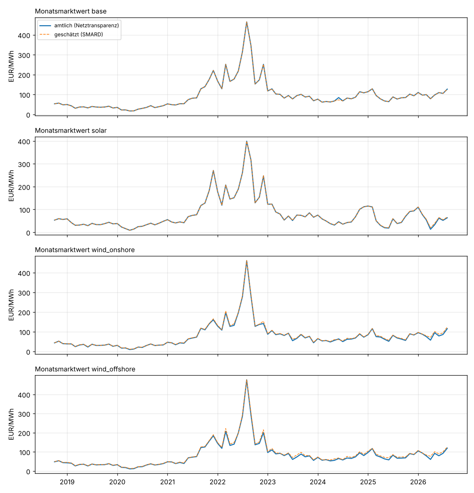
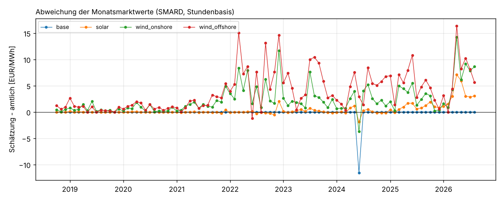

# Marktwerte: eigene Schätzung gegen die amtlichen Werte

Einmalige Auswertung vom 23.10.2026, Auftrag in [job.yaml](job.yaml). Frage: Wie weit weichen
die Monats- und Jahresmarktwerte, die `pdb_marktwert` aus freien Daten (SMARD) rechnet, von den
amtlichen Werten der Übertragungsnetzbetreiber auf Netztransparenz.de ab? Daran hängt, was eine
Instanz verliert, die Netztransparenz nicht freigibt (`PDB_ALLOW_NETZTRANSPARENZ=false`).

## Ergebnis in Kürze

**Die Prognosemodelle verlieren nichts.** Last- und Preismodell (`de_lu_v1`) nutzen keine
Marktwerte. Marktwerte brauchen nur Auswertungen wie die PV-Speicher-Analysen, später auch die
Vergütungsrechnung eigener Anlagen.

**Der Basiswert (MW-EPEX) stimmt exakt, Solar fast, Wind liegt systematisch zu hoch.**
Monatswerte Oktober 2018 bis August 2026 (95 Monate), Schätzung minus amtlich:

| Marktwert | Bias | MAE | MAE in % | größte Abweichung |
|---|---|---|---|---|
| Base (MW-EPEX) | −0,12 EUR/MWh | 0,12 EUR/MWh | 0,13 % | 11,56 EUR/MWh (Juni 2024, siehe unten) |
| Solar | +0,44 EUR/MWh | 0,56 EUR/MWh | 0,71 % | 7,10 EUR/MWh (April 2026) |
| Wind an Land | +2,36 EUR/MWh | 2,44 EUR/MWh | 3,2 % | 14,21 EUR/MWh (April 2026) |
| Wind auf See | +3,87 EUR/MWh | 3,89 EUR/MWh | 4,7 % | 16,39 EUR/MWh (April 2026) |

Jahreswerte 2019–2025: Base 0,15 %, Solar 0,41 %, Wind an Land +3,1 %, Wind auf See +5,0 %
(alle MAE). Ohne den Ausreißer Juni 2024 liegt Base in jedem Monat unter 0,01 EUR/MWh.

**Der Fehler wächst.** Bis 2020 liegt Wind unter 1 EUR/MWh daneben, seit 2022 meist 2–8
EUR/MWh, 2026 bis 16 EUR/MWh. Solar war bis 2024 praktisch exakt (unter 0,3 %), 2025 liegt es
bei +2,2 %, 2026 bei +5,9 %. Die Abweichung hängt mit den Stunden negativer Preise zusammen:
In Monaten mit mehr als 20 solchen Stunden ist der Wind-Fehler etwa doppelt so groß
(Korrelation 0,4–0,55). Die naheliegende Erklärung, nicht belegt: In diesen Stunden wird
abgeregelt. Die Ist-Erzeugung bei SMARD fällt dann, die billigen Stunden zählen weniger, und
die Schätzung steigt. Die ÜNB gewichten mit ihrer Online-Hochrechnung, die das offenbar anders
abbildet. Seit dem Solarspitzengesetz (2025) regeln auch PV-Anlagen bei negativen Preisen ab,
das passt zum Anstieg bei Solar.

**Viertelstundenpreise helfen nicht.** Ab Oktober 2025 mit Viertelstunden statt Stunden
gewichtet, sinkt nur der Solar-Fehler (4,3 % → 2,8 %); bei Wind bleibt er gleich. Die
Hochrechnung ist die Ursache, nicht die Auflösung.

**SMARD ist die bessere Grundlage als ENTSO-E.** Mit ENTSO-E-Daten gerechnet sind alle
Fehler größer (Base 1,6 %, Solar 3,0 %, Wind 5–6 % MAE). SMARD gibt den Preis offenbar so
wieder, wie ihn die ÜNB verwenden.

**Folgerung:** Für Base und Solar bis 2024 ersetzt die Schätzung die amtlichen Werte. Für Wind
und für Solar seit 2025 überschätzt sie den Marktwert um einige Prozent. Wer Erlöse eigener
Anlagen damit rechnet, sollte das wissen oder Netztransparenz freigeben. Eine Korrektur über
die Stunden negativer Preise (z. B. Erzeugung in diesen Stunden aus der Prognose der ÜNB statt
aus der Ist-Erzeugung) ist ein möglicher nächster Schritt.

## Ausreißer Juni 2024

Netztransparenz führt für Juni 2024 einen MW-EPEX von 84,45 EUR/MWh. SMARD, ENTSO-E und
Energy-Charts ergeben übereinstimmend 72,89 EUR/MWh aus 720 Stunden. Der Unterschied (11,56
EUR/MWh, also rund 8 300 EUR/MWh über den Monat) lässt sich nicht mit einzelnen Stunden
erklären, auch nicht mit der entkoppelten Auktion am 26.06.2024. Die Ursache ist offen,
möglicherweise ein Fehler in der Veröffentlichung oder beim Abruf. Derselbe Monat zieht auch
den Jahreswert 2024 (Base −0,95 EUR/MWh) nach unten.

## Grafiken





## Daten und Methode

| | |
|---|---|
| Referenz | Netztransparenz.de, `mw_*` ab 1/2012 (Wind auf See ab 1/2013), `jw_*` 2013–2025 |
| Grundlage der Schätzung | Stundenmittel aus `energy.value` (Produktionsdatenbank, Export vom 23.10.2026) |
| Day-Ahead-Preis DE-LU | ab Oktober 2018 (Gebotszone DE-LU); davor kein Vergleich möglich |
| Erzeugung | SMARD-Ist-Erzeugung Wind an Land, Wind auf See, PV ab 2015 |
| Rechnung | `energy_ingest.sources.marktwert.market_values`, wie im Betrieb: Base = Mittel des Preises, sonst mit der Erzeugung gewichtetes Mittel; nur Perioden mit mindestens 98 % der Stunden |
| Varianten | `smard` (Betrieb), `entsoe` (gleiche Rechnung mit ENTSO-E), `smard_15min` (ab 10/2025 Viertelstunden) |
| Kennzahlen | Bias und MAE in EUR/MWh; in % als Summe der Fehler durch Summe der amtlichen Werte |

Tabellen: [kennzahlen.csv](tabellen/kennzahlen.csv) (je Variante, Periode, Typ),
[kennzahlen_jahre.csv](tabellen/kennzahlen_jahre.csv) (SMARD je Jahr),
[kennzahlen_viertelstunden.csv](tabellen/kennzahlen_viertelstunden.csv),
[paare.csv](tabellen/paare.csv) (jeder Monat und jedes Jahr einzeln),
[lauf.json](tabellen/lauf.json) (Abdeckung, Hashes der Eingaben, Commit).

## Einschränkungen

- Die Methode der ÜNB (Anlage 1 EEG, Online-Hochrechnung) ist nicht im Detail veröffentlicht;
  die Erklärung über Abregelung ist eine Vermutung aus dem Zusammenhang mit negativen Preisen.
- Der Vergleich beginnt mit der Gebotszone DE-LU im Oktober 2018. Für 2012–2018 gibt es keine
  eigenen Preise in der Datenbank.
- Netztransparenz wurde für diese Auswertung einmalig gelesen. Im Betrieb ist die Quelle nicht
  freigegeben.

Aufruf:

```sh
uv run --with pandas --with matplotlib \
    python docs/analysen/marktwert-schaetzung/auswertung.py --daten <ordner mit csv.gz>
```
