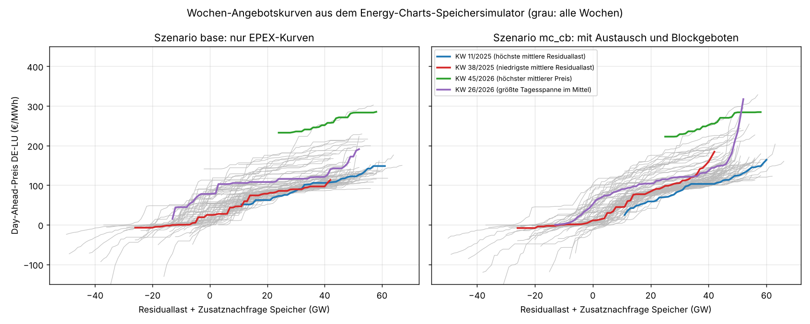
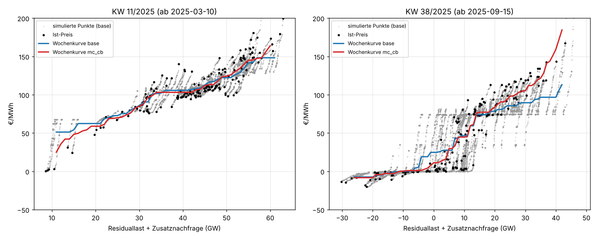
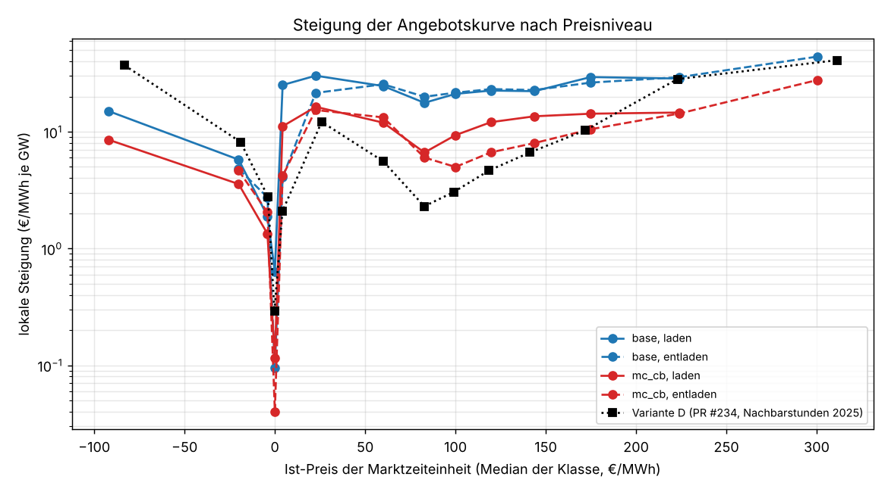
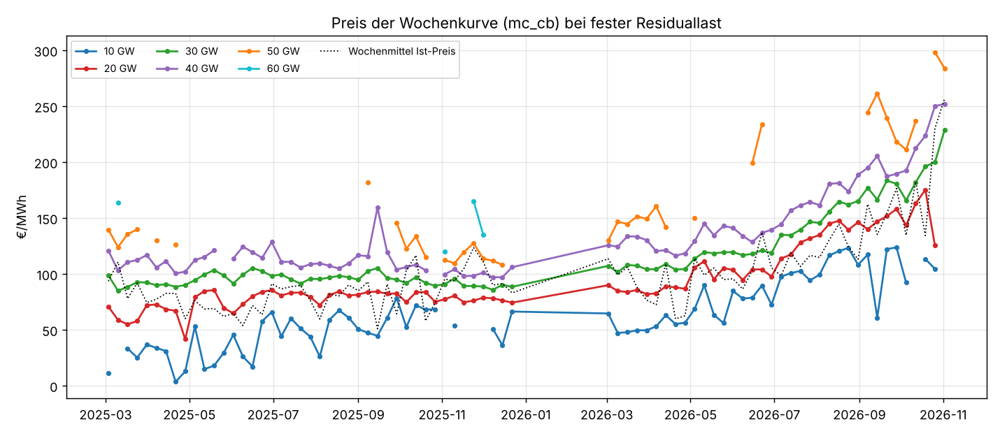

# Merit-Order-Angebotskurven aus dem Speichersimulator von Energy-Charts

Einmalige Auswertung vom 09.11.2026, Auftrag in [job.yaml](job.yaml). Frage: Lassen sich aus
der Simulation auf der Energy-Charts-Seite
[„Simulierte Börsenstrompreise“](https://www.energy-charts.info/charts/price_spot_market_simulated/chart.htm?l=de&c=DE)
die Merit-Order-Angebotskurven (Preis über Residuallast) für verschiedene Wochen ableiten, indem
man an Speichergröße und -leistung dreht?

## Ergebnis in Kürze

- **Ja, und zwar ohne an Reglern zu drehen.** Die Seite rechnet im Browser nichts, sie lädt je
  ISO-Woche eine Datei, in der das Fraunhofer ISE alle 2000 Varianten vorgerechnet hat
  (100 Leistungsstufen von 0,1 bis 20 GW × 5 Speicherdauern 2–6 h × 4 Szenarien). Jede Variante
  verschiebt die Nachfrage je Viertelstunde um die Ladeleistung und liefert den Preis, der sich
  dann auf den echten EPEX-Gebotskurven einstellt. Damit liegen je Marktzeiteinheit bis zu 500
  Punkte auf der lokalen Angebotskurve. Ausgewertet sind alle 79 veröffentlichten Wochen
  (KW 10/2025 bis KW 45/2026, ohne KW 1–9/2026, die es nicht gibt).
- **Form der Kurve.** Um 0 €/MWh ist die Kurve fast flach (Median 0,1 €/MWh je GW): Wind und PV
  bieten dort, mehrere GW Zusatznachfrage bewegen den Preis kaum. Knapp darüber springt sie
  steil auf das Niveau der fossilen Kraftwerke (10–40 €/MWh: 15–16 €/MWh je GW), wird zwischen
  70 und 160 €/MWh wieder flacher (5–14 €/MWh je GW mit Austausch und Blockgeboten) und über
  260 €/MWh steil (28–75). Ein „Hockeyschläger“ mit Stufe bei null.
- **Austausch und Blockgebote halbieren die Steigung.** Auf den reinen EPEX-Kurven (Szenario
  `base`) liegt die mittlere Wochensteigung bei 21 €/MWh je GW, mit Marktkopplung bei 13, mit
  Blockgeboten bei 10, mit beidem (`mc_cb`) bei 8. Für Speicherfragen ist `mc_cb` die richtige
  Kurve, die reine Gebotskurve überschätzt die Preiswirkung um den Faktor 2–3.
- **Wochenkurve erklärt den Preis gut.** Eine monotone Kurve je Woche über der Residuallast
  erklärt im Median 89 % der Preisvarianz (MAE 12 €/MWh, `mc_cb`). Schlechter in Wochen mit
  stark wechselndem Austausch oder Brennstoffpreis, z. B. KW 45/2026 (R² 0,41).
- **Die Kurve wandert mit dem Brennstoffniveau.** Bei 30 GW Residuallast lag der Preis 2025
  stabil bei 85–105 €/MWh (Median 95), 2026 bei 102–229 (Median 128). Seit Juli 2026 steigt die
  ganze Kurve, in KW 45/2026 lag sie bei 30/40/50 GW auf 229/252/284 €/MWh, gut doppelt so hoch
  wie im März 2025 (85/103/124). Die Form bleibt, das Niveau verschiebt sich.
- **Vergleich mit unserer freien Näherung (Variante D aus
  [batteriespeicher-2025-ise](../batteriespeicher-2025-ise/README.md)).** Um 0 €/MWh trifft D
  die Steigung gut. Zwischen 70 und 160 €/MWh ist D um den Faktor 2 zu flach (2,3–6,7 statt
  5–14 €/MWh je GW), über 200 €/MWh doppelt so steil wie `mc_cb` (28 statt 14, D liegt dort auf
  der reinen Gebotskurve `base`). Speicher senken mittlere Abendpreise also stärker und
  Spitzenpreise schwächer, als D annimmt.

## Wochenkurven



Grau sind alle 79 Wochen, farbig die automatisch gewählten repräsentativen Wochen
([repraesentativ.csv](tabellen/repraesentativ.csv)). Die Kurven gelten nur im 0,5- bis
99,5-%-Bereich der jeweiligen Woche; außerhalb gibt es keine Punkte.

| Woche | Grund | Ø Preis | Ø Residuallast | Preis bei 20 / 30 / 40 / 50 GW (`mc_cb`) | Steigung `base` / `mc_cb` | R² |
|---|---|---:|---:|---|---:|---:|
| KW 11/2025 (ab 10.03.) | höchste mittlere Residuallast | 110,6 | 42,4 GW | 59 / 85 / 103 / 124 | 12,4 / 3,3 | 0,86 |
| KW 38/2025 (ab 15.09.) | niedrigste Residuallast und niedrigster Preis | 51,0 | 9,1 GW | 84 / 105 / 159 / – | 10,3 / 3,5 | 0,93 |
| KW 26/2026 (ab 22.06.) | größte Tagesspanne | 137,1 | 27,5 GW | 104 / 121 / 137 / 234 | 24,0 / 10,1 | 0,86 |
| KW 45/2026 (ab 02.11.) | höchster Preis, letzte vollständige Woche | 256,6 | 40,9 GW | – / 229 / 252 / 284 | 25,9 / 13,8 | 0,41 |

Preise in €/MWh, Steigung als Median der lokalen Steigungen der Woche in €/MWh je GW. Alle Wochen
mit Kennzahlen je Szenario in [wochen.csv](tabellen/wochen.csv), die Kurven im 1-GW-Raster in
[kurven.csv](tabellen/kurven.csv).



Die grauen Punkte zeigen, was die Simulation hergibt: Die Varianten einer Marktzeiteinheit liegen
als kurze, schräge Punktreihe rechts (Laden) oder links (Entladen) vom Ist-Preis (schwarz). Die Striche einer
Woche liegen nicht exakt auf einer Kurve, weil sich Austausch, Kraftwerksverfügbarkeit und
Gebote von Stunde zu Stunde ändern. Die Wochenkurve ist der monotone Ausgleich darüber. Im
September 2025 sieht man die Stufe bei 0 €/MWh deutlich: Bis etwa 5 GW Residuallast bleibt der
Preis bei null, dann springt er auf 70–80 €/MWh.

## Steigung nach Preisniveau



| Preisklasse €/MWh | Marktzeiteinheiten | `base` Laden | `base` Entladen | `mc_cb` Laden | `mc_cb` Entladen | Variante D |
|---|---:|---:|---:|---:|---:|---:|
| < −50 | 178 | 15,0 | (5,6) | 8,6 | (14,6) | 37,1 |
| −50 bis −10 | 388 | 5,8 | 4,8 | 3,6 | 4,7 | 8,2 |
| −10 bis −2 | 598 | 1,9 | 2,7 | 1,3 | 2,0 | 2,8 |
| −2 bis 0,5 | 2186 | 0,6 | 0,1 | 0,1 | 0,04 | 0,3 |
| 0,5 bis 10 | 1073 | 25,1 | 4,1 | 11,1 | 4,2 | 2,1 |
| 10 bis 40 | 1660 | 30,2 | 21,5 | 16,4 | 15,3 | 12,2 |
| 40 bis 70 | 2612 | 24,6 | 25,5 | 12,0 | 13,3 | 5,6 |
| 70 bis 90 | 5077 | 17,7 | 19,9 | 6,6 | 6,0 | 2,3 |
| 90 bis 110 | 6218 | 21,1 | 21,6 | 9,3 | 5,0 | 3,0 |
| 110 bis 130 | 5163 | 22,5 | 23,2 | 12,1 | 6,7 | 4,7 |
| 130 bis 160 | 5632 | 22,2 | 22,8 | 13,6 | 8,0 | 6,7 |
| 160 bis 200 | 3686 | 29,4 | 26,4 | 14,3 | 10,5 | 10,3 |
| 200 bis 260 | 2345 | 28,6 | 29,4 | 14,6 | 14,3 | 28,3 |
| > 260 | 1011 | (90,9) | 44,0 | (75,3) | 27,7 | 41,0 |

Median der lokalen Steigung in €/MWh je GW, Werte in Klammern aus weniger als 20 Marktzeiteinheiten.
Marktzeiteinheiten sind bis 30.09.2025 Stunden, danach Viertelstunden; die Zählung mischt beide.
Quartile in [steigung_preisniveau.csv](tabellen/steigung_preisniveau.csv), je Woche in
[steigung_wochen.csv](tabellen/steigung_wochen.csv). „Laden“ heißt Zusatznachfrage (Kurve nach
rechts), „Entladen“ Zusatzangebot (nach links). Der Unterschied bei 0,5–10 €/MWh ist die Stufe:
Wer knapp über null zusätzlich kauft, schiebt den Preis über die Kante zu den fossilen
Kraftwerken.

## Preis bei fester Residuallast



Je Woche der Preis der `mc_cb`-Kurve bei 10 bis 60 GW Residuallast (Lücken: Residuallast in der
Woche nicht erreicht; Dezember 2025 bis März 2026 fehlen in der Quelle). Die Abstände zwischen
den Linien (die Form) bleiben ähnlich, das Niveau folgt dem Gaspreis. Das bestätigt den Ansatz
aus [grenzkostenindex](../../PROGNOSEMODELLE.md): Preis relativ zum Brennstoffniveau, Form aus
der Residuallast.

## Daten und Methode

- **Quelle.** Wochendateien der Seite „Simulierte Börsenstrompreise“,
  `…/price_spot_market_simulated/data/de/week_15min_<Jahr>_<KW>.json.gz`, je Woche 2–6 MB
  gepackt, darin 6022 Reihen: Erzeugung, Last, Netzeinspeisepotenzial Wind/PV, Ist-Preis DE-LU
  und je Variante simulierter Preis, Batterieleistung und Ladestand. Methodik:
  [Gandhi, Simulated Day-Ahead Prices with Additional Battery Storage, v1.0, 24.09.2026](https://www.energy-charts.info/charts/price_spot_market_simulated/downloads/battery_simulation_methodology_en.pdf).
- **Was die Simulation rechnet.** Je Marktzeiteinheit die Überschussangebotskurve
  E(p) = Angebot(p) − Nachfrage(p) aus den aggregierten EPEX-Kurven. Mit Zusatznachfrage w ist
  der Preis E⁻¹(w). Im Szenario `base` liegen alle Varianten einer Viertelstunde also exakt auf
  der echten Gebotskurve. `mc` ergänzt eine Importantwortkurve der Nachbarzonen (JAO/ENTSO-E,
  sättigt an den Kuppelkapazitäten), `cb` entscheidet die Blockgebote je Tag neu (gemischt-
  ganzzahlig nach EUPHEMIA), `mc_cb` beides. Die Batterieflotte handelt wohlfahrtsoptimal über
  eine Woche, 86 % Wirkungsgrad.
- **Punkte.** w = −Batterieleistung (Laden positiv) in GW. Je Marktzeiteinheit alle 500
  Varianten eines Szenarios plus der Ist-Preis bei w = 0; x-Achse Residuallast + w.
  Residuallast hier = Last − Wind an Land − Wind auf See − PV (Netzeinspeisepotenzial). Die
  Reihe „Residuallast“ der Datei weicht davon um ±4 GW ab, ihre Definition ist nicht
  dokumentiert. Bis 30.09.2025 war die Auktion stündlich; die Datei wiederholt den Stundenwert
  viermal, die Auswertung verdichtet diese Werte wieder auf Stunden (in KW 40/2025 nur bis
30.09.). Marktzeiteinheiten ohne Last- oder Erzeugungswert fallen heraus (Anzahl in
[lauf.json](tabellen/lauf.json), dort auch die Parameter der Quelle wie der Wirkungsgrad).
- **Wochenkurve.** Gewichtete isotone Regression (Pool Adjacent Violators auf 0,1-GW-Klassen),
  jede Marktzeiteinheit zählt gleich viel.
- **Lokale Steigung.** Je Marktzeiteinheit Kleinste Quadrate durch den Ist-Punkt über alle
  Varianten mit 0,05 ≤ |w| ≤ 2 GW, getrennt nach Laden und Entladen. Dann Median je Preisklasse
  des Ist-Preises (Klassen wie in PR #234). Viele Viertelstunden haben nur eine Seite, weil die
  Flotte dort nur lädt oder nur entlädt.

## Grenzen

- **Lokal, nicht global.** Die Simulation verschiebt die Nachfrage höchstens um die Leistung, die
  die Flotte tatsächlich fährt (`base` bis etwa 6 GW Laden und 3 GW Entladen, `mc_cb` bis 13 GW).
  Weiter weg von der Ist-Residuallast stammt die Wochenkurve aus anderen Viertelstunden derselben
  Woche, nicht aus der Gebotskurve der Viertelstunde selbst.
- **Leerstellen.** Viertelstunden, in denen sich Speicher nicht lohnen (kleine Tagesspanne), liefern
  keine Punkte; vor allem im Szenario `mc_cb` bleibt die Flotte oft stehen. Ihre Steigung fehlt.
- **Gebotskurve ist nicht Kraftwerkspark.** Die Kurve enthält auch preisabhängige Nachfrage,
  Pumpspeicher und Händler. Sie ist die Marktantwort, keine technische Merit-Order aus
  Grenzkosten (dafür [merit-order](../merit-order/README.md)).
- **Modellannahmen des ISE** gehen ein: Nachbarzonen als skalierte DE-LU-Kurve, Faktoren κ
  geschätzt, Blockantwort nur an Ankerstufen voll gerechnet.
- **Zeitraum.** KW 1–9/2026 sind nicht veröffentlicht, 2025 beginnt mit KW 10.

## Quellen

- Fraunhofer ISE, Energy-Charts, „Simulierte Börsenstrompreise“, Wochendateien abgerufen am
  09.11.2026; Grundlage: EPEX SPOT (aggregierte Kurven, Blockgebote), JAO, ENTSO-E
  Transparency. Die Dateien tragen **keine Lizenzangabe**, die EPEX-Kurven selbst sind nicht frei.
  JAO- und ENTSO-E-Daten gehen nur über die ISE-Rechnung ein; wir haben sie nicht selbst abgerufen,
  eine Lizenz für die abgeleiteten Reihen nennt die Quelle nicht.
  Deshalb liegen die Rohdateien nur im lokalen Cache; veröffentlicht sind nur aggregierte
  Kennzahlen (Wochenkurven im 1-GW-Raster, Mediane der Steigung) wie in
  [intraday-schaetzung](../intraday-schaetzung/README.md). Kein regelmäßiger Datenbank-Input.
- L. Gandhi, Simulated Day-Ahead Prices with Additional Battery Storage, Description of the
  Method, v1.0, 24.09.2026, Fraunhofer ISE. Ohne Lizenzangabe, nur zitiert.
- Vergleich: Variante D aus [batteriespeicher-2025-ise](../batteriespeicher-2025-ise/README.md)
  (Energy-Charts/SMARD, CC BY 4.0).

## Nachvollziehen

```bash
uv run --no-project --with numpy --with matplotlib --with pyyaml \
    python docs/analysen/merit-order-ise-simulation/auswertung.py --cache /tmp/ec-sim
```

Das Skript lädt die Wochen aus [job.yaml](job.yaml) in den Cache (rund 350 MB gepackt), rechnet
in gut zwei Minuten alle Wochen und schreibt `tabellen/` und `grafiken/` samt
[lauf.json](tabellen/lauf.json) mit SHA-256 jeder Wochendatei. Rechenaufwand gering, ein
Laptop oder der Cloud-Container reicht.
