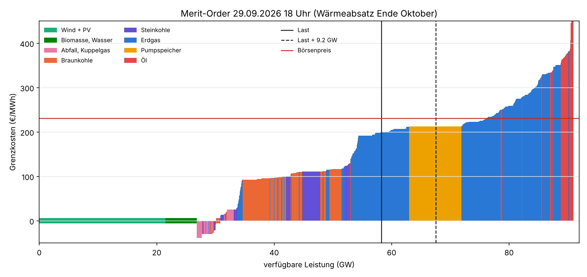
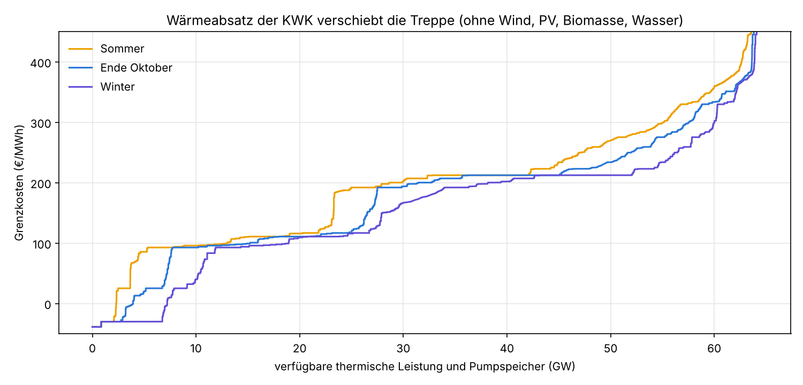
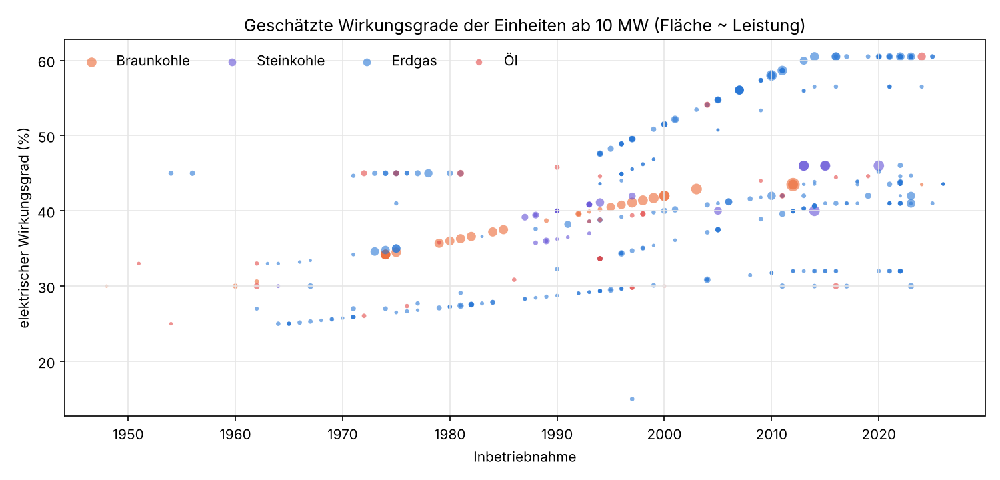
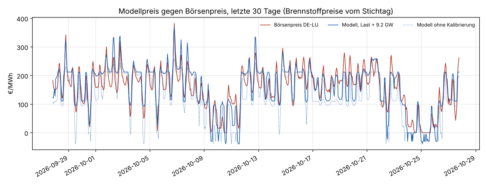

# Merit-Order Deutschland aus dem Marktstammdatenregister

Einmalige Auswertung vom 27.10.2026. Frage: Wie sieht die Angebotskurve der Day-Ahead-Auktion
DE-LU heute aus, wenn man sie nur aus freien Daten nachbaut? Die echten aggregierten
Gebotskurven verkauft die EPEX über die EEX. Sie kosten ab etwa 68 €/Monat, gibt es nur für
EPEX-Mitglieder und dürfen nicht weitergegeben werden. Für dieses Projekt fallen sie deshalb weg.
Nachgebaut wird die Treppe hier aus den Einheiten im MaStR, geschätzten Wirkungsgraden, den
Brennstoff- und CO2-Preisen vom Stichtag und einer Wärmegutschrift für KWK-Anlagen.

## Ergebnis in Kürze

**Die nachgebaute Treppe trifft die Form des Börsenpreises gut, das Niveau erst nach einer
Korrektur.** Für die letzten 30 Tage (28.09.–27.10.2026, 720 Stunden) liefert sie zu den
Brennstoffpreisen vom Stichtag:

| Variante | MAE €/MWh | Bias €/MWh | RMSE €/MWh | Korrelation |
|---|---|---|---|---|
| ohne Korrektur | 41,8 | −34,9 | 52,4 | 0,86 |
| Last + 9,25 GW | **28,3** | 3,4 | 34,4 | **0,91** |

Ohne Korrektur ist das Modell im Mittel um 35 €/MWh zu billig. Es fehlt Nachfrage nach
steuerbarer Leistung. Schlägt man pauschal 9,25 GW auf die Last auf, sinkt der mittlere Fehler
auf 28 €/MWh. Die Zahl ist eine Anpassung auf dieselben 30 Tage, die sie bewertet. Die 9 GW
stehen für den Stromexport in teurere Nachbarländer, für Regelleistung, die nicht am Spotmarkt
angeboten wird, für Kraftwerke, die länger als angenommen in Revision sind, und für
Industriekraftwerke, die nur den eigenen Bedarf decken.

**Zwischen Kohle und Gas klafft eine Lücke von rund 80 €/MWh.** Erdgas kostet mit 97 €/MWh
(TTF plus Transport) fast fünfmal so viel je Wärmeeinheit wie Importkohle (20 €/MWh). Der
CO2-Preis von 86 €/t holt davon nur einen Teil auf. Sobald Gas den Preis setzt, springt er
deshalb von gut 110 auf knapp 200 €/MWh. Im Börsenpreis der 30 Tage sieht man das als zwei
Niveaus: Stunden mit viel Wind liegen um 100–150, die übrigen um 190–230 €/MWh.

| Beispielanlage | η el. | Brennstoff €/MWh | CO2 €/MWh | Grenzkosten €/MWh |
|---|---|---|---|---|
| Braunkohle, BoA-Block 2012 | 0,435 | 9 | 79 | **93** |
| Braunkohle, 500-MW-Block 1975 | 0,345 | 12 | 100 | **116** |
| Steinkohle 2015 | 0,46 | 44 | 63 | **111** |
| Steinkohle 1985 | 0,386 | 52 | 75 | **131** |
| GuD 2016 | 0,605 | 161 | 29 | **192** |
| GuD 2000 | 0,515 | 189 | 34 | **225** |
| offene Gasturbine 2010 | 0,393 | 247 | 44 | **296** |
| Öl-Gasturbine 1975 | 0,27 | 464 | 85 | **554** |

Grenzkosten = (Brennstoff + Emissionsfaktor × CO2-Preis) / η + variable Betriebskosten (3 bis
5 €/MWh).

**KWK verschiebt die Treppe im Winter um mehrere Gigawatt nach links.** 71 000 der 79 000
Einheiten sind im MaStR mit einer KWK-Anlage verknüpft, die meisten davon kleine BHKW. Kann
ihre Wärme abgesetzt werden, ersetzt sie einen Gaskessel und ist derzeit 124 €/MWh wert. Im
Sommer bieten 5 GW unter 90 €/MWh, also unter der günstigsten Braunkohle, Ende Oktober 8 GW
und im Winter 12 GW. Der Gasteil der Treppe liegt im Winter um 20 bis 60 €/MWh tiefer als im
Sommer.

**Folgerung für das Prognosemodell:** Als zusätzliches Merkmal für `ml_train` taugt die Treppe
erst, wenn die fehlenden 9 GW erklärt sind und sie sich auch über längere Zeit mit wechselnden
Brennstoffpreisen bewährt. Lohnen würde sich dafür vor allem der Export. Freie Tagesreihen für
TTF, EUA und API2 gibt es nicht. Für die Historie bleibt deshalb nur der implizite
Brennstoffpreis aus SMARD, wie in [preisniveau-schaetzung](../preisniveau-schaetzung/README.md).

## Grafiken



Eine typische Abendstunde: Die durchgezogene Linie ist die gemessene Last, die gestrichelte
die Last mit der Korrektur. Links Wind, PV, Biomasse und Wasser mit ihrer gemessenen
Einspeisung (Grenzkosten nahe null, hier als schmales Band), dann Müll und Kuppelgase, KWK mit
Wärmegutschrift, Braunkohle, Steinkohle, Gas, Pumpspeicher und Öl.







Das Modell bildet die Tagesgänge ab. Die Abendspitzen trifft es schlechter: Anfahrkosten,
Mindestlasten und Blockgebote fehlen. Die Plateaus bei 212 €/MWh kommen vom Pumpspeicher, der
im Modell als ein Block zu Opportunitätskosten bietet. Für die Tage Anfang Oktober überschätzt
das Modell die Gaskosten, denn der TTF lag damals noch bei 72 bis 85 €/MWh.

## Modell

1. **Kraftwerkspark:** alle Einheiten aus `EinheitenVerbrennung` mit Status „In Betrieb".
   Herausgerechnet sind Notstromaggregate (3,8 GW), Netzreserve (9,9 GW), Kapazitätsreserve
   (1,0 GW) und vorübergehend stillgelegte Einheiten (1,8 GW). Im Markt bleiben 79 004
   Einheiten: Erdgas 32,9 GW, Braunkohle 14,8 GW, Steinkohle 7,6 GW, Müll und Kuppelgase
   4,1 GW, Öl 3,4 GW. Dazu kommen 9,9 GW Pumpspeicher (`EinheitenStromSpeicher`). Kernkraft
   ist seit April 2023 vom Netz. Für die Verfügbarkeit gilt pauschal 88 % der
   Nettonennleistung, für den Pumpspeicher 90 %.
2. **Wirkungsgrad:** Das MaStR hat keine Wirkungsgrade, wohl aber Technologie, Energieträger,
   Leistung und Inbetriebnahme. Geschätzt wird der Nettowirkungsgrad im Kondensationsbetrieb.
   Er steigt innerhalb einer Technologieklasse linear mit dem Baujahr und ist durch den heute
   erreichbaren Bestwert gedeckelt. Nachrüstungen kennt das MaStR nicht.

   | Technologie (MaStR) | Schätzung η el. | Bestwert |
   |---|---|---|
   | Braunkohle | 0,30 + 0,0030 · (Jahr − 1960) | 0,435 |
   | Steinkohle, Kondensation | 0,33 + 0,0028 · (Jahr − 1965) | 0,46 |
   | GuD (GT mit nachgeschalteter Dampfturbine, GT mit Abhitzekessel ab 50 MW) | 0,45 + 0,0065 · (Jahr − 1990), −0,04 unter 50 MW | 0,605 |
   | offene Gasturbine | 0,27 + 0,0035 · (Jahr − 1975) | 0,41 |
   | Verbrennungsmotor | 0,40 + 0,035 · log₁₀(P in MW) | 0,48 |
   | Gas/Öl-Dampfturbine, Kondensation / Gegendruck | 0,33 + 0,0020 · (J − 1965) / 0,25 + 0,0015 · (J − 1965) | 0,42 / 0,32 |
   | Müll / Kuppelgase | 0,24 / 0,36 pauschal | |

3. **Brennstoffe frei Kraftwerk** (€/MWh Heizwert):

   | Brennstoff | €/MWh | Grundlage |
   |---|---|---|
   | Erdgas, Großkraftwerk | 97,1 | TTF 94,6 + 2,5 Transport |
   | Erdgas, unter 8 MW | 108,6 | TTF + 14 Netzentgelte und Umlagen |
   | Importsteinkohle | 20,1 | API2 137 USD/t, 6000 kcal/kg, + 2,5 Transport |
   | Braunkohle | 4,0 | variable Tagebaukosten (Annahme) |
   | leichtes Heizöl | 125,3 | NY Harbor ULSD 5,265 USD/gal |
   | schweres Heizöl | 52,4 | Brent 116,8 USD/bbl × 0,85 |
   | Müll | −10 | Entsorgungserlös, läuft ohnehin |
   | Kuppelgase | 8 | Hochofen-, Koksofen-, Raffineriegas |

   CO2: EU-ETS 86 €/t. Gas- und Ölanlagen unter 8 MW elektrisch (etwa 20 MW Feuerungsleistung) zahlen
   stattdessen den nationalen CO2-Preis nach BEHG (60 €/t). Emissionsfaktoren in t CO2/MWh: Erdgas 0,201,
   Steinkohle 0,335, Braunkohle 0,400, leichtes Heizöl 0,266, schweres Heizöl 0,280.
4. **KWK:** Die Wärmeleistung der KWK-Anlage (`AnlagenKwk.ThermischeNutzleistung`) wird nach
   elektrischer Leistung auf die verknüpften Einheiten verteilt, daraus ergibt sich das
   Wärme-Strom-Verhältnis r. Jede abgesetzte MWh Wärme ist so viel wert wie der eingesparte
   Brennstoff eines Gaskessels (η 0,92) samt CO2, also (97,1 + 0,201 · 86) / 0,92 = 124 €/MWh.
   - **Feste Kopplung** (Gegendruckturbine, BHKW-Motor, Gasturbine mit Abhitzekessel unter
     50 MW): Grenzkosten = (1 + r) / η_gesamt · Brennstoff − r · Wärmewert · Absatzanteil.
     Ohne Wärmeabsatz (Sommer) höchstens Kondensationskosten (Notkühler).
   - **Entnahme-Kondensation** (Großkraftwerke, GuD mit Fernwärme): Nur ein wärmegebundener
     Block, höchstens die halbe Leistung, wird günstiger, weil die Entnahme bloß 0,15 MWh Strom
     je MWh Wärme kostet. Der Rest bietet zu Kondensationskosten.
   - **Absatzanteil:** Sommer 25 %, Ende Oktober 60 %, Winter 100 % der Wärmeleistung.
   - **Untergrenze** −30 €/MWh, weil Wärmespeicher, Elektrokessel und Spitzenkessel tiefere
     Gebote unwirtschaftlich machen.
   - Den KWKG-Zuschlag rechnet das Modell nicht ein. Er gilt nur für eine begrenzte Zahl von
     Vollbenutzungsstunden und entfällt bei negativen Preisen. Er verschiebt eher, wann eine
     Anlage läuft, als ihr Gebot dauerhaft zu senken.
5. **Pumpspeicher** bieten zu Opportunitätskosten. Angesetzt ist das 80-%-Quantil der Preise
   der 30 Tage (212 €/MWh).
6. **Preis je Stunde:** Bedarf = Last − (Wind + PV) − (Biomasse + Wasser), gemessen. Der Preis
   ist die Grenzkosten der Einheit, bei der die kumulierte verfügbare Leistung den Bedarf
   erreicht. Die Korrektur verschiebt den Bedarf um einen festen Betrag. Gesucht wurde in
   Schritten von 250 MW zwischen −5 und +25 GW nach dem kleinsten MAE
   ([tabellen/kalibrierung.csv](tabellen/kalibrierung.csv)).

Nicht im Modell: Austausch mit den Nachbarländern, Anfahrkosten, Mindestlasten, Blockgebote,
Netzengpässe, Must-run der Systemdienstleistungen und Brennstoffpreise, die sich in den 30 Tagen
ändern.

## Daten

- [Marktstammdatenregister](https://www.marktstammdatenregister.de/MaStR/Datendownload),
  Gesamtdatenexport vom 20.10.2026 (Release 26.2), Datenlizenz Deutschland – Namensnennung –
  2.0: Tabellen `EinheitenVerbrennung`, `AnlagenKwk`, `EinheitenStromSpeicher`,
  `EinheitenKernkraft`. Der Stack lädt den Export quartalsweise in den Bronze-Bucket
  (`mastr-snapshot`). `mastr_export.py` zieht daraus die CSVs.
- Datenbank des Stacks (`db_export.sh`): Stundenmittel aus `energy.value_best` für
  Day-Ahead-Preis, Last und Erzeugung (SMARD und Energy-Charts, CC BY 4.0), die installierte
  EE-Leistung aus `assets.capacity_daily`, EZB-Kurs USD/EUR (1,115 am 26.10.2026), EIA ULSD
  NY Harbor (gemeinfrei), Weltbank Pink Sheet (Brent August 2026, CC BY 4.0).
- Von Hand übernommen, weil es keine freie Tagesreihe gibt (einmalig für diese Analyse):
  - EUA Dez-26: 86 €/t, Settlement 23.10.2026 laut purelyenergy.co.uk. Zur Einordnung meldete
    IndexBox für den 12.10.2026 88,3 €/t (ICE).
  - TTF Frontmonat: 94,6 €/MWh am 27.10.2026 laut oilpriceapi.com
  - API2 Kohle: 137 USD/t am 18.09.2026 laut cnyes.com (neuester gefundener Wert)
  - BEHG-Preis 2026: Preiskorridor 55–65 €/t, angesetzt 60 €/t

## Nachrechnen

Im Stack-Verzeichnis die Rohdaten ziehen (rund 3 GB Download aus dem eigenen Bucket, wenige
Minuten):

```bash
docker compose exec -T mastr-snapshot python - /tmp/meritorder < docs/analysen/merit-order/mastr_export.py
docker compose cp mastr-snapshot:/tmp/meritorder ./meritorder-daten
docs/analysen/merit-order/db_export.sh ./meritorder-daten
```

Dann auswerten (Tabellen und Grafiken landen in diesem Ordner, `--html` schreibt zusätzlich
eine interaktive Seite mit Stundenregler und Jahreszeit-Umschalter aus
`interaktiv.template.html`):

```bash
uv run --no-project --with pandas --with numpy --with matplotlib \
    python docs/analysen/merit-order/auswertung.py --daten ./meritorder-daten --html merit-order.html
```

Die Annahmen zu Brennstoff- und CO2-Preisen stehen oben in `auswertung.py`. Für einen anderen
Stichtag müssen sie von Hand nachgezogen werden.
