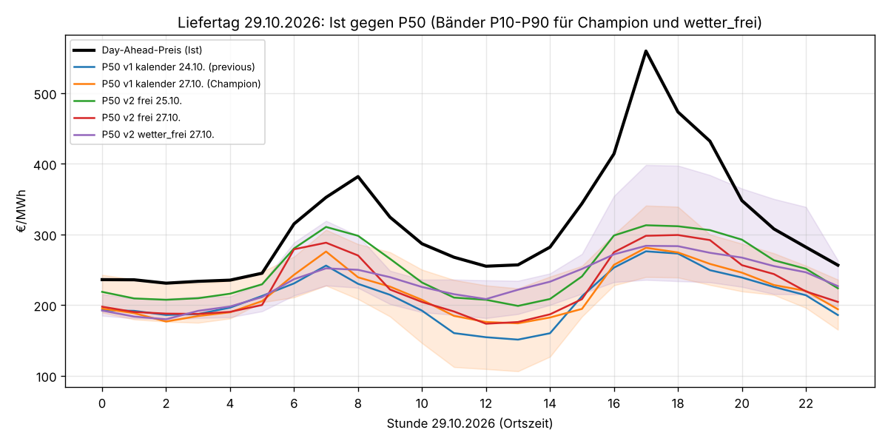
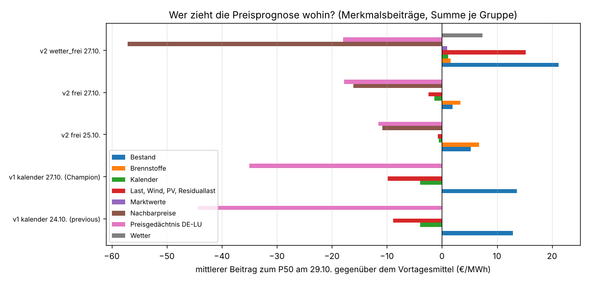
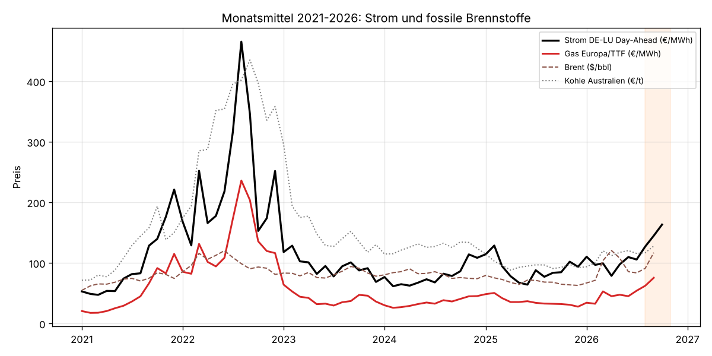
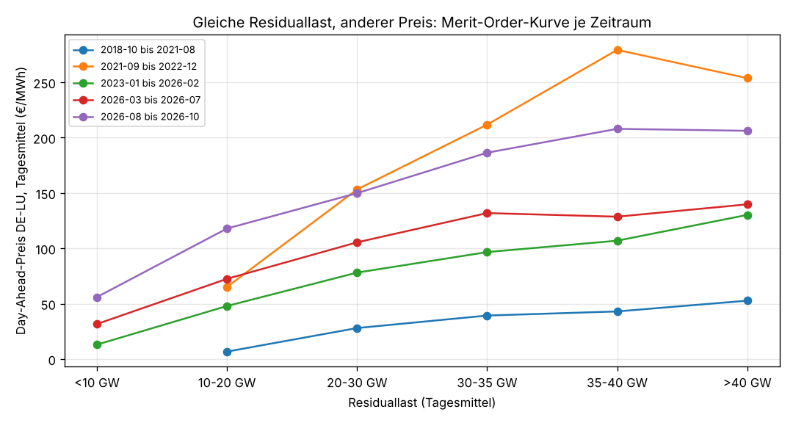

# Preisprognose für den 29.10.2026: Warum alle Modelle zu niedrig lagen

Einmalige Auswertung vom 28.10.2026, Auftrag in [job.yaml](job.yaml). Anlass: Der Day-Ahead-Preis
DE-LU für Donnerstag, 29.10.2026, lag weit über allen Prognosen. Frage des Nutzers: Liegt es an
den stark gestiegenen Preisen für fossile Energieträger? Und mit welchen Daten wurden die Modelle
trainiert?

## Ergebnis in Kürze

**Alle fünf aktiven Versionen lagen in jeder Stunde zu niedrig.** Der Day-Ahead-Preis lag im
Tagesmittel bei **314,8 €/MWh**, mit 382 €/MWh um 8 Uhr und **560 €/MWh um 17 Uhr**. Die
P50-Prognosen (Ausgabe 28.10. 08 UTC, vor der Auktion) lagen im Mittel zwischen 210 und
250 €/MWh. Der Fehler (MAE) betrug 65 bis 105 €/MWh, und er ist gleich dem mittleren Fehler,
weil keine Version in irgendeiner Stunde zu hoch lag. Das P10–P90-Band traf nur 1 bis 9 der 24
Stunden.

**Die Vermutung stimmt für das Preisniveau.** Gas, Öl und Kohle sind seit dem Frühjahr 2026
stark gestiegen. Gas Europa (Weltbank, TTF) lag im September 2026 bei **75 €/MWh**, im September
2025 bei 32 €/MWh. Brent stieg im selben Zeitraum von 68 auf 117 $/bbl, Kohle (Australien) von
106 auf 147 $/t, Heizöl in Deutschland (netto) von 0,57 auf 1,15 €/l. Bei gleicher Residuallast
ist Strom deshalb heute fast doppelt so teuer wie in den Jahren 2023 bis Anfang 2026. Der
Nachtpreis am 29.10. von 231 bis 245 €/MWh passt zu Gaskraftwerken mit Grenzkosten bei diesem
Gaspreis.

**Den Sprung vom 28. auf den 29.10. erklären die fossilen Preise aber nicht allein.** Das
Tagesmittel stieg von 249 auf 315 €/MWh. Zugleich stiegen fast alle Nachbarzonen kräftig, vor
allem die windabhängigen im Norden und Osten (DK1 +89, CZ +51, PL +46, AT +39 €/MWh). Das deutet
auf anhaltende Windflaute in Nord- und Mitteleuropa hin: Wind an Land und auf See zusammen lieferte
am 24.10. noch 47 GW, am 28.10. nur noch 13 GW. Tägliche Gas- und CO2-Preise, mit denen sich ein
Brennstoffsprung in den letzten Tagen prüfen ließe, haben wir nicht (siehe unten).

**Warum die Modelle das nicht abbilden**, in der Reihenfolge der Wirkung:

1. **Rückfallerwartung.** Alle Preismodelle rechnen relativ zum Mittel des letzten bekannten
   Liefertags (hier 28.10., 249 €/MWh). Der lag doppelt so hoch wie das 7-Tage-Mittel
   (121 €/MWh). Nach solchen Ausreißertagen fiel der Preis in der Vergangenheit meist wieder (in
   19 von 24 Fällen seit 2018, Median −24 €/MWh; [tabellen/rueckfall_faelle.csv](tabellen/rueckfall_faelle.csv)). Diese Regel haben die Modelle gelernt; sie zieht
   den P50 am 29.10. um 11 bis 44 €/MWh nach unten. Der 29.10. ist eine der seltenen Ausnahmen,
   wie die Dunkelflaute am 11./12.12.2024 (266 → 395 €/MWh).
2. **Brennstoffpreise wirken kaum.** v1 (Champion) hat gar keine Brennstoffmerkmale. Die
   v2-Modelle haben sie, aber nur als Monats- bzw. Wochenwerte mit bis zu fünf Wochen Verzug
   (Gas, Brent, Kohle: Stand September). Sie tragen am 29.10. nur **+2 bis +7 €/MWh** bei. Im
   Training war das Preisniveau über das Preisgedächtnis (Vortag, Vorwoche) schneller und genauer
   zu haben, also haben die Bäume die Brennstoffe kaum genutzt. CO2-Preise und tägliche Gaspreise
   fehlen ganz.
3. **Windprognose ohne Wetter zu hoch.** v1 und v2 `frei` sagten für den 29.10. 18 bis 21 GW Wind
   voraus, v2 `wetter_frei` mit GFS nur 8 GW. Nur `wetter_frei` sah damit eine hohe Residuallast
   (44 statt 31 bis 34 GW) und hob den Preis dafür um 15 €/MWh. Dafür drückten bei ihm die
   Nachbarpreise des Vortags den P50 um 57 €/MWh, allein das Tschechien-Mittel um 42 €/MWh.
4. **Spitze um 17 Uhr.** 560 €/MWh ist eine Knappheitsspitze am Abend bei Flaute. Solche
   Spitzen liegen weit über allen Quantilen, weil die Bänder ohnehin zu schmal sind (im Backtest
   decken P10–P90 nur 57 bis 67 % statt 80 % ab).

Am Vortag (Liefertag 28.10.) lagen die Modelle dagegen gut: 229 bis 245 €/MWh gegen 249 €/MWh
Ist, obwohl auch dort der Preis gegenüber dem Vortag um 94 €/MWh stieg.

## Prognose und Ist je Stunde

Ausgabezeitpunkt 28.10.2026 08 UTC (10 Uhr Ortszeit, vor Gebotsschluss), P50 in €/MWh. Ist
vorläufig aus Energy-Charts (SMARD veröffentlicht den Preis später). Alle Zeilen in
[tabellen/stunden_29_10.csv](tabellen/stunden_29_10.csv).

| Stunde | Ist | v1 kalender (Champion) | v2 frei 25.10. | v2 frei 27.10. | v2 wetter_frei |
|---|---|---|---|---|---|
| 00 | 236 | 195 | 219 | 198 | 192 |
| 04 | 235 | 190 | 216 | 190 | 198 |
| 08 | 382 | 239 | 298 | 270 | 250 |
| 12 | 255 | 176 | 208 | 174 | 209 |
| 14 | 282 | 182 | 209 | 187 | 233 |
| 17 | **560** | 281 | 313 | 298 | 284 |
| 19 | 432 | 258 | 306 | 292 | 274 |
| 22 | 282 | 220 | 251 | 219 | 246 |

| Version | P50 Mittel | MAE | größter Fehler | Stunden im Band P10–P90 |
|---|---|---|---|---|
| v1 kalender 24.10. (previous) | 210 | 104,6 | 284 (17 Uhr) | 3 von 24 |
| v1 kalender 27.10. (Champion) | 217 | 98,1 | 279 (17 Uhr) | 4 von 24 |
| v2 frei 25.10. | 250 | 64,7 | 247 (17 Uhr) | 9 von 24 |
| v2 frei 27.10. | 227 | 88,1 | 262 (17 Uhr) | 1 von 24 |
| v2 wetter_frei 27.10. | 233 | 81,5 | 276 (17 Uhr) | 4 von 24 |

Dass die ältere v2-Version vom 25.10. hier am besten abschneidet, ist Zufall der Merkmalsauswahl:
Beide v2-`frei`-Versionen haben dieselben Daten und Merkmale bis auf die Ortszeit-Lags der Last
(PR #106).

## Was den P50 bewegt hat

Für jede Version wurde der P50 des Preismodells am 29.10. mit LightGBM `pred_contrib` (SHAP) in
Beiträge je Merkmal zerlegt ([merkmalsbeitraege.py](merkmalsbeitraege.py)). Der P50 ist
**Zentrum + Beiträge**; das Zentrum ist bei allen Versionen das Mittel des 28.10. (249,2 €/MWh).
Summen je Merkmalsgruppe, Mittel über die 24 Stunden (nur die 30 stärksten Merkmale je Version,
der Rest ist klein):

| Version | Preisgedächtnis DE-LU | Nachbarpreise | Last/Wind/PV/Residuallast | Brennstoffe | Bestand | Wetter |
|---|---|---|---|---|---|---|
| v1 kalender (Champion) | −35,0 | – | −9,8 | – | +13,6 | – |
| v2 frei 25.10. | −11,5 | −10,8 | −0,7 | **+6,7** | +5,2 | – |
| v2 frei 27.10. | −17,7 | −16,1 | −2,4 | **+3,4** | +1,9 | – |
| v2 wetter_frei | −18,0 | −57,1 | +15,2 | **+1,6** | +21,2 | +7,3 |

Werte der Brennstoffmerkmale zum Ausgabezeitpunkt in
[daten/merkmalswerte_ausgabe.csv](daten/merkmalswerte_ausgabe.csv): Gas Europa 25,42 $/MMBtu
(September, +4,31 gegenüber dem Wert vier Wochen zuvor), Brent 116,8 $/bbl (+25,9), Kohle
Australien 147,1 $/t (+11,9), ULSD New York 5,27 $/gal (20.10., +0,36), Heizöl DE 1,20 €/l
(19.10.). Die Modelle kennen den Anstieg also, nutzen ihn aber kaum.

## Fossile Brennstoffe und Strompreis

| Monat | Strom DE-LU (€/MWh) | Gas Europa (€/MWh) | Brent ($/bbl) | Kohle AU ($/t) | Heizöl DE netto (€/l) | Residuallast (GW) |
|---|---|---|---|---|---|---|
| Mittel 2025 | 90 | 36 | 69 | 108 | 0,60 | 29,7 |
| 09/2025 | 84 | 32 | 68 | 106 | 0,57 | 24,9 |
| 03/2026 | 99 | 53 | 104 | 139 | 0,75 | 29,4 |
| 06/2026 | 110 | 45 | 85 | 139 | 0,75 | 23,2 |
| 08/2026 | 127 | 62 | 91 | 135 | 0,89 | 20,3 |
| 09/2026 | 145 | 75 | 117 | 147 | 1,15 | 23,2 |
| 10/2026 (bis 29.) | 163 | – | – | – | 1,18 | 25,6 |

Gas umgerechnet aus $/MMBtu mit dem EZB-Monatsmittel EUR/USD. Vollständig in
[tabellen/brennstoffe_monat.csv](tabellen/brennstoffe_monat.csv).

Der Strompreis ist mitgestiegen, obwohl die Residuallast eher niedriger war. Deutlicher wird es,
wenn man Tage gleicher Residuallast vergleicht:

| Residuallast (Tagesmittel) | 2023-01 bis 2026-02 | 2026-03 bis 07 | 2026-08 bis 10 | 2021-09 bis 2022-12 (Gaskrise) |
|---|---|---|---|---|
| 10–20 GW | 48 | 72 | 118 | 65 |
| 20–30 GW | 78 | 105 | 150 | 153 |
| 30–35 GW | 97 | 132 | 186 | 212 |
| 35–40 GW | 107 | 129 | 208 | 279 |

Seit August 2026 kostet derselbe Residuallasttag 50 bis 100 €/MWh mehr als 2023 bis Anfang 2026.
Das ist der Brennstoffeffekt, und er liegt zwischen dem Normalzustand und der Gaskrise 2022. Am
29.10. kam eine hohe Residuallast (Flaute) auf dieses Niveau.

**Was die Daten nicht zeigen können:** Die Datenbank hat keine täglichen Gaspreise (TTF, THE-VTP:
nicht frei, auf der VM nicht geladen) und keine CO2-Preise (EUA: EEX, nicht frei). Ob Gas oder
CO2 in den letzten Tagen vor dem 29.10. noch einmal gesprungen sind, lässt sich deshalb nicht
prüfen. Die jüngsten Ölwerte (ULSD 20.10., Heizöl 19.10.) zeigen keinen neuen Sprung.

## Mit welchen Daten die Modelle trainiert wurden

Aus den Manifesten der Registry ([daten/modelle.csv](daten/modelle.csv), Merkmalslisten in
[daten/merkmale_preismodell.csv](daten/merkmale_preismodell.csv)). Alle Versionen wurden mit
Ausgabetagen bis Mitte Oktober 2026 trainiert, also mit 8 Tagen Abstand zum Snapshot.

| Version | Rolle | Ausgabetage | Merkmalsgruppen | Merkmale Preis | Brennstoffe | Backtest Preis MAE / P10–P90 |
|---|---|---|---|---|---|---|
| de_lu_v1-kalender-202610242054-9a18ba | previous | 2018-10-08 bis 2026-10-15 | calendar, lags, capacity, stage1 | 56 | nein | – |
| de_lu_v1-kalender-202610270115-7e355b | Champion | 2018-10-08 bis 2026-10-16 | calendar, lags, capacity, stage1 | 56 | nein | 31,3 / 67 % |
| de_lu_v2-frei-202610251049-7e1594 | Challenger | 2018-10-08 bis 2026-10-16 | + nachbarn, lastprognose, brennstoffe, marktwerte | 137 | ja | – |
| de_lu_v2-frei-202610270147-6b979e | Challenger | 2018-10-08 bis 2026-10-16 | + nachbarn, lastprognose, brennstoffe, marktwerte | 137 | ja | 30,5 / 63 % |
| de_lu_v2-wetter_frei-202610271848-df539f | Challenger | 2021-03-23 bis 2026-10-16 | + weather (GFS) | 169 | ja | 27,6 / 57 % |

Die Gruppe `brennstoffe` (nur in v2) umfasst EUR/USD (EZB, täglich), ULSD New York und US-Golf
(EIA, wöchentlich veröffentlicht), Diesel und Heizöl DE netto (EU Oil Bulletin, wöchentlich) sowie
die Monatswerte der Weltbank für Gas Europa, LNG Japan, Henry Hub, Kohle Australien und Südafrika
und Brent. Jeweils als zuletzt veröffentlichter Wert und Änderung über 28 Tage. Nicht enthalten:
CO2 (EUA), tägliche Gaspreise (TTF/THE), STEO-Ausblick (Varianten `steo`/`frei_steo` gibt es,
aber kein aktives Modell).

Wie oft die Modelle im Training ein Gaspreisniveau wie heute gesehen haben
([tabellen/trainingsabdeckung_gas.csv](tabellen/trainingsabdeckung_gas.csv), Monatswert zum
jeweiligen Veröffentlichungsstand):

| Gas Europa (€/MWh) | Trainingstage v1/v2 frei | Anteil | Strompreis im Mittel |
|---|---|---|---|
| unter 30 | 1187 | 41 % | 47 |
| 30–50 | 1035 | 35 % | 91 |
| 50–70 | 212 | 7 % | 117 |
| ab 70 | 466 | 16 % | 221 |

Die Tage ab 70 €/MWh stammen fast alle aus der Gaskrise 2021/22 mit damals viel höheren
Strompreisen. Der Septemberwert 2026 (75 €/MWh) war erst ab 08.10. veröffentlicht, also nur für
die letzten 8 Trainingstage bekannt.

## Eingänge und Datenlage

- **Preisgedächtnis:** Mittel 28.10. 249,2 €/MWh, 7-Tage-Mittel 121,5 €/MWh (darin der
  windreiche 24./25.10. mit 30 und 13 €/MWh).
- **Lastprognose der ÜNB** (`fc_load_da_forecast`, nur v2): zum Ausgabezeitpunkt 08 UTC noch
  nicht veröffentlicht (erscheint um 10 Uhr Ortszeit), also leer. So vorgesehen.
- **Wind-/PV-Prognose der ÜNB** für den 29.10. war zum Analysezeitpunkt noch nicht in der
  Datenbank (SMARD liefert sie gegen 18 Uhr am Vortag). Sie ist kein Modelleingang, nur
  Vergleichsmaßstab.
- **Last:** Die Modelle erwarten im Mittel 58 GW, die ÜNB 55,7 GW. Kein wesentlicher Beitrag.
- **ml-predict:** Für den Ausgabezeitpunkt 28.10. 08 UTC liegen von allen fünf Versionen
  Prognosen vor (teils per `--fill-new` nachgerechnet, mit dem Veröffentlichungsstand von 08 UTC).

## Vorschläge (nicht umgesetzt)

1. **Brennstoffniveau aus dem Strommarkt selbst schätzen.** Ein tägliches Merkmal „Preis bei
   hoher Residuallast“ der letzten 7 bis 14 Tage (z. B. Steigung und Achsenabschnitt der
   Preis-Residuallast-Beziehung oder Preis der teuersten Nachtstunden) bildet Gas- und
   CO2-Kosten zeitnah ab, ganz ohne unfreie Quellen. Das ist der schon früher vorgeschlagene
   „implizite Grenzkostenindex“.
2. **Preis relativ zu diesem Niveau statt zum Vortag zentrieren** oder das Zentrum aus Vortag und
   Niveau mischen. Dann kippt die Rückfallerwartung bei hoher Residuallast nicht mehr ins
   Gegenteil.
3. **Wetter für die Erzeugung.** `wetter_frei` traf den Wind deutlich besser. Ein Champion mit
   Wetter würde die Residuallast an Flautetagen richtig einschätzen.
4. **Quantile kalibrieren** (z. B. konforme Korrektur über die letzten Wochen), damit Spitzen wie
   17 Uhr wenigstens im P90-Bereich liegen.
5. **Freie CO2-Quelle suchen.** Ohne CO2 fehlt ein Drittel der Grenzkosten eines Gaskraftwerks.
6. **Die Nachbarpreise prüfen.** Der stark negative Beitrag des Tschechien-Mittels in
   `wetter_frei` (−42 €/MWh bei einem CZ-Preis über dem deutschen) sieht nach Überanpassung aus.

## Dateien

- [abfragen.sql](abfragen.sql): Abfragen gegen die Datenbank (nur lesend), Ergebnis in `daten/`.
- [merkmalsbeitraege.py](merkmalsbeitraege.py): Merkmale und SHAP-Beiträge der aktiven Versionen
  im ml-train-Image auf der VM.
- [auswertung.py](auswertung.py): erzeugt `tabellen/` und `grafiken/` aus `daten/`.
- `daten/`: Rohdaten, u. a. Brennstoffpreise monatlich ab 2018
  ([brennstoffe_monatlich.csv](daten/brennstoffe_monatlich.csv)), täglich/wöchentlich ab 2025
  ([brennstoffe_taeglich_woechentlich.csv](daten/brennstoffe_taeglich_woechentlich.csv)),
  Tageswerte Strom ab 10/2018 ([tageswerte.csv](daten/tageswerte.csv)).

Quellen und Lizenzen: Day-Ahead-Preise Energy-Charts (CC BY 4.0) bzw. SMARD (CC BY 4.0,
Bundesnetzagentur | SMARD.de); Last, Erzeugung, Residuallast, ÜNB-Prognosen SMARD; Gas, Öl, Kohle
Weltbank Pink Sheet (CC BY 4.0); ULSD U.S. EIA (gemeinfrei); Diesel/Heizöl EU Weekly Oil Bulletin
(CC BY 4.0); EUR/USD Europäische Zentralbank; Gasspeicher GIE AGSI+.
