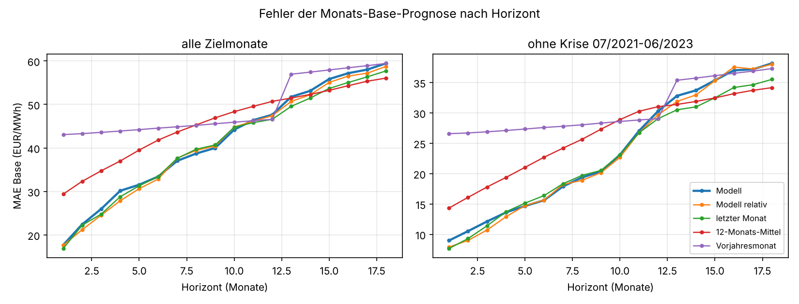
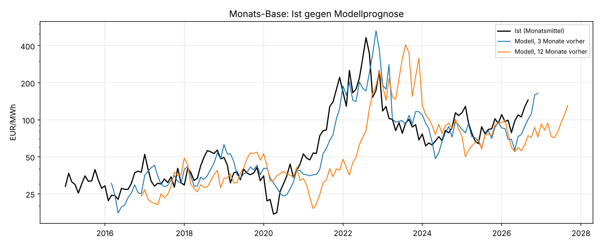

# Preisniveau aus freien Daten: Backtest 2016–2026

Einmalige Auswertung vom 25.10.2026, Auftrag in [job.yaml](job.yaml). Frage: Wie gut sagt ein Modell, das nur freie Daten nutzt,
das Monatsmittel des Day-Ahead-Preises (Base) und die Marktwerte Solar und Wind an Land für die
nächsten 18 Monate voraus? Hintergrund: Für Terminpreise gibt es keine freie Quelle. Der
Terminpreis ist ohnehin nur ein mäßiger Schätzer des späteren Spotpreises
([terminpreis-treffsicherheit](../terminpreis-treffsicherheit/README.md)). Die Messlatte sind
daher einfache Spot-Mittel.

## Ergebnis in Kürze

**Bester Schätzer: der letzte Monat, korrigiert um die Brennstoffprognose der EIA.** Die
"STEO-Regression" schreibt das Monatsmittel des letzten Monats fort. Sie verschiebt es um die
Änderung, die der damals aktuelle Short-Term Energy Outlook der EIA für Henry Hub und Brent
erwartete. Bei 7–18 Monaten Vorlauf sinkt der Fehler damit um 4–7 % gegenüber dem bloßen
Fortschreiben. Bei 1–6 Monaten ist der Vorteil klein (1–6 %). MAE in EUR/MWh, 130 Stichtage
(Januar 2016 bis Oktober 2026):

| Horizont (Monate) | STEO-Regression | Modell | Modell relativ | letzter Monat | 12-Monats-Mittel | Vorjahresmonat |
|---|---|---|---|---|---|---|
| 1–3 | **21,1** | 22,0 | 21,1 | 21,3 | 32,1 | 43,3 |
| 4–6 | 30,7 | 31,7 | **30,4** | 31,2 | 39,4 | 44,2 |
| 7–12 | **40,6** | 42,3 | 42,6 | 42,5 | 47,4 | 45,7 |
| 13–18 | **51,6** | 55,9 | 55,0 | 53,9 | 53,8 | 58,2 |

Ohne die Krise (Zielmonate 07/2021–06/2023):

| Horizont (Monate) | STEO-Regression | Modell | Modell relativ | letzter Monat | 12-Monats-Mittel | Vorjahresmonat |
|---|---|---|---|---|---|---|
| 1–3 | **9,1** | 10,5 | 9,2 | 9,5 | 16,1 | 26,7 |
| 4–6 | **14,2** | 14,6 | 14,4 | 15,1 | 21,0 | 27,4 |
| 7–12 | **21,9** | 22,9 | 22,7 | 22,8 | 27,9 | 28,4 |
| 13–18 | **30,9** | 35,7 | 35,5 | 33,0 | 32,8 | 36,3 |

**Das physikalische Modell allein bringt nichts.** Grenzkosten, Merit-Order und Residuallast
("Modell") liegen gleichauf mit dem Fortschreiben des letzten Monats. Saison, Residuallast und
Ausbau verschieben das Monatsmittel kaum messbar. Entscheidend ist der Brennstoffpreis.

**Die STEO-Prognose trägt Information über die Richtung.** Die erwartete Änderung des
Henry-Hub-Preises korreliert mit der späteren Änderung des deutschen Strompreises (0,2–0,6
je nach Horizont), obwohl Henry Hub ein US-Gaspreis ist. Gasspeicher (Eurostat) und der
Gaspreistrend der Weltbank verbessern nichts. Mit ihnen ("Regression alle Merkmale") wird die
Prognose sogar schlechter.

**Bei den Marktwerten hilft das Modell wenig.** Solar: Bei 7–18 Monaten liegt das Modell
1–2 EUR/MWh vor dem naiven Schätzer (Wertfaktor des Vorjahresmonats mal Base des letzten
Monats). Wind an Land: kein Vorteil. Die Tabellen dazu stehen in [tabellen/](tabellen/).

**Folgerung:**

- Als Niveau-Merkmal für `ml_train` taugen der gleitende Spotpreis der letzten 30 Tage und die
  erwartete Brent- und Henry-Hub-Änderung aus dem aktuellen STEO. Der STEO ist gemeinfrei und
  erscheint monatlich als xlsx mit fester URL. Er ist deshalb als Quelle `eia_steo` in
  `energy_ingest` eingebunden, die Änderung für 1–3 Monate als Merkmalsgruppe `steo` in
  `config/ml/de_lu_v2.yaml` (Varianten `steo` und `frei_steo`).
- Ein eigener Dienst für das physikalische Modell lohnt sich in dieser Form nicht.
- Mehr als einige Prozent sind ohne Terminmarkt nicht zu erwarten. Den größten Teil des
  Fehlers machen Brüche wie 2021/2022, die niemand vorhergesehen hat.

## Grafiken





Die Prognose des physikalischen Modells mit 12 Monaten Vorlauf läuft dem Ist um ein Jahr
hinterher, genau wie ein fortgeschriebener Stand. 2022 hat sie den Anstieg verpasst, 2023 den
Rückgang.

## Modell

An jedem Monatsersten t, nur mit Daten vor t:

1. **Brennstoffniveau C:** Median des Preises in den Stunden der letzten 30 Tage, deren
   Residuallast im oberen Viertel der letzten 365 Tage liegt. In diesen Stunden setzen Gas oder
   Steinkohle den Preis. C enthält Brennstoff- und CO2-Kosten zusammen, ohne TTF- oder
   EUA-Daten.
2. **Merit-Order-Form g:** In den 365 Tagen vor t wird der Preis jeder Stunde durch das C der
   30 Tage davor geteilt. Davon wird der Median je Residuallast-Klasse (2 GW) gebildet.
3. **Erwartete Residuallast:** Für jeden Zielmonat dieselben Kalendermonate der bis zu drei
   Vorjahre. Wind und Solar werden mit der installierten Leistung skaliert (Stand vor t, linear
   aus den letzten 12 Monaten fortgeschrieben). Die Last bleibt unverändert.
4. **Preis** je simulierter Stunde = C × g(Residuallast). Base ist das Mittel. Der Marktwert
   ist das mit der simulierten Erzeugung gewichtete Mittel. Am Ende wird über die Vorjahre
   gemittelt.

**Modell relativ:** Monatsmittel des letzten Monats × Modell(Zielmonat) / Modell(letzter
Monat). Ein falsch geschätztes C kürzt sich so heraus. Übrig bleibt nur, was das Modell über
Saison und Ausbau sagt.

**STEO-Regression:** Prognose = Monatsmittel des letzten Monats × exp(b1 · ΔHenry Hub + b2 ·
ΔBrent). Δ ist die log-Änderung zwischen letztem Monat und Zielmonat in der STEO-Ausgabe, die
im letzten Monat erschienen ist. b1 und b2 werden je Horizont per Ridge-Regression (λ = 1)
geschätzt, ohne Achsenabschnitt. Trainiert wird nur auf Zielmonaten vor dem Stichtag, mit
mindestens 24 Beispielen. Wo das fehlt (Anfang 2016–2018) oder der STEO den Zielmonat nicht
mehr abdeckt (er reicht bis Ende Y+1), bleibt es beim letzten Monat.

**Regression alle Merkmale:** wie oben, zusätzlich mit der Saison aus "Modell relativ", der
Abweichung des EU-Gasspeichers vom Mittel der fünf Vorjahre (Eurostat, drei Monate Verzug)
und dem Dreimonatstrend des europäischen Gaspreises (Weltbank, ein Monat Verzug).

**Naive Schätzer:** Monatsmittel des letzten vollständigen Monats, Mittel der letzten 12
Monate und derselbe Kalendermonat im letzten verfügbaren Jahr. Für die Marktwerte:
Wertfaktor (Marktwert / Base) des Vorjahresmonats × Base des letzten Monats.

## Daten

- [Energy-Charts-API](https://api.energy-charts.info/) (Fraunhofer ISE), CC BY 4.0:
  `/price` (Day-Ahead DE-AT-LU bis 30.09.2018, danach DE-LU; Bundesnetzagentur | SMARD.de),
  `/public_power` (Last, Wind an Land, Wind auf See, Solar; Viertelstunden zu Stundenmitteln)
  und `/installed_power` (installierte Leistung je Monat)
- [EIA Short-Term Energy Outlook](https://www.eia.gov/outlooks/steo/), alle 142 Ausgaben
  Januar 2015 bis Oktober 2026 aus dem Archiv
  (`https://www.eia.gov/outlooks/steo/archives/<mmmYY>_base.xlsx`), Tabelle 2, Reihen
  `NGHHUUS` (Henry Hub) und `BREPUUS` (Brent). Die Prognosen sind Werk der EIA und gemeinfrei.
  Die historischen Brent- und Henry-Hub-Werte darin stammen von Thomson Reuters. Verwendet
  wird nur die prognostizierte Änderung.
- [Eurostat `nrg_stk_gasm`](https://ec.europa.eu/eurostat/databrowser/view/nrg_stk_gasm/default/table),
  Gasspeicher-Endbestand EU27, CC BY 4.0
- [Weltbank Pink Sheet](https://www.worldbank.org/en/research/commodity-markets),
  "Natural gas, Europe", CC BY 4.0

Aufruf aus dem Repository-Wurzelverzeichnis. Der erste Lauf lädt etwa 12 Jahre Stundendaten und
142 STEO-Ausgaben und dauert einige Minuten:

```
uv run --no-project --with pandas --with matplotlib --with httpx --with openpyxl \
    python docs/analysen/preisniveau-schaetzung/auswertung.py --cache /tmp/pn
```

Ergebnisse: [tabellen/prognosen.csv](tabellen/prognosen.csv) (jede Prognose mit Merkmalen, Ist
und naiven Werten), [tabellen/kennzahlen_base.csv](tabellen/kennzahlen_base.csv),
[tabellen/kennzahlen_mw_solar.csv](tabellen/kennzahlen_mw_solar.csv),
[tabellen/kennzahlen_mw_wind_onshore.csv](tabellen/kennzahlen_mw_wind_onshore.csv),
[tabellen/ist_monate.csv](tabellen/ist_monate.csv).

## Einschränkungen

- Die STEO-Regression ist nicht unabhängig gewählt. Ein erster Ansatz mit Achsenabschnitt hat
  den Preisanstieg 2016–2021 als Trend gelernt und war schlechter als naiv. Erst ohne
  Achsenabschnitt war er besser. Getestet wurden außerdem Varianten mit nur Henry Hub, mit
  stärkerer Regularisierung und mit 36-Monats-Fenster; sie liegen dazwischen. Der Vorteil von
  4–7 % ist deshalb eher eine Obergrenze.
- Die Prognosen überlappen sich: Zielmonate aus benachbarten Stichtagen sind nicht unabhängig.
  Unterschiede von wenigen Prozent liegen nahe an dem, was der Zufall erklären kann.
- Die installierte Leistung ist der heutige Datenstand. Nachmeldungen im MaStR sind darin schon
  enthalten, im Backtest wäre sie also etwas zu gut bekannt.
- Die Marktwerte sind mit der Ist-Erzeugung von Energy-Charts auf Stundenbasis gerechnet, nicht
  mit der Hochrechnung der ÜNB (siehe [marktwert-schaetzung](../marktwert-schaetzung/README.md)).
- Die Parameter des physikalischen Modells (30 Tage, oberes Viertel, 2-GW-Klassen, 3 Vorjahre)
  wurden nicht optimiert.
