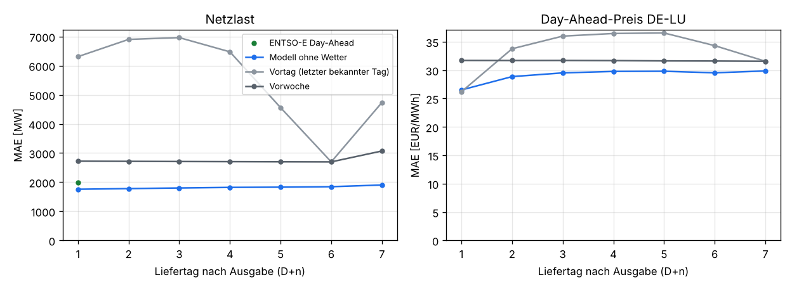
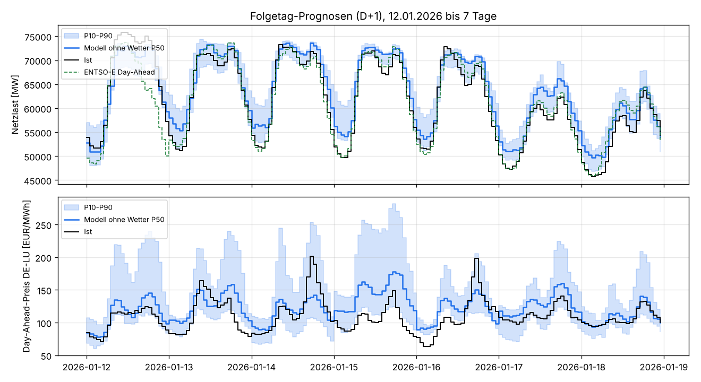

# Erstes Prognosemodell: Last DE und Day-Ahead-Preis DE-LU

Backtest vom 22.10.2026, Auftrag in [job.yaml](job.yaml), Modell und Code in
[`services/ml_train`](../../../services/ml_train/README.md), Konfiguration
[`config/ml/de_lu_v1.yaml`](../../../config/ml/de_lu_v1.yaml). Frage: Wie gut sagt ein
zweistufiges LightGBM-Quantilmodell Netzlast und Day-Ahead-Preis für D+1 bis D+7 vorher,
verglichen mit der ENTSO-E-Lastprognose und einfachen Verfahren? Was bringen die GFS-Features?

## Ergebnis in Kürze

**Die Last schlägt ohne Wetter schon die ENTSO-E-Day-Ahead-Prognose.** Über 2024 bis Oktober
2026 liegt der mittlere absolute Fehler (MAE) für den Folgetag bei 1,73 GW gegenüber 1,98 GW
bei ENTSO-E (gleiche Stunden, −13 %), RMSE 2,23 gegen 2,56 GW. Bis D+7 steigt der Fehler nur
auf 1,90 GW, weil das Modell ohne Wetter vor allem Kalender und Saison lernt. Die Vorwoche
liegt bei 2,7 GW, der letzte bekannte Tag bei 5–7 GW (anderer Wochentag).

**Beim Preis ist das Modell ab D+2 klar besser als die einfachen Verfahren, für D+1 gleichauf.**
MAE D+1 26,5 €/MWh (Vortagespreis 26,2), RMSE 36,3 gegen 38,7. Für D+2 bis D+7 29–30 €/MWh
gegen 31,6–36,6. Die Rangfolge der Stunden eines Tags (wichtig für Lastverschiebung) trifft
das Modell besser: Rangkorrelation 0,875 gegen 0,79 (Vortag) bzw. 0,82 (Vorwoche).

**Ohne Wetter sind Wind und PV nur Klimatologie** (Wind an Land MAE 7,4 GW gegen 1,2 GW bei
den ÜNB-Prognosen). Damit fehlt der Preisstufe die wichtigste Größe, die Residuallast. Genau
hier sollen die GFS-Features wirken. Die Wetterhistorie reicht dafür aber noch nicht: Features
gibt es bisher erst ab 05.08.2026, der Backfill ab März 2021 läuft noch (etwa drei Wochen).

**Erste Vorschau mit Wetter (nur acht Ausgabetage, Training mit 19 Tagen):** Wind an Land
3,6 statt 5,5 GW, PV 1,8 statt 2,5 GW, Preis D+1/D+2 30,9 statt 41,9 €/MWh. Die Last wird mit
so wenig Training schlechter (2,1 statt 1,7 GW). Das ist ein Hinweis, kein Ergebnis.

**Champion ist damit vorerst die Variante `kalender`.** Die Variante `wetter` wird nach dem
Backfill mit demselben Backtest neu bewertet und läuft bis dahin höchstens als Challenger.

| D+1, gleiche Stunden 2024–10/2026 | MAE | RMSE | Bias | P10–P90 enthält Ist |
|---|---|---|---|---|
| Last: Modell ohne Wetter | 1 726 MW | 2 228 MW | −43 MW | 65 % |
| Last: ENTSO-E Day-Ahead | 1 985 MW | 2 563 MW | +119 MW | – |
| Last: Vorwoche | 2 720 MW | 4 090 MW | −39 MW | – |
| Preis: Modell ohne Wetter | 26,3 €/MWh | 36,0 €/MWh | −9,4 €/MWh | 62 % |
| Preis: Vortag (letzter bekannter Tag) | 26,1 €/MWh | 38,6 €/MWh | −0,1 €/MWh | – |
| Preis: Vorwoche | 31,7 €/MWh | 47,3 €/MWh | −1,1 €/MWh | – |





Weitere Grafiken: [Sommerwoche](grafiken/haupt_beispiel_sommer.png),
[Wind und PV je Vorlauf](grafiken/haupt_erzeugung_mae_vorlauf.png),
[Wetter-Vorschau](grafiken/wetter_mae_vorlauf.png),
[Wetter-Beispiel September](grafiken/wetter_beispiel_september.png).

## Schwächen, die der Backtest zeigt

- **Die Quantile sind zu schmal.** Das Band P10–P90 enthält 62–65 % der Ist-Werte statt 80 %.
  Nächster Schritt: Kalibrierung der Quantile auf dem jeweils letzten Trainingsjahr
  (konformale Korrektur je Vorlauf), bevor die Bänder im Dashboard erscheinen.
- **Preis mit Bias −9 €/MWh,** vor allem 2024 (−17 €/MWh) und im Frühling (−16 €/MWh). Ohne Gas- und CO₂-Preise
  kennt das Modell das Preisniveau nur aus den Lags.
- **PV im Mittel +1 GW zu hoch:** Der MaStR-Bestand wächst schneller als die gemessene
  Einspeisung (Eigenverbrauch, Abregelung). Ein Trend im Kapazitätsfaktor fehlt noch.
- **2026 ist die Last schlechter** (MAE 2,3 GW). Ein Teil kommt aus der Datenlücke (unten).

## Datenlücke in der Datenbank

In `energy.value` fehlen für **alle Reihen und alle Quellen die Stunden vom 18.09.2026 00 UTC
bis 16.10.2026 23 UTC** (696 Stunden). Ausgaben in dieser Zeit haben keine Lags, und es gibt
keine Ist-Werte zum Prüfen. Der Backtest lässt diese Stunden aus, die Wetter-Vorschau endet
deshalb mit der Ausgabe am 17.09.2026. Nachladen mit
`energy-ingest backfill 2026-09-17 2026-10-18 --force` auf der VM.

## Daten und Methode

| | |
|---|---|
| Snapshot | `566fdb79d88a4b8d`, exportiert am 22.10.2026 mit `ml-train snapshot` (Energie ab 2015, Wetter ab 01.08.2026, Clusterung v2026Q4) |
| Ziele | `load_actual`, `da_price_de_lu`; Hilfsziele `gen_wind_onshore`, `gen_wind_offshore`, `gen_solar` (Stundenmittel aus `energy.value_best`) |
| Ausgabe | täglich 08 UTC, Liefertage D+1 bis D+7 in Ortszeit |
| Training | Expanding Window ab 08.10.2018 (Gebotszone DE-LU), jeder zweite Ausgabetag, bis 8 Tage vor dem Testzeitraum |
| Test (haupt) | sechs Halbjahre 01.01.2024 bis 21.10.2026, 166 000 Stunden je Ziel |
| Test (wetter) | Ausgaben 10.–17.09.2026, Training Variante `wetter` nur mit Ausgaben ab 06.08.2026, jeder Tag |
| Modell | LightGBM, Quantile 0,1/0,5/0,9, 400 Bäume; Stufe 1 Last/Wind/PV, Stufe 2 Preis mit Stufe-1-P50 und Residuallast (im Training out-of-fold) |
| Vergleich | ENTSO-E- bzw. ÜNB-Day-Ahead-Prognosen (nur D+1), Vortag, Vorwoche |
| Kennzahlen | MAE, RMSE, Bias, Pinball-Loss (P10/P50/P90), Anteil Ist im Band P10–P90, Rangkorrelation der Stunden je Liefertag |

Leakage-Schutz: Ist-Werte zählen ab Intervallende + 2 h als bekannt, Preise eines Liefertags ab
13 Uhr am Vortag, Wetter aus dem 00Z-Lauf (verarbeitet nach etwa 6 h). Die ENTSO-E-Prognose
erscheint gegen 10 Uhr Ortszeit, also etwa zur selben Zeit wie die eigene Ausgabe.

Zwei Entscheidungen kommen aus einem ersten Lauf: Für Wind und PV lernt das Modell den
Kapazitätsfaktor, und die installierte Leistung ist dort kein Merkmal mehr. Sie wirkte wie ein
Zeitindex, und im ersten Lauf lag Wind an Land 2024 um 6 GW zu hoch. Der Preis wird relativ zum
Mittel des letzten bekannten Liefertags gelernt (im Halbjahr 07–12/2025 MAE D+1 21,4 statt
22,3 €/MWh mit dem 7-Tage-Mittel; Training ab 2023 statt 2018 war schlechter, 24,9 €/MWh).

## Unsicherheit und Einschränkungen

- Die Wetter-Vorschau beruht auf acht Ausgabetagen im September und einem Training über
  19 Tage. Sie zeigt die Richtung, belastbar wird der Vergleich erst nach dem Backfill.
- Der Bestand je Cluster ist aus dem MaStR-Snapshot von 10/2026 zurückgerechnet. Nachgemeldete
  Anlagen sind damit auch in früheren Tagen enthalten (leichter Vorgriff, betrifft nur die
  Normierung von Wind und PV).
- Die Benchmarks sind die zuletzt veröffentlichten ÜNB-Stände (`energy.value` überschreibt
  Prognosen); Revisionen nach 10 Uhr würden sie leicht begünstigen.

## Dateien

- `tabellen/haupt_*.csv`, `tabellen/wetter_*.csv`: Kennzahlen gesamt, je Vorlauf, Jahreszeit,
  Jahr, Folgetag auf gemeinsamen Stunden, Rangkorrelation Preis.
- `tabellen/lauf_*.json`: Snapshot-ID, Konfig-Hash, Faltungen, Laufzeiten, Git-Commit.
- `grafiken/`: erzeugt mit [`auswertung.py`](auswertung.py) aus den Backtest-Prognosen
  (`predictions.parquet`, nicht im Repo).

Neu erzeugen:

```bash
uv run ml-train snapshot --out .ml-data/snap --weather-from 2026-08-01
uv run ml-train backtest --snapshot .ml-data/snap --out .ml-data/bt-main --variant kalender
uv run ml-train backtest --snapshot .ml-data/snap --out .ml-data/bt-wx --variant kalender \
    --variant wetter --test-from 2026-09-10 --fold-months 1 --stride 1
uv run --with matplotlib python docs/analysen/prognose-de-lu-v1/auswertung.py .ml-data/bt-main .ml-data/bt-wx
```
