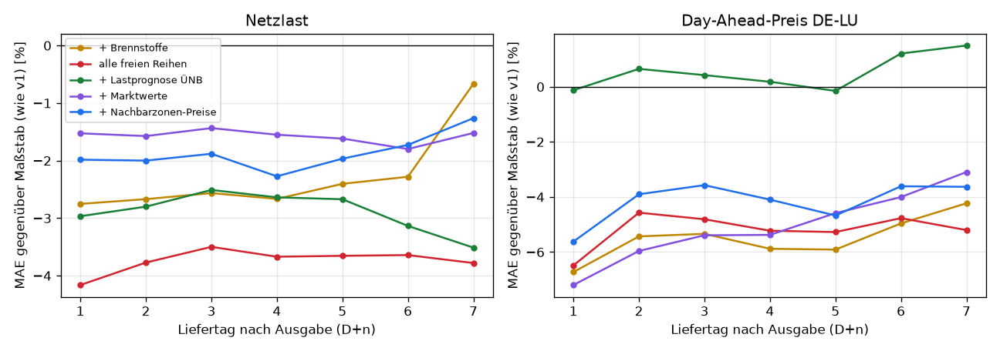
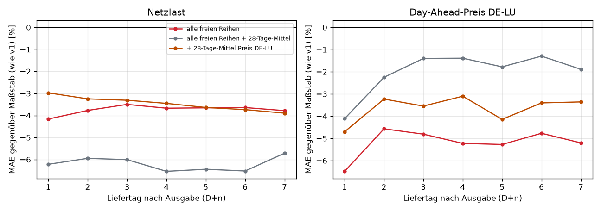

# Prognosemodell v2: Was bringen die neuen freien Daten?

Backtest vom 24.10.2026, Auftrag in [job.yaml](job.yaml), Auswertung in
[auswertung.py](auswertung.py), Konfiguration
[`config/ml/de_lu_v2.yaml`](../../../config/ml/de_lu_v2.yaml). Frage: Wie viel verbessern die neu
eingebundenen freien Reihen die Prognose von Netzlast und Day-Ahead-Preis für D+1 bis D+7
gegenüber dem bisherigen Modell `de_lu_v1/kalender`? Geprüft werden die Day-Ahead-Preise der
14 Nachbarzonen, die Day-Ahead-Lastprognose der ÜNB, Brennstoffpreise mit Wechselkurs und die
selbst berechneten Marktwerte. Alle Reihen stammen aus freien Quellen, keine aus
`PDB_ALLOW_*`-Quellen. Das so trainierte Modell darf deshalb frei veröffentlicht werden.

## Ergebnis in Kürze

**Mit allen freien Reihen (`frei`) sinkt der Fehler beim Preis um 5 % und bei der Last um 4 %.**
Gemessen wurde über 2025 bis Oktober 2026 auf denselben 110 000 Stunden je Ziel. Beim Preis
sinkt der MAE von 31,0 auf 29,4 €/MWh, bei der Last von 1,89 auf 1,82 GW. Der Pinball-Loss über
P10/P50/P90 sinkt um je 3 %. Für den Folgetag schlägt das Modell damit erstmals den
Vortagespreis: 26,4 €/MWh gegenüber 28,7 €/MWh (v1: 28,3). Bei der Last liegt es mit 1,76 GW
11 % unter der ÜNB-Prognose (1,98 GW).

**Der Großteil des Preisgewinns kommt aus einem längeren Preisgedächtnis, nicht aus den neuen
Daten selbst.** v1 kennt den Preis nur über den letzten Tag und die letzten sieben Tage.
Brennstoffe, Marktwerte und Nachbarpreise bringen jeweils für sich 4–5 %, aber kaum mehr als alle
zusammen. Das deutet auf eine gemeinsame Ursache: Jede Gruppe liefert ein Preisniveau über
Wochen. Die Gegenprobe bestätigt das. Schon ein 28-Tage-Mittel des eigenen Preises DE-LU,
also ganz ohne neue Quelle, bringt 3,6 %, und zwar in 2025 und 2026 gleichmäßig. Der Zusatznutzen
der freien Reihen darüber hinaus liegt bei etwa 1,5 Prozentpunkten. Er hält 2026 nicht:
`frei` gewinnt 2025 8,1 %, 2026 nur 2,1 %.

**Die Lastprognose der ÜNB als Merkmal bringt wenig.** Sie gilt für D+1 erst ab 10 Uhr am Vortag
als bekannt. Bei Ausgabe um 08 UTC ist das nur im Sommer der Fall (dann 10 Uhr Ortszeit). Bei
Ausgabe um 09 UTC ist sie immer bekannt, verbessert D+1 aber nur um 1,8 %. Das Modell ist ohnehin
schon 7,5 % besser als die ÜNB-Prognose, ein schwächerer Eingang hilft da kaum.

**Bestes Modell für die Last ist `frei_niveau`** (alle freien Reihen und das 28-Tage-Mittel): −6,2 %
MAE, für jeden Vorlauf, in beiden Jahren und in allen Jahreszeiten. Beim Preis verliert diese
Kombination aber wieder (−2,0 %, 2026 sogar +4,5 %). Die Gruppen überlagern sich, und mehr
Merkmale machen das Modell nicht automatisch besser.

**Empfehlung:** `de_lu_v2/frei` als Challenger neben dem Champion `de_lu_v1/kalender`
registrieren. Die Champion/Challenger-Regel entscheidet dann im laufenden Betrieb. Für die Last
fehlt v1 ein Lastniveau über Wochen. Die Gewinne durch Preisniveau und Brennstoffe (2026 bis
−10 %) zeigen das. Der nächste Schritt dafür ist ein 28-Tage-Mittel der Last, kein weiteres
Preissignal.

| Lauf `haupt` und `niveau`, 01.2025–10.2026, gleiche Stunden | Preis MAE | Δ | Last MAE | Δ | Pinball Preis / Last |
|---|---|---|---|---|---|
| `kalender` (Maßstab, wie v1) | 31,0 €/MWh | – | 1 893 MW | – | – |
| + Nachbarzonen-Preise | 29,7 €/MWh | −4,1 % | 1 858 MW | −1,9 % | −3,2 % / −1,4 % |
| + Lastprognose ÜNB | 31,2 €/MWh | +0,5 % | 1 838 MW | −2,9 % | +0,8 % / −0,5 % |
| + Brennstoffe | 29,3 €/MWh | −5,5 % | 1 850 MW | −2,3 % | −2,6 % / −2,4 % |
| + Marktwerte | 29,4 €/MWh | −5,1 % | 1 863 MW | −1,6 % | −2,3 % / −1,3 % |
| **`frei`** (alle vier) | **29,4 €/MWh** | **−5,2 %** | 1 822 MW | −3,7 % | −3,2 % / −3,0 % |
| Gegenprobe: + 28-Tage-Mittel Preis DE-LU | 29,9 €/MWh | −3,6 % | 1 827 MW | −3,5 % | −2,0 % / −0,8 % |
| `frei_niveau` (alle vier + 28-Tage-Mittel) | 30,4 €/MWh | −2,0 % | **1 776 MW** | **−6,2 %** | −2,5 % / −4,4 % |

Weitere Grafiken: [Ausgabe 09 UTC](grafiken/09utc_mae_gewinn.png),
[Wind und PV](grafiken/haupt_erzeugung_mae_gewinn.png),
[Wetter-Kurztest](grafiken/wetter_mae_gewinn.png).

## Folgetag (D+1) mit Vergleichsverfahren

| D+1, gleiche Stunden 2025–10/2026 | Preis MAE | Preis RMSE | Last MAE | Last RMSE |
|---|---|---|---|---|
| `de_lu_v2/frei` | 26,4 €/MWh | 38,0 €/MWh | 1 757 MW | 2 248 MW |
| `de_lu_v2/frei_niveau` | 27,1 €/MWh | 38,5 €/MWh | 1 719 MW | 2 202 MW |
| `kalender` (wie v1) | 28,3 €/MWh | 40,3 €/MWh | 1 833 MW | 2 356 MW |
| Vortag (letzter bekannter Tag) | 28,7 €/MWh | 45,0 €/MWh | – | – |
| Vorwoche | 36,1 €/MWh | 54,8 €/MWh | 2 696 MW | 4 000 MW |
| ÜNB Day-Ahead (Last) | – | – | 1 981 MW | 2 552 MW |

Die Rangfolge der Stunden eines Liefertags (wichtig für Lastverschiebung und Speicher) wird etwas
besser: Rangkorrelation des Preises 0,868 mit `frei` gegenüber 0,854 mit `kalender`, für alle
Vorläufe ähnlich ([Tabelle](tabellen/haupt_preis_rangkorrelation.csv)).

## Wie belastbar sind die Unterschiede?

- **Wiederholbar, aber nicht frei von Zufall.** Zwei Läufe derselben Variante liefern dieselben
  Zahlen (fester Seed, `kalender` und `frei` in `haupt` und `niveau` identisch). Jede neue Spalte
  ändert aber die zufällige Merkmalsauswahl je Baum. Wie groß dieser Effekt ist, zeigt
  `lastprognose`: Das Merkmal ist für D+2 bis D+7 immer leer, trotzdem verschiebt sich der
  Lastfehler dort um 2,5–3,5 % (bei 09 UTC um 0 %). **Unterschiede unter etwa 3 % sind daher kein
  Befund.** Das gilt für alle Last-Gewinne einzelner Gruppen und für `lastprognose` beim Preis.
- **Belastbar** sind die Preisgewinne von Brennstoffen und Marktwerten. Sie gelten für jeden
  Vorlauf, in beiden Jahren (−5,8 / −5,2 % bzw. −5,9 / −4,2 %) und am stärksten im Winter (−10 %).
  Ebenso belastbar ist der Lastgewinn von `frei_niveau`.
- **Herbst bleibt schwierig:** Beim Preis ist im Herbst keine Variante mehr als 1 % besser,
  `frei` ist 3,9 % und `frei_niveau` 6,2 % schlechter ([Jahreszeiten](tabellen/haupt_jahreszeit.csv)).
  Die Gewinne entstehen im Winter, Frühling und Sommer.
- **Wind und PV ohne Wetter** sind Klimatologie (Wind an Land MAE 7 GW). Verschiebungen um 2–5 %
  durch Preis- oder Brennstoffreihen sind dort Zufall, kein Zusammenhang.
- **Die Quantilbänder bleiben zu schmal:** P10–P90 enthält je nach Variante 66–75 % statt 80 % der
  Ist-Werte. Mit `frei` wird das Band beim Preis noch etwas schmaler (68,5 % statt 72,6 %).

## Ausgabe um 09 statt 08 UTC

Eine Stunde später auszugeben macht schon `kalender` beim Preis 2,8 % besser (eine Stunde mehr
Ist-Werte). `frei` erreicht dann 28,7 €/MWh (D+1: 25,5) und bei der Last 1,81 GW (D+1: 1,73).
Bis zum Gebotsschluss (12 Uhr Ortszeit) bleibt dann im Sommer aber nur eine Stunde. Ob sich das
lohnt, hängt davon ab, ob die Prognose vor der Auktion genutzt wird. Die Ausgabe bleibt
vorerst bei 08 UTC.

## Wetter: noch nicht bewertbar

In `feat.nwp_value` liegen Wetter-Features **erst ab dem 06.01.2026** (593 Läufe). Für 2021 bis
2025 gibt es keine einzige Zeile, obwohl der GFS-Backfill ab März 2021 läuft. Der Kurztest
(Test Juli bis Oktober 2026, Training nur Januar bis Juni 2026) ist deshalb nur ein Hinweis. Für
D+1 liegt `wetter` bei Wind an Land bei 2,4 GW MAE (ÜNB 1,2 GW, Vortag 8,3 GW) und beim Preis bei
27,9 €/MWh (Vortag 35,5). Die Last ist mit 2,5 GW schlechter als die ÜNB (1,6 GW) und sogar als
die Vorwoche (1,8 GW), weil das Training nur ein halbes Jahr umfasst. `wetter_frei` wird mit den
zusätzlichen Merkmalen beim Preis 13 % schlechter: Für rund 80 zusätzliche Merkmale reichen
sechs Monate nicht. **Für das Ziel ist das der größte offene Hebel:** Erst wenn die GFS-Historie ab 2021 als
Gold-Features vorliegt, lässt sich Wetter bewerten. Dann gehört auch Wind und PV in die
Preisstufe.

## Daten und Methode

| | |
|---|---|
| Snapshot | `cb9d83c5ca7e852a`, exportiert am 24.10.2026 mit `ml-train --config config/ml/de_lu_v2.yaml snapshot` (Energie ab 2015, 43 Reihen, Wetter ab 06.01.2026) |
| Datenstand | Lücke 18.09.–16.10.2026 geschlossen (PR #42): `load_actual` vom 10.09. bis 23.10. jeden Tag vollständig. Nachbarpreise ab 2018, Weltbank und Monatsmarktwerte bis 08/2026, Jahresmarktwerte bis 2024 |
| Ausgabe | täglich 08 UTC (Lauf `09utc`: 09 UTC), Liefertage D+1 bis D+7 in Ortszeit |
| Training | Expanding Window ab 08.10.2018, jeder zweite Ausgabetag, bis 8 Tage vor dem Testzeitraum |
| Test | vier Halbjahre 01.01.2025 bis 23.10.2026; Wetter-Kurztest vier Monate ab 01.07.2026 |
| Vergleich | je Lauf alle Varianten auf denselben Stunden (Ziel, Ausgabe, Stunde) |
| Rechner | Laptop mit 16 Kernen, `OMP_NUM_THREADS=8`; Laufzeit 73 min (`haupt`), 35 min (`09utc`), 15 min (`wetter`), 47 min (`niveau`). Ohne Thread-Grenze war ein Fold rund 25-mal langsamer |

### Neue Merkmalsgruppen und wann sie als bekannt gelten

| Gruppe | Reihen | Merkmale | bekannt ab |
|---|---|---|---|
| `nachbarn` | Day-Ahead-Preise AT, BE, CH, CZ, DK1, DK2, FR, HU, IT-Nord, NL, NO2, PL, SE4, SI (Energy-Charts, CC BY 4.0) | gleiche Stunde am letzten bekannten Tag, Tages- und 7-Tage-Mittel | wie der Preis DE-LU: Auktionsergebnis ab 13 Uhr am Vortag |
| `lastprognose` | Day-Ahead-Lastprognose der ÜNB (SMARD bzw. ENTSO-E 6.1.b, beide frei) | Wert der Zielstunde | ab 10 Uhr am Vortag des Liefertags, sonst leer (also nur D+1) |
| `brennstoffe` | USD/EUR (EZB), Diesel ULSD NY Harbor und Golfküste (EIA, Public Domain), Diesel und Heizöl netto DE (Oil Bulletin), Erdgas EU, LNG Japan, Henry Hub, Kohle Australien und Südafrika, Brent (Weltbank, Monatsmittel) | letzter veröffentlichter Wert und Änderung über 28 Tage | Zeitpunkt `published` der Reihe in der DB |
| `marktwerte` | Monats- und Jahresmarktwerte Base, Wind an Land, Wind auf See, Solar (`pdb_marktwert`, aus SMARD) | letzter veröffentlichter Wert und Änderung über 35 Tage | zwei Wochen nach Monats- bzw. Jahresende |
| `preisniveau` (Gegenprobe) | Preis DE-LU selbst | 28-Tage-Mittel bis zum letzten bekannten Liefertag | wie der Preis |

Nicht verwendet: Brent, WTI und Henry Hub als Tageswerte. Sie tragen bei der EIA den Vermerk
Thomson Reuters und sind deshalb nicht frei (`eia_reuters`). Brent und Henry Hub gehen nur als
Monatsmittel der Weltbank ein. Die Wind- und PV-Prognosen der ÜNB erscheinen erst um 18 Uhr am
Vortag und sind um 08 UTC nicht bekannt.

## Nächste Schritte

1. `de_lu_v2/frei` nach dem Merge auf der VM trainieren und als Challenger registrieren.
2. 28-Tage-Mittel der Last (und der Residuallast) als Lag ergänzen und gegen `frei` testen.
3. GFS-Historie ab 2021 in `feat.nwp_value` bringen, danach Wetter-Varianten mit vollem Backtest.
4. Quantile kalibrieren (Band P10–P90 bei 68–73 % statt 80 %).
