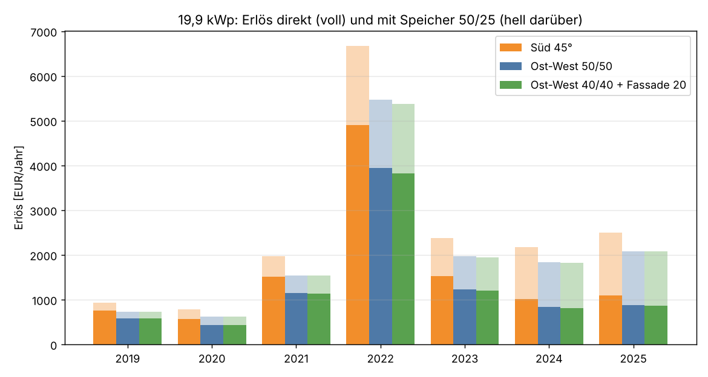
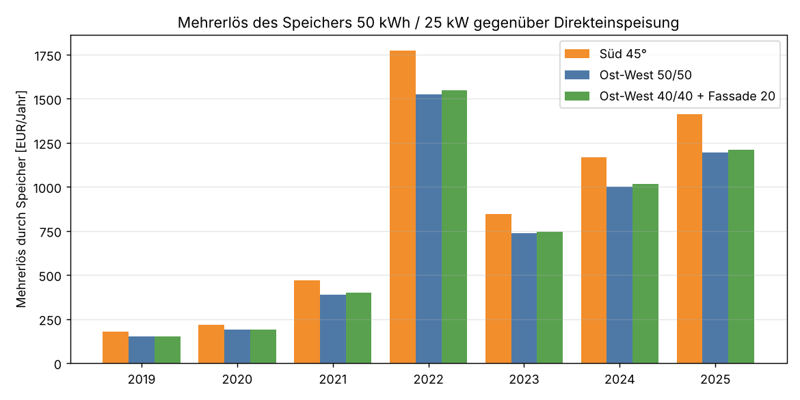
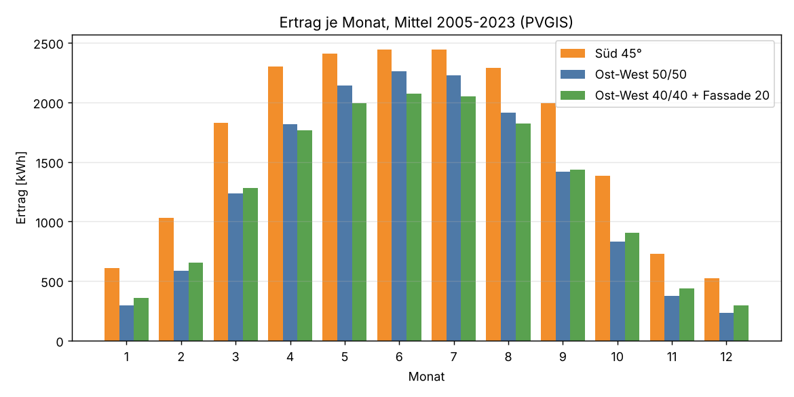
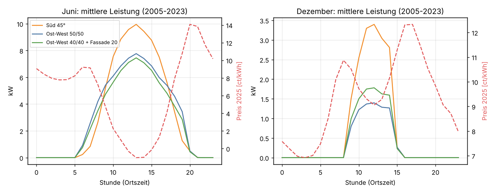
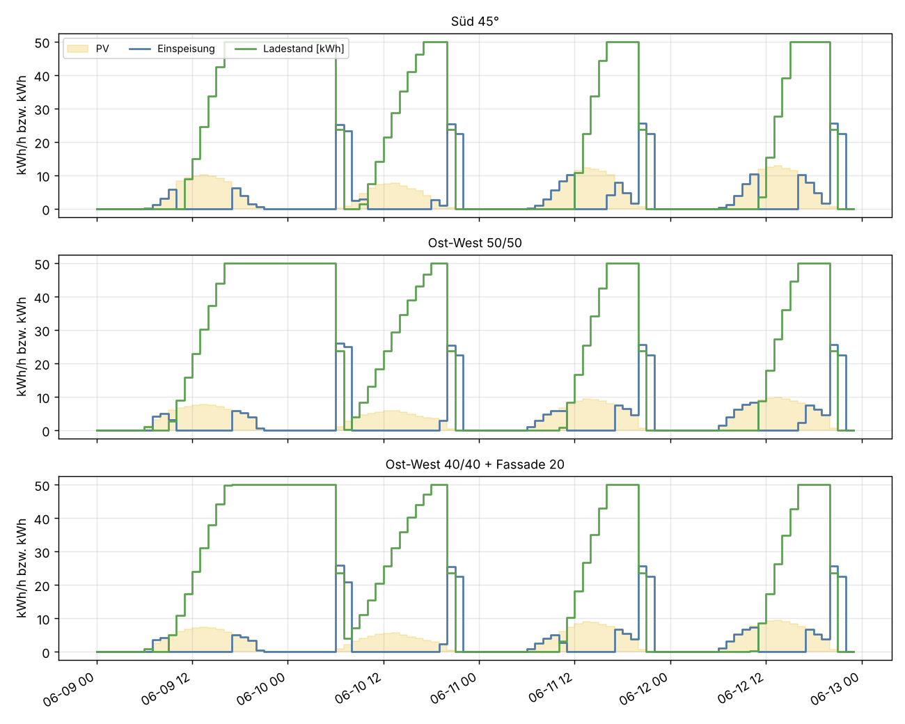

# PV-Ausrichtung mit Speicher: Süd, Ost-West oder Ost-West mit Fassade?

Einmalige Auswertung vom 22.10.2026, Auftrag in [job.yaml](job.yaml). Frage: Was erlöst eine Anlage mit 19,9 kWp und einem
Speicher von 50 kWh / 25 kW am Day-Ahead-Markt, je nachdem, wie die Module ausgerichtet sind?
Verglichen werden drei Belegungen derselben 19,9 kWp, alle Dachflächen 45° geneigt:

- **Süd:** 19,9 kWp nach Süden.
- **Ost-West 50/50:** je 9,95 kWp nach Osten und nach Westen.
- **Ost-West 40/40 + Fassade 20:** je 7,96 kWp nach Osten und Westen, 3,98 kWp an der
  Südfassade (90°).

Fahrplan, Speichermodell und Datenbasis sind dieselben wie in der Analyse
[PV-Speicher-Arbitrage](../pv-speicher-arbitrage/README.md): Der Speicher plant jeden Tag um
13 Uhr, wenn die Preise des Folgetags feststehen, bis Mitternacht des Folgetags.

## Ergebnis in Kürze

**Süd bringt am meisten, mit und ohne Speicher.** Bei 45° Neigung erntet eine Ost- oder
Westfläche gut ein Fünftel weniger als eine Südfläche. Der etwas bessere Marktwert des
Ost-West-Stroms gleicht das nicht aus: Je kWh erlöst Ost-West 2025 mit Speicher 13,0 ct, Süd
12,0 ct, aber Süd hat 30 % mehr kWh.

**2025, Standort Mitte (50,9° N, 10,0° O):**

| | Süd | Ost-West 50/50 | Ost-West 40/40 + Fassade 20 |
|---|---|---|---|
| Ertrag | 20 861 kWh | 16 020 kWh | 15 743 kWh |
| Marktwert des PV-Stroms | 4,9 ct/kWh | 5,2 ct/kWh | 5,2 ct/kWh |
| Erlös ohne Speicher | 1 087 € | 883 € | 867 € |
| Mehrerlös Speicher | **+1 412 €** | **+1 194 €** | **+1 211 €** |
| Erlös mit Speicher | 2 499 € | 2 077 € | 2 078 € |
| Mehrerlös Speicher, realistisch | +1 141 € | +952 € | +962 € |
| Erlös mit Speicher, realistisch | 2 229 € | 1 836 € | 1 829 € |
| Vollzyklen Speicher | 282 | 238 | 243 |

„Realistisch“ heißt: mit Fehlern in der PV-Prognose (±30 % je Tag, ±20 % je Stunde) und
85 % statt 90 % Rundlaufwirkungsgrad. Die Direkteinspeisung regelt bei negativem Preis ab.

**Der Speicher verdoppelt den Erlös.** 2025 bringt der Speicher bei allen drei Belegungen mehr
als die Anlage ohne Speicher selbst. Ohne Speicher fiel 2025 ein Fünftel des Südertrags
(4 150 kWh) in Stunden mit negativem Preis und wäre abgeregelt worden. Der Speicher nimmt
davon bis zu 50 kWh am Tag auf und verkauft sie am Abend oder am nächsten Morgen.

**Fassade statt Ost-West ist praktisch gleichwertig.** Die Fassade erntet übers Jahr etwas
weniger (706 statt 771 kWh/kWp), dafür im Winter mehr. Unterm Strich liegen beide Ost-West-
Varianten bei Ertrag und Erlös innerhalb von 2 %.

| Mittel 2023–2025 | Süd | Ost-West 50/50 | Ost-West 40/40 + Fassade 20 |
|---|---|---|---|
| Ertrag | 20 447 kWh | 15 837 kWh | 15 500 kWh |
| Erlös ohne Speicher | 1 209 € | 984 € | 960 € |
| Mehrerlös Speicher | +1 142 € | +977 € | +990 € |
| Mehrerlös Speicher, realistisch | +909 € | +765 € | +772 € |



Alle Jahre 2019–2025 stehen in [tabellen/jahre.csv](tabellen/jahre.csv). Der Mehrerlös des
Speichers ist seit 2023 stark gestiegen, weil die Mittagspreise im Sommer auf 1–2 ct/kWh
gefallen sind, während der Abend bei 13–14 ct liegt.



## Ertrag

Langjähriges Mittel 2005–2023 aus PVGIS ([tabellen/ertrag_langjaehrig.csv](tabellen/ertrag_langjaehrig.csv)):

| Fläche | kWh je kWp und Jahr |
|---|---|
| Süd 45° | 1 006 |
| Ost 45° | 788 |
| West 45° | 755 |
| Süd 90° (Fassade) | 706 |

| Belegung | Ertrag im Mittel | schlechtestes / bestes Jahr | höchste Stundenleistung |
|---|---|---|---|
| Süd | 20 016 kWh (1 006 kWh/kWp) | 17 853 / 22 152 kWh | 19,4 kW |
| Ost-West 50/50 | 15 348 kWh (771 kWh/kWp, −23 %) | 14 163 / 16 761 kWh | 11,8 kW |
| Ost-West 40/40 + Fassade 20 | 15 089 kWh (758 kWh/kWp, −25 %) | 13 779 / 16 518 kWh | 11,4 kW |

Ost-West verteilt den Ertrag breiter über den Tag und erreicht nur 60 % der Spitzenleistung
der Südanlage. Im Sommer liegt Ost-West morgens und abends über Süd, mittags deutlich darunter.
Im Winter liefert Süd etwa das Doppelte. Die Fassade hebt den Winterertrag gegenüber reinem
Ost-West um rund ein Viertel (Dezember 300 statt 235 kWh) und senkt den Sommerertrag.





## Wie der Speicher fährt

Im Sommer lädt der Speicher in den billigsten Mittagsstunden voll und entlädt mit voller
Leistung (25 kW) in den zwei teuersten Abendstunden. Bei Süd und bei Ost-West wird er an
sonnigen Tagen gleichermaßen voll, deshalb ist der Mehrerlös ähnlich. Bei Süd ist er
zusätzlich im Frühjahr, Herbst und Winter öfter voll, was die 15–17 % mehr Mehrerlös
erklärt. Die 50 kWh entsprechen dem Ertrag von 2,5 Stunden Süd-Volllast; an einem sonnigen
Junitag erntet die Südanlage etwa 120 kWh, die Ost-West-Anlage etwa 105 kWh.



**Was der Speicher kosten darf:** Mit dem realistischen Mehrerlös im Mittel 2023–2025 und
15 Jahren Lebensdauer ohne Zins sind das rund 13 600 € (Süd), 11 500 € (Ost-West) und
11 600 € (Ost-West mit Fassade), also 270 bzw. 230 € je kWh Speicherkapazität. Mit den
Preisen von 2025 statt des Mittels wären es 340 € (Süd) bzw. 290 € je kWh.

## Grenzen der Rechnung

- **Nur Börsenverkauf.** Die Rechnung gilt für Direktvermarktung, eine Anlage ohne
  EEG-Förderung oder eine neue Anlage nach dem Solarspitzengesetz. Bei fester EEG-Vergütung
  bringt das Verschieben nichts. Eigenverbrauch ist nicht gerechnet.
- **Keine Einspeisegrenze.** Speicher und PV dürfen zusammen mehr als 25 kW einspeisen. Das
  kommt am Abend und am Morgen vor, wenn der Speicher mit voller Leistung entlädt und die PV
  noch etwas liefert (2025 rund 200 Stunden bis 28 kW). Die Energie über 25 kW ist mit
  55–100 kWh im Jahr vernachlässigbar.
- **2024 und 2025 ohne PVGIS.** PVGIS reicht bis 2023. Für 2024 und 2025 ist die deutsche
  PV-Einspeisung je Monat und Stunde auf die Form der jeweiligen Belegung umgerechnet. Diese
  Reihe ist glatter als eine einzelne Anlage (geringere Spitzen) und lieferte in der
  Gegenprobe der Speicher-Analyse 1–9 % höhere Mehrerlöse als PVGIS.
- **Stundenpreise.** Seit 01.10.2025 handelt die Auktion in 15 Minuten; mit Stundenmitteln
  sind die Spannen innerhalb der Stunde nicht erfasst.
- **Ein Standort.** Mitte Deutschland. Die Speicher-Analyse zeigt, dass Nord und Süd den
  Ertrag um −3 bis +10 % ändern, den Mehrerlös des Speichers aber kaum.

## Daten und Methode

| | |
|---|---|
| Preise | Day-Ahead DE-LU, stündlich, Snapshot `snap-20261022` (SMARD/ENTSO-E) |
| PV-Ertrag | PVGIS 5.3 (SARAH3/ERA5), je Fläche 1 kWp, 14 % Systemverluste, stündlich 2005–2023; Azimut Süd 0°, Ost −90°, West 90°; Neigung Dach 45°, Fassade 90°; Standort 50,9° N / 10,0° O. Die Belegungen sind Summen der Flächen nach Anteil an 19,9 kWp. |
| Speicher | 50 kWh, 25 kW laden und entladen, je 95 % Wirkungsgrad, Laden nur aus der eigenen Anlage |
| Fahrplan | Täglich um 13 Uhr LP bis Mitternacht des Folgetags, ausgeführt bis 13 Uhr des Folgetags. Im Fenster gilt der PV-Ertrag als bekannt (Variante: mit Prognosefehler). Code aus [pv-speicher-arbitrage/auswertung.py](../pv-speicher-arbitrage/auswertung.py). |

## Wiederholen

```sh
mkdir -p .ml-data/pvgis
for f in "sued45 45 0" "ost45 45 -90" "west45 45 90" "fassade90 90 0"; do
  set -- $f
  curl -o .ml-data/pvgis/mitte_$1_1kwp.json "https://re.jrc.ec.europa.eu/api/v5_3/seriescalc?lat=50.9&lon=10.0&outputformat=json&pvcalculation=1&peakpower=1&loss=14&angle=$2&aspect=$3&startyear=2005&endyear=2023"
done
uv run --with pandas --with pyarrow --with scipy --with matplotlib \
    python docs/analysen/pv-ausrichtung-speicher/auswertung.py
```

Dazu der Snapshot aus `ml-train snapshot` unter `.ml-data/snap-20261022/`. Laufzeit etwa
2 Minuten. Das Skript steht in [auswertung.py](auswertung.py).
