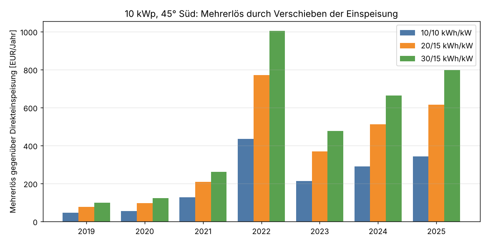
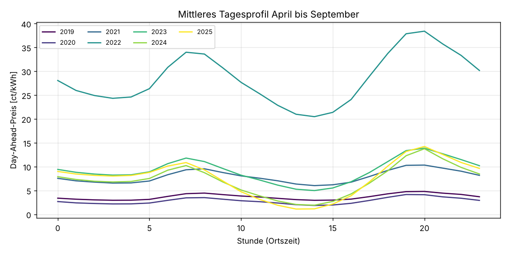
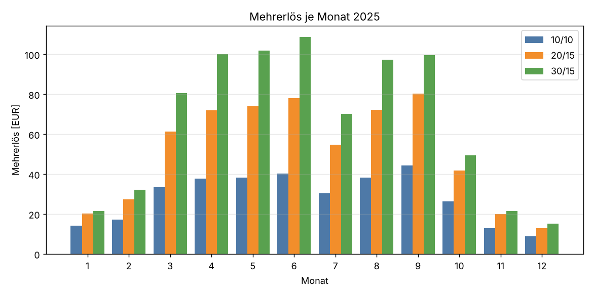
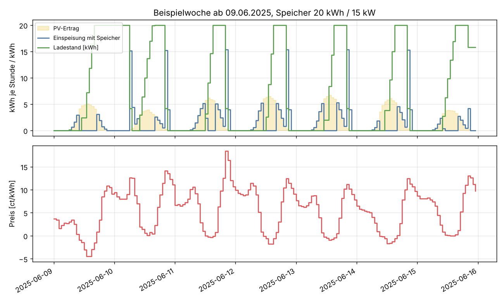

# PV-Speicher: Was bringt das Verschieben der Einspeisung in teure Stunden?

Einmalige Auswertung vom 22.10.2026. Frage: Wie viel mehr erlöst eine 10-kWp-PV-Anlage
(45° Neigung, genau nach Süden) am Day-Ahead-Markt, wenn ein Speicher den Mittagsstrom in die
teuren Abend-, Nacht- und Morgenstunden verschiebt? Verglichen werden drei Speicher:
10 kWh / 10 kW, 20 kWh / 15 kW und 30 kWh / 15 kW. Die Preise des Folgetags sind erst um 13 Uhr
bekannt, der Speicher plant deshalb jeden Tag neu über die Tagesgrenze.

## Ergebnis in Kürze

**Der Speicher bringt heute ein Mehrfaches dessen, was er 2019 gebracht hätte.** 2025 liegt
der Mehrerlös bei etwa 340 € (10/10), 615 € (20/15) und 800 € (30/15) im Jahr. Das sind 63 %,
113 % und 146 % mehr als die reine Einspeisung, die 2025 nur noch 546 € brachte. Mit
Prognosefehlern beim PV-Ertrag und realistischeren Speicherverlusten bleiben davon etwa
**290 €, 510 € und 640 €**.

| Jahr | PV-Ertrag | Ø Preis | Marktwert PV | Direkt-einspeisung | + 10/10 | + 20/15 | + 30/15 |
|---|---|---|---|---|---|---|---|
| 2019 | 10 547 kWh | 3,8 ct | 3,6 ct | 382 € | 46 € | 78 € | 100 € |
| 2020 | 10 814 kWh | 3,0 ct | 2,5 ct | 282 € | 55 € | 96 € | 124 € |
| 2021 | 9 580 kWh | 9,8 ct | 7,8 ct | 758 € | 127 € | 210 € | 261 € |
| 2022 | 11 131 kWh | 23,8 ct | 22,1 ct | 2 462 € | 435 € | 771 € | 1 004 € |
| 2023 | 10 111 kWh | 9,5 ct | 7,5 ct | 769 € | 212 € | 370 € | 478 € |
| 2024 | 10 231 kWh | 7,8 ct | 4,7 ct | 508 € | 290 € | 513 € | 664 € |
| 2025 | 10 483 kWh | 9,0 ct | 4,9 ct | 546 € | 342 € | 615 € | 798 € |

Standort Mitte (50,9° N, 10,0° O). „Marktwert PV“ ist der mit dem PV-Ertrag gewichtete
Durchschnittspreis. Die Direkteinspeisung regelt bei negativem Preis ab; ohne Abregelung wäre
sie 2025 um 33 € schlechter.



**Warum der Speicher so stark zugelegt hat:** Bis 2021 war der Strompreis über den Tag fast
flach. Seit 2023 drückt der PV-Zubau die Mittagspreise im Sommerhalbjahr auf 1–2 ct/kWh,
während der Abend bei 13–14 ct liegt (Grafik unten). Die Zahl der Stunden mit negativem Preis
stieg von 143 (2021) auf 482 (2025). Der Marktwert des PV-Stroms ist 2025 nur noch gut halb so
hoch wie der Durchschnittspreis. Genau diese Lücke schließt der Speicher.



**Die 13-Uhr-Grenze kostet fast nichts.** Ein Speicher, der das ganze Jahr im Voraus kennt,
erlöst nur 0–2 % mehr. Grund: Der Speicher wird jeden Tag voll geladen und am Abend oder am
nächsten Morgen wieder geleert. Weiter als bis zum nächsten Morgen muss er fast nie planen,
und das deckt das Fenster von 13 Uhr bis Mitternacht des Folgetags ab.

**Mehr Kapazität lohnt sich weniger als die erste.** Die ersten 10 kWh bringen 2025 rund
34 € je kWh und Jahr, die nächsten 10 kWh 27 €, die dritten 18 €. Ab etwa 20 kWh gibt es an
vielen Tagen nicht genug günstigen Mittagsstrom bzw. teure Stunden, um den Speicher sinnvoll
zu füllen und zu leeren. Der Speicher fährt 265–340 Vollzyklen im Jahr; ein Großteil der
Mehrerlöse fällt von März bis September an.



## Wie empfindlich ist das Ergebnis?

Mittel 2023–2025, Mehrerlös in €/Jahr gegenüber Direkteinspeisung:

| Variante | 10/10 | 20/15 | 30/15 |
|---|---|---|---|
| Basis (PV-Ertrag im Fenster bekannt, 90 % Wirkungsgrad) | 281 | 499 | 647 |
| PV-Prognosefehler (±30 % je Tag, ±20 % je Stunde) | 265 | 457 | 576 |
| Wirkungsgrad 85 % und 5 % Reserve im Speicher | 249 | 446 | 577 |
| Verschleißkosten 3 ct je entladener kWh im Fahrplan | 271 | 478 | 617 |
| Volle Voraussicht (ganzes Jahr bekannt, Obergrenze) | 282 | 505 | 660 |
| Laden auch aus dem Netz zum Börsenpreis | 433 | 835 | 1 195 |

Alle Jahre stehen in [tabellen/varianten.csv](tabellen/varianten.csv).

- **PV-Prognose:** Wer mit einer fehlerhaften Prognose plant, verliert 6 % (10/10) bis 11 %
  (30/15). Ein großer Speicher verlässt sich stärker darauf, mittags tatsächlich voll zu werden.
- **Wirkungsgrad:** 85 % statt 90 % Rundlaufwirkungsgrad kosten 11 %.
- **Verschleiß:** Mit 3 ct je kWh Verschleißkosten im Fahrplan verzichtet der Speicher auf
  Fahrten mit kleiner Preisspanne. Das kostet heute nur 3–5 %, 2019/2020 aber zwei Drittel,
  weil die Spannen damals klein waren.
- **Netzladen:** Darf der Speicher zusätzlich günstigen Netzstrom laden und wieder einspeisen,
  steigt der Mehrerlös um 55–85 %. Das ist eine Obergrenze: Netzentgelte, Umlagen und die
  Abgrenzung nach § 21 EEG (Grünstrom- und Graustrom-Anteil) sind nicht gerechnet.
- **Standort:** Norddeutschland (53,5° N) liegt 2025 bei 341/610/785 €, Süddeutschland
  (48,4° N) bei 346/631/830 €. Der Standort ändert den Ertrag um −3 bis +10 %, den Mehrerlös kaum,
  weil der Speicher in allen Fällen fast täglich voll wird ([tabellen/standorte.csv](tabellen/standorte.csv)).

**Was das für die Investition heißt:** Mit den realistischen Werten (Prognosefehler und
schlechterer Wirkungsgrad) bringt der Speicher im Mittel 2023–2025 grob 230 € (10/10),
400 € (20/15) und 500 € (30/15) im Jahr. Über 15 Jahre ohne Zins sind das etwa 350, 300 und
250 € je kWh Speicherkapazität. Teurer darf der Speicher samt Einbau nicht sein, wenn er sich
allein über das Verschieben der Einspeisung bezahlt machen soll. Mit den Preisen von 2025 statt
des Mittels liegt die Grenze bei etwa 430, 380 und 320 €/kWh. Wenn die Mittagspreise weiter
fallen, steigt sie.

## Für wen gilt das?

Nur für eine Anlage, die ihren Strom zum Börsenpreis verkauft: Direktvermarktung, eine
Anlage ohne EEG-Förderung oder eine neue Anlage nach dem Solarspitzengesetz (keine Vergütung
bei negativem Preis). Bei fester EEG-Einspeisevergütung bringt das Verschieben nichts, weil
jede kWh gleich bezahlt wird. Eigenverbrauch ist nicht gerechnet; im Haushalt ist der Speicher
für den Eigenverbrauch in der Regel mehr wert, weil er Bezugsstrom zu 30 ct und mehr ersetzt.
Gebühren des Direktvermarkters sind nicht abgezogen. Sie treffen Speicher und
Direkteinspeisung gleich und ändern den Mehrerlös nicht.

## Daten und Methode

| | |
|---|---|
| Preise | Day-Ahead DE-LU, stündlich, aus der Datenbank (Snapshot `snap-20261022`, SMARD/ENTSO-E). Seit 01.10.2025 handelt die Auktion in 15 Minuten; die Stundenmittel unterschätzen die Spannen innerhalb der Stunde leicht. |
| PV-Ertrag | PVGIS 5.3 (SARAH3/ERA5), 10 kWp, 45°, Azimut 0° (Süd), 14 % Systemverluste, stündlich 2005–2023. Standort Mitte 50,9° N / 10,0° O, zum Vergleich Nord 53,5° / 10,0° und Süd 48,4° / 11,0°. |
| Jahre ohne PVGIS (2024, 2025) | Die deutsche PV-Einspeisung (`gen_solar`) wird auf ihr gleitendes Jahresmittel normiert und je Monat und Stunde auf das PVGIS-Profil skaliert. So passt das Wetter zu den Preisen des Jahres. Gegenprobe 2019–2023: Diese Ersatzreihe liefert 1–9 % höhere Mehrerlöse als PVGIS ([tabellen/gegenprobe_national.csv](tabellen/gegenprobe_national.csv)), 2024/2025 sind also eher leicht zu hoch. |
| Speicher | Laden und Entladen je 95 % (Rundlauf 90 %), voller Ladestand nutzbar, Leistung je Richtung wie angegeben. Laden nur aus der eigenen PV-Anlage (außer Variante Netzladen). Keine Grenze für die Einspeiseleistung. |
| Fahrplan | Täglich um 13 Uhr (Ortszeit) ein lineares Programm über das Fenster bis Mitternacht des Folgetags (35 h), ausgeführt bis 13 Uhr des Folgetags, dann neu geplant. Im Fenster gilt der PV-Ertrag als bekannt (Variante: mit Fehler). Der Speicher darf bei negativem Preis abregeln, wie die Direkteinspeisung auch. |
| Vergleich | Direkteinspeisung derselben PV-Reihe, Abregelung bei negativem Preis. |

Die Beispielwoche zeigt den Fahrplan: Der Speicher lädt in den billigsten Mittagsstunden voll
und speist am Abend, teils erst am nächsten Morgen, wieder ein.



## Wiederholen

Benötigt den Snapshot aus `ml-train snapshot` und die PVGIS-Dateien (nicht im Repository):

```sh
mkdir -p .ml-data/pvgis
curl -o .ml-data/pvgis/mitte.json "https://re.jrc.ec.europa.eu/api/v5_3/seriescalc?lat=50.9&lon=10.0&outputformat=json&pvcalculation=1&peakpower=10&loss=14&angle=45&aspect=0&startyear=2005&endyear=2023"
# nord.json: lat=53.5&lon=10.0, sued.json: lat=48.4&lon=11.0
uv run --with pandas --with pyarrow --with scipy --with matplotlib \
    python docs/analysen/pv-speicher-arbitrage/auswertung.py
```

Laufzeit etwa 5 Minuten. Alle Zahlen stehen in [tabellen/](tabellen/), das Skript in
[auswertung.py](auswertung.py).
