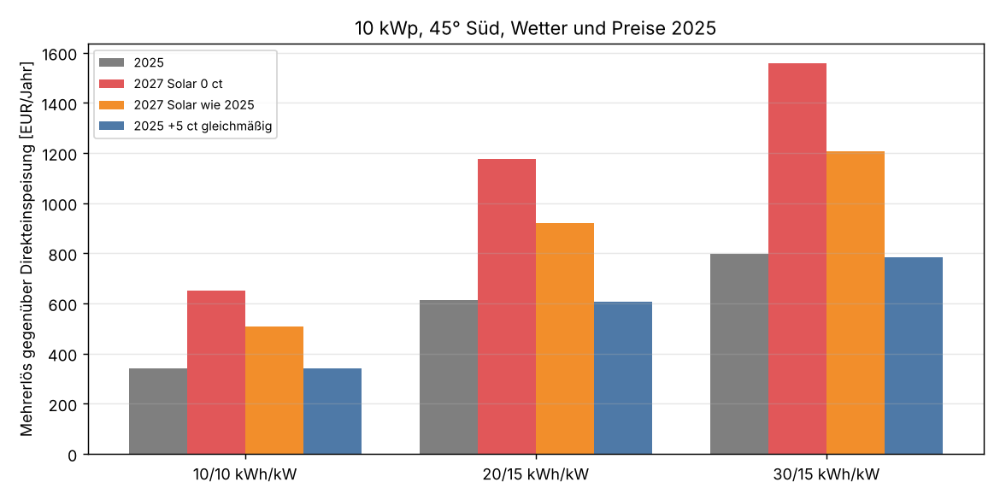
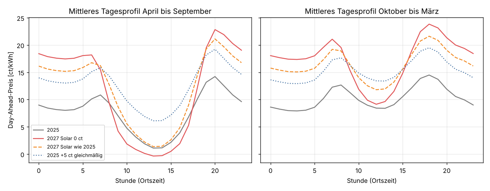

# PV-Speicher, Szenario 2027: Haushaltsstrom an der Börse 5 ct teurer, Solarmittag bei 0 ct

Einmalige Auswertung vom 22.10.2026, Auftrag in [job.yaml](job.yaml), Szenario zur Analyse
[PV-Speicher-Arbitrage](../pv-speicher-arbitrage/README.md). Gleiche Anlage (10 kWp, 45°, Süd),
gleiche Speicher (10/10, 20/15, 30/15 kWh/kW), gleicher Fahrplan (Planung um 13 Uhr bis
Mitternacht des Folgetags), Wetter und Preisverlauf von 2025. Annahme für 2027:

- Der Börsenpreis für Haushaltsstrom, also der mit dem Standardlastprofil H0 gewichtete
  Day-Ahead-Preis, liegt 5 ct/kWh über 2025 (14,3 statt 9,3 ct/kWh).
- In den Solarstunden fällt der Preis trotzdem auf 0 ct. Negative Preise bleiben negativ.
- Den Aufschlag tragen die übrigen Stunden: Abend, Nacht, Morgen und trübe Tage.

## Ergebnis in Kürze

**Der Speicher bringt im Szenario fast doppelt so viel wie 2025.** Der Mehrerlös gegenüber der
Direkteinspeisung steigt auf etwa 650 € (10/10), 1 180 € (20/15) und 1 560 € (30/15) im Jahr.
Mit Prognosefehlern beim PV-Ertrag und schlechterem Wirkungsgrad bleiben davon etwa
**560 €, 980 € und 1 260 €**.

| | 2025 | Szenario 2027 | Änderung |
|---|---|---|---|
| H0-gewichteter Börsenpreis | 9,3 ct | 14,3 ct | +5,0 ct |
| Preis in Solarstunden (1 050 h) | 1,6 ct | −0,6 ct | |
| Preis in Stunden ohne Sonne | 10,1 ct | 19,6 ct | +9,4 ct |
| Marktwert des PV-Stroms | 4,9 ct | 3,8 ct | −1,1 ct |
| Erlös ohne Speicher | 546 € | 431 € | −115 € |
| Mehrerlös 10/10 | +342 € | **+651 €** | +309 € |
| Mehrerlös 20/15 | +615 € | **+1 176 €** | +561 € |
| Mehrerlös 30/15 | +798 € | **+1 557 €** | +759 € |
| Erlös mit 20/15 | 1 161 € | 1 607 € | +446 € |

| Mehrerlös realistisch¹ | 2025 | Szenario 2027 |
|---|---|---|
| 10/10 | 288 € | 555 € |
| 20/15 | 508 € | 975 € |
| 30/15 | 635 € | 1 260 € |

¹ Mit Fehlern in der PV-Prognose (±30 % je Tag, ±20 % je Stunde) und 85 % statt 90 %
Rundlaufwirkungsgrad, beide Abzüge zusammengerechnet.

**Ohne Speicher verliert die Anlage.** Der teurere Haushaltsstrom kommt bei ihr nicht an,
weil sie genau dann einspeist, wenn der Preis bei null liegt. Der Erlös sinkt sogar um ein
Fünftel, weil die Solarstunden von 1,6 ct auf null fallen. Mit Speicher steigt der Erlös
dagegen um rund 40 % (20/15: 1 607 statt 1 161 €).

**Was der Speicher kosten darf:** Mit dem realistischen Mehrerlös und 15 Jahren ohne Zins sind
das etwa 830 € (10/10), 730 € (20/15) und 630 € (30/15) je kWh Kapazität. Mit den Preisen von
2025 waren es 430, 380 und 320 €/kWh.



## Was den Unterschied macht: die Form, nicht die Höhe

Zum Vergleich steht in der Grafik eine Variante, in der jede Stunde gleichmäßig 5 ct teurer
ist. Dort ändert sich der Mehrerlös des Speichers praktisch nicht (höchstens 2 % weniger), nur die
Direkteinspeisung bringt 5 ct je kWh mehr. Ein Speicher verdient an der Spanne zwischen
billigen und teuren Stunden, nicht am Preisniveau. Im Szenario wächst die Spanne: Der Mittag
wird billiger, der Rest des Tages um 9,4 ct teurer.

Die zweite Variante „Solar wie 2025“ lässt die Solarstunden auf ihrem Preis von 2025
(im Mittel 1,6 ct) statt sie auf null zu setzen. Der Aufschlag in den übrigen Stunden ist dann
kleiner (7,2 ct), der Mehrerlös liegt dazwischen: 508 / 919 / 1 206 €.

| Variante | Aufschlag ohne Sonne | Erlös ohne Speicher | + 10/10 | + 20/15 | + 30/15 |
|---|---|---|---|---|---|
| 2025 | – | 546 € | 342 € | 615 € | 798 € |
| Szenario: Solar 0 ct | 9,4 ct | 431 € | 651 € | 1 176 € | 1 557 € |
| Solar wie 2025 | 7,2 ct | 706 € | 508 € | 919 € | 1 206 € |
| alle Stunden +5 ct | 5,0 ct | 1 043 € | 340 € | 608 € | 784 € |



## Wie die Preisreihe gebaut ist

Ausgangspunkt sind die stündlichen Day-Ahead-Preise DE-LU von 2025. Jede Stunde bekommt ein
Solargewicht w aus dem PV-Anteil an der deutschen Last in dieser Stunde (2025):

- PV-Anteil ab 50 %: w = 1, die Stunde ist eine Solarstunde (1 050 Stunden, Preis 2025 im
  Mittel 1,6 ct).
- PV-Anteil zwischen 0 und 50 %: w steigt linear von 0 auf 1 (Morgen, Abend, trübe Tage).
- Ohne PV (Nacht): w = 0.

Der Szenariopreis ist dann

    p' = (1 − w) · (p + a) + w · min(p, 0)

Der Aufschlag a ist eine Zahl für das ganze Jahr. Er ist so bestimmt, dass der H0-gewichtete
Mittelwert von p' genau 5 ct über dem von p liegt, und beträgt 9,4 ct. Er ist größer als 5 ct,
weil die Solarstunden billiger werden und weil ein Teil des Haushaltsverbrauchs mittags
anfällt.

Das H0-Profil ist das dynamisierte BDEW-Standardlastprofil für Haushalte, Jahr 2025, aus der
Bibliothek demandlib ([daten/h0_dyn_2025.csv](daten/h0_dyn_2025.csv), Ortszeit, 1 000 kWh/a).
Das neue Profil H25 der BDEW ist nicht verwendet.

Die Zahlen stehen in [tabellen/preise.csv](tabellen/preise.csv) und
[tabellen/ergebnis.csv](tabellen/ergebnis.csv).

## Grenzen

- **Ein Wetterjahr.** Alles beruht auf 2025. Der PV-Ertrag 2025 ist aus dem deutschen
  PV-Profil auf die 45°-Südanlage umgerechnet (PVGIS reicht nur bis 2023), siehe die
  Hauptanalyse.
- **Speicher ändern den Markt.** Wenn viele Speicher genau diese Spanne nutzen, wird sie
  kleiner. Das Szenario nimmt die Preise als gegeben.
- **Nur Börsenverkauf, kein Eigenverbrauch.** Wie in der Hauptanalyse: Die Rechnung gilt für
  Anlagen, die zum Börsenpreis verkaufen. Netzladen ist nicht gerechnet.
- **Stundenpreise.** Die Viertelstundenpreise seit 10/2025 sind auf Stunden gemittelt.

## Wiederholen

Benötigt den Snapshot `.ml-data/snap-20261022/` und `.ml-data/pvgis/mitte.json` wie in der
Hauptanalyse:

```sh
uv run --with pandas --with pyarrow --with scipy --with matplotlib \
    python docs/analysen/pv-speicher-szenario-2027/auswertung.py
```

Das H0-Profil in `daten/` wurde so erzeugt:

```sh
uv run --with demandlib --with 'pandas<3' python -W ignore -c "
from demandlib import bdew
p = bdew.ElecSlp(year=2025).get_scaled_power_profiles({'h0_dyn': 1000})['h0_dyn']
h = p.resample('h').mean(); h.index.name = 'lokalzeit'
h.rename('h0_kwh').to_csv('docs/analysen/pv-speicher-szenario-2027/daten/h0_dyn_2025.csv', float_format='%.5f')"
```
