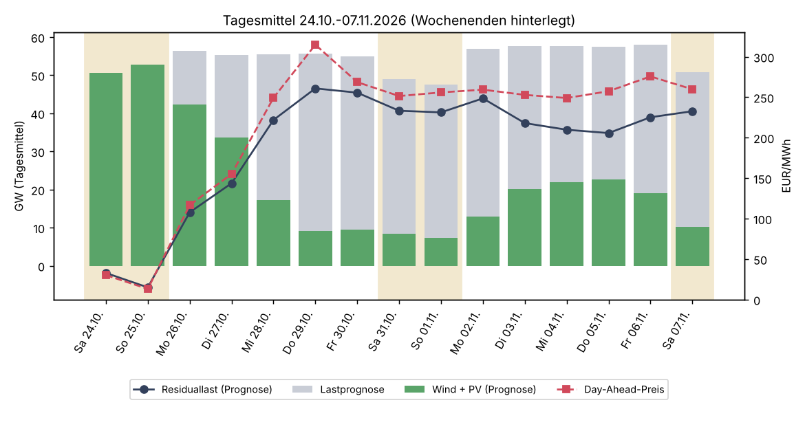
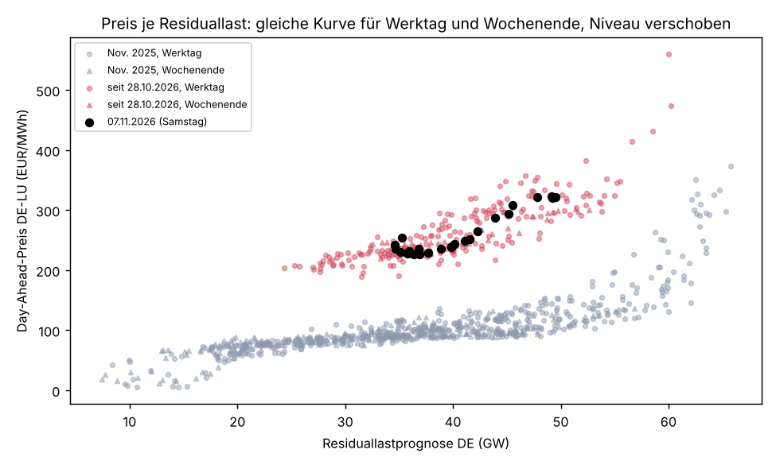
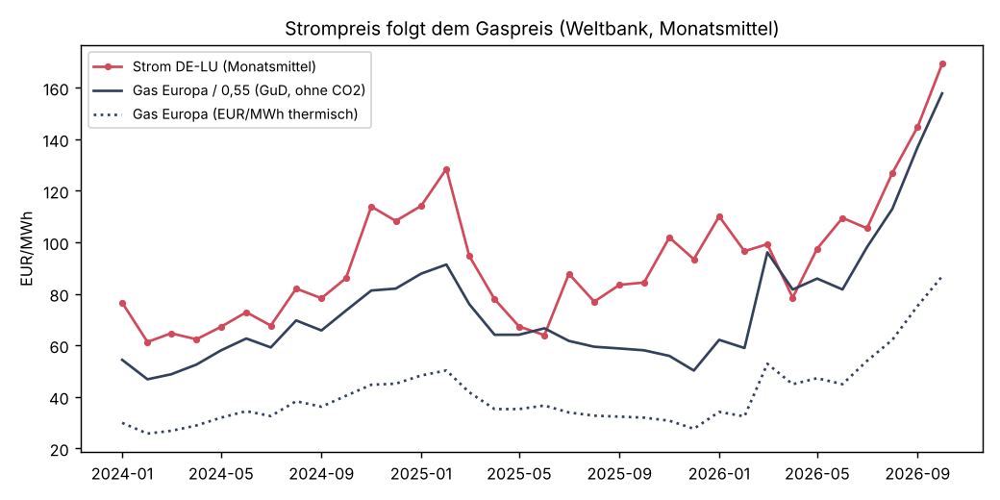
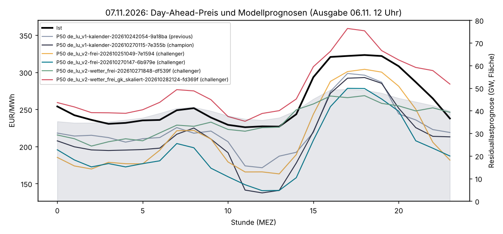

# Samstag, 07.11.2026: Warum der Strom trotz Wochenendlast so teuer ist

Einmalige Auswertung vom 07.11.2026, Auftrag in [job.yaml](job.yaml). Frage: Warum ist Strom
heute (Samstag) so teuer, obwohl die Last samstags eigentlich viel niedriger ist?

## Ergebnis in Kürze

**Die niedrigere Last kommt beim Preis nicht an, weil gleichzeitig der Wind fehlt.** Der
Day-Ahead-Preis DE-LU liegt am Samstag im Tagesmittel bei **259,8 EUR/MWh** (226 bis 323), nur
16 EUR unter Freitag (275,6). Die Lastprognose der ÜNB ist zwar um **7,3 GW** niedriger als am
Freitag (50,7 statt 58,0 GW), die Windprognose aber ebenfalls um **7,3 GW** (6,6 statt 13,8 GW),
PV noch einmal um 1,6 GW. Die Residuallast, die Kohle-, Gas- und Importstrom decken müssen,
steigt deshalb sogar leicht auf **40,5 GW** (Freitag 39,0, Di–Do 36,0). Für den Preis zählt
die Residuallast, nicht die Last:

| Tagesmittel (Prognose) | Sa 07.11. | Fr 06.11. | Δ | Mittel Di–Do | Δ |
|---|---:|---:|---:|---:|---:|
| Last | 50,7 GW | 58,0 GW | −7,3 | 57,6 GW | −6,8 |
| Wind (on- + offshore) | 6,6 GW | 13,8 GW | −7,3 | 16,1 GW | −9,6 |
| PV | 3,6 GW | 5,2 GW | −1,6 | 5,4 GW | −1,8 |
| **Residuallast** | **40,5 GW** | **39,0 GW** | **+1,6** | **36,0 GW** | **+4,6** |
| Day-Ahead-Preis | 259,8 | 275,6 | −15,8 | 253,1 | +6,8 |

Werte in [tabellen/zerlegung.csv](tabellen/zerlegung.csv) und [tabellen/tage.csv](tabellen/tage.csv).
Zum Vergleich der Samstag zwei Wochen davor: 24.10. mit 46 GW Wind, Residuallast −1,9 GW,
Preis 30 EUR/MWh.

**Dass dieselbe Residuallast heute 250 statt 100 EUR/MWh kostet, liegt am Gaspreis.** Im
November 2025 kostete eine Stunde mit gleicher Residuallast (±2,5 GW) im Median 101 EUR/MWh.
Seit dem 28.10.2026 liegen Werktage und Wochenenden auf derselben, um rund 150 EUR/MWh nach
oben verschobenen Kurve. Erdgas Europa (Weltbank) stieg von 30,8 EUR/MWh (Nov. 2025) auf
86,8 EUR/MWh thermisch (Okt. 2026), allein der Brennstoff einer GuD-Anlage kostet damit rund
158 statt 56 EUR/MWh Strom, bei einer Gasturbine 228 EUR/MWh, jeweils ohne CO2.

**Ganz Mitteleuropa hat dasselbe Problem.** Die Nachbarzonen lagen am Samstag fast alle beim
deutschen Preis (8 von 11 innerhalb ±10 EUR/MWh; BE, NL, FR, DK1/DK2, CZ, AT 259–263). Die
Kopplung war also kaum durch Engpässe begrenzt, und aus dem Ausland kam kein billigerer Strom.
Nur Norwegen-Süd (198) und Polen (232) waren günstiger. Die französische Kernkraft lief normal
(41–43 GW, Ist bis 06.11.). Die Flaute dauert seit dem 28.10. an, deshalb lagen schon Samstag
und Sonntag der Vorwoche bei 251 und 256 EUR/MWh.

**Das Champion-Modell lag deutlich zu tief.** `de_lu_v1-kalender-202610270115-7e355b` sagte im
Tagesmittel 212 EUR/MWh voraus (MAE je Stunde 48 EUR/MWh) und hat dabei vor allem den
Wochenendabschlag aus dem Kalender gelernt. Am besten traf der Challenger mit Grenzkostenindex
`de_lu_v2-wetter_frei_gk_skaliert-202610282124-fd369f`: 279 EUR/MWh, MAE 19 EUR/MWh, er sieht
das Brennstoffniveau und die Windflaute.



## Preis je Residuallast

Stundenpreis gegen Residuallastprognose. Grau: November 2025, rot: seit 28.10.2026, Dreiecke
Wochenende, schwarz der 07.11. Der Samstag liegt mitten in der roten Wolke. Einen eigenen
Wochenendeffekt gibt es bei gleicher Residuallast kaum
([tabellen/preis_je_residuallast.csv](tabellen/preis_je_residuallast.csv)).



| Residuallast | Nov. 2025, Werktag | Nov. 2025, Wochenende | seit 28.10.2026, Werktag | seit 28.10.2026, Wochenende |
|---|---:|---:|---:|---:|
| 35–40 GW | 97 | 101 | 237 | 238 |
| 40–45 GW | 105 | 96 | 287 | 255 |
| 45–50 GW | 117 | 102 | 303 | 290 |

Median EUR/MWh je Klasse; am Wochenende seit 28.10. nur 9–20 Stunden je Klasse.

## Brennstoffniveau



Monatsmittel in [tabellen/gas_strom_monat.csv](tabellen/gas_strom_monat.csv). Der Strompreis
folgt seit März 2026 dem Gaspreis nach oben. In der Flaute setzen Gaskraftwerke und teils
Gasturbinen den Preis, und deren Brennstoffkosten haben sich fast verdreifacht. CO2 kommt noch
hinzu (rund 0,37 t/MWh bei GuD), ist hier mangels freier Tagesreihe aber nicht eingerechnet
(siehe [eua-rueckrechnung](../eua-rueckrechnung/README.md)). Der Gasspeicher DE lag am 06.11.
laut VM-Datenbank bei 147,7 TWh und wird seit Anfang November entleert.

## Stundenverlauf und Modelle



Ist-Preis und P50 aller aktiven Versionen (jüngste Ausgabe 06.11. 12 Uhr) je Stunde in
[tabellen/stunden_07_11.csv](tabellen/stunden_07_11.csv), Tagesmittel 31.10.–07.11. in
[tabellen/modelle_tagesmittel.csv](tabellen/modelle_tagesmittel.csv).

| Version | Rolle | P50 Tagesmittel 07.11. |
|---|---|---:|
| de_lu_v1-kalender-…-9a18ba | previous | 224,1 |
| de_lu_v1-kalender-…-7e355b | champion | 212,2 |
| de_lu_v2-frei-…-7e1594 | challenger | 213,6 |
| de_lu_v2-frei-…-6b979e | challenger | 195,8 |
| de_lu_v2-wetter_frei-…-df539f | challenger | 234,2 |
| de_lu_v2-wetter_frei_gk_skaliert-…-fd369f | challenger | 278,8 |
| **Ist** | | **259,8** |

Die Modelle ohne Grenzkostenindex legen mittags einen tiefen Einbruch bis 140 EUR/MWh, der
nicht kam: Ohne Sonne und Wind blieb die Residuallast mittags bei 35–37 GW. Der Champion hat
schon an den vorigen Wochenenden zu tief gelegen (31.10.: 194 statt 251, 01.11.: 186 statt
256). Das spricht dafür, den Grenzkosten-Challenger zu befördern, sobald der Backtest das
bestätigt.

## Daten und Methode

- Stundenwerte von SMARD (Day-Ahead-Preis DE-LU 4169, Lastprognose 411, Residuallastprognose
  4362, Wind-onshore-/offshore-Prognose 123/3791, PV-Prognose 125, Ist-Last 410,
  Ist-Residuallast 4359), 01.09.2025 bis 07.11.2026. Die Residuallastprognose von SMARD ist
  genau Lastprognose minus Wind- und PV-Prognose (Rest 0,0 GW in der Zerlegung).
- Verglichen wird mit **Prognosen**, weil der Day-Ahead-Preis am Vortag auf Basis der
  Prognosen entsteht und Ist-Werte für den 07.11. noch fehlen.
- Preis je Residuallastklasse: Median je 5-GW-Klasse, November 2025 gegen 28.10.–06.11.2026,
  getrennt nach Werktag und Wochenende.
- Nachbarpreise, Handelssaldo DE (`/cbet`) und Kernkraft FR (`/public_power`) von
  Energy-Charts. Die Preise werden nur übernommen, wenn `license_info` CC BY 4.0 nennt.
- Gas Europa (Weltbank Pink Sheet, USD/MMBtu) mit dem Eurostat-Monatskurs in EUR/MWh thermisch
  (1 MMBtu = 0,29307 MWh), Brennstoffkosten Strom mit Wirkungsgrad 0,55 (GuD) bzw. 0,38
  (Gasturbine).
- Modellprognosen und Gasspeicher aus der Datenbank der VM mit [abfragen.sql](abfragen.sql)
  (nur lesend, 07.11.2026 ~01:30 UTC), Ergebnis in [daten/vm_export.txt](daten/vm_export.txt).
  Jüngste Ausgabe je Version bis 12 Uhr am Vortag.

## Grenzen

- Ein einzelner Tag. Die Aussage „Residuallast statt Last“ stützt sich aber auf den Vergleich
  aller Stunden seit 28.10. und Nov. 2025.
- CO2-Preis fehlt (keine freie Tagesreihe); der Brennstoffvergleich nutzt Monatsmittel, keine
  Tagespreise für Gas.
- Die P10/P90-Bänder fehlen im Export (Quantile in der Abfrage nicht getroffen), verglichen wird
  nur der P50.
- Handelssaldo und Kernkraft FR sind Ist-Werte bis 06.11.; für den 07.11. lagen sie beim Lauf
  noch nicht vor.
- Am Wochenende seit 28.10. gibt es je Residuallastklasse nur 7–20 Stunden.

## Quellen

- Bundesnetzagentur | SMARD.de, CC BY 4.0 (Preise, Last, Erzeugung, Prognosen; auch die
  Nachbarpreise über Energy-Charts).
- Energy-Charts.info (Fraunhofer ISE), CC BY 4.0 (Handelssaldo, Erzeugung Frankreich).
- Weltbank, Commodity Markets „Pink Sheet“, CC BY 4.0 (Erdgas Europa).
- Eurostat `ert_bil_eur_m`, CC BY 4.0 (Wechselkurs).
- Eigene Datenbank (Modellprognosen PredictionDB, Gasspeicher aus AGSI+ von GIE, Nutzung mit
  Namensnennung).

## Nachvollziehen

```bash
# Modellexport (VM, nur lesend)
docker compose exec -T postgres sh -c 'psql -X -q -U "$POSTGRES_USER" -d "$POSTGRES_DB"' \
  < docs/analysen/samstagspreis-2026-11-07/abfragen.sql \
  > docs/analysen/samstagspreis-2026-11-07/daten/vm_export.txt

# Auswertung (aus der Repo-Wurzel)
uv run --no-project --with pandas --with matplotlib --with httpx --with openpyxl --with pyyaml \
  python docs/analysen/samstagspreis-2026-11-07/auswertung.py --cache /tmp/samstag
```

Laufprotokoll in [tabellen/lauf.json](tabellen/lauf.json).
