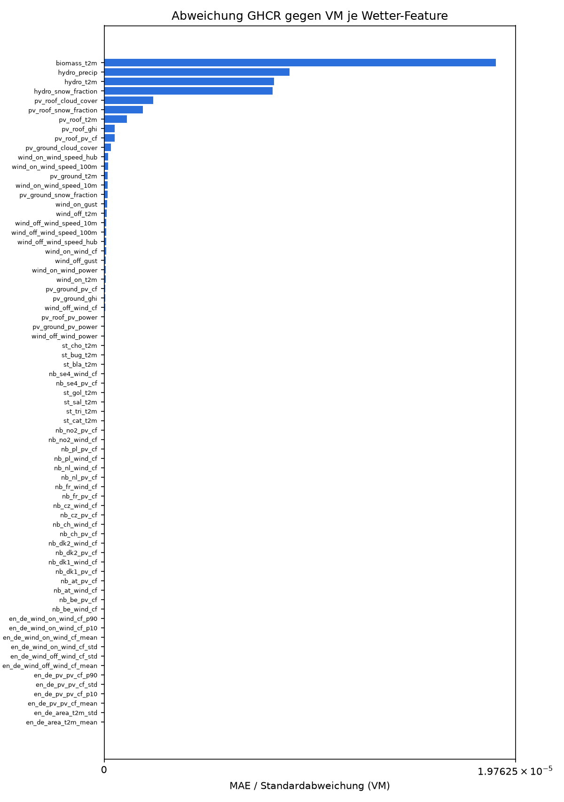

# Trainings-Snapshot aus GHCR gegen den Export der VM

Einmalige Auswertung vom 16.11.2026, Auftrag in [job.yaml](job.yaml). Frage: Liefert der
Trainings-Snapshot, den GitHub Actions ohne Datenbank aus den GHCR-Paketen baut
(`ml-train snapshot --ghcr`), dieselben Eingänge wie der Export aus der Datenbank der VM
(`ml-train snapshot`)?

## Ergebnis in Kürze

Ja. Für Januar und Februar 2025 (Konfiguration `de_lu_v2`) enthalten beide Snapshots genau dieselben
Zeilen:
- 38.763 Energiewerte aus 57 Reihen,
- 1.224.132 Wetterwerte aus 71 Features,
- 25.866 Bestandszeilen (die ganze Historie des Bestands, 4.311 Tage je Technologie).

Auf keiner Seite fehlt oder steht eine Zeile zu viel.

- **Energie:** Alle Reihen sind gleich bis auf Rundung im Bereich der Gleitkommagenauigkeit.
  Die größte Abweichung hat die Last mit 1,5·10⁻¹¹ MW.
- **Wetter:** Die Nachbarzonen, die Kraftwerksstandorte und die GEFS-Kennzahlen sind exakt gleich.
  Bei den DE-Clustern liegt die mittlere Abweichung im Median bei 1,6·10⁻⁷ Standardabweichungen
  und höchstens bei 1,9·10⁻⁵. Die größte Einzelabweichung beträgt 0,00046 K (Temperatur, Biomasse).
- **Bestand:** Alle Werte stimmen auf höchstens 0,025 MW überein, über die ganze Historie und
  nicht nur im Januar und Februar.
- **Gewichte der Cluster:** Die Leistung je Cluster weicht zwischen den Gewichten der VM
  (`assets.grid_weight`) und dem Bestand im Gewichte-Paket um höchstens 0,8 MW bzw. 0,08 %
  ab. Daher kommen die kleinen Abweichungen bei den DE-Clustern.

Der Snapshot aus dem Runner kann den Export der VM für Training und Backtest damit ersetzen.

## Ergebnisse

| Teil | Zeilen VM | Zeilen GHCR | nur VM | nur GHCR | Abweichung |
|---|---:|---:|---:|---:|---|
| Energie (57 Reihen) | 38.763 | 38.763 | 0 | 0 | max. 1,5·10⁻¹¹ |
| Wetter DE-Cluster (30 Features) | 738.680 | 738.680 | 0 | 0 | MAE/σ Median 1,6·10⁻⁷, max. 1,9·10⁻⁵ |
| Wetter Nachbarzonen (22) | 333.586 | 333.586 | 0 | 0 | 0 |
| Wetter Standorte (7) | 106.554 | 106.554 | 0 | 0 | 0 |
| GEFS-Kennzahlen (12) | 45.312 | 45.312 | 0 | 0 | 0 |
| Bestand (6 Technologien, ganze Historie) | 25.866 | 25.866 | 0 | 0 | max. 0,025 MW |

Einzelwerte stehen in [energie.csv](tabellen/energie.csv), [wetter.csv](tabellen/wetter.csv),
[wetter_gruppen.csv](tabellen/wetter_gruppen.csv) und [bestand.csv](tabellen/bestand.csv). Die
Lizenzklassen der Quellen stehen in [quellen.csv](tabellen/quellen.csv), die Leistung je Cluster in
[gewichte.csv](tabellen/gewichte.csv).



**Leistung je Cluster.** Die VM gewichtet mit `sum(assets.grid_weight.capacity_mw)`, der Runner
mit dem letzten Wert aus `capacity.parquet` des Gewichte-Pakets (= `assets.capacity_daily` am
2026-10-20). Der Unterschied je Technologie:

| Technologie | Cluster | grid_weight (MW) | capacity_daily (MW) | größte Abweichung je Cluster (MW) |
|---|---:|---:|---:|---:|
| biomass | 8 | 9.085,6 | 9.084,4 | 0,80 |
| hydro | 8 | 5.442,4 | 5.442,4 | 0,09 |
| pv_ground | 20 | 47.113,1 | 47.113,1 | 0,02 |
| pv_roof | 25 | 84.191,2 | 84.191,8 | 0,31 |
| wind_off | 4 | 11.628,8 | 11.628,8 | 0,00 |
| wind_on | 25 | 71.400,6 | 71.400,6 | 0,01 |

**Quellen.** Beide Manifeste führen nur freie Quellen. Die VM nennt zusätzlich `entsoe_last`.
In GHCR fehlt diese Quelle, weil für die Energie-Pakete noch kein ENTSO-E-Schlüssel hinterlegt
ist. Die Werte unterscheiden sich dadurch nicht: SMARD steht im Rang vor ENTSO-E und liefert
alle betroffenen Reihen.

## Daten und Methode

- Zeitraum 2025-01-01 bis 2025-03-01 (UTC), Wetterläufe 00 und 12 UTC im ganzen Zeitraum,
  Konfiguration `config/ml/de_lu_v2.yaml` (mit Nachbarzonen, Standorten und GEFS).
- VM: `ml-train snapshot` aus der Datenbank, Snapshot `f9ac8c7ee2636d3e`.
- GHCR: `ml-train snapshot --ghcr --require-free`, Snapshot `ca8c16165a70fa1f`. Verwendet
  wurden 14 Pakete aus `energy`, `gfs-0p25-gold`, `gfs-0p5-gold`, `gefs-0p5-silver` und
  `gfs-0p25-weights`. Es fehlte keines.
- Beide Snapshots werden über die Schlüssel verbunden: Energie `code, ts`, Wetter
  `feature, run_time, valid_time`, Bestand `day, technology`. Je Reihe bzw. Feature gezählt
  werden Zeilen auf beiden Seiten, MAE, größte Abweichung, MAE durch Standardabweichung der VM
  und der Anteil exakt gleicher Werte (relativ 10⁻⁴, mindestens absolut 10⁻⁴).
- Die Wetterzeilen der Standorte vor dem ersten Lauf (31 Tage Vorlauf für gleitende Mittel)
  zählen nicht mit. Der Vergleich nimmt nur Läufe im Zeitraum. Deshalb stehen in den Tabellen
  1.224.132 statt der 1.280.118 Wetterzeilen der Snapshots (`rows.weather` in `manifest.json`;
  der Vorlauf ist `sites.history_days` der Konfiguration).
- Der Bestand (`capacity.parquet`) wird nicht auf den Zeitraum begrenzt. Beide Snapshots
  enthalten die ganze Historie, und der Vergleich nimmt alle Tage.
- Die Schlüssel sind auf beiden Seiten eindeutig: Die Summe der Zeilen je Gruppe in den Tabellen
  ist gleich der Zeilenzahl in [lauf.json](tabellen/lauf.json). Das Skript bricht bei doppelten
  Schlüsseln ab.
- Die Leistung je Cluster wurde zusätzlich nur lesend per SQL auf der VM abgefragt
  (Clusterung `v2026Q4`, Gitter `gfs_0p25`, Abfrage in [gewichte.sql](gewichte.sql)). Diese Tabelle
  schreibt nicht `auswertung.py`, sondern die Abfrage selbst.

## Grenzen

- Geprüft sind nur zwei Wintermonate des Jahres 2025. Die Bausteine sind über die ganze
  Historie dieselben (dieselbe Clusterung, dieselben Paketformate). Fehlende Läufe oder Lücken in
  anderen Monaten deckt dieser Vergleich aber nicht ab.
- Beide Seiten rechnen hier mit der Clusterung `v2026Q4`. Läufe, die die VM mit einer älteren
  Clusterung gerechnet hat, würden abweichen. Das Gold im Runner nutzt für alle Läufe dieselben
  Gewichte.
- Verglichen werden nur die Werte, nicht der Zeitpunkt der Veröffentlichung (`published` in
  `energy.parquet`). Ob beide Seiten dieselbe Verfügbarkeit annehmen, prüft dieser Abgleich nicht.
- Ohne ENTSO-E-Schlüssel fehlt `entsoe_last` als Ersatzquelle in GHCR. Fällt SMARD für eine
  Stunde aus, hätte die VM einen Wert und der Runner keinen. Im Zeitraum kam das nicht vor.

## Quellen

- SMARD (Bundesnetzagentur), CC BY 4.0
- Energy-Charts (Fraunhofer ISE), CC BY 4.0 je Reihe
- ENTSO-E Transparency Platform, Lastprognose (`entsoe_last`, nur im Snapshot der VM),
  CC BY 4.0
- EZB, Referenzkurs EUR/USD, Weiterverwendung mit Quellenangabe
- EIA und EIA STEO (gemeinfrei), Weltbank Pink Sheet (CC BY 4.0)
- Weekly Oil Bulletin der EU-Kommission (CC BY 4.0)
- Hub'eau / eaufrance (Licence Ouverte 2.0)
- NOAA/NCEP GFS und GEFS (gemeinfrei, Quellenvermerk „NOAA/NCEP GFS“)
- Marktstammdatenregister (Bundesnetzagentur), DL-DE BY 2.0
- Natural Earth (gemeinfrei) für die Regionen

## Nachvollziehen

```bash
# VM (Compose-Profil ml), nur lesend
docker compose --profile ml run --rm ml-train --config config/ml/de_lu_v2.yaml snapshot \
    --from 2025-01-01 --to 2025-03-01 --weather-from 2025-01-01 --run-hours 0,12 \
    --out /data/abgleich-vm-2025q1
# ohne Datenbank, aus GHCR
uv run --package ml-train --extra ghcr ml-train --config config/ml/de_lu_v2.yaml snapshot --ghcr \
    --require-free --from 2025-01-01 --to 2025-03-01 --weather-from 2025-01-01 --run-hours 0,12 \
    --out /tmp/abgleich-ghcr-2025q1
uv run --no-project --with pandas --with pyarrow --with matplotlib \
    python docs/analysen/snapshot-ghcr-abgleich/auswertung.py \
    --vm /tmp/abgleich-vm-2025q1 --ghcr /tmp/abgleich-ghcr-2025q1
# Leistung je Cluster (VM, nur lesend), Befehl im Kopf von gewichte.sql
```
