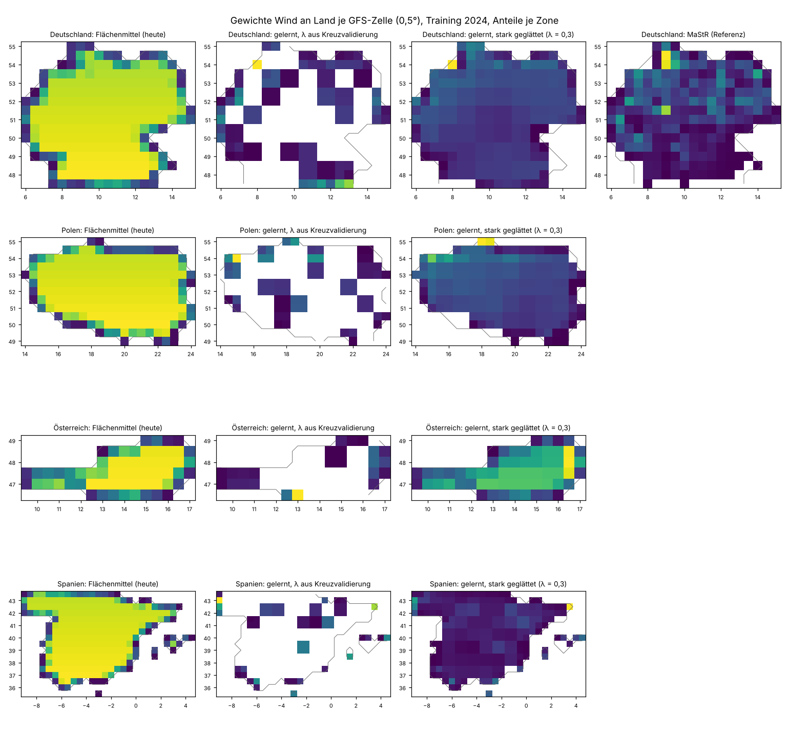

# Standortgewichte für Wind und PV aus der Ist-Erzeugung lernen

Einmalige Auswertung vom 1.11.2026 (Auftrag: [job.yaml](job.yaml)). Frage: Für Länder ohne offenes Anlagenregister kennen wir
nicht, wo Windräder und PV-Anlagen stehen. Lassen sich Gewichte je Gitterzelle stattdessen aus
der tatsächlichen Erzeugung je Zone lernen, und sind sie besser als das heutige Flächenmittel?

Hintergrund: Im GEFS-Silber (`config/gefs/regions_v2.json.gz`) ist nur DE nach Leistung
gewichtet (MaStR). Die übrigen 49 Zonen sind Flächenmittel. Für AT, CZ, PL, IT und den
Südosten gibt es kein offenes Register (siehe `docs/DATENQUELLEN-ZUGANG.md`). Untersucht
wurden PL, AT und ES; DE dient als Prüfstein, weil dort die MaStR-Gewichte als Referenz
vorliegen.

## Ergebnis in Kürze

- **Wind an Land: deutlich besser.** Gelernte Gewichte erklären die Erzeugung des Testjahres
  viel besser als das Flächenmittel. In ES steigt R² von 0,08 auf 0,67, in AT von 0,34 auf
  0,76, in PL von 0,69 auf 0,81. Mit vertauschten Jahren kommt dasselbe heraus.
- **In DE besser als das MaStR.** Die gelernten Gewichte erreichen R² 0,89 (MaStR 0,84,
  Flächenmittel 0,69).
- **PV: kein Gewinn.** Das Flächenmittel ist bei PV schon fast so gut wie jede Gewichtung,
  auch wie das MaStR in DE (R² je ≈ 0,95). Bewölkung ist großräumig, die Lage der Anlagen
  spielt bei 0,5° kaum eine Rolle.
- **Die Gewichte sind keine Standorte.** Schwach geglättet sammelt die Anpassung das Gewicht
  auf wenigen Zellen, die das Wetter der Zone gut anzeigen: in AT 42 % auf zwei Alpenzellen
  um 46,5° N 13° O, wo kaum Windräder stehen, in ES auf Mallorca und dem Cap de Creus. In DE
  korrelieren diese Gewichte nicht mit dem MaStR (−0,09). Stark geglättet (λ = 0,3) werden
  sie plausibel (Korrelation mit dem MaStR 0,70), und die Güte liegt dann genau beim MaStR
  (R² 0,84).

Für die Prognose zählt die Güte, nicht die Lage. Die gelernten Gewichte sind also ein echter
Gewinn für Wind, aber man darf sie nicht als Anlagenkarte veröffentlichen oder für
Anlagenprognosen verwenden.

## Daten und Methode

**Daten:**

- **Wetter je Zelle:** GFS 0,5° aus unserem Silber `ghcr.io/the78mole/predictiondb-data/gfs-0p5-silver`,
  Lauf 00Z, Schritte f003 bis f024 (3-stündlich), 1.1.2024 bis 31.12.2025, 731 von 731 Läufen.
  Größen: Wind 100 m (u, v), Globalstrahlung (Intervallmittel), Temperatur 2 m.
- **Ist-Erzeugung:** Energy-Charts `/public_power`, Reihen „Wind onshore“ und „Solar“ für DE,
  PL, AT, ES (PL 2024 stündlich, sonst Viertelstunden).
- **Installierte Leistung:** Energy-Charts `/installed_power`, jährlich (monatlich gibt es nur
  für DE), Jahresendwerte linear interpoliert.
- **Zonen und MaStR-Gewichte:** `config/gefs/regions_v2.json.gz` (Flächenanteile je Zelle,
  in DE zusätzlich `DE:wind_on` und `DE:pv` aus dem MaStR).

Ziel ist der Kapazitätsfaktor CF = Erzeugung / installierte Leistung. Wind wird im Fenster
±1,5 h um den Schritt gemittelt, PV über die 3 h vor dem Schritt (wie `dswrf` im Silber).

**Methode:**

1. Je Zelle der Zone werden aus dem GFS ein Wind-CF (Wind 100 m, Leistungskurve 3/12/25 m/s
   wie `wx_process.features.PowerCurve`) und ein PV-CF (Globalstrahlung und Temperatur wie
   `PvModel`) gerechnet.
2. Zellen werden zu 1°-Blöcken (2 × 2) zusammengefasst, damit die Zahl der Unbekannten zu den
   Daten passt (DE 68, PL 57, AT 20, ES 82 Blöcke).
3. Je Zone und Technik: nicht negative kleinste Quadrate (NNLS) des Ist-CF auf die Block-CF,
   mit Ridge-Strafe zur skalierten Flächenverteilung. λ wird im Trainingsjahr gewählt (jeder
   vierte Monat als Validierung); zusätzlich laufen feste λ = 0,03 und λ = 0,3.
4. Training 2024, Test 2025, danach vertauscht. Vergleich mit dem Flächenmittel (mit eigenem
   Skalenfaktor) und in DE mit den MaStR-Gewichten (ebenfalls mit Skalenfaktor).

PV wird nur zu Tagstunden bewertet (Zell-CF > 0,02), sonst würden die Nachtnullen das R²
schönen. Alle Kennzahlen stehen in [tabellen/ergebnis.csv](tabellen/ergebnis.csv) und
[tabellen/stabilitaet.csv](tabellen/stabilitaet.csv), die gelernten Wind-Gewichte je Zelle in
[tabellen/gewichte_wind.csv](tabellen/gewichte_wind.csv), das Laufprotokoll in
[tabellen/lauf.json](tabellen/lauf.json).

## Ergebnisse

R² im Testjahr (Training 2024 → Test 2025 / Training 2025 → Test 2024):

| Zone, Technik | Flächenmittel | gelernt (λ aus CV) | gelernt, λ = 0,03 | gelernt, λ = 0,3 | MaStR | mittlerer CF |
|---|---|---|---|---|---|---|
| DE Wind | 0,69 / 0,80 | **0,89 / 0,92** | 0,88 | 0,84 | 0,84 / 0,90 | 0,18 |
| PL Wind | 0,69 / 0,80 | **0,81 / 0,89** | 0,80 | 0,77 | – | 0,24 |
| AT Wind | 0,34 / 0,24 | **0,76 / 0,77** | 0,70 | 0,50 | – | 0,24 |
| ES Wind | 0,08 / 0,01 | **0,67 / 0,67** | 0,67 | 0,54 | – | 0,20 |
| DE PV | 0,95 / 0,94 | 0,95 / 0,95 | 0,95 | 0,95 | 0,94 / 0,94 | 0,14 |
| PL PV | 0,88 / 0,90 | 0,88 / 0,90 | 0,88 | 0,88 | – | 0,21 |
| AT PV | 0,85 / 0,85 | 0,86 / 0,87 | 0,85 | 0,85 | – | 0,14 |
| ES PV | 0,66 / 0,77 | 0,68 / 0,79 | 0,68 | 0,67 | – | 0,29 |

Die festen λ gelten für Training 2024 → Test 2025. „Mittlerer CF“ ist der Ist-CF im Testjahr
2025 (PV nur Tagstunden).

RMSE des Wind-CF (Test 2025): DE 0,076 → 0,044, PL 0,095 → 0,074, AT 0,180 → 0,109,
ES 0,114 → 0,068.

**Stabilität:** Die Gewichte aus 2024 und aus 2025 korrelieren bei Wind in AT mit 0,98 und in
ES mit 0,94 (Überlappung 87 % bzw. 84 %), in DE und PL mit 0,73 bzw. 0,69. Bei PV sind sie
nicht stabil (DE 0,03), was zum fehlenden Gewinn passt. In AT liegen nur 42 % der gelernten
Wind-Gewichte östlich von 15,5° O (Fläche dort: 31 %), obwohl dort fast alle Windräder stehen.

**Warum das Flächenmittel bei Wind so schlecht ist:** In AT liegt der Großteil der Windräder
im Osten (Burgenland, Niederösterreich), die Fläche aber vor allem in den Alpen. Das
Flächenmittel braucht dort einen Skalenfaktor von 2,3 und erklärt die Schwankungen kaum. In ES
mittelt die Fläche über Regionen mit ganz unterschiedlichen Windregimen, die sich gegenseitig
auslöschen.



## Einschränkungen

- **Statistische, keine physikalischen Gewichte.** Die Anpassung nutzt auch Zellen, deren
  GFS-Wind das Wetter der Zone gut anzeigt, ohne dass dort Anlagen stehen (Alpen, Küsten,
  Inseln). Das gleicht zugleich Fehler des GFS und der einfachen Leistungskurve aus.
- **Kapazität nur jährlich.** Jahresendwerte linear interpoliert; der Sprung bei ES-Solar
  (29 → 41 GW) und Abregelung in ES drücken die PV-Güte.
- **Nur Analyse-nahe Schritte.** Gelernt mit f003 bis f024. Für längere Vorläufe (GEFS bis
  384 h) ist nicht geprüft, ob die Gewichte gleich gut tragen.
- **Lizenz der Ist-Erzeugung.** Energy-Charts gibt CC BY 4.0 an; die Rohdaten außerhalb DE
  stammen überwiegend aus ENTSO-E 16.1, das nicht auf der Free-Re-use-Liste steht. Die
  gelernten Gewichte sind ein abgeleitetes Produkt; vor einer Veröffentlichung als Teil von
  `regions_v3` sollte das geklärt sein.

## Vorschlag

1. Für **Wind an Land** gelernte Gewichte je Zone für alle Zonen ohne Register in eine
   `regions_v3` aufnehmen, für Zonen mit Register (CH, FR, DK, NL, BE, NO, SE) die
   Registergewichte. Glättung moderat wählen (z. B. λ = 0,03: DE R² 0,88, AT 0,70, ES 0,67),
   damit die Gewichte nicht auf einzelnen Zellen sitzen.
2. Für **PV** beim Flächenmittel bleiben, oder Bevölkerungsraster als Näherung; Lernen bringt
   nichts.
3. Wind auf See getrennt behandeln (eigene Zellen auf dem Meer, Erzeugung je Land frei
   verfügbar).
4. Vor dem Umbau prüfen, ob die Gewichte auch für Vorläufe von 5 bis 15 Tagen tragen.

## Quellen

- **NOAA/NCEP Global Forecast System (GFS)**, gemeinfrei; verdichtet als GFS-0p5-Silber von
  PredictionDB, CC BY 4.0.
- **Energy-Charts, Fraunhofer ISE** (`api.energy-charts.info`, `/public_power`,
  `/installed_power`), CC BY 4.0 laut API-Dokumentation. Für Länder außer DE stammen die
  Erzeugungsdaten überwiegend von der ENTSO-E-Transparenzplattform (16.1).
- **Marktstammdatenregister (MaStR)** der Bundesnetzagentur, Datenlizenz Deutschland –
  Namensnennung 2.0, über `config/gefs/regions_v2.json.gz`.

## Nachvollziehen

Rohdaten laden (etwa 16 GB Download, nur lokal) und auswerten; `auswertung.py` schreibt
`tabellen/` und `grafiken/` neu:

```bash
uv run --no-project --with numpy --with numcodecs python -I \
  docs/analysen/standortgewichte-lernen/abruf.py --cache /tmp/sg
uv run --no-project --with numpy --with scipy --with matplotlib --with pyyaml python -I \
  docs/analysen/standortgewichte-lernen/auswertung.py --cache /tmp/sg
```
