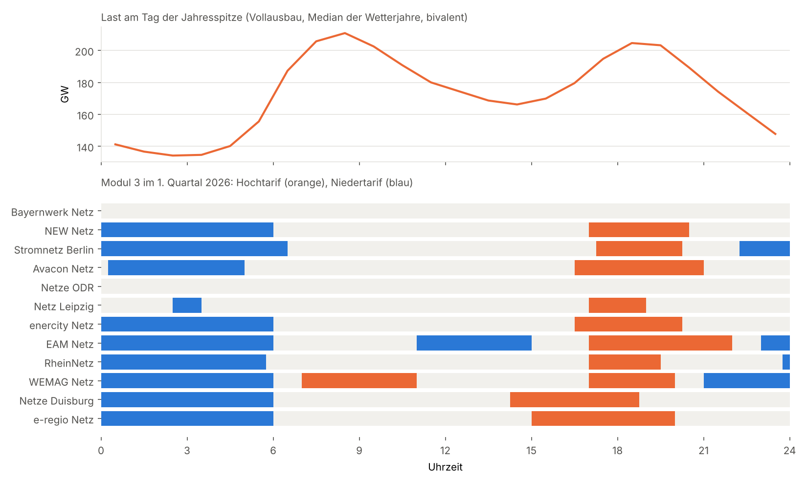
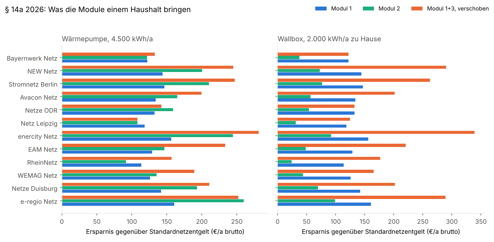
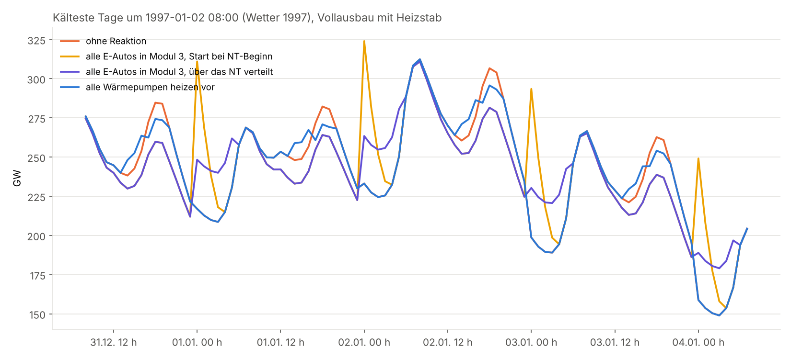
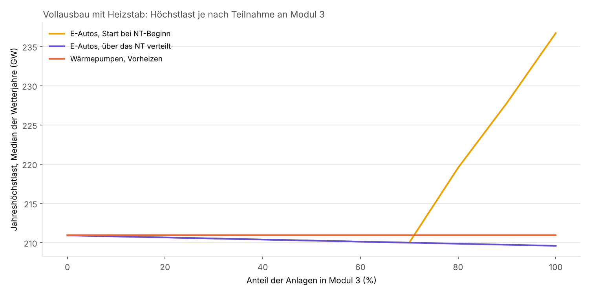

# Steuerbarkeit nach § 14a EnWG: Senken Wärmepumpen und E-Autos die Lastspitze?

Einmalige Auswertung vom 26.10.2026. Die Frage: Neue Wärmepumpen und Wallboxen sind seit
2024 steuerbare Verbrauchseinrichtungen. Ihre Betreiber wählen zwischen drei Modulen. Reicht
der Anreiz aus Modul 3, damit sie ihren Verbrauch aus der Lastspitze nehmen? Oder wählen
die meisten Modul 1 oder 2, sodass die Steuerbarkeit an der Höchstlast nichts ändert?

Die Analyse baut auf [elektrifizierung-last](../elektrifizierung-last/README.md) auf (alle
Pkw elektrisch, Wärmepumpen statt fossiler Heizungen, Jahreshöchstlast 185 GW im Median der
Wetterjahre 1991–2025). Neu sind bivalente Wärmepumpen mit Heizstab und die Reaktion der
Haushalte auf die Zeitfenster aus Modul 3. Keine der Reihen geht in die Datenbank; die
Preisblätter sind von Hand mit Quelle übernommen.

## Ergebnis in Kürze

**Der Anreiz aus Modul 3 ist nicht zu klein, er sitzt an der falschen Stelle.** Wer
verschieben kann, fährt bei 9 von 12 untersuchten Netzbetreibern mit Modul 1+3 am besten.
Ein Haushalt mit Wallbox spart damit im Median 202 € im Jahr (Modul 1: 133 €, Modul 2:
55 €), mit Wärmepumpe 205 € (Modul 2: 162 €). Das ist eine Obergrenze: Sie setzt voraus,
dass die Wärmepumpe den Hochtarif immer meidet. Die Zeitfenster zielen aber auf die
abendliche Spitze im örtlichen Niederspannungsnetz. Die bundesweite Höchstlast einer
elektrifizierten Wärmeversorgung entsteht an kalten Wintermorgen. Dort greift kein
Hochtarif, und die Wärmepumpen haben keine Leistung frei, um auszuweichen.

**Heizstäbe treiben die Spitze stärker als jede Steuerung sie senkt.** Liegt der
Bivalenzpunkt der Luft-Wärmepumpen zwischen −5 und 0 °C, steigt die Jahreshöchstlast im
Median von 185 auf 211 GW, im Kältejahr 1997 von 242 auf 312 GW. Allein die Heizstäbe ziehen
in dieser Stunde 144 GW. Über das Jahr verbrauchen sie nur 8 TWh, 5 % des Wärmepumpenstroms.
Die Spitze liegt dann in 26 von 35 Wetterjahren um 8 Uhr morgens, nicht am Abend.

**Modul 3 senkt die Höchstlast so gut wie gar nicht und kann sie erhöhen.**

| Szenario (Vollausbau, Bivalenzpunkt −5 bis 0 °C) | Spitze Median (GW) | Spitze 1997 (GW) | Änderung Median |
|---|---|---|---|
| ohne Reaktion | 210,9 | 312,3 | – |
| 30 % der E-Autos in Modul 3 | 210,5 | 311,9 | −0,4 |
| alle E-Autos in Modul 3, Ladestart bei NT-Beginn | 236,7 | 323,9 | +25,8 |
| alle E-Autos in Modul 3, über das NT verteilt | 209,6 | 310,9 | −1,3 |
| alle Wärmepumpen heizen vor dem Hochtarif vor | 210,9 | 312,3 | 0,0 |
| E-Autos systemdienlich (Lastglättung) | 198,2 | 300,3 | −12,7 |
| Obergrenze Dimmung: Heizstäbe aus, Wallboxen auf 4,2 kW | 159,6 | 169,8 | −51,3 |

Laden ab etwa 70 % der E-Autos im Niedertarif und starten alle bei dessen Beginn, entsteht
um Mitternacht eine neue Spitze über der alten. Vorheizen ändert an der Spitze nichts:
Unterhalb des Bivalenzpunkts läuft der Verdichter schon am Anschlag, und mit dem Heizstab
vorzuheizen lohnt sich bei COP 1 nicht.

**Dimmen ist kein Ersatz.** Rechnerisch brächte das Dimmen aller Anlagen auf 4,2 kW 51 GW,
fast nur durch abgeschaltete Heizstäbe. Die Wärme fehlt dann aber in den Häusern, und das an
mehreren Tagen hintereinander. Der Netzbetreiber darf auch nur dimmen, wenn sein örtliches
Netz überlastet ist, und muss jeden Eingriff begründen und melden. Für die bundesweite
Spitze taugt das nicht. Sie lässt sich nur über Anreize senken.

**Folgerung:** Die These hält, aber aus einem anderen Grund als vermutet. Nicht die Höhe
des Rabatts entscheidet, sondern drei Dinge, die Modul 3 nicht adressiert:

1. Die Zeitfenster sind fest, örtlich und meist nur am Abend. Nur WEMAG hat ein
   Morgenfenster. Bayernwerk und Netze ODR bieten im Winter gar keins an.
2. Wärmepumpen können an den kritischen Tagen nicht verschieben. Wirksam sind dort nur
   kleinere Heizstab-Anteile: tiefere Bivalenzpunkte (bei −10 bis −5 °C sinkt die Spitze
   im Median auf 187 GW), besser gedämmte Gebäude oder Wärmespeicher mit Reserveleistung.
3. Feste Niedertarife bündeln die Ladung. Ein Signal muss die bundesweite Knappheit
   abbilden und Starts streuen. Das kann ein dynamischer Tarif, der heute schon ähnlich
   viel bringt: 59 € im Jahr für eine Wallbox und 87 € für eine Wärmepumpe, die ein Fünftel
   ihres Tagesbedarfs verschiebt (Day-Ahead 2024–2025).

Für die Prognose heißt das: §-14a-Module sind kein sinnvolles Merkmal für die Höchstlast.
Wichtig sind Temperatur und Tageszeit (Wintermorgen) sowie der Anteil an Heizstäben.

## Preisblätter 2026



Stichprobe aus zwölf Netzbetreibern, darunter große Flächennetze und Stadtnetze. Werte
netto, Niederspannung ohne Leistungsmessung, vollständig in
[tabellen/preisblaetter_2026.csv](tabellen/preisblaetter_2026.csv).

- **Modul 1:** pauschal 96–135 € netto im Jahr. Die Pauschale folgt überall der Formel aus
  BK8-22/010-A: 80 € brutto plus 20 % von 3.750 kWh zum Standard-Arbeitspreis. Die Werte aller
  zwölf Preisblätter stimmen damit auf den Cent überein
  ([tabellen/preisblaetter_pruefung.csv](tabellen/preisblaetter_pruefung.csv)).
- **Modul 2:** 40 % des Arbeitspreises, kein Grundpreis, aber ein eigener Zählpunkt (hier
  mit 25 € netto im Jahr angesetzt).
- **Modul 3:** nur zusammen mit Modul 1 und mit intelligentem Messsystem. Hochtarif
  6,6–15,5 ct/kWh, Niedertarif 0,5–3,6 ct/kWh. Zehn Netzbetreiber haben ein Hochtariffenster
  am späten Nachmittag oder Abend im Winter, zwei (Bayernwerk, Netze ODR) nur im Sommer.
  Netze ODR legt den Hochtarif im Sommer auf die Nacht (22–5 Uhr), Bayernwerk den
  Niedertarif auf die Mittagszeit (10–15 Uhr), also auf die PV-Einspeisung. Das vorläufige
  Preisblatt von Netz Leipzig nennt einen Hochtarif unter dem Standardtarif.

## Was ein Haushalt spart



Ersparnis gegenüber dem Standardnetzentgelt in € brutto im Jahr. Wärmepumpe: 4.500 kWh im
Jahr, Tagesgang und Jahresverlauf aus der Hochrechnung (bivalent). Wallbox: 2.000 kWh zu
Hause, Ladung ab Ankunft wie in elektrifizierung-last.

- **Modul 1+3 passiv** (ohne Verhaltensänderung) liegt meist zwischen Modul 1 und 2.
- **Modul 1+3 verschoben:** Die Wallbox lädt in der billigsten Nachtstunde zwischen 18 und
  7 Uhr. Die Wärmepumpe meidet den Hochtarif (heizt vorher, zahlt Standardtarif) und legt
  10 % ihres Tagesbedarfs in den Niedertarif.
- **Mehrwert von Modul 3** gegenüber dem besseren von Modul 1 und 2 (Median): 65 € für die
  Wallbox, 36 € für die Wärmepumpe. Bei Netze ODR, Netz Leipzig und e-regio ist Modul 2 oder
  Modul 1 für die Wärmepumpe günstiger.

Ein dynamischer Stromtarif bringt eine ähnliche Größenordnung über den Energiepreis: Die
Wallbox spart im Mittel 2,5 ct/kWh (59 € im Jahr), die Spanne zwischen den vier teuersten
und den vier billigsten Stunden eines Tages beträgt 8,1 ct/kWh (87 € im Jahr bei 20 %
Verschiebung). Beide Anreize lassen sich kombinieren. Sie zeigen aber in verschiedene
Richtungen, wenn das Netzentgelt den Abend verteuert und die Börse den Morgen.

## Was das für die Höchstlast heißt





**Heizstab.** Die Luft-Wärmepumpen (85 % der Anlagen) sind so ausgelegt, dass sie am
Bivalenzpunkt (Tagesmittel der Temperatur) den Wärmebedarf gerade decken. Die
Bivalenzpunkte sind gleich über −5 bis 0 °C verteilt. Unterhalb sinkt die Heizleistung um
2,5 % je Kelvin, den Rest liefert der Heizstab mit COP 1. Sole-Wärmepumpen bleiben
monovalent.

| Auslegung | Spitze Median (GW) | Spitze max. (GW) | Heizstab in der Spitzenstunde (GW) | Heizstab (TWh/a) |
|---|---|---|---|---|
| monovalent (elektrifizierung-last) | 185,3 | 241,5 | 0 | 0 |
| Bivalenzpunkt −5 bis 0 °C | 210,9 | 312,3 | 143,5 | 8,3 |
| Bivalenzpunkt −10 bis −5 °C | 186,7 | 288,9 | 96,2 | 0,8 |

**Zeitpunkt der Spitze.** Monovalent liegt sie in 27 von 35 Wetterjahren um 18 Uhr, wenn
E-Autos nach Ankunft laden. Mit Heizstab liegt sie in 26 von 35 Jahren um 8 Uhr: Der
Wärmebedarf ist morgens am höchsten, die Außentemperatur am tiefsten, die Heizleistung der
Wärmepumpe am kleinsten.

**Modul 3.** Repräsentatives Fenster aus der Stichprobe: Hochtarif 17–20 Uhr, Niedertarif
0–6 Uhr, im 1. und 4. Quartal. 10 der 12 Netzbetreiber haben im Winter einen Hochtarif um
17–19 Uhr; die Teilnahme gilt nur für diesen Anteil.

- *E-Autos:* Der teilnehmende Anteil lädt nicht ab Ankunft, sondern in der folgenden Nacht
  im Niedertarif. Zwei Varianten: Start bei NT-Beginn (50/30/15/5 % der Energie in den ersten
  vier Stunden) oder gleich über 0–6 Uhr verteilt.
- *Wärmepumpen:* Raumwärme aus 17–20 Uhr wird 14–17 Uhr vorab gedeckt, aber nur so weit,
  wie der Verdichter dort Leistung frei hat.

## Grenzen

- Stichprobe von 12 Netzbetreibern; die vollständige Sammlung der Preisblätter läuft in
  einem eigenen Projekt. Vier Preisblätter sind vorläufig (Avacon, Netz Leipzig, enercity,
  EAM). Die Zeitfenster wurden aus PDF-Tabellen gelesen; bei Avacon und EAM ist die Zuordnung
  nicht ganz eindeutig.
- Die Haushaltsrechnung nimmt an, dass die Wärmepumpe den Hochtarif immer meidet. An kalten
  Tagen geht das nicht, der Vorteil von Modul 3 ist für sie also eine Obergrenze.
- Der Heizstab ist nicht in seiner Leistung begrenzt. Reale Heizstäbe haben 6–9 kW je
  Einfamilienhaus; reicht das nicht, kühlt das Haus aus, und die Spitze fällt etwas kleiner
  aus. Größere Gebäude mit Wärmepumpe sind oft anders ausgelegt. Die Spitze mit Heizstab ist
  daher eher eine obere Abschätzung, die Richtung aber robust.
- Wärmespeicher, Pufferspeicher und Gebäudemasse über drei Stunden hinaus sind nicht
  abgebildet. Sie wären der Hebel, mit dem Wärmepumpen auch an kalten Tagen verschieben
  könnten, wenn genug Verdichterleistung dafür installiert ist.
- Bestandsanlagen vor 2024 mit unterbrechbarem Wärmepumpentarif (Sperrzeiten des
  Netzbetreibers) sind nicht getrennt betrachtet. Sie fallen im Vollausbau kaum ins Gewicht.
- Die Dimmung ist nur als rechnerische Obergrenze angegeben. Die Festlegung BK6-22-300
  erlaubt sie nur bei drohender Überlastung des örtlichen Netzes, auf mindestens 4,2 kW je
  Anlage, mit Nachweis und Veröffentlichung jedes Eingriffs.

## Quellen

Frei, maschinell geladen:

- Day-Ahead-Preise DE-LU stündlich 2024–2025: [SMARD](https://www.smard.de)
  (Bundesnetzagentur, CC BY 4.0)
- Temperatur, Netzlast, Pkw-Bestand: wie in
  [elektrifizierung-last](../elektrifizierung-last/README.md#quellen)

Von Hand übernommen (nur für diese Analyse), Preisblätter Netzentgelte Strom 2026:

- [Bayernwerk Netz](https://www.bayernwerk-netz.de/content/dam/revu-global/bayernwerk-netz/files/netz/netzzugang/netzentgeltestrom/bayernwerk-preisblatt-netzentgelte-2026.pdf)
- [NEW Netz](https://www.new-netz.de/mediathek/Preisblatt_NN_Strom_2026.pdf)
- [Stromnetz Berlin](https://www.stromnetz.berlin/files/globalassets/dokumente/entgelte/zugang/entgelte-01-01-2026/nne-b-2026_20260522.pdf)
- [Avacon Netz](https://www.avacon-netz.de/content/dam/revu-global/avacon-netz/documents/netzentgelte-strom/2026/Preisbl%C3%A4tter_AVANG_Strom_01.01.2026.pdf) (vorläufig)
- [Netze ODR](https://www.netze-odr.de/fileadmin/Netze-ODR/Dokumente/Unternehmen/Veroeffentlichungen/Netzentgelte/Netzentgelte_Strom_2026.pdf)
- [Netz Leipzig](https://files.l.de/lde-typo3/Netz/Downloads/Netznutzung/Strom/Preisblatt_Netzentgelte_Strom_2026__voraussichtlich_.pdf) (vorläufig)
- [enercity Netz](https://www.enercity-netz.de/assets/cms/eng/partner/preisarchiv-strom/preisblatt-netznutzung-strom-2026-tag-vorlaeufig.pdf) (vorläufig)
- [EAM Netz](https://www.eam-netz.de/fileadmin/user_upload/Ueber_Uns/Netzinformation/Netzentgelte/strom/251009_Preisblatt_EAM_Netz_Strom_2026_-_unter_Vorbehalt.pdf) (vorläufig)
- [RheinNetz](https://www.rheinnetz.de/netzentgelte-strom-ab-dem-01.01.2026.pdfx)
- [WEMAG Netz](https://www.wemag-netz.de/media/506/download)
- [Netze Duisburg](https://www.netze-duisburg.de/fileadmin/user_upload/Netz_nutzen/Netzentgelte/Strom/251215_Netze_Duisburg_-_Preisblatt_Strom_2026_Final.pdf)
- [e-regio Netz](https://cms.e-regio.de/assets/global/Dokumente/Netznutzungsentgelte/2025-12-19-Netzentgelte-Strom-e-regio-Netz-2026.pdf)

Einordnung der Zeitfenster 2025/2026: [ZfK, 18.11.2025](https://www.zfk.de/politik/regulierung/zeitvariable-netzentgelte-modul-3-netzbetreiber).
VNBdigital veröffentlicht keine Netzentgelte oder Preisblätter nach § 14a (Stand 26.10.2026).

## Aufruf

Aus dem Repository-Wurzelverzeichnis, mit demselben Cache wie elektrifizierung-last
(lädt beim ersten Lauf zusätzlich die SMARD-Preise):

```bash
uv run --no-project --with pandas --with matplotlib --with httpx --with holidays \
    python docs/analysen/steuerbarkeit-14a/auswertung.py --cache /tmp/el
```

Ergebnisse: [tabellen/](tabellen/) (Preisblätter, Haushaltsrechnung, Bivalenz, Szenarien,
Teilnahmekurven, `lauf.json`) und [grafiken/](grafiken/).
