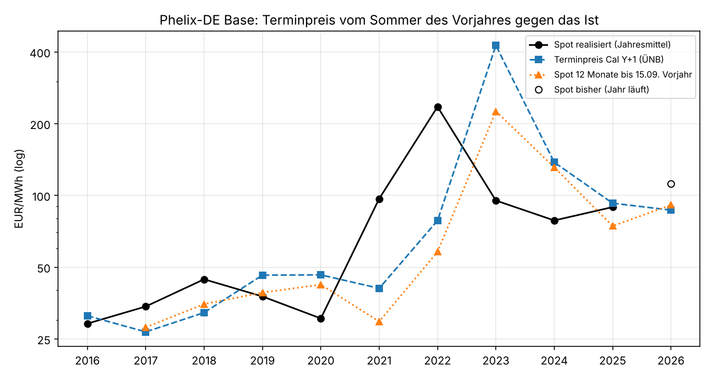

# Terminpreise: Wie gut trifft der Jahres-Future den späteren Spotpreis?

Einmalige Auswertung vom 25.10.2026, Auftrag in [job.yaml](job.yaml). Frage: Taugt der Terminpreis als Messlatte für ein eigenes,
aus freien Daten geschätztes Preisniveau? Konkret: Wie nah kommt der Phelix-DE Base Year Future
für das Folgejahr (Cal Y+1) dem Jahresmittel des Day-Ahead-Preises, das später tatsächlich
eintritt? Hintergrund: Eine freie Quelle für Terminpreise gibt es nicht (Energy-Charts darf die
EEX-Settlements nicht weitergeben). Das Projekt muss das Niveau also selbst schätzen und
braucht einen Maßstab dafür.

## Ergebnis in Kürze

**Der Terminpreis sagt das Folgejahr nicht besser voraus als ein einfaches Spot-Mittel.**
Lieferjahre 2017–2025 (9 Jahre), Schätzung minus Ist, jeweils am Stand vom 15.09. des
Vorjahres:

| Schätzer | Bias | MAE | Median abs. Fehler | MAPE |
|---|---|---|---|---|
| Terminpreis Cal Y+1 (ÜNB, Mittel 16.06.–15.09.) | +20,5 EUR/MWh | 72,3 EUR/MWh | 52 % | 75 % |
| Spot-Mittel 16.06.–15.09. des Vorjahres | +7,8 EUR/MWh | 61,4 EUR/MWh | 29 % | 62 % |
| Spot-Mittel der 12 Monate bis 15.09. des Vorjahres | −8,8 EUR/MWh | 52,4 EUR/MWh | 39 % | 50 % |

Ohne die Krisenjahre 2021–2024 (5 Jahre: 2017–2020, 2025) liegen alle drei gleichauf:
Terminpreis 9,5, Spot Sommer 10,5, Spot 12 Monate 8,8 EUR/MWh MAE, also rund 20–25 %.

**Die großen Fehler entstehen bei Brüchen, und dort liegt der Markt genauso daneben.** 2021
und 2022 lag der Terminpreis 58 % bzw. 67 % unter dem Ist, 2023 lag er 347 % über dem
Ist (425,61 gegen 95,18 EUR/MWh). Der Future vom Sommer 2022 hat den Höchststand der Gaskrise
ins Folgejahr fortgeschrieben, genau wie das naive Mittel.

**In ruhigen Jahren sind Abweichungen von ±20–50 % normal.** 2018 lag der Terminpreis 27 %
unter dem Ist, 2020 (Corona) 52 % darüber. Auch für 2010–2014 nennt die Bundesregierung eine
mittlere Überschätzung des Börsenpreises in den Prognosen von 8,80 EUR/MWh
([BT-Drs. 18/7208](https://dserver.bundestag.de/btd/18/072/1807208.pdf), S. 3). Das
Öko-Institut beziffert 2013 auf 51 EUR/MWh geplant gegen rund 38 EUR/MWh realisiert
([Öko-Institut 2013](https://www.oeko.de/oekodoc/1825/2013-495-de.pdf), S. 16).

**Folgerung für das eigene Preisniveau:**

- Der Terminpreis ist keine genaue Vorhersage. Er ist der Preis, zu dem man sich heute
  absichern kann, mit Risikoprämie. Ein eigenes Modell muss ihn nicht treffen.
- Gemessen wird das eigene Niveau am realisierten Spot. Die Messlatte sind die naiven
  Spot-Mittel aus dieser Analyse; wer sie im Backtest nicht schlägt, bringt nichts.
- Ein Jahreswert je Lieferjahr ist für belastbare Aussagen zu wenig (9 Paare, davon 4
  Krisenjahre). Der Backtest des eigenen Modells sollte Monate als Ziel nehmen und mehrere
  Horizonte (1–18 Monate) auswerten.

## Grafik



Logarithmische Achse, damit 2022/2023 die übrigen Jahre nicht erdrücken. 2026 läuft noch
(Stand bis 26.10.2026: 111,76 EUR/MWh gegen 86,78 EUR/MWh Terminpreis).

## Daten und Methode

- **Terminpreis:** der Phelix-DE Baseload Year Future für das Lieferjahr, den die
  Übertragungsnetzbetreiber für die Prognose der EEG-Umlage (bis 2022) bzw. des
  EEG-Finanzierungsbedarfs (ab 2023) ansetzen. Seit 2019 ist das laut Quelle das Mittel der
  Handelstage 16.06.–15.09. des Vorjahres; für ältere Jahre nennen die Sekundärquellen den
  Zeitraum nicht. Die Werte wurden einmalig von Hand aus den Veröffentlichungen übernommen,
  jede Zeile in [tabellen/terminpreise.csv](tabellen/terminpreise.csv) trägt Quelle und
  Fundstelle. Sie fließen in kein Modell und in keine Datenbank ein.
- **Spot realisiert:** Jahresmittel des Day-Ahead-Preises aus der
  [Energy-Charts-API](https://api.energy-charts.info/) (`/price`, Fraunhofer ISE), Lizenz
  CC BY 4.0 (Bundesnetzagentur | SMARD.de). Gebotszone DE-AT-LU bis 30.09.2018, danach DE-LU.
  Seit 01.10.2025 Viertelstunden, vorher auf Stunden gemittelt. Ein Jahr gilt als vollständig
  ab 8 700 Stunden.
- **Naive Schätzer:** Mittel der Spotpreise, die am 15.09. des Vorjahres bekannt waren: über
  denselben Zeitraum wie der Terminpreis (16.06.–15.09.) und über die 12 Monate davor.
  Mindestens 95 % der Stunden, sonst fehlt der Wert (2016: 12-Monats-Mittel fehlt, weil die
  Daten erst 2015 beginnen).
- **Kennzahlen:** Bias = mittlere Abweichung Schätzung minus Ist, MAE = mittlerer
  absoluter Fehler, MAPE = mittlerer absoluter Fehler in Prozent des Ist.

Aufruf aus dem Repository-Wurzelverzeichnis (lädt die Spotpreise von Energy-Charts, etwa
2 Minuten):

```
uv run --no-project --with pandas --with matplotlib --with httpx \
    python docs/analysen/terminpreis-treffsicherheit/auswertung.py --cache /tmp/spot.csv.gz
```

Ergebnisse: [tabellen/paare.csv](tabellen/paare.csv) (je Lieferjahr),
[tabellen/kennzahlen.csv](tabellen/kennzahlen.csv),
[tabellen/kennzahlen_ohne_krise.csv](tabellen/kennzahlen_ohne_krise.csv).

## Einschränkungen

- 9 Lieferjahre sind eine sehr kleine Stichprobe; ein einzelnes Krisenjahr verschiebt jeden
  Mittelwert. Die Aussage "nicht besser als naiv" gilt für diesen Zeitraum, nicht allgemein.
- Für 2015 fehlt der Terminpreis (keine Quelle gefunden), für 2013/2014 der realisierte
  Spotpreis in der Energy-Charts-API. Diese Jahre fehlen in den Kennzahlen.
- 2016–2018 stammen aus Sekundärquellen (Öko-Institut). Der Bericht von 2018 ordnet
  32,22 EUR/MWh auf S. 23 dem Jahr 2017 zu, auf S. 16 und S. 29 dem Jahr 2018; verwendet ist
  2018, weil S. 28 für 2017 ausdrücklich 26,75 EUR/MWh nennt.
- 2020: Die ÜNB-Folie nennt den Wert nur im Vergleich ("49,34 EUR/MWh statt 46,41 EUR/MWh"
  für die Liquiditätsreserve). Verwendet ist 46,41 EUR/MWh als regulär angesetzter Preis.
- Der ÜNB-Wert ist ein Mittel über drei Monate, kein einzelner Settlement-Preis. Ein Future
  vom 15.09. oder vom Jahresende kann näher oder weiter weg liegen.

## Quellen

- Übertragungsnetzbetreiber, Veröffentlichungen zur EEG-Umlage bzw. zum
  EEG-Finanzierungsbedarf auf netztransparenz.de:
  [2019](https://www.netztransparenz.de/xspproxy/api/staticfiles/ntp-relaunch/dokumente/erneuerbare%20energien%20und%20umlagen/eeg-umlage/eeg-umlage%202019/20181015_vero%CC%88ffentlichungeeg-umlage2019.pdf),
  [2020](https://www.netztransparenz.de/xspproxy/api/staticfiles/ntp-relaunch/dokumente/erneuerbare%20energien%20und%20umlagen/eeg-umlage/eeg-umlage%202020/2019-10-15vero%CC%88ffentlichungeeg-umlage2020.pdf),
  [2021](https://www.netztransparenz.de/xspproxy/api/staticfiles/ntp-relaunch/dokumente/erneuerbare%20energien%20und%20umlagen/eeg-umlage/eeg-umlage%202021/2020-10-15vero%CC%88ffentlichungeeg-umlage2021.pdf),
  [2022](https://www.netztransparenz.de/xspproxy/api/staticfiles/ntp-relaunch/dokumente/erneuerbare%20energien%20und%20umlagen/eeg-umlage/eeg-umlage%202022/2021-10-15vero%CC%88ffentlichungeeg-umlage2022.pdf),
  [2023](https://www.netztransparenz.de/xspproxy/api/staticfiles/ntp-relaunch/dokumente/erneuerbare%20energien%20und%20umlagen/eeg-umlage/eeg-finanzierungsbedarf%202023/2022-10-14vero%CC%88ffentlichungeeg-finanzierungsbedarf2023.pdf),
  [2024](https://www.netztransparenz.de/xspproxy/api/staticfiles/ntp-relaunch/dokumente/erneuerbare%20energien%20und%20umlagen/eeg/eeg%20finanzierung/eeg-finanzierungsbedarf/2023-10-25%20ver%C3%B6ffentlichung%20eeg-finanzierungsbedarf%202024.pdf),
  [2025](https://www.netztransparenz.de/xspproxy/api/staticfiles/ntp-relaunch/dokumente/erneuerbare%20energien%20und%20umlagen/eeg/20241025%20ver%C3%B6ffentlichung%20eeg-finanzierungsbedarf%202025.pdf),
  [2026](https://www.netztransparenz.de/xspproxy/api/staticfiles/ntp-relaunch/dokumente/erneuerbare%20energien%20und%20umlagen/eeg/eeg%20finanzierung/eeg-finanzierungsbedarf/20251024%20ver%C3%B6ffentlichung%20eeg-finanzierungsbedarf%202026.pdf)
- Öko-Institut: [Analyse der EEG-Umlage 2014](https://www.oeko.de/oekodoc/1825/2013-495-de.pdf)
  (Kurzstudie für Agora Energiewende, 2013) und
  [Wieviel kostet erneuerbarer Strom? Analyse der EEG-Umlage von 2010 bis 2018](https://www.oeko.de/fileadmin/oekodoc/Endbericht-Analyse-EEG-Umlage-2010-2018.pdf)
- Deutscher Bundestag, [Drucksache 18/7208](https://dserver.bundestag.de/btd/18/072/1807208.pdf)
- Fraunhofer ISE, [Energy-Charts-API](https://api.energy-charts.info/), Day-Ahead-Preise
  DE-AT-LU und DE-LU, CC BY 4.0 (Bundesnetzagentur | SMARD.de)
