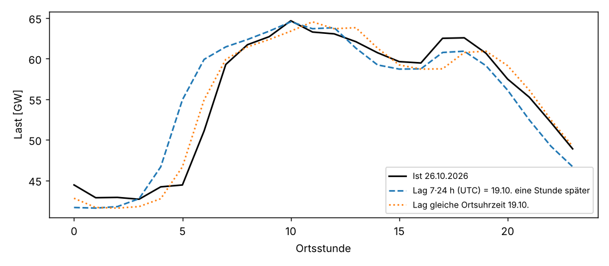
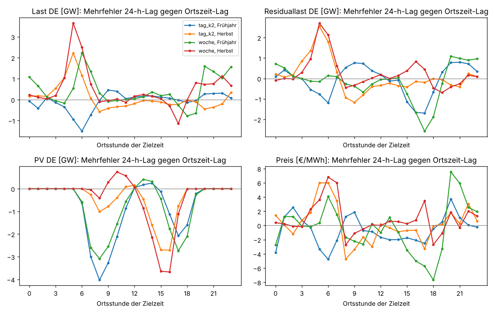

# Zeitumstellung: Warum die Lastprognose am 26.10.2026 danebenlag

Einmalige Auswertung vom 27.10.2026, Auftrag in [job.yaml](job.yaml). Anlass: Nach der
Umstellung von Sommer- auf Winterzeit am Sonntag, 25.10.2026, lag die Prognose für Montag,
26.10., auffällig daneben. Frage: Fehlt dem Modell die gültige Zeit, oder greift ein Merkmal
über die Umstellung hinweg falsch?

## Ergebnis in Kürze

**Die gültige Zeit kennt das Modell schon.** Die Kalendermerkmale (`hour`, `dow`, `weekend`,
Feiertage …) werden in Ortszeit Europe/Berlin gerechnet, dazu kommt ein Sommerzeit-Flag `dst`.
Daran liegt es nicht.

**Der Fehler steckt in den Lag-Merkmalen.** `lag_<reihe>_day` und `lag_<reihe>_week` holten
„dieselbe Stunde" an einem früheren Tag als feste Zeitspanne k·24 h in UTC. Liegt eine
Umstellung dazwischen, ist das in Ortszeit eine Stunde daneben. Für Montag, 26.10., 05 Uhr MEZ
lieferte der Wochen-Lag den Wert von Montag, 19.10., **06 Uhr** MESZ. Das Modell übernimmt
den Wochen-Lag der Last fast eins zu eins und legte den Morgenanstieg deshalb eine Stunde zu
früh:

| 26.10.2026, Ortszeit | Prognose P50 | Ist | Fehler | Wochen-Lag (19.10., eine Stunde später) |
|---|---|---|---|---|
| 05 Uhr | 52,5 GW | 44,4 GW | **+8,0 GW** | 52,4 GW |
| 06 Uhr | 58,8 GW | 51,1 GW | **+7,7 GW** | 58,7 GW |
| übrige 22 Stunden | | | höchstens ±2,2 GW | |

Tagesmittel des Lastfehlers (MAE) am 26.10.: 1,37 GW. Ohne die zwei Morgenstunden wären es
etwa 0,8 GW. Modell `de_lu_v1-kalender-202610242054-9a18ba`, Ausgabe 25.10. 08 UTC, D+1.



**Über acht Jahre bestätigt.** Auf den SMARD-Reihen 2019–2026 ist der Wochen-Lag der Last in
der Woche nach einer Umstellung mit Ortszeit **13 % (Frühjahr) bzw. 16 % (Herbst)** genauer
als mit 7·24 h. Bei der PV ist es umgekehrt: Sie folgt dem Sonnenstand, also UTC; in Ortszeit
wäre der Lag 24–41 % schlechter. Preis und Residuallast mischen beides und liegen in beiden
Varianten gleichauf (±2 %).

**Korrektur (in diesem PR):** Neue Option `lag_local_time` in der Modellkonfiguration. Für die
dort genannten Reihen greifen `_day` und `_week` auf dieselbe Ortsuhrzeit zurück; die doppelte
02-Uhr-Stunde im Oktober wird gemittelt, die fehlende im März durch 03 Uhr ersetzt. Der
Leakage-Schutz bleibt: Liegt die Ortsuhrzeit der Vorwoche schon nach dem Wissensstand, nimmt
das Merkmal die Woche davor. In `de_lu_v1` und `de_lu_v2` steht `lag_local_time:
[load_actual]`. Alle anderen Reihen bleiben unverändert bei k·24 h. Bestehende Modelle rechnen
mit ihrer gespeicherten Konfiguration weiter wie bisher; wirksam wird die Korrektur erst mit
dem nächsten Training.

**Nicht durch die Zeitumstellung erklärt:** Der Preisfehler am 26.10. (MAE 37,6 €/MWh, bis
−93 €/MWh um 18 Uhr) kommt vor allem vom Wind. Die Variante `kalender` hat kein Wetter und sagte
für Wind an Land 36–37 GW voraus; tatsächlich waren es nachmittags 16–20 GW. Nur der zu hohe
Preis von 0 bis 5 Uhr passt zum verschobenen Lag.

## Wie groß der Effekt je Reihe ist

Naive Prognose „Wert k Tage früher", einmal als k·24 h (UTC), einmal als dieselbe Ortsuhrzeit.
Fenster: Umstellungstag bis k Tage danach, gemittelt über die Umstellungen 2019 bis 10/2026
(je 8 im Frühjahr und Herbst). Gewinn = 1 − MAE Ortszeit / MAE UTC; positiv heißt, Ortszeit
ist besser.

| Reihe | Lag | Frühjahr: MAE UTC → Ortszeit | Gewinn | Herbst: MAE UTC → Ortszeit | Gewinn |
|---|---|---|---|---|---|
| Last | Vorwoche | 3,58 → 3,13 GW | **+12,6 %** | 2,96 → 2,49 GW | **+15,8 %** |
| Last | Vortag (k=1) | 6,63 → 6,95 GW | −4,8 % | 5,93 → 5,56 GW | +6,3 % |
| Last | k=2 | 9,56 → 9,64 GW | −0,8 % | 8,98 → 8,89 GW | +1,0 % |
| PV | Vorwoche | 3,03 → 3,76 GW | **−24,2 %** | 1,40 → 1,82 GW | **−30,1 %** |
| PV | k=2 | 2,46 → 3,24 GW | −31,9 % | 0,98 → 1,38 GW | −40,8 % |
| Residuallast | Vorwoche | 10,36 → 10,51 GW | −1,4 % | 11,60 → 11,36 GW | +2,1 % |
| Preis | Vorwoche | 30,3 → 30,7 €/MWh | −1,3 % | 41,5 → 40,5 €/MWh | +2,4 % |
| Preis | k=1 | 30,8 → 32,6 €/MWh | −5,6 % | 34,8 → 34,7 €/MWh | +0,3 % |

Vollständig in [tabellen/zusammenfassung.csv](tabellen/zusammenfassung.csv), je Umstellung in
[tabellen/je_umstellung.csv](tabellen/je_umstellung.csv). Beim Wochen-Lag der Last ist
Ortszeit in 15 von 16 Umstellungen besser (Ausnahme Frühjahr 2024, Ostern).

Die Tageslags der Last gewinnen kaum. Das Fenster umfasst nur den Umstellungssonntag und ein bis
zwei Folgetage; dort vergleicht der Lag ohnehin verschiedene Wochentage (Sonntag gegen Samstag,
Montag gegen Sonntag), und dieser Unterschied überdeckt die eine Stunde Versatz.

Übers ganze Jahr ändert die Korrektur wenig (Wochen-Lag Last −0,8 % MAE), weil nur 2 von 52
Wochen betroffen sind. In diesen Wochen aber trifft sie genau die teuren Stunden:



Bei der Last liegt der Mehrfehler am Morgenanstieg (5–7 Uhr, im Herbst im Mittel bis 3,7 GW)
und am Abend. Bei der PV ist es spiegelbildlich: Morgens und nachmittags verschiebt Ortszeit
die Sonnenkurve um eine Stunde, deshalb bleibt die PV bei k·24 h.

## Warum das Sommerzeit-Flag nicht reicht

`dst` sagt dem Modell, ob die Zielstunde in der Sommerzeit liegt, nicht ob der Lag über eine
Umstellung greift. Ein Merkmal „Lag ist verschoben" hätte das Modell nur an 2 × 7 Tagen im Jahr
sehen können, zu selten für die Bäume, um den Versatz selbst herauszurechnen. Die Korrektur am
Merkmal ist einfacher und wirkt sofort.

## Daten und Methode

| | |
|---|---|
| Prognosen | `fcst.prediction_error` auf der VM, Ausgabe 08 UTC, D+1, 26.10.2026 (lesend) |
| Reihen | SMARD Stundenwerte: Netzlast DE (410), Residuallast DE (4359), PV DE (4068), Day-Ahead-Preis DE-LU (4169); CC BY 4.0, Bundesnetzagentur \| SMARD.de |
| Zeitraum | 01.10.2018–26.10.2026, Umstellungen 2019–2026 |
| Lags | k = 1, 2 (Tageslag; das Modell nutzt für die Last D+1 k = 2, für den Preis k = 1) und 7 (Vorwoche) |
| Ortszeit-Lag | gleiche Wanduhrzeit k Ortstage zurück; doppelte Stunde: erste; fehlende Stunde: k·24 h |

Aufruf aus dem Repository-Wurzelverzeichnis:

```
uv run --with matplotlib python docs/analysen/zeitumstellung/auswertung.py
```

## Nächste Schritte

- Neutraining mit der Korrektur (neue Versionen in beiden Linien), danach Backtest der Woche
  nach den Umstellungen gegen die bisherigen Versionen.
- Die Variante `kalender` hat kein Wetter; der Windfehler vom 26.10. ist ein Argument, die
  Wetter-Varianten zum Champion zu machen, sobald die GFS-Historie reicht.
