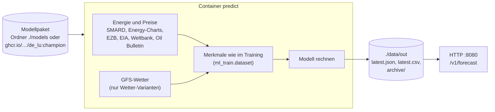

# Prognose-Stack (schlank)

Ein Container, der nur Prognosen rechnet: Er lädt ein fertig trainiertes Modellpaket, holt die
für eine Prognose nötigen Eingänge selbst bei freien Quellen und gibt Last DE und
Day-Ahead-Preis DE-LU (P10/P50/P90 je Stunde, Liefertage D+1 bis D+7) als Dateien und über eine
kleine HTTP-Schnittstelle aus. Kein Training, kein Backfill, keine Datenbank, kein S3.

Für wen: Nutzer der Prognosen, etwa für Home Assistant, evcc, Node-RED oder eigene Skripte zur
Steuerung von Speicher, Wärmepumpe oder Ladezeiten. Wer selbst trainieren will, braucht den
vollen Stack im Wurzelordner (`compose.yaml`, siehe [`docs/PROGNOSEMODELLE.md`](../docs/PROGNOSEMODELLE.md)).



## Schnellstart

```bash
cd predict
cp .env.example .env
mkdir -p models data
# Modellpaket nach ./models legen (siehe unten), dann:
docker compose up -d
curl -s localhost:8080/v1/forecast/da_price_de_lu | jq '.targets.da_price_de_lu[:3]'
```

Der erste Lauf dauert einige Minuten, weil die Historie der Eingänge einmal geladen wird
(Lags 45 Tage; bei Modellen mit Marktwerten oder Brennstoffpreisen bis gut zwei Jahre
Stundenwerte für die eigene Marktwertberechnung, rund 600 SMARD-Abrufe). Danach lädt jeder Lauf
nur das Fenster um heute und braucht Sekunden. Ohne Wetter-Variante lädt der Dienst kein GFS.

## Modell einbinden

`PDB_PREDICT_MODEL` ist entweder ein Ordner oder eine OCI-Referenz:

| Wert | Bedeutung |
|---|---|
| `/models` (Vorgabe) | Paket im Ordner `./models`, eingebunden nur lesend |
| `ghcr.io/the78mole/predictiondb-models/de_lu:champion` | Paket als ORAS-Artefakt aus GHCR, anonym; `champion` wird alle `PDB_PREDICT_MODEL_REFRESH_H` Stunden neu aufgelöst, ein Champion-Wechsel kommt also von selbst an |
| `ghcr.io/…/de_lu:de_lu_v2-frei-2026.10.24-3fa1c2` | feste Version |

Veröffentlicht werden Modelle auf GHCR erst, wenn mindestens drei Jahre GFS-Trainingsdaten
vorliegen (Tag-Schema in [ARCHITEKTUR.md 7.11](../docs/ARCHITEKTUR.md)). Bis dahin erzeugt der
Betreiber eines vollen Stacks ein Paket aus seiner Registry:

```bash
# im vollen Stack (Wurzelordner), Version aus "ml-train registry list"
docker compose --profile ml run --rm ml-train bundle <version> --out /data/pakete/<version>
# Bestand aus einem Snapshot statt der Datenbank (Laptop):
uv run ml-train --config config/ml/de_lu_v2.yaml bundle <version> --out pakete/<version> \
    --registry .ml-data/registry --snapshot .ml-data/snap
```

Den Ordner nach `predict/models/` kopieren (der Inhalt selbst, also `models/package.json`).

Ein Paket enthält das Modell, seine Konfiguration, das Manifest mit den Backtest-Kennzahlen,
den Bestand je Technologie aus dem MaStR (letzte 400 Tage, danach gilt der letzte Wert wie im
Training) und bei Wetter-Varianten die Gitter-Gewichte der Cluster, mit denen trainiert wurde.
Backtest-Prognosen mit Ist-Preisen sind nicht enthalten. Aufbau: `services/ml_train/src/ml_train/bundle.py`.

## Ausgabe

Gewählt sind **Dateien als Quelle der Wahrheit und eine kleine, nur lesende HTTP-Schnittstelle
darüber**:

- Dateien brauchen keine laufende Verbindung, überleben Neustarts, lassen sich per Volume,
  Freigabe oder `rsync` weiterreichen und von jedem Skript lesen. Sie werden atomar ersetzt.
- HTTP ist das, was Home Assistant (`rest`-Sensor), evcc, Node-RED und Grafana (Infinity) direkt
  abfragen können, ohne Dateizugriff auf den Host. Die Schnittstelle liest nur `latest.json`,
  Datei und Antwort sind also immer gleich.
- Eine Datenbank oder MQTT würde den Stack schwerer machen, ohne dass ein Verbraucher es
  braucht; MQTT kann später ein eigener kleiner Dienst sein, der `latest.json` beobachtet.

| Datei / Pfad | Inhalt |
|---|---|
| `data/out/latest.json`, `GET /v1/forecast` | alle Ziele, je Stunde `valid_time` (UTC, Stundenbeginn), `p10`, `p50`, `p90`; dazu Modell, Wetterlauf, fehlende Eingänge, Quellen mit Lizenz und Namensnennung |
| `GET /v1/forecast/<ziel>` bzw. `?target=` | nur ein Ziel (`da_price_de_lu`, `load_actual`, `gen_wind_onshore`, `gen_wind_offshore`, `gen_solar`) |
| `data/out/latest.csv`, `?format=csv` | `target,valid_time,p10,p50,p90` |
| `data/out/archive/JJJJMMTTThhmmZ.json` | jede Ausgabe, `PDB_PREDICT_KEEP_DAYS` Tage |
| `GET /v1/model` | Version, Variante, Trainingszeitraum, Kennzahlen |
| `GET /health` | 200 bei frischer Prognose, sonst 503 (Healthcheck des Containers) |

Einheiten: Preis in EUR/MWh, Last und Erzeugung in MW (Stundenmittel). P10 und P90 sind derzeit
zu eng (siehe [PROGNOSEMODELLE.md, Kap. 11](../docs/PROGNOSEMODELLE.md#11-bekannte-grenzen)).

Beispiel für Home Assistant:

```yaml
rest:
  - resource: http://predict-host:8080/v1/forecast/da_price_de_lu
    scan_interval: 900
    sensor:
      - name: Strompreis Prognose
        value_template: "{{ value_json.targets.da_price_de_lu[0].p50 }}"
        unit_of_measurement: EUR/MWh
        json_attributes: [targets, issue_time]
```

## Datenquellen

Nur freie Quellen ohne Schlüssel, in derselben Rangfolge wie `energy.value_best` im vollen
Stack. Fällt eine Quelle aus, springt die nächste ein; fehlt eine Reihe ganz, bleibt das
Merkmal leer und `inputs_missing` nennt sie.

| Reihen | Quelle (Rang) | Lizenz |
|---|---|---|
| Preis DE-LU, Last, Residuallast, Erzeugung, Lastprognose der ÜNB | SMARD, dann Energy-Charts | CC BY 4.0, Bundesnetzagentur \| SMARD.de; Energy-Charts.info |
| Preise der Nachbarzonen | Energy-Charts | CC BY 4.0 (SMARD) |
| Marktwerte nach EEG (`mw_*`, `jw_*`) | eigene Berechnung aus SMARD wie `pdb_marktwert` | CC BY 4.0 (SMARD) |
| USD/EUR | EZB | Weiterverwendung mit Quellenangabe |
| ULSD New York Harbor, Gulf Coast | EIA (Bulk-Dateien, mit `PDB_EIA_API_KEY` über die API) | Public Domain |
| Monatsmittel Kohle, Gas, LNG, Brent | Weltbank Pink Sheet | CC BY 4.0 |
| Heizöl, Diesel DE | EU Weekly Oil Bulletin | CC BY 4.0 |
| Wetter (nur Wetter-Varianten) | NOAA GFS 0,25°, NOMADS-Filter bzw. AWS/Google | gemeinfrei |
| Bestand, Cluster | im Paket, aus dem MaStR | Datenlizenz Deutschland – Namensnennung 2.0 |

Die Prognosen stehen wie die Modelle unter **CC BY 4.0**. Namensnennung: „PredictionDB
(the78mole)“ plus die Quellenvermerke aus `attribution` in `latest.json`.

## Einstellungen

| Variable | Vorgabe | |
|---|---|---|
| `PDB_PREDICT_MODEL` | `/models` | Ordner oder OCI-Referenz |
| `PDB_PREDICT_EVERY_MIN`, `PDB_PREDICT_OFFSET_MIN` | `60`, `20` | Läufe stündlich um hh:20 UTC (SMARD und Börse sind dann aktuell) |
| `PDB_PREDICT_HTTP_PORT` | `8080` | `0` schaltet HTTP ab |
| `PREDICT_PORT` | `8080` | Port auf dem Host (nur Compose) |
| `PDB_PREDICT_KEEP_DAYS` | `14` | Archiv |
| `PDB_PREDICT_MODEL_REFRESH_H` | `24` | wandernde Tags neu auflösen |
| `PDB_PREDICT_STALE_AFTER_H` | `3` | ab dann meldet `/health` 503 |
| `PDB_EIA_API_KEY` | leer | optional, spart den Download der EIA-Bulk-Dateien (rund 60 MB je 6 h) |
| `PDB_LOG_LEVEL`, `PDB_LOG_JSON` | `INFO`, `true` | |

Eine einzelne Prognose ohne Dauerbetrieb:

```bash
docker compose run --rm predict pdb-predict once --issue 2026-10-24T08 --no-write
docker compose run --rm predict pdb-predict info
```

## Image und Releases

Die CI baut das Image `ghcr.io/the78mole/predictiondb-predict` aus `predict/Dockerfile` und
legt dafür eine eigene Release-Reihe mit Tags `predict/vX.Y.Z` an, getrennt von den Releases
`vX.Y.Z` des Gesamtprojekts (Workflow `.github/workflows/predict.yml`). Die Version richtet sich
nach Conventional Commits seit dem letzten `predict/v*`-Tag und zählt nur Commits, die den
Prognose-Stack oder die von ihm genutzten Pakete ändern. Image-Tags: `X.Y.Z`, `X.Y`, `latest`
und der Commit. In `.env` lässt sich mit `PREDICT_TAG=0.1` auf eine Reihe festlegen.

## Entwicklung

```bash
uv run pytest predict
uv run pdb-predict once --no-write    # mit PDB_PREDICT_MODEL=pfad/zum/paket PDB_PREDICT_DATA_DIR=.predict
docker build -f predict/Dockerfile -t predictiondb-predict .
```

Code: `predict/src/pdb_predict` (Paket laden und aus GHCR holen `package.py`, Eingänge
`energy.py` und `weather.py`, Lauf und Ausgabe `service.py`, HTTP `server.py`). Merkmale und
Modell kommen unverändert aus `ml_train`, die Quellen aus `energy_ingest`, Download und
Wetter-Features aus `wx_ingest` und `wx_process`.
