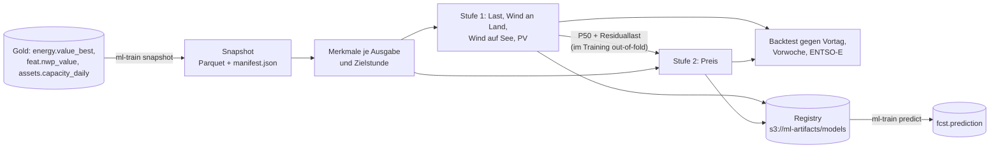

# ml-train

Erstes Prognosemodell für die **Netzlast DE** und den **Day-Ahead-Preis DE-LU**: Quantile
P10/P50/P90 je Stunde für die Liefertage D+1 bis D+7, zweistufig mit LightGBM
(Kap. 7.3, 7.4 und 7.7 in `docs/ARCHITEKTUR.md`). Ausführliche Beschreibung für Anwender:
[`docs/PROGNOSEMODELLE.md`](../../docs/PROGNOSEMODELLE.md). Konfiguration in
`config/ml/de_lu_v1.yaml` und `config/ml/de_lu_v2.yaml`, Backtest-Ergebnisse in
[`docs/analysen/prognose-de-lu-v1/`](../../docs/analysen/prognose-de-lu-v1/README.md) und
[`docs/analysen/prognose-de-lu-v2/`](../../docs/analysen/prognose-de-lu-v2/README.md).

## Aufbau



- **Ausgabe** täglich 08 UTC, also vor dem Gebotsschluss (12 Uhr Ortszeit). Ziele sind ganze
  Liefertage in Ortszeit (23 bis 25 Stunden).
- **Leakage-Schutz:** Ist-Werte zählen ab Intervallende + 2 h, Preise eines Liefertags ab
  13 Uhr am Vortag, Wetter aus dem jüngsten Lauf mit `run_time + 6 h ≤ Ausgabe` (also der
  00Z-Lauf desselben Tags). Die Prognosen der ÜNB (ENTSO-E/SMARD) sind in `de_lu_v1` nur Benchmark;
  `de_lu_v2` nutzt die Lastprognose zusätzlich als Merkmal, nur für D+1 und erst ab 10 Uhr am Vortag.
- **Merkmale:** Kalender (Stunde, Wochentag, Feiertagsanteil nach Bevölkerung der Länder,
  Brückentage, Weihnachten, Sommerzeit, Tageslänge), Vorlauf, installierte Leistung je
  Technologie (MaStR), Lags (gleiche Stunde am letzten vollständigen Tag und in der Vorwoche,
  Tages- und 7-Tage-Mittel, letzter bekannter Wert) für Ziele und Residuallast, Wetter je
  Technologie aus den GFS-Cluster-Features (`*_power` summiert, sonst leistungsgewichtet).
- **Interpolation beim Lesen:** Wetter liegt im Snapshot in nativen GFS-Schritten. Erst die
  Merkmalsbildung füllt die dreistündlichen Schritte ab 120 h auf Stunden auf (Momentanwerte
  linear, Intervallwerte über das Intervall verteilt) und markiert sie mit `wx_interp`.
- **Ziele:** Wind und PV als Kapazitätsfaktor (geteilt durch die installierte Leistung), der
  Preis relativ zum Tagesmittel des letzten bekannten Liefertags. Bäume extrapolieren nicht, so bleiben wachsender Bestand und
  neue Preisniveaus beherrschbar.
- **Varianten:** `kalender` (ohne Wetter, ab Start der Gebotszone DE-LU im Oktober 2018) ist der
  Maßstab, `wetter` nutzt zusätzlich die GFS-Features und braucht deren Historie.
- **`de_lu_v2`:** weitere freie Reihen als Merkmalsgruppen (`series_groups`): Nachbarpreise,
  ÜNB-Lastprognose, Brennstoffe, Marktwerte, Preisniveau, EIA STEO (`outlook`) und der
  Grenzkostenindex aus SMARD (`grenzkosten`); Varianten mit `scale` lernen den Preis relativ zu
  `gk_niveau`. Einzelheiten in `docs/PROGNOSEMODELLE.md` Kap. 10.2.

## Aufruf

```bash
uv run ml-train snapshot --out .ml-data/snap                      # aus PDB_DATABASE_URL
uv run ml-train backtest --snapshot .ml-data/snap --out .ml-data/bt
uv run ml-train backtest --snapshot .ml-data/snap --out .ml-data/bt-wx \
    --variant kalender --variant wetter --test-from 2026-09-15 --fold-months 1 --stride 1
uv run ml-train fit --snapshot .ml-data/snap --variant kalender --backtest .ml-data/bt \
    --role champion                                                # Registry: PDB_ML_REGISTRY
uv run ml-train registry list
uv run ml-train registry evaluate <version>                        # Champion/Challenger
uv run ml-train registry promote <version>
uv run ml-train registry sync                                      # Spiegel für Grafana
uv run ml-train registry attach-backtest <version> --backtest .ml-data/bt # Backtest nachreichen
uv run ml-train predict --dry-run                                  # aktive Versionen, jetzt
```

Auf der VM laufen dieselben Befehle über das Compose-Profil `ml` (`docker compose --profile ml
run --rm ml-train …`, Ordner `/data` im Volume `ml-data`), die Inferenz als Dienst
`ml-predict` (jede volle Stunde für `de_lu_v1` und `de_lu_v2`, verpasste Stunden bis 24 h zurück
werden nachgeholt, neue Versionen rechnen mit `--fill-new 216` die Vergleichszeitpunkte der
letzten neun Tage nach). Der Trainings-Container hat eine feste CPU-Grenze
(`ML_TRAIN_CPUS`, Vorgabe 4), damit Ingest und Verarbeitung nebenher weiterlaufen.

| Variable | Standard |
|---|---|
| `PDB_DATABASE_URL`, `PDB_S3_*` | siehe `.env.example` |
| `PDB_ML_CONFIG` | `config/ml/de_lu_v1.yaml` |
| `PDB_ML_REGISTRY` | `s3://ml-artifacts/models` (oder ein lokaler Ordner) |
| `PDB_ML_CACHE` | `/tmp/ml-train-cache` (geladene Modelle) |

## Registry und Champion/Challenger

Bis MLflow läuft, ist die Registry ein Verzeichnisbaum (lokal oder in Garage) mit
`registry.json` je Konfiguration und einem Ordner je Version (LightGBM-Modelle als Text,
`manifest.json` mit Konfig-Hash, Snapshot-ID, Git-Commit und Backtest-Kennzahlen,
`backtest.parquet`). Rollen: `champion`, `challengers`, `baseline`, `previous`. `predict`
inferiert Champion, Challenger, Baseline und den letzten Vorgänger nebeneinander, jede Version
mit eigenem `model_version` in `fcst.prediction`.

`promote` prüft auf den gemeinsamen Backtest-Zeilen beider Versionen: Der Challenger muss je
Ziel im Mittel (Pinball-Loss über P10/P50/P90) besser sein und darf in keiner Gruppe aus Ziel,
Vorlauftag und Jahreszeit mit mindestens 200 Werten mehr als 5 % schlechter sein
(`promotion` in der YAML).

### Spiegel in der Datenbank (Dashboard „Prognose und Energiedaten“)

Grafana liest keine Dateien aus Garage. `registry sync` schreibt deshalb Versionen mit Rolle,
Trainingsdauer und -zeitraum nach `meta.model_version`, den Verlauf nach `meta.model_event` und
die Backtest-Kennzahlen je Ziel und Vorlauftag (MAE, RMSE, Bias, Pinball, Abdeckung P10–P90;
`lead_day` 0 = alle) nach `meta.model_metric`. `fit` und `promote` gleichen danach selbst ab,
`predict` vor jedem Lauf, sodass Änderungen spätestens nach einer Stunde im Dashboard stehen. Ist
keine Datenbank erreichbar (Training auf dem Laptop), wird der Abgleich nur protokolliert und
übersprungen. Die Sicht `fcst.prediction_error` stellt jede gespeicherte Medianprognose dem
Ist-Wert (Stundenmittel aus `energy.value_best`) gegenüber; daraus rechnen die Panels den
Prognosefehler im Betrieb. `fit --backtest` übernimmt die Laufzeit des Backtests aus `lauf.json`
ins Manifest (`backtest_seconds`). Ohne `--backtest` trainierte Versionen haben keine Backtest-Kennzahlen;
`registry attach-backtest` legt die Prognosen eines Backtests derselben Konfiguration und
Variante nachträglich dazu, der nächste Abgleich füllt `meta.model_metric`.

### Fortschritt laufender Jobs

`snapshot`, `backtest` und `fit` tragen sich beim Start in `meta.ml_job` ein und melden jeden
Schritt (Backtest: je Faltung und Variante, Training: Merkmale, je Stufe und Ziel ein Modell,
Registrieren) mit Zählerstand. Ein Lebenszeichen je Minute hält `updated_at` auch in langen
Schritten frisch; das Panel „Laufende Trainings und Backtests" unter „Modellversionen" zeigt so
laufende und in den letzten 24 Stunden beendete Jobs mit Fortschritt, Laufzeit und geschätztem
Ende. `docker stop` (SIGTERM) wird als Fehler eingetragen; hart beendete Jobs ohne Lebenszeichen
seit 15 Minuten markiert der nächste Start als abgebrochen. Ohne Datenbank läuft alles wie bisher.

## Tests

```bash
uv run pytest services/ml_train
```

Die Tests laufen auf einem synthetischen Snapshot (`ml_train.testing`) mit bekanntem
Zusammenhang und prüfen vor allem den Leakage-Schutz der Lags und des Wetterlaufs, die
Ausrichtung der Wetterintervalle, Faltungen, Speichern/Laden und die Champion/Challenger-Regel.

## Offen

- `fcst.model_spread` (Streuung der aktiven Versionen) und der Grafana-Teil aus Kap. 7.10.
- Schulferien, bevölkerungsgewichtete Temperatur (Regionsmasken), Grenzhandel und
  Lastprognosen der Nachbarn (seit #159 in `energy.value_best`) als Merkmale.
- Reaktion auf `NOTIFY features_ready` statt stündlicher Inferenz; Ausgabe auch nach dem
  06Z-Lauf.
- MLflow statt Datei-Registry; Snapshot-Austausch über `ml-exchange` mit presigned URLs.
- Neuronales Netz (TFT/TiDE) gegen diesen LightGBM-Champion, sobald die Wetterhistorie da ist.
